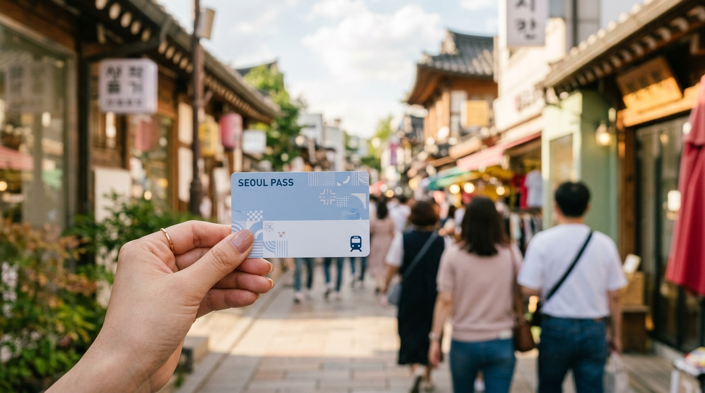

こんにちは、SEOUL TRIP NOTE の J です。

韓国旅行を計画中の皆さん、交通手段や現地での支払い方法について、どんなカードを使えばいいか迷っていませんか？特にソウルでは、地下鉄やバスの利用が欠かせませんし、カフェやショッピングでのキャッシュレス決済もスマートに済ませたいところです。

現在ソウルでは、ソウル市が導入した「気候同行カード」と、外国人旅行者に人気の「WOWPASS」という二つの選択肢があります。

公式情報をもとに、「気候同行カード」と「WOWPASS」のそれぞれの特徴、メリット・デメリット、そしてどんな旅行スタイルにおすすめかを比較して整理しました。

### 【結論】この記事の要点まとめ

*   **気候同行カード**: 1日に何度も地下鉄やバスに乗って観光地を巡るスタイル向き。一定期間の乗車が定額になる交通専用パスです。
*   **WOWPASS**: 現金両替の手間を減らし、買い物や食事のカード決済と移動を1枚に集約したい人向け。全国で使えるプリペイド決済カードです。
*   **選び方の基準**: 1日の移動回数、ソウル市外へ足を延ばすかどうか、そして街中での支払いをどう管理したいかで選ぶのが現実的です。

---

## 気候同行カードとは？旅行者向け活用術

ソウル市が導入した「気候同行カード」は、公共交通機関の利用促進と気候変動対策を目的とした交通定期券です。明洞や弘大、聖水などを地下鉄やバスで1日に何往復も移動する旅行者にとって、運賃を定額に抑えられる選択肢となります。

### 気候同行カードの基本機能

気候同行カードは、ソウル市内の地下鉄と市内バスが期間中乗り放題になる交通パスです。旅行者は日数単位の**短期券**を利用します。なお、住民向けの30日券は2026年9月末で利用終了となったため、旅行者は短期券を利用してください。

**短期券の料金（執筆時点の目安）**

| 種類 | 料金 |
| :--- | :--- |
| 1日券 | 5,000ウォン |
| 2日券 | 8,000ウォン |
| 3日券 | 10,000ウォン |
| 5日券 | 15,000ウォン |
| 7日券 | 20,000ウォン |

カード実物は地下鉄駅の顧客安全室や一部のコンビニで購入し、駅の券売機で短期券をチャージして使います。2026年3月からは対象の新型券売機において海外発行のクレジットカードでも短期券のチャージが可能になり、ウォン現金の用意が必須ではなくなりました。

### 旅行者にとってのメリット

*   **交通費の節約**: ソウル市内の地下鉄やバスを頻繁に利用する場合、都度運賃を支払うよりも交通費を抑えやすくなります。
*   **乗り換えのストレス軽減**: 乗り降りの回数を気にせず移動できるため、予定変更にも柔軟に対応できます。
*   **ソウル市内観光に最適**: 主要な観光エリアの多くをカバーしており、市内中心部の移動に適しています。

### 気候同行カードの注意点

> **【注意点】気候同行カードの利用範囲と決済方法**
> *   **利用範囲の限定**: 基本はソウル市内の地下鉄とバスが対象です。新盆唐線（シンブンダンソン）やソウル市外の路線区間では使えません。空港鉄道については、ソウル市内から乗車して仁川空港駅（第1・第2ターミナル）で下車することは可能ですが、**仁川空港駅からの乗車には利用できません**。利用予定の路線が対象かはソウル市の公式案内を確認してください。
> *   **チャージ対応機**: クレジットカードチャージは対象の新型券売機で行う必要があります。旧型機を使う場合はウォン現金が必要です。
> *   **決済機能なし**: 交通専用カードのため、店舗での買い物やカフェでの支払いには使えません。

---

## WOWPASSとは？キャッシュレス決済と交通カードの融合

※ AIで生成したイメージ画像です

「WOWPASS」は、外国人旅行者向けに発行されているプリペイドカードで、外貨両替、デビット決済、そしてTmoney交通カードの機能を1枚にまとめたサービスです。韓国国内の店舗決済と交通移動をカード1枚で管理できる点が評価されています。

### WOWPASSの基本機能

*   **外貨両替・チャージ**: 日本円などの現金を主要駅やホテルにあるWOWPASSキオスクへ直接投入し、ウォン残高としてチャージできます。
*   **デビットカード決済**: チャージしたウォン残高を使い、韓国内のクレジットカード・デビットカード加盟店で決済できます。
*   **Tmoney交通カード機能**: カード裏面にTmoney機能が備わっており、全国の地下鉄、バス、タクシーで乗車用カードとして利用できます。

### 旅行者にとってのメリット

*   **両替と決済の手間を軽減**: 市内の両替所へ足を運ぶ時間を省き、空港や駅の専用キオスクですぐに準備が整います。
*   **幅広い場所で利用可能**: Tmoneyで全国の交通機関、デビット機能で一般店舗と、日常的な支払いをほぼカバーできます。
*   **残高確認が簡単**: 専用アプリで利用履歴や残高を即座に確認でき、旅費の管理が容易です。

### WOWPASSの注意点

> **【注意点】WOWPASSのチャージと手数料**
> *   **Tmoney機能のチャージ**: デビット残高とTmoney残高は別々に管理されています。駅券売機やコンビニでの現金チャージのほか、WOWPASSアプリ経由でデビット残高からTmoneyへチャージすることも可能です（アプリチャージ時は手数料が発生します）。
> *   **手数料**: 初回登録料として6,000ウォンがかかります。日本円などの現金チャージには手数料がかかりませんが、クレジットカードからチャージする場合は約4%の手数料がかかります。
> *   **残高の引き出し**: 残ったウォン残高をキオスクで現金として引き出す場合、1回あたり1,000ウォンの引き出し手数料がかかります。

---

## 【徹底比較】気候同行カード vs WOWPASS どっちを選ぶべき？

移動の頻度や、街中での支払いをどう済ませたいかによって選ぶべきカードが変わります。

### 気候同行カードとWOWPASSの機能比較表

| 項目 | 気候同行カード | WOWPASS |
| :--- | :--- | :--- |
| **主要機能** | ソウル市内の地下鉄・バス乗り放題 | 外貨両替、デビットカード決済、Tmoney交通カード |
| **交通機関の対応範囲** | ソウル市内（仁川空港は下車のみ可、一部路線除く） | 全国の地下鉄、バス、タクシー（Tmoney残高が必要） |
| **購入・チャージ方法** | カード購入後、券売機でチャージ（現金または海外クレカ対応機） | キオスクで外貨チャージ、アプリ連携 |
| **決済機能** | なし | あり（デビットカード加盟店） |
| **外国人旅行者向け** | 1〜7日の短期券 | 外国人旅行者専用 |
| **料金体系** | 短期券 1日5,000〜7日20,000ウォン（執筆時点の目安） | 初回登録料 6,000ウォン ＋ チャージ額 |
| **有効期間** | 短期券の券種日数 | 6年間（公式サイトで最新規約を確認） |
| **メリット** | ソウル市内の交通費を定額化できる | 買い物・飲食の決済と全国交通を1枚に集約可能 |
| **デメリット** | 買い物には使えない、利用エリアの制限がある | 登録料・引出手数料・クレカチャージ手数料がある |

※ 料金やサービス仕様は執筆時点の目安です。改定される場合があるため、最新情報は各公式サイトで確認してください。

### 選び方の判断基準

旅程の行動パターンに合わせて選ぶのが失敗しない方法です。

*   **ソウル市内を1日に何度も地下鉄・バスで往復する旅**
    *   **気候同行カード**が適しています。1日に4〜5回以上改札を通るスケジュールなら、都度運賃を払うより安く済むケースが多いとされています。

*   **カフェ巡りやショッピングの決済を手軽にし、移動はほどほどの旅**
    *   **WOWPASS**が向いています。店舗でのカード決済をスムーズに行いながら、必要な分だけTmoneyに残高を入れて移動できます。

*   **ソウル市外（水原や仁川など）への移動が含まれる旅**
    *   気候同行カードは対象外区間が多くなるため、全国区で乗車できるTmoney機能を備えた**WOWPASS**を主軸にするのが扱いやすい選択です。

---

## 注意点とお得に使うコツ

※ AIで生成したイメージ画像です

### 気候同行カードのお得な利用術

> **【ポイント】利用可能エリアの境界を把握する**
> ソウル市外へまたがる移動では改札を出られない場合があるため、事前に下車駅がソウル市管轄か確認しておくことが大切です。また、仁川空港へ向かう際はソウル市内から乗車してそのまま下車できますが、帰路ではなく「往路（仁川空港からソウルへ向かう移動）」では使えない点に注意してください。

### WOWPASSを賢く使うコツ

> **【ポイント】チャージ方法と残高の使い分け**
> キオスクで日本円現金をチャージする場合は手数料がかからないため、手持ちの現金を効率よくウォン化できます。一方でクレジットカードチャージは約4%の手数料が発生します。また、店舗決済用の残高と交通用のTmoney残高は別勘定なので、移動前にアプリでTmoney残高を確認しておく習慣をつけておくと改札前で慌てずに済みます。

---

## よくある質問（FAQ）

### Q1: 気候同行カードは空港鉄道でも使えますか？

ソウル市内（ソウル駅など）から乗車して仁川空港駅（第1・第2ターミナル）で**下車する場合に限り利用可能**です。一方、仁川空港駅から乗車してソウル市内へ向かう便には利用できません。また、全席指定の「直通列車」は対象外です。空港から市内への移動には、WOWPASSのTmoney機能や通常の乗車券を利用してください。

### Q2: WOWPASSのTmoney機能と気候同行カードは併用できますか？

併用可能です。ソウル市内観光で移動が密集する日は気候同行カードを使い、仁川空港からの移動やソウル市外へ足を延ばす日、タクシーの乗車にはWOWPASSのTmoneyを使う、という組み合わせを選ぶ旅行者もいます。

### Q3: 短期旅行（2〜3日）におすすめなのはどちらですか？

移動が1日に2〜3回程度であれば、WOWPASSに少し交通費を入れておくほうが管理の手間が少なくなります。朝から晩まで複数の街を細かく地下鉄・バスで巡る予定なら、気候同行カードの2日券や3日券を検討するとよいでしょう。

### Q4: 紛失した場合はどうなりますか？

気候同行カードの短期券は、現物カードを紛失した場合に再発行や残存期間の補償を受けることは原則として困難とされています。
WOWPASSはアプリと連携しておけば、紛失時にアプリから一時停止手続きを行い、残高の保護や再発行処理を進めることが可能です。ただし初回登録料の6,000ウォンは戻りません。

---

## まとめ

ソウル市内の地下鉄やバスに集中して乗り続けるなら「気候同行カード」、ショッピングや食事を含めた総合的なキャッシュレス決済を重視し、全国の交通機関もカバーしたいなら「WOWPASS」が適しています。

自身の移動範囲と旅程の長さを整理し、滞在スタイルに合ったカードを選んでみてください。
