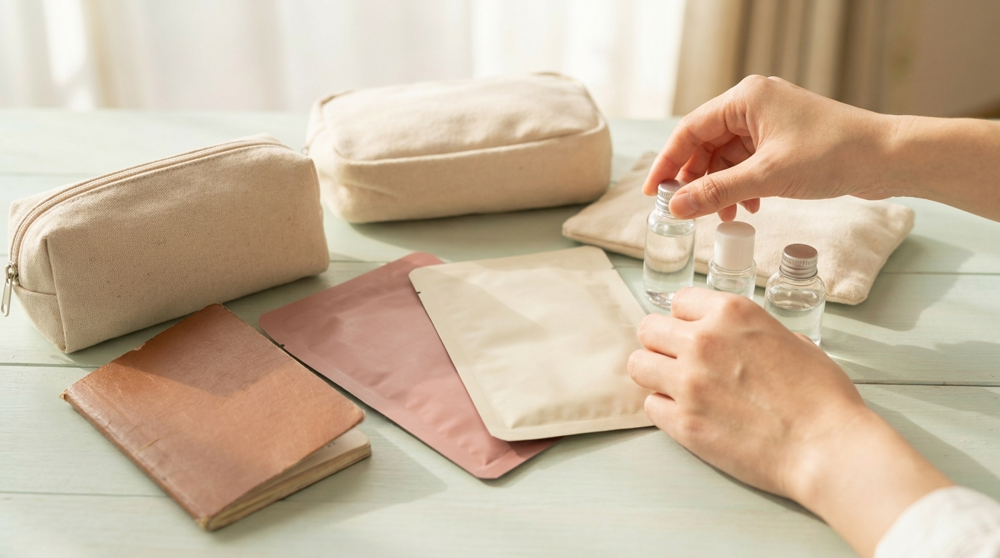

こんにちは、SEOUL TRIP NOTE の J です。

韓国旅行の定番スポットといえばオリーブヤングが有名ですが、最近では「韓国ダイソー」も渡韓購入品を探す場所として大きな注目を集めています。SNSなどでダイソーコスメの話題を見かけて、「日本の店舗と何が違うの？」「どんなコスメが買えるの？」と気になっている方も多いのではないでしょうか。

韓国のダイソーは、日本の店舗とは品揃えや価格設定、ブランドコラボの規模などが大きく異なります。韓国ダイソーの価格帯の仕組み、人気のコスメカテゴリ、日本のダイソーとの違い、そして旅行者がスムーズに買い物をするための実用的なコツを整理してまとめました。

> **この記事の要点まとめ**
> - 韓国ダイソーは全品1,000ウォン均一ではなく、500〜5,000ウォンの均一定額制
> - 有名スキンケア・コスメブランドとの公式共同開発アイテム（ダイソーコスメ）が充実している
> - 明洞や弘大などの大型店はフロア数が多く、コスメや旅行グッズの在庫が豊富
> - セルフレジは日本語表示に切り替え可能で、クレジットカードやWOWPASS決済に対応
> - 一部大型店舗では事後免税（タックスリファンド）に対応している場合がある

---

## 日本のダイソーと韓国ダイソーの違い

韓国のダイソー（DAISO）は、もともと日本の大創産業との合弁事業としてスタートしましたが、現在は韓国企業のアソン・ダイソー（Asung Daiso）が単独で運営しています。そのため、日本のダイソーとは取り扱う商品や店舗の雰囲気にいくつかの違いがあります。

### 1. 価格設定は500〜5,000ウォンの6段階
韓国ダイソーは「均一定額制」を採用しています。価格帯は基本的に以下の6つに分かれています。

- 500ウォン
- 1,000ウォン
- 1,500ウォン
- 2,000ウォン
- 3,000ウォン
- 5,000ウォン

店内の最高価格は5,000ウォンに設定されており、それ以上の価格帯の商品は基本的に置かれていません。値札シールに価格が大きく書かれており、表記がないものは1,000ウォンです。

### 2. コスメコーナーの独自性と規模
韓国ダイソーの最大の特徴は、美容アイテムの充実度です。単なるプライベートブランドのプチプラ商品にとどまらず、韓国の有名化粧品メーカーと共同開発した専用ラインが数多く並んでいます。ドラッグストアや免税店で扱われるブランドのエッセンスを取り入れたアイテムが、3,000〜5,000ウォン程度で購入できるため、地元の方だけでなく旅行者の間でも話題を集めています。

大型店ではワンフロア丸ごと、または売り場の大部分がコスメ・スキンケア・美容ツールに割かれていることも珍しくありません。

---

## 渡韓購入品で注目されるダイソーコスメの主なカテゴリ

※ AIで生成したイメージ画像です

韓国ダイソーで取り扱われている化粧品は、スキンケアからメイクアップまで多岐にわたります。公式情報や旅行者の口コミの傾向から、特に注目度の高いカテゴリを整理しました。

### スキンケア・導入液（美容液）
韓国コスメブランドとのコラボラインが最も活発な分野です。特にVTコスメティックスと共同開発した製品などは、入荷後すぐに売り切れる店舗が出るほどの反響を見せています。個包装タイプ（パウチタイプ）の美容液が多く、旅行中の持ち運びやお試し用として選ばれる傾向があります。

実際のスペックや愛用者の声については、別記事の[韓国ダイソー『VTリードルショット』は効果ある？利用者の声とスペックから検証](/blog/daiso-reedle-shot-honest-review/)でも詳しくまとめています。

### トナーパッド・シートマスク
オリーブヤングでも定番のトナーパッドやシートマスクですが、ダイソーでは1,000ウォン〜3,000ウォンの価格帯で手に入ります。数枚入りのミニパックや、ピンポイントで使える部分用パックなど、小分けにされた商品が多い点が特徴です。ばらまき土産としても選びやすいサイズ感となっています。

### メイクアップツール
ブラシ、パフ、スパチュラなどの美容ツールは、品質と価格のバランスが良いと高く評価されることが多いアイテムです。特にファンデーションスパチュラや、クッションファンデ用の替えパフセットなどは2,000〜3,000ウォン程度で揃うため、まとめ買いする人が目立ちます。

---

## 韓国ダイソーとオリーブヤングの比較

コスメを探す際、オリーブヤング（オリヤン）と韓国ダイソーのどちらに行くべきか迷う方もいるはずです。それぞれの特徴を比較表にまとめました。

| 項目 | 韓国ダイソー | オリーブヤング |
| :--- | :--- | :--- |
| **価格帯** | 500〜5,000ウォン（上限5,000ウォン） | 10,000〜40,000ウォン前後が中心 |
| **コスメの容量** | 小容量・お試しサイズ・パウチが多い | 通常サイズ・セット商品・企画セットが多い |
| **テスター** | 店舗や商品によって一部あり（ない場合も多い） | ほぼ全商品にテスター完備 |
| **取り扱い品目** | コスメ、日用品、文具、食品、雑貨全般 | スキンケア、メイク、ヘアケア、健康食品中心 |
| **主な用途** | お試し買い、ばらまき土産、旅行用消耗品 | 本格的なスキンケア調達、トレンドの新作購入 |
| **店舗規模** | 郊外〜都市部まで多数（明洞などは超大型ビル） | 駅前・繁華街に密集 |

オリーブヤングで気になるブランドをじっくり選び、ダイソーでは小分けのお試しコスメやメイクツールを揃えるというように、目的に応じて使い分けるのが効率的です。

各エリアのショップ事情については、[ソウルのショッピングエリア比較｜明洞・弘大・聖水・東大門・江南の違い](/blog/seoul-shopping-area-comparison/)も参考にしてみてください。

---

## 韓国ダイソーで賢く買い物するための4つのコツ

※ AIで生成したイメージ画像です

ソウルのダイソーで買い物を楽しむために知っておきたい、具体的な注意点とコツをまとめました。

### 1. 大型店（フラッグシップ店舗）を狙う
韓国ダイソーは路面店から地下の小型店まで様々ですが、コスメや人気雑貨を狙うならフロア数の多い大型店が適しています。

- **明洞駅店**: 地下鉄4号線・明洞駅の目の前にあり、地上1階から地上12階まで（全12フロア）ビル全体がダイソーになっています。
- **弘大2号店**: 弘大入口駅近くにある地上7階建ての大型店で、若者向けの商品やキャラクターグッズが充実しています。
- **江南高速バスターミナル店**: 地下1階の広大なワンフロアに圧倒的な品揃えが集まっています。

明洞や弘大などの人気観光地にある店舗は、平日の夕方以降や週末の午後に非常に混雑する傾向があります。商品棚が見づらくなることもあるため、開店直後から午前中の早い時間帯に訪れるのがおすすめです。

### 2. セルフレジの使い方を把握しておく
現在、ソウル市内の多くのダイソーではセルフレジ（無人決済端末）が主流になっています。

画面の右上または下部にある「言語選択」から「日本語」を選択すると、音声と画面案内が日本語に切り替わります。商品に印字されたQRコードを読み取り口にかざしてスキャンし、決済画面に進みます（通常のバーコードをかざすとエラーになるため注意が必要です）。セルフレジはキャッシュレス専用端末のため、海外クレジットカードやWOWPASSなどが利用可能です。現金で支払う場合は有人カウンターを利用する必要があります。

移動や決済の準備については、[渡韓旅行者必見！気候同行カードとWOWPASS徹底比較ガイド【2026年最新】](/blog/climate-card-vs-wowpass-comparison/)もあわせて確認しておくと便利です。

> **レジ袋の注意点**  
> 韓国では環境保護法に基づき、使い捨てプラスチック袋の無償提供が禁じられています。レジ袋が必要な場合は、レジ画面で有料の紙袋（100〜200ウォン程度・執筆時点の目安）または不織布バッグを選択して購入するか、エコバッグを持参してください。

### 3. タックスリファンド（事後免税）の手続きを確認する
外国人観光客が多く訪れる店舗（明洞駅店など）では、タックスリファンド（事後免税）に対応しています。セルフレジ等で免税レシート（還付伝票）を発行し、出国時に空港のKIOSK端末や窓口で払い戻し手続きを行います。ただし、全店舗で対応しているわけではありません。免税を希望する場合は、店頭の案内表示などを事前に確認してください。

還付の条件や対象金額のルールは変更される場合があるため、最新の公式情報をご確認ください。制度全体の概要は[韓国の免税ショッピング完全ガイド｜即時還付と空港還付の比較と手続き手順](/blog/korea-tax-free-shopping-guide/)で解説しています。

### 4. 人気コスメは見つけたらその場で購入する
SNS等で話題になったダイソーコスメは、入荷してもすぐに陳列棚からなくなることがあります。「明洞で見つからなかったけれど、ホテルの最寄り駅にある小さな店舗に行ったら普通に並んでいた」という声も多く聞かれます。気になる商品を見かけた際は、後回しにせずその場で購入しておくのが確実です。

---

## よくある質問（FAQ）

### Q1. 韓国ダイソーの支払いに日本円は使えますか？
使えません。韓国ウォン（現金）、各種クレジットカード、またはWOWPASSなどのプリペイドカードを利用してください。

### Q2. ダイソーコスメは敏感肌でも使えますか？
大手化粧品メーカーが製造を担当している製品が多いとされていますが、すべての人に肌トラブルが起きないわけではありません。ビタミンC誘導体、レチノール、シカ成分、マイクロニードル（スピキュール）など、成分によって刺激を感じる場合があります。使用前に成分表示を確認し、腕の内側などでパッチテストを行ってから使用することをおすすめします。

### Q3. お土産用のお菓子やラーメンも買えますか？
はい、充実しています。食品コーナーには、個包装のスナック菓子、伝統菓子（薬果・ヤックァなど）、インスタントラーメンなどが並んでいます。スーパーマーケットよりも少量パックで販売されているものが多く、ばらまき土産の調達にも便利です。

---

## まとめ

韓国ダイソーは、500〜5,000ウォンという手頃な価格帯でありながら、実力派のコスメや便利なトラベルグッズが手に入る心強いショッピングスポットです。

- 価格の上限は5,000ウォンで、値札表記をチェックする
- コスメを探すなら明洞や弘大などの大型店がおすすめ
- 午前中の時間帯を狙うと混雑を避けてゆっくり見られる
- レジ袋は有料のため、マイバッグを持参するとスムーズ

人気アイテムは入れ替わりが早いため、気になるものを見かけたらその場で確保するのがおすすめです。オリーブヤングとも上手に使い分けながら、効率よく買い物を楽しんでみてください。