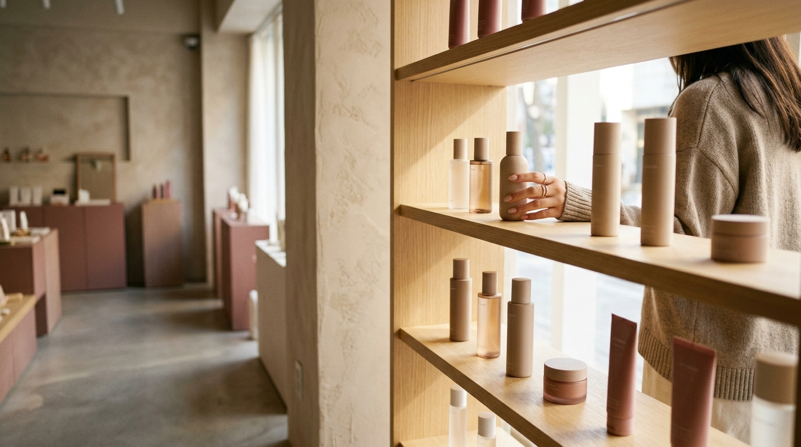
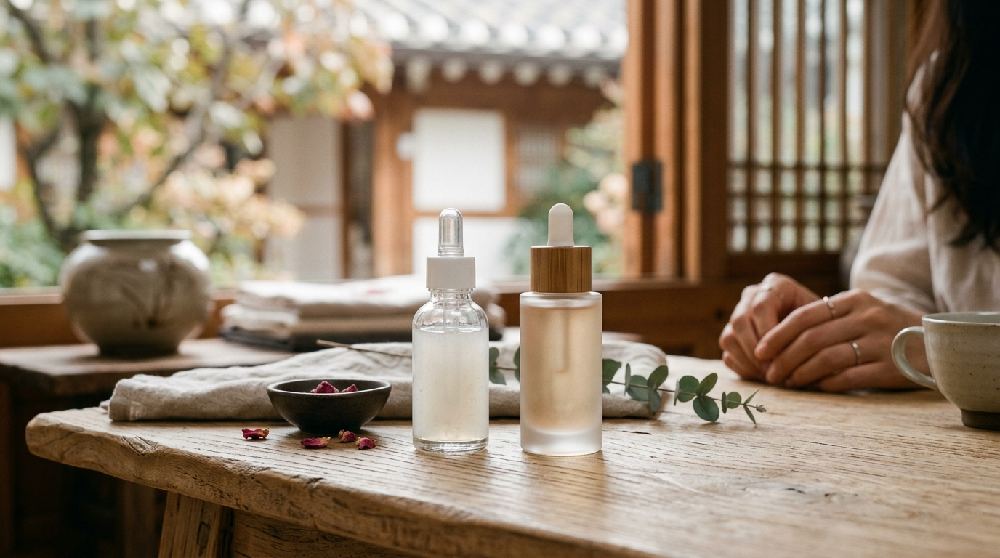

アンニョンハセヨ！SEOUL TRIP NOTE の J です。この記事では、公開されている製品情報や口コミの傾向をもとに、渡韓前に知っておきたいポイントをまとめています。

最近、韓国のSNSで話題になっているのが、人気ダーマコスメブランドVTの『リードルショット』が「韓国ダイソー」で買えるようになったというニュースです。「ダイソーでリードルショット？効果は？本物なの？」と気になっている方も多いのではないでしょうか。これまでオリヤン（オリーブヤング）で購入するイメージが強かったリードルショットが、3,000ウォンや5,000ウォン前後で手に入るとあって、注目が集まっています。

今回は、ダイソー版リードルショットについて、製品情報と口コミの傾向から見えてくる特徴をお届けします。オリヤン版との違いや、どこで買えるか、購入のコツまで、渡韓前に知っておきたい情報をまとめました。毛穴ケアが気になる方はぜひ参考にしてください。

### 【結論】この記事を読めばわかること！

*   **韓国ダイソー版リードルショットは「お試し」に向いた選択肢。** 口コミでは、リードルショット初心者さんや、刺激が気になる方に試しやすいという声が多く見られます。
*   オリヤン版より**マイルドな使用感**という評価が多く、手軽に試せる**高コスパ**なアイテムです。
*   毛穴のザラつきや肌のキメ整えを目的としたアイテムで、**継続して使うことが前提**とされています。
*   人気が高く**売り切れ注意！** 見つけたら早めの購入がおすすめです。

---

### 韓国ダイソーで『VTリードルショット』が買えるって本当？人気の秘密を解説！

「リードルショット」は、渡韓好きの間ではすっかりおなじみのアイテムです。肌にマイクロニードル（微細な針状の天然成分）を届けることで、美容成分の浸透をサポートし、毛穴や肌のキメ、ハリにアプローチするとされる、いわば「塗る肌管理」アイテムです。

そんな人気のリードルショットが、韓国ダイソーでも買えるようになりました。これはVTコスメと韓国ダイソーのコラボレーションによるもので、ダイソーの「Beauty」ラインとして登場しています。

**なぜこんなに話題なの？**

最大の理由は、やはり「価格」と「手軽さ」です。オリヤンで販売されているリードルショットは、自宅で本格的な肌管理ができる分、それなりの価格がします。一方、ダイソー版は3,000ウォン（約350円）や5,000ウォン（約580円）が目安と、かなり手頃な価格です。これまで興味はあったものの価格面で迷っていた方も、気軽に試しやすくなりました。

最近の韓国ダイソーコスメは品質面での評価も高まっていて、VTだけでなく他の人気ブランドとのコラボも増えています。「安くて品質も悪くない」というイメージが定着しつつあり、旅行者にとってもうれしい流れといえそうです。

---

### 口コミと製品情報から見る！ダイソー版リードルショットの特徴

※ AIで生成したイメージ画像です

ここからは、SNSやレビューサイトで見られる口コミの傾向と、公開されている製品情報をもとに、ダイソー版リードルショットの特徴を整理していきます。

#### 【購入状況】どこで買える？売り切れ状況は？

口コミでは、観光客が多く訪れる**明洞駅店**や、地元の若者にも人気の**弘大入口駅店**などの大型店舗で見つけたという声がよく見られます。発売当初はかなり品薄だったようで、特にSNSで話題になった直後は「棚が空っぽだった」という投稿も多くありました。現在は少し落ち着いてきたという声もありますが、人気の「100（マイルドタイプ）」と「300（スタンダードタイプ）」は、午前中に売り切れることもあるとされています。

💡 **Jの豆知識**
> 観光客が多い明洞や弘大のダイソーは、品切れになりやすい傾向があるといわれています。確実に手に入れたいなら、開店直後を狙うか、少し郊外の大型店舗を訪れてみるのもひとつの方法です。地下鉄2号線の蚕室（チャムシル）駅近くのダイソーなども、品揃えが良いという口コミが見られます。

#### 【使用感】チクチク感は？使用後の肌の変化は？（口コミの傾向）

ダイソーでは主に「VTリードルショット100」「300」などのミニサイズが販売されています。口コミの傾向をまとめると、以下のような声が多く見られます。

*   **テクスチャーと香り**: どちらもサラッとした乳白色の美容液で、香りはほとんど気にならないという声が多いです。
*   **チクチク感**:
    *   **100（マイルド）**: 塗った瞬間に軽いピリピリ感がある程度で、数秒で気にならなくなるという声が多く、初心者向けと評価されています。
    *   **300（スタンダード）**: 100よりはっきりチクチク感があるという声が多い一方、「オリヤン版の300よりはマイルドに感じた」という口コミも見られます。こちらも数秒で慣れるという意見が多いです。
*   **使用後の肌の変化**:
    *   使った翌朝に「肌のザラつきが減った」「鼻周りや顎のゴワつきが気にならなくなった」「化粧ノリが良くなった」と感じたという声が見られます。
    *   継続使用で「肌のキメが整い、触り心地がなめらかになった」という口コミもあります。一方で「劇的な変化はない」という声もあり、価格を考えれば満足という評価が多い傾向です。感じ方には個人差がある点に注意してください。

#### 【使い方】おすすめの順番と頻度

リードルショットは洗顔後、一番最初に使うのが基本とされています。

1.  洗顔
2.  リードルショット（適量を顔全体に優しくなじませる）
3.  化粧水
4.  美容液
5.  乳液・クリーム

*   **頻度の目安**:
    *   **100**: 毎日夜のスキンケアに使っているという声が多く見られます。
    *   **300**: 2〜3日に1回程度の頻度で使うという声が多いです。肌の調子を見ながら調整するのがおすすめです。

⚠️ **注意点**
> リードルショットを使った後は、いつも以上に保湿をしっかり行うことが大切です。また、肌に刺激を感じやすい方は、まず腕などでパッチテストをしてから顔に使うようにしてください。朝使う場合は、必ず日焼け止めを塗るようにしましょう。

---

### 【必見】ダイソー版リードルショット、どこで買える？購入のコツと注意点

ダイソー版リードルショットは、韓国国内のダイソー店舗で購入できます。ただし、品揃えは店舗によって大きく異なるので注意が必要です。

#### 販売店舗と価格

*   **販売店舗**: 韓国のダイソー全店で取り扱いがあるわけではありません。コスメコーナーが充実している大型店舗や、観光客が多いエリアの店舗（明洞、弘大、江南など）が狙い目です。
    *   **明洞駅店（명동역점）**: 地下鉄4号線明洞駅1番出口すぐ。観光客が多く品揃えも豊富ですが、売り切れも早いといわれています。
    *   **弘大入口駅店（홍대입구역점）**: 地下鉄2号線・空港鉄道弘大入口駅1番出口すぐ。若者向けのコスメが充実しています。
    *   **江南駅店（강남역점）**: 地下鉄2号線江南駅10番出口付近。オフィス街なので、午前中が狙い目かもしれません。
*   **価格（目安）**:
    *   VTリードルショット100（ミニサイズ）：3,000ウォン（約350円）
    *   VTリードルショット300（ミニサイズ）：5,000ウォン（約580円）
    *   VTリードルショット700（ミニサイズ）：5,000ウォン（約580円）
    *   VTリードルショット1000（ミニサイズ）：5,000ウォン（約580円）
    ※ 価格は変更される可能性があります。

#### 売り切れ状況と見つけるためのコツ

前述の通り人気が高く、特に100と300はすぐに売り切れてしまうことがあるようです。

*   **開店直後を狙う**: 店舗の開店時間に合わせて行くのが確実性の高い方法です。
*   **店員さんに聞く**: 在庫状況や入荷予定を店員さんに尋ねてみるのも良いでしょう。「VT 리들샷 있어요? (VT リードルショットありますか？)」と聞いてみてください。
*   **複数の店舗を巡る**: 滞在に余裕があるなら、いくつかのダイソーを回ってみるのもひとつの手です。

---

### オリーブヤング版と比較！ダイソー版リードルショット、本当に効果あるの？

※ AIで生成したイメージ画像です

「結局、オリヤン版とダイソー版、どっちがいいの？」という疑問を持つ方も多いと思います。製品情報と口コミの傾向をもとに、それぞれの特徴を比較してみました。

#### 「VTリードルショット」ダイソー版 vs オリーブヤング版 比較表

| 項目         | VTリードルショット（韓国ダイソー版）                               | VTリードルショット（オリーブヤング版）                           |
| :----------- | :----------------------------------------------------------------- | :--------------------------------------------------------------- |
| **製品名**   | VT リードルショット 100/300/700/1000（ミニサイズ）               | VT リードルショット 100/300/700/1000/2000/3000（フルサイズ）   |
| **価格帯（目安）** | 3,000ウォン〜5,000ウォン（約350円〜580円）                 | 30,000ウォン〜60,000ウォン台（約3,500円〜7,000円）             |
| **容量**     | 6ml（100, 300, 700, 1000共通）                                 | 50ml（100, 300）、30ml（700, 1000）、20ml（2000, 3000）など |
| **リードル含有量** | オリヤン版よりマイルドに調整されているとの見方あり（公式発表なし） | 各製品名の数字がリードル含有量の目安（例: 100は95,000本）       |
| **チクチク感** | マイルドという口コミが多い。初心者でも使いやすいとされる。       | レベル100からでもしっかりチクチク感があるという声が多い。     |
| **おすすめ肌質** | リードルショット初心者、刺激が気になる方、手軽に試したい方、お試し用 | リードルショットに慣れている方、本格的な肌管理を求める方       |
| **期待される効果** | 毛穴のザラつき、キメ、美容成分の浸透サポート、肌のなめらかさ | 毛穴、ハリ、弾力、肌の再生サイクル、美容成分の浸透サポート     |
| **コスパ**   | ミニサイズで手軽に試せるので、お試しに向いている。               | フルサイズで継続使用するなら、セール時が狙い目。               |

#### 結論：どちらを選ぶべき？

*   **「リードルショットは初めて」という方や、刺激に不安がある方**は、まずダイソー版の「100」から試してみるのがおすすめです。手頃な価格で肌管理の入り口を体験できるのは大きな魅力です。
*   **「もっと本格的なケアをしたい」「リードルショットは使い慣れている」という方**は、オリヤン版を選ぶ方が多いようです。リードル含有量が多いため、よりしっかりとしたケアが期待できるとされています。

ダイソー版は、旅行中のお試しや、お友達へのお土産にも向いています。口コミでは価格のわりに満足度が高いという声が多いので、目的に合わせて上手に使い分けてみてください。

---

### 💡Jがまとめた注意点＆お得なコツ

> *   **ダイソーは免税対象外！でも十分安いからOK**
>     韓国のダイソーは、基本的に外国人観光客の即時還付（タックスリファンド）の対象外です。ただ、元々の価格が手頃なので、免税にならなくても十分お得感があります。免税手続きの手間がない分、サッと購入できるのも便利です。
> *   **複数購入のススメ（お土産にも）**
>     見つけたら「まとめ買い」がおすすめです。自分用はもちろん、美容好きの友人へのお土産にも喜ばれやすいアイテムです。何本かストックしておくと、次回の渡韓まで安心です。
> *   **リードルショット使用後のスキンケアは「保湿」が大切**
>     リードルショットを使った後は、肌が一時的に乾燥しやすくなることがあるとされています。普段よりも念入りに、保湿力の高い化粧水や美容液、クリームでしっかり潤いを閉じ込めてあげてください。口コミでは、シカクリームやヒアルロン酸系のパックと併用しているという声も見られます。
> *   **ダイソーの他のVTコスメも要チェック！**
>     ダイソーではリードルショット以外にも、VTのシカシリーズのパックやクリーム、洗顔料なども販売されています。こちらもプチプラで評価が高いので、あわせてチェックしてみてください。

---

### ❓ よくある質問（FAQ）

**Q1: リードルショットは毎日使っても大丈夫ですか？**
A1: ダイソー版の「VTリードルショット100」は、毎日夜のスキンケアに使っているという口コミが多く見られます。一方、「300」以上のレベルは、肌の状態を見ながら2〜3日に1回など、使用頻度を調整するのがおすすめです。初めて使う際は、まず週に1〜2回から始めて、徐々に慣らしていくと安心です。

**Q2: 敏感肌でも使えますか？**
A2: ダイソー版の「VTリードルショット100」は、オリヤン版に比べてマイルドな使用感という声が多く、敏感肌の方でも比較的試しやすいとされています。ただし、肌質には個人差があるため、心配な方は必ず腕の内側などでパッチテストを行ってから、顔全体に使用してください。赤みや強い刺激を感じた場合は、使用を中止しましょう。

**Q3: ダイソー版とオリヤン版、併用はできますか？**
A3: 使い分けることは可能です。例えば、普段はオリヤン版の「300」を使い、旅行中や肌の調子が不安定な時はダイソー版の「100」で軽くケアする、といった使い方もできます。ただし、同じ日に複数のリードルショットを重ねて使うのは避けてください。

**Q4: どこで買えば一番確実に手に入りますか？**
A4: 確実性が高いのは、ソウル市内の大型ダイソー店舗（明洞駅店、弘大入口駅店、江南駅店など）の開店直後を狙う方法です。特に観光客の多い店舗は品切れになりやすいので、朝一番で行くか、比較的観光客が少ないエリアの大型店舗を訪れるのがおすすめです。店舗によって入荷状況が異なるため、いくつか候補の店舗をピックアップしておくと良いでしょう。

---

### まとめ＆最後に

韓国ダイソー版『VTリードルショット』について、口コミと製品情報からまとめてみましたが、いかがでしたでしょうか？
口コミを見ると、価格のわりに満足度が高いという声が目立ちます。オリヤン版に比べてマイルドな使用感とされているので、リードルショット初心者さんや、肌への刺激が気になる方にとって試しやすいアイテムといえそうです。

もちろん、オリヤン版のような本格的な「塗る肌管理」を求めるなら、そちらを選ぶ方が良いでしょう。一方でダイソー版は、「手軽に毛穴ケアを始めたい」「お試しで使ってみたい」という方にとって、有力な選択肢のひとつです。

渡韓の際は、ぜひダイソーに立ち寄って、話題のコスメをチェックしてみてください。品薄になりやすいので、見つけたら早めに手に取るのがおすすめです。

SEOUL TRIP NOTE では、これからも渡韓がもっと楽しくなる韓国美容情報をお届けしていきます。また次の記事でお会いしましょう、アンニョン！
