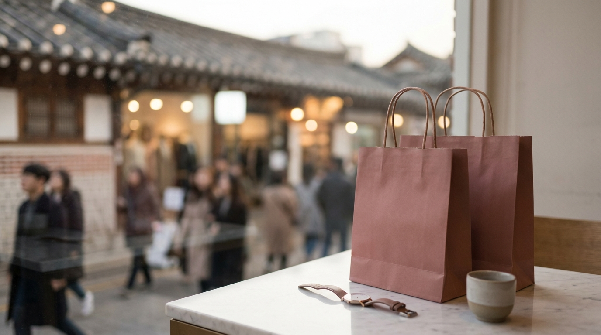
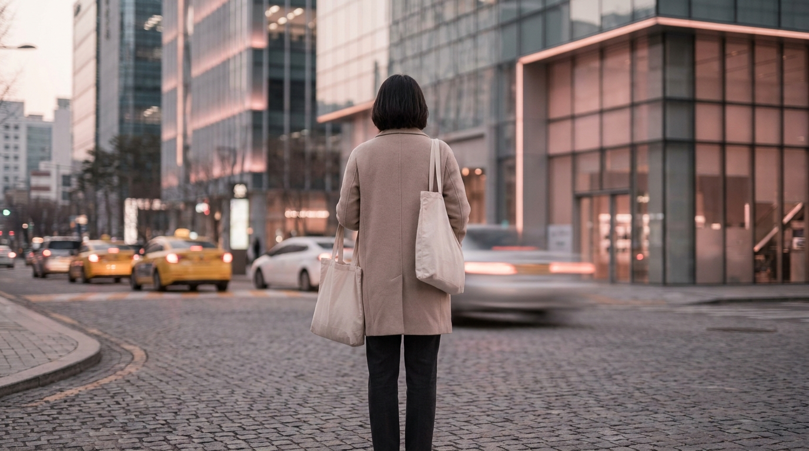

こんにちは、SEOUL TRIP NOTE の J です。ソウル在住の立場から、日本の旅行者のみなさんに役立つ現地の正確な情報を調べてお届けしています。

ソウル旅行の醍醐味といえば、トレンドの韓国服やアクセサリーをリーズナブルに探せる「東大門ショッピング」を思い浮かべる方が多いのではないでしょうか。「夜中まで買い物が楽しめる」と聞いて訪れたものの、「小売りをしてくれなかった」「開いている時間がわからず無駄足になった」という声も少なくありません。

東大門エリアは、一般の旅行者が1着から気軽に買える「小売ファッションビル」と、バイヤー向けの「卸売市場」が混在しています。東大門ショッピングで迷わないための基本ルール、営業時間、支払い方法や注意点を客観的なデータに基づいてまとめました。

他エリアとの違いを先に把握したい方は、[ソウルのショッピングエリア比較｜明洞・弘大・聖水・東大門・江南の違い](/blog/seoul-shopping-area-comparison/)も参考にしてみてください。

## 【結論】東大門ショッピングの要点まとめ

東大門でのお買い物をスムーズに進めるための基本ポイントは以下の通りです。

- **昼と夜で街の顔が変わる**: 日中は現代シティアウトレットやDOOTA MALLなどの「小売ビル」、夜20時以降はapM系列やDDP周辺の「卸売ビル」が活発になります。
- **卸売エリアは「2点以上」や「現金決済」が原則**: 小売不可（トメ＝卸売のみ）の店が多く、購入できる場合も試着不可・返品不可が基本です。
- **移動と終電の計画が必須**: 深夜帯は地下鉄が動いていないため、徒歩圏内に宿泊するか、タクシー・深夜バスの利用を事前に想定しておく必要があります。

---

## 卸売ビルと小売ファッションビルの違い

東大門ショッピングが難しく感じられる最大の原因は、ビルごとにターゲット（一般客向けか、仕入れ業者向けか）が異なる点にあります。訪問する目的や旅のスタイルに合わせて目的地を選びましょう。

### 1. 小売ファッションビル（一般旅行者向け）
DOOTA MALL、現代シティアウトレット、ミリオレなどが代表的です。同じ小売系でもビルの形態によって買い物環境が異なります。
- **特徴**: DOOTA MALLや現代シティアウトレットなどの近代的な大型モールは、試着室が整いクレジットカード決済や即時還付（タックスリファンド）に対応している店舗が多いのが特徴です。一方、ミリオレのような個人商店が連なるブース型ビルは、現金決済推奨や試着不可の店も多く見られます。
- **営業時間**: 執筆時点の目安として、現代シティアウトレットは21:00（金〜日・祝日は21:30）まで、DOOTA MALLは24:00まで、ミリオレは翌2:00まで営業しています。営業時間は変動する可能性があるため、訪れるビルごとに公式情報での事前確認が欠かせません。

### 2. 卸売ビル（バイヤー・仕入れ向け）
apM、apM PLACE、apM Luxe、TEAM204、THE OT、DDPファッションモールなどが代表的です。
- **特徴**: 主にアパレルショップのバイヤーが仕入れを行う場所です。「同じ色違いで2点以上」などの条件付きで個人に売ってくれるブースもありますが、基本は卸売のみ（낱개＝バラ売り不可）とされています。
- **営業時間**: 夜（20:00〜22:00頃）にオープンし、翌朝（5:00〜6:00頃）まで営業します。

近年旅行者の間で定着している東大門の大型アクセサリー専門店の中には、卸売の雰囲気を持ちながらも一般客が1点からカードで購入しやすいシステムを整えている店舗もあります。

### 【比較】小売ビルと卸売ビルのスペック比較

| 項目 | 小売ファッションビル | 卸売ファッションビル |
| :--- | :--- | :--- |
| **主な営業時間** | 施設により異なる（21:00〜翌2:00頃） | 20:00〜翌朝05:00前後 |
| **購入単位** | 1点から可能 | 原則複数点（店により1点可能な場合あり） |
| **試着** | 近代モールは可、ブース型ビルは不可が多い | 原則不可 |
| **決済方法** | クレジットカード / WOWPASS / 現金（ブース型は現金推奨） | 現金（ウォン）推奨 / 一部口座振込 |
| **レシート・免税** | 近代モールは即時還付対応あり（ブース型は非対応多め） | 手書き伝票のみ・免税手続き不可が多い |
| **適した旅行者** | 初めての渡韓、日中や夜浅い時間にゆったり見たい人 | トレンド韓国服をまとめ買いしたい中上級者 |

※各ビルの営業スケジュールや決済手段は店舗ごとに異なるため、執筆時点の目安としてお考えください。

---

## 効率的な回り方と営業時間スケジュール

※ AIで生成したイメージ画像です

東大門エリアは、訪問する時間帯によって回るべきルートが大きく変わります。

### パターンA：昼〜夕方のショッピング
夜遅くの行動を避けたい方や、ひとり旅で安全を重視したい方に向いているルートです。
- 11:00〜15:00：現代シティアウトレットやDOOTA MALLを散策。カフェで休憩。
- 15:00〜18:00：近隣のコスメショップや周辺の市場（広蔵市場など）へ移動。

昼間の移動には地下鉄が便利です。路線図や乗り換えの手順は、[ソウルの地下鉄を乗りこなす！路線図の見方・運賃・乗り換えガイド](/blog/seoul-subway-how-to-ride/)で詳しく解説しています。

### パターンB：深夜のナイトショッピング
東大門ならではの活気ある卸売市場を体感したい方向けのスケジュールです。
- 20:00〜21:00：大型アクセサリー専門店や靴・バッグのビルをチェック。
- 22:00〜01:00：オープンした卸売ビル（apM系列など）を散策。

> **深夜ショッピングの注意点**  
> 卸売ビルは金曜の夜から土曜にかけて休業するケースが多く見られます。一般的に「日曜の夜〜金曜の早朝」が営業日となっているビルが主流のため、渡韓日程の曜日に注意して計画を立ててください。

---

## 卸売エリアで韓国服を買うための実践ルール

卸売エリアで個人買いを試みる際は、通常のショッピングモールとは異なるルールを理解しておく必要があります。

### 1. バラ売り可能か確認する（낱개 돼요?）
卸売ビルの通路には大量の服が袋詰めされて積まれています。店員に声をかける際は、韓国語で「ナッケ デヨ？（낱개 돼요? / バラ売りできますか？）」と確認するのが一般的とされています。断られた場合は無理に交渉せず、次のお店へ移動しましょう。

### 2. 現金（ウォン）を多めに準備する
卸売ブースの多くは、事業者向けの卸価格を設定しているため、クレジットカード決済ができない店舗がほとんどです。口座振込（韓国の銀行口座）または現金（ウォン）での支払いが基本となります。

現金の確保とあわせて、滞在中の移動手段やカード決済の使い分けについては、[渡韓旅行者必見！気候同行カードとWOWPASS徹底比較ガイド【2026年最新】](/blog/climate-card-vs-wowpass-comparison/)も参考に準備を進めてください。

### 3. 試着と返品はできない前提で選ぶ
卸売ビルではトップスやワンピースだけでなく、ボトムスであっても試着室がありません。サイズ選びに不安がある場合は、普段着用している服の身幅や着丈の数値をあらかじめ測り、メジャーを持参して照らし合わせるのが確実です。購入後の返品・交換は原則受け付けられないという声が多いため注意してください。

---

## ナイトショッピング時の移動と安全対策

※ AIで生成したイメージ画像です

深夜の東大門エリアで買い物を楽しんだ後、ホテルへ戻る手段を事前に確保しておくことが重要です。

- **徒歩圏内のホテルを予約する**: 東大門歴史文化公園（DDP）駅周辺のホテルに宿泊すれば、時間を気にせず徒歩で戻ることができます。
- **配車アプリ（カカオTなど）の活用**: 深夜帯の流しのタクシーは、近距離だと乗車拒否されたり、不当な料金を請求されたりするトラブルが報告されています。配車アプリを利用して事前に行き先と目安料金を確定させて呼ぶのが安全です。
- **深夜バス（オルペミバス）の確認**: ソウル市内を走る深夜専用バス（N番バス）が運行しています。路線がホテルの最寄りを通っているか、事前に地図アプリ（NAVERマップ等）で確認しておくと選択肢が広がります。

---

## よくある質問（FAQ）

### Q1. 韓国語が全く話せなくても東大門で買い物ができますか？
DOOTA MALLや現代シティアウトレットなどの近代モールは日本語案内や英語が通じるスタッフが多く、問題なく買い物ができます。卸売ビルでは電卓に数字を打ち込んで値段を提示してくれる店舗も多いですが、意思疎通が難しい場面もあるため、翻訳アプリや簡単な韓国語フレーズを準備しておくと安心です。

### Q2. 卸売ビルで値切り交渉はできますか？
卸売ビルで提示される価格はすでに卸売基準の低価格であることが多く、1〜2点の購入で値切る行為は基本的に歓迎されないとされています。無理な値下げ交渉は避け、提示された価格に納得できる場合のみ購入するのが無難です。

### Q3. 日曜日の夜は営業していますか？
多くの卸売ビルは「金曜夜・土曜夜が休業、日曜日の夜（20時〜21時以降）から営業再開」というスケジュールをとっています。ただし、ビルごとに定休日が異なる場合があるため、渡韓前に各ビルの公式案内や現地の案内所情報をご確認ください。

### Q4. 購入した服の免税（タックスリファンド）は受けられますか？
DOOTA MALLや現代シティアウトレットといったモールの対象店舗ではパスポート提示による即時還付や免税書類の発行が可能です。一方、ミリオレのようなブース型ビルや卸売市場の個人店舗では、免税書類の発行に対応していない店舗が大半を占めます。

---

## まとめ

東大門は、訪問する時間帯とビルの特性（小売か卸売か、モールの形態など）を理解していれば、効率的にお気に入りの韓国服やアイテムを探せる街です。

初心者の方や日中にゆっくり見て回りたい方は近代的な小売モール、夜の活気ある空間で掘り出し物を探したい方は卸売エリアというように、旅の目的やスケジュールに合わせて無理のないプランを立ててみてください。安全な移動手段を確保して、充実したソウル買い物を楽しんでください。