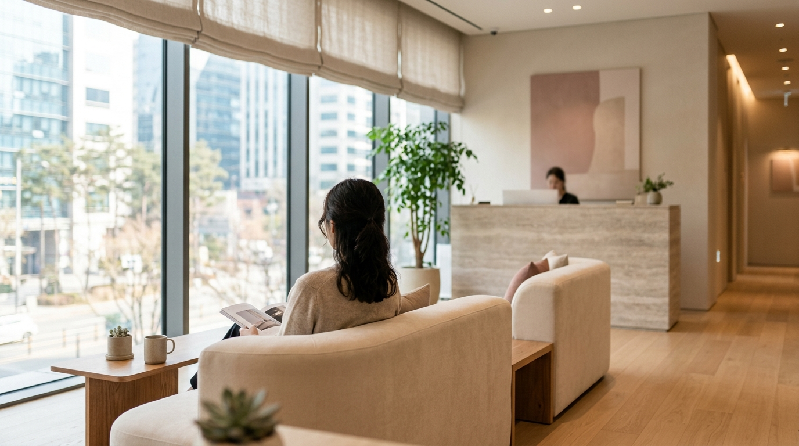
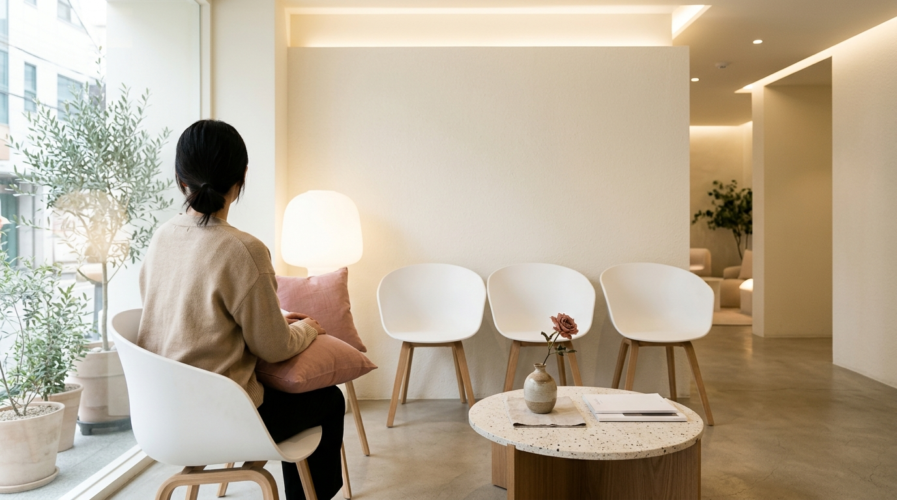

こんにちは、SEOUL TRIP NOTE の J です。

「渡韓美容」という言葉が定着するほど、韓国での美容医療は日本の皆さんにとって身近なものになりました。特にソウルは、最新の美容技術が集まる中心地です。一方で、「言葉が通じるか不安」「どのクリニックを選べば良いか分からない」「予約方法が複雑そう」といった声も多く聞かれます。

慣れない土地での医療行為には誰しも慎重になるものです。特に初めての渡韓美容では、細かいニュアンスまで相談できる日本語対応のクリニックを見つけることが大切なポイントといえます。

この記事では、江南（カンナム）と明洞（ミョンドン）エリアで日本語対応の美容皮膚科を選ぶときに確認したいポイント、予約から施術までの流れ、よくある疑問を整理しました。特定のクリニックを推薦するものではありませんので、実際の医療機関選びにあたっては公式サイト等の一次情報を必ずご確認ください。

### 【結論】要点まとめ

*   **日本語対応クリニックは多数**: 江南・明洞エリアには、渡韓旅行者向けに日本語対応体制を整えているクリニックが充実しています。
*   **LINE予約が手軽**: 多くのクリニックがLINE公式アカウントを通じた日本語での予約や事前相談を受け付けています。
*   **事前の情報収集が大切**: 施術内容、料金内訳、ダウンタイムなどを事前に確認し、カウンセリングで不明点を解消しておきましょう。
*   **価格は変動の可能性あり**: 施術料金やキャンペーン内容は時期により変わるため、最新情報は公式サイトや問い合わせ時に確認が必要です。

## 渡韓美容の特徴と日本語対応クリニックの探し方

渡韓美容が注目を集め続ける背景には、施術トレンドの移り変わりの早さや選択肢の多さ、肌管理メニューの豊富さなどがあります。

ただ、言葉の壁はどうしても不安要素になりがちです。施術は医療行為であり、身体に関わる判断を伴います。カウンセリングで自分の肌状態や仕上がりの希望を正確に伝え、ダウンタイムやリスクを把握するためにも、スムーズな意思疎通は欠かせません。

日本語対応に力を入れているクリニックであれば、単に通訳を介するだけでなく、日本の利用者が気になりやすいポイントを把握した上で案内してくれる傾向があります。

**クリニック選びの視点**

*   **立地とアクセス**: 滞在先のホテルからの移動のしやすさや、最寄り駅からの距離を確認します。江南や明洞は交通網が発達しており、選択肢も豊富です。
*   **得意とする施術分野**: 肌管理、リフトアップレーザー、注入系など、自分が受けたい施術の実績が多いかを確かめます。
*   **日本語対応の形態**: 専任通訳が同席するのか、日本語堪能なスタッフが対応するのか、問診票が日本語化されているかなどをチェックします。
*   **評判の傾向**: 利用者の口コミやレビューから、院内の雰囲気やカウンセリングの丁寧さといった大まかな傾向を把握します。

## 日本語対応クリニックを見分ける5つのチェックポイント

※ AIで生成したイメージ画像です

江南や明洞には日本語対応をうたう美容皮膚科が数多く存在します。看板や広告の表記だけで判断せず、次の5点を事前に問い合わせ等で確かめておくと安心です。

> **ポイント：医療機関の情報は必ず一次情報で確認**
> 施術メニュー、料金体系、通訳の対応日などは変更される場合があります。SNSのまとめ情報だけで判断せず、クリニックの公式サイトや予約時の案内で最新内容を確認してください。

### 1. 日本語対応の「範囲」

「日本語対応」と書かれていても、受付のみ対応可能な場合と、医師の診察・カウンセリング中も通訳が同席する場合とでは安心感が異なります。施術中の声かけや、同意書・問診票の日本語版があるかも事前に確認しておきたいところです。

### 2. 医師からの直接説明があるか

カウンセリングを医師自身が行うのか、室長（カウンセラー）のみが担当するのかは院によって分かれます。効果の目安や副作用、ダウンタイムについて医師から直接説明を受けられる体制かどうかも選定の基準になります。

### 3. 料金の内訳が明確か

提示金額に麻酔代や付加価値税（VAT）が含まれているかどうかは事前に確認が必要です。なお、韓国の美容皮膚科で処方される内服薬や外用薬は基本的に院外処方となるため、薬代は近隣の薬局で別途支払うのが一般的です。施術費用の見積もりは、メッセージ画面などに残しておくと行き違いを防げます。

### 4. 施術後の移動のしやすさ

江南駅、新沙、狎鴎亭、清潭洞一帯は美容クリニックが密集しており、明洞はホテルやショッピングエリアと隣接しているのが特徴です。施術直後は赤みや腫れが出ることもあるため、宿泊先へ戻りやすい動線かどうかも考慮しておくと無理がありません。

### 5. アフターケアと帰国後の連絡手段

施術後の過ごし方に関する指示や、帰国後に違和感があった際の連絡窓口が用意されているかも重要です。処方薬や鎮静用コスメの取り扱いについてもあらかじめ確認しておきましょう。

## 予約から施術までの一般的な流れ

トラブルを防ぎスムーズに施術を受けるための、予約から当日の退院までの流れです。

### ステップ1: クリニック選びと下調べ

チェックポイントをもとに、希望に合うクリニックを絞り込みます。

*   **公式サイトや公式案内の確認**: 施術内容、価格設定、日本語対応の体制をチェックします。
*   **施術内容の把握**: 自分が検討している施術の仕組み、メリット、ダウンタイムの目安をあらかじめ知っておくと、カウンセリング時の質問が明確になります。

### ステップ2: LINEでの予約

多くの韓国美容クリニックでは、LINE公式アカウントを窓口にして日本語での予約や事前相談を受け付けています。海外からの旅行者にとって、もっとも連絡が取りやすい手段のひとつです。

1.  **公式アカウントの登録**: 公式サイトに記載されたIDやQRコードから友だち追加します。
2.  **予約希望内容の送信**: 主に以下の内容を送信します。
    *   氏名（ローマ字・漢字）
    *   生年月日
    *   希望の施術（「毛穴レーザーの相談」「肌管理希望」など相談ベースでも可）
    *   希望日時（候補を2〜3つ挙げると調整がスムーズです）
    *   連絡先電話番号
    *   日本語カウンセリング希望の旨
3.  **カウンセリング内容の擦り合わせ**: 施術が確定していなくても、まずはカウンセリング枠を押さえ、肌状態を直接診てもらった上で決定するのが一般的です。

### ステップ3: 来院当日

1.  **来院・受付**: 予約時間の10〜15分前を目安に到着します。受付で名前を伝え、日本語の問診票を記入します。
2.  **カウンセリング**: 通訳スタッフ同席のもと、肌の悩み、予算、ダウンタイムの許容度を伝えます。疑問や不安があればこの段階で残さず確認します。
3.  **施術**: 洗顔や麻酔クリームの塗布など、施術に応じた準備を経て処置を受けます。
4.  **会計**: 施術費用を精算します。
5.  **処方箋の受け取りとアフターケア説明**: 注意事項の説明を受け、処方箋が出た場合は指示された近隣の薬局へ向かい、別途薬代を支払って薬を受け取ります。

## 計画時に知っておきたいポイント

### 事前の確認事項

*   **見積もり内容の精査**: 麻酔代や付加価値税の有無を施術前に確認しておきます。薬が出る場合は薬局での別会計が発生することも念頭に置いておきましょう。
*   **タックスリファンドの対象外**: 外国人旅行者向けの美容医療に対する付加価値税還付（タックスリファンド）制度は、2025年末をもって終了しました。2026年現在は美容医療施術の税金還付は受けられませんのでご注意ください。
*   **為替レートの影響**: 支払額は為替レートによって変動します。日本円での支払いを想定している場合は、最新のレートをもとに余裕を持った予算組みをおすすめします。

> **施術後のスケジュール管理**
> レーザーや注入治療によっては数日〜1週間ほど赤みや内出血が続く場合があります。帰国日や観光の予定に影響が出ないよう、余裕をもった日程を組むことが大切です。

## 【比較】人気施術の料金目安

※ AIで生成したイメージ画像です

渡韓美容で検討されることの多い代表的な施術の費用目安です。使用する機器、薬剤のブランド、ショット数などによって価格帯は大きく異なります。

| 施術名 | 料金の目安（ウォン） | 特徴の傾向 |
| :--- | :--- | :--- |
| 水光注射 | 15万〜40万W | 肌の水分感やキメのケア。使用する薬剤の種類により変動。 |
| リジュラン | 25万〜60万W | 肌のハリ・弾力アプローチ。注入CC数により変動。 |
| シュリンク | 10万〜30万W | 超音波を用いたタイトニング。照射ショット数により変動。 |
| ボトックス | 5万〜20万W | 表情ジワの緩和やエラ縮小など。部位や製剤（韓国製・米国製）で変動。 |
| レーザートーニング | 5万〜15万W | トーンアップやシミ・くすみケア。機器や回数で変動。 |

※上記は執筆時点（2026年10月）での一般的な目安です。実際の価格はクリニックや適用キャンペーン、肌状態に応じた処置内容によって異なります。最新の正確な料金はカウンセリング時に直接ご確認ください。

## よくある質問（FAQ）

### Q1. 韓国語が全く話せなくても大丈夫ですか？

日本語通訳が常駐しているクリニックや、日本語が堪能なスタッフが在籍する医院を選べば、手続きから施術説明まで問題なく進められます。ただし、通訳がつくタイミング（カウンセリングのみか、施術中もか）はクリニックにより異なるため、事前に確認しておくと安心です。

### Q2. 施術費用はどのくらい準備すべきですか？

基本的なスキンケアや簡単なレーザー管理であれば10万〜20万ウォン前後から受けられるものもありますが、複合的な治療やリフトアップ機器を用いると数十万ウォン規模になることも珍しくありません。また、処方薬が出た場合は薬局での支払いも発生するため、目安より少し多めに予算を想定しておくのが現実的です。

### Q3. 予約はどれくらい前に取ればよいですか？

週末や連休、観光シーズンは混雑しやすいため、渡韓の2週間〜1ヶ月前を目安に連絡するのが一般的です。平日の日中などは比較的予約が取りやすい場合もあります。

### Q4. 免税手続き（タックスリファンド）はできますか？

美容医療を対象とした外国人旅行者向けの付加価値税還付制度は2025年12月末で終了しており、2026年現在は対象外となっています。

## 最後に

言葉の通じるクリニックをしっかり見極め、料金や施術内容を事前に納得いくまで確認することが、納得のいく渡韓美容への近道です。

立地や対応体制、アフターフォローの有無などを比較しながら、ご自身のスケジュールや希望に合ったクリニックを選んでみてください。最新の診療スケジュールや正確な料金については、各クリニックの公式窓口へ直接お問い合わせください。
