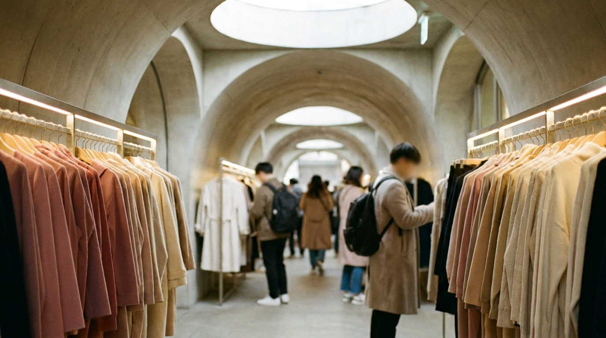

こんにちは、SEOUL TRIP NOTE の J です。

ソウル旅行のショッピング先として、必ず名前が挙がるのが高速ターミナル駅直結の地下街「GOTOMALL（江南ターミナル地下ショッピングセンター）」です。全長約880メートル、東西に広がる通路に約600もの店舗が並び、洋服やアクセサリー、インテリア雑貨などが手頃な価格で手に入ります。

一方で、「広すぎて迷子になった」「現金が必要と聞いて焦った」「同じ服が別の店でもっと安く売られていた」という声もよく聞かれます。

この記事では、高速ターミナル GOTOMALL 買い方の基本ルールから、効率的なゴートゥーモール 回り方、そして現金払いの仕組みや注意点まで、公開情報と現地の状況をもとに整理して解説します。

> **GOTOMALL攻略の要点**
> - **構造の理解**：東西に伸びる2本の平行通路（合計約1.7km）を「往復」して回るのが基本です。
> - **支払い方法**：表示価格は「現金払い（ヒョングム）」前提の店が多く、カード払いは手数料が加算される場合があります。
> - **商品の特徴**：トレンド服が10,000ウォン前後から揃いますが、試着不可の店舗が多いためサイズ確認が不可欠です。

---

## GOTOMALLの基本情報と迷わないアクセス

GOTOMALLは地下鉄3号線・7号線・9号線が交差する「高速バスターミナル（コソクターミナル）駅」に直結しています。

| 項目 | 内容（執筆時点の目安） |
| :--- | :--- |
| **正式名称** | 江南ターミナル地下ショッピングセンター（GOTOMALL） |
| **最寄り駅** | 地下鉄3号線・7号線・9号線 高速バスターミナル駅 |
| **出口番号** | 8-1番・8-2番出口方面 |
| **営業時間** | 10:00〜22:00頃（店舗により開店・閉店時間が前後します） |
| **定休日** | 年中無休（旧正月・秋夕の当日は休業店舗多数） |

ソウル市内の移動には地下鉄が便利です。交通系ICカードの準備については、[渡韓旅行者必見！気候同行カードとWOWPASS徹底比較ガイド](/blog/climate-card-vs-wowpass-comparison/)も参考にしてください。

改札を出たら「8-1」「8-2」出口の案内表示を目指して進むと、そのまま地下街のエントランスに到着します。

---

## 迷わず効率よく回るゴートゥーモール回り方

※ AIで生成したイメージ画像です

GOTOMALLは、中央に通路があり、北側と南側にそれぞれ1本ずつ長い通路が並行して走っています。端から端まで歩くだけでも片道約880メートルあります。

### 1. 通路を「コの字」型に歩く
もっとも無駄のないゴートゥーモール 回り方は、片方の端（西側：盤浦方面）からスタートし、一方の通路をまっすぐ進んで反対側の端（東側：蚕院方面）まで行き、もう一方の通路を通って戻ってくる「コの字」型のルートです。

途中で通路を横断してジグザグに進むと、自分がどのあたりにいるのか把握しにくくなります。

### 2. 気に入った商品は「店番号」を控える
店舗の柱や看板の上部には、「G-025」や「C-088」のようにアルファベットと数字が記載されています。「後でもう一度戻って買おう」と思っても、同じような店が並んでいるため自力で見つけるのは非常に困難です。気になったアイテムがあったら、店番号と服の写真をセットでスマートフォンにメモしておくことをおすすめします。

### 3. 空いている時間帯を狙う
地元の通勤客や買い物客も多く利用するため、平日の夕方（17:00以降）や週末の午後は非常に混雑します。通路が狭いため、スーツケースを引いて歩くのは困難です。比較的落ち着いて買い物ができる平日の11:00〜14:00頃の訪問が適しています。

---

## GOTOMALL 現金 現金払いのルールと価格表示

GOTOMALLで買い物をする際に最も知っておくべき点が、支払い方法による価格の違いです。

### 現金特価（ヒョングムカ）とは？
ハンガーラックや店頭に「10,000ウォン」「5,000ウォン」といった値札が大きく貼られている場合、その多くは**「GOTOMALL 現金 現金払い」を前提とした特価**です。

クレジットカードやWOWPASSなどのプリペイドカードで決済しようとすると、以下のような対応になる店舗が一般的です。

- 表示価格に10%程度の付加価値税（VAT）や手数料が上乗せされる（例：10,000ウォン表記 → カード決済時は11,000ウォン）
- カード決済そのものを断られる（低価格ワゴンセール品など）

韓国は完全なキャッシュレス社会として知られていますが、東大門の卸売市場や伝統市場、そしてGOTOMALLのような格安地下街では、現金払いが依然として好まれます。

現金を十分に用意していない場合は、地下街の中央広場や駅のコンコースにあるATMでウォンを引き出すか、事前に両替を済ませておく必要があります。

---

## GOTOMALLと他のショッピングエリアの比較

ソウルで服を買う場所として、東大門や明洞、ホンデなどと比較されることがよくあります。特徴を整理しました。

| エリア | 価格帯の目安 | 試着のしやすさ | 支払い方法 | 主なターゲット層 |
| :--- | :--- | :--- | :--- | :--- |
| **GOTOMALL** | 5,000〜30,000ウォン | ほぼ不可（一部ボトムス可） | 現金推奨（カードは+10%） | 10代〜60代（幅広い年代向け） |
| **東大門（卸売）** | 10,000〜40,000ウォン | 不可 | 現金のみの店が多い | バイヤー・20代〜40代 |
| **明洞・弘大（路面店）** | 15,000〜50,000ウォン | 可能（フィッティングルームあり） | カード決済完全対応 | 10代〜30代・観光客 |
| **百貨店・モール** | 50,000ウォン〜 | 可能 | カード決済完全対応 | 全年齢・ブランド志向 |

深夜の買い物や大量購入を検討している方は、[東大門ショッピング完全ガイド](/blog/dongdaemun-shopping-guide/)も併せてチェックしてみてください。

---

## 韓国 地下街 ショッピング コツと失敗を防ぐ注意点

※ AIで生成したイメージ画像です

高速ターミナル GOTOMALL 買い方で後悔しないために、以下のチェックポイントを押さえておきましょう。

### 1. 試着ができない前提でサイズを把握しておく
GOTOMALLの洋服店の多くは試着室がありません。トップスはもちろん、スカートやワンピースも試着できないことがほとんどです。一部のパンツ（ズボン）専門店では試着できる場合もありますが、基本的には「平置きサイズ」を目測で判断する必要があります。

事前に自分のウエストサイズや、普段着ているトップスの身幅・着丈を把握しておくと失敗が少なくなります。韓国のアパレル表記については、[韓国服・靴のサイズ表記ガイド](/blog/korean-clothing-size-guide/)に詳しくまとめています。

### 2. 縫製やファスナーを購入前にその場で確認する
低価格で提供されているため、中には縫製のほつれ、ボタンのゆるみ、ファスナーの引っかかり、小さな汚れなどがある商品も混ざっています。購入後の返品・交換は基本的に受け付けられないため、会計前にお店の鏡の前で細部まで確認してください。

### 3. 一番奥まで歩いてから決める
GOTOMALL内では、まったく同じデザインの服が複数の店舗で販売されていることが日常茶飯事です。手前の店で15,000ウォンで売られていたニットが、奥の店では10,000ウォンで販売されていることもあります。まずは一通り通路を流し見して、価格相場をつかんでから決断するのが賢い韓国 地下街 ショッピング コツです。

---

## よくある質問（FAQ）

### Q1. GOTOMALLでタックスリファンド（免税還付）は受けられますか？
GOTOMALLの小規模アパレル店舗のほとんどは、事後免税制度（Tax Refund）の加盟店ではありません。そのため、外国人旅行者向けの免税手続きは基本的にできないと考えておく必要があります。

### Q2. トイレやコインロッカーはありますか？
地下街の両端と中央付近に公衆トイレが設置されています。また、地下鉄駅の改札付近やバスターミナル周辺にコインロッカーがありますが、週末は埋まりやすいため、大きな荷物はホテルに置いて身軽な状態で訪れることをおすすめします。

### Q3. WOWPASSは使えますか？
WOWPASSは韓国の国内クレジットカード（デビットカード）ネットワークを利用しているため、カード決済対応の店舗であれば使用可能です。ただし、クレジットカードと同様に10%程度の手数料が上乗せされる場合や、現金のみの店舗では使えない点にご注意ください。

### Q4. 飲食店やカフェはありますか？
地下街の両端（東側・西側）に飲食店街が広がっています。韓国の軽食（キンパやトッポッキ）、冷麺、定食屋のほか、有名コーヒーチェーンも複数あります。ショッピングの合間に休憩を取るのに便利です。

---

## まとめ

高速ターミナル駅のGOTOMALLは、韓国の最新トレンドアイテムをリーズナブルに手に入れたい方にとって魅力的なスポットです。

- **通路は「コの字」で回り、気になる店は番号を控える**
- **値札の多くは「現金特価」のため、ウォンの現金を多めに用意する**
- **試着ができないため、サイズ確認と商品の状態チェックを念入りに行う**

これらを意識するだけで、無駄な体力を使わずに満足度の高い買い物が楽しめます。ぜひ事前準備を整えて、お気に入りのアイテムを見つけてみてください。