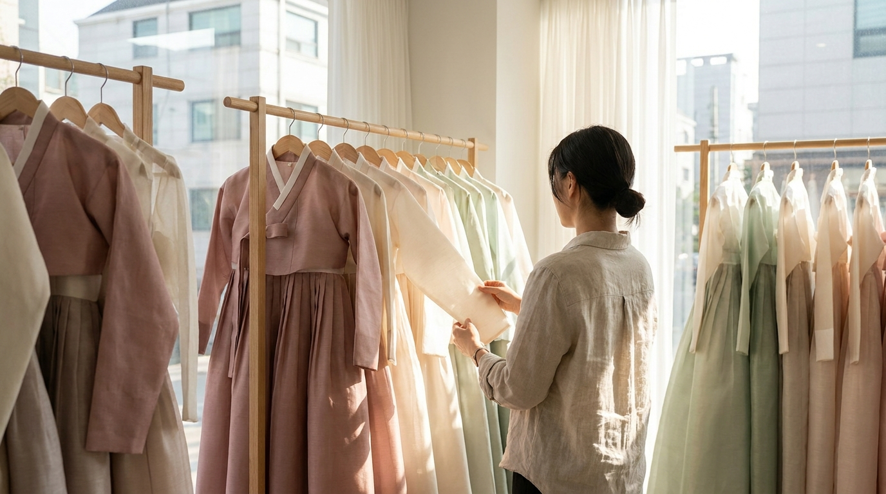
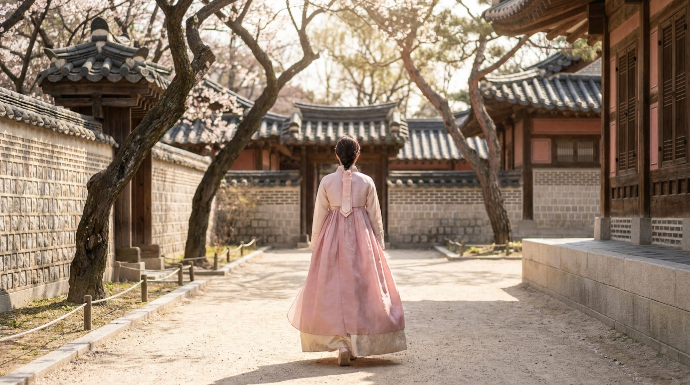

こんにちは、SEOUL TRIP NOTE の J です。ソウルを代表する観光スポットといえば、朝鮮王朝の正宮である「景福宮（キョンボックン）」が挙げられます。

渡韓旅行の計画を立てる際、「韓服（チマチョゴリ）を着て景福宮を歩いてみたい」「韓服を着ていくと景福宮の入場料が無料になるって本当？」と気になっている方も多いのではないでしょうか。

この記事では、宮陵遺跡本部が定める「韓服着用者の無料入場規定」、景福宮韓服レンタルの相場や選び方、効率的な回り方と写真スポットについて、公式情報をもとに整理して解説します。旅行プランをスムーズに進めるための参考にしてください。

> **この記事の要点まとめ**
> - 正しい規定に沿った韓服を上下ともに着用していれば、外国人旅行者でも景福宮の入場料（通常3,000ウォン）が無料になります。
> - 過度な露出や上下バラバラの着用は無料対象外になるため、事前のルール確認が大切です。
> - 景福宮駅周辺には多数の韓服レンタル店があり、相場は2時間で15,000〜30,000ウォン程度が目安です。
> - 守門将交代儀式の時間に合わせて訪れると、より充実した見学ができます。

---

## 景福宮の入場料と韓服着用で無料になる公式ルール

景福宮の大人（19歳〜64歳）の通常入場料は3,000ウォンです。しかし、国家遺産庁（宮陵遺跡本部）のガイドラインにより、「韓服を正しく着用した観覧者」は国籍を問わず入場料が免除（無料）されます。

チケット窓口に並ぶ必要はなく、韓服を着た状態で改札ゲートに向かうと、そのまま入場できる運用となっています。

ただし、どんな服でも認められるわけではありません。「伝統の趣を著しく損なわないこと」を目的とした着用規定が定められています。

### 入場無料の対象となる韓服の基準
公式規定による主なチェックポイントは以下の通りです。

- **上下のセット着用が必須**: 女性の場合は「チマ（スカート）＋チョゴリ（上着）」、男性の場合は「パジ（ズボン）＋チョゴリ（上着）」を正しく着用している必要があります。上着だけ、またはスカートだけを私服に合わせたスタイルは対象外です。
- **適切な着丈と露出**: チマの長さは足首が見える程度まで認められますが、過度に短いミニスカート丈や、胸元・背中が大きく開いたデザインは無料対象から外れる場合があります。
- **性別の制限撤廃**: 以前は性別に合わせた着用が義務付けられていましたが、現在は性別に関わらず、伝統様式に沿った上下の組み合わせであれば無料対象として認められています。

一般的な韓服レンタル店で貸し出されている衣装は、基本的にこの規定をクリアしているものがほとんどです。ただし、個性的なアレンジ衣装などを選ぶ際は、店員さんに「景福宮の無料入場に対応しているか」を確認しておくと安心です。

---

## 韓服レンタルの種類と料金相場



<p class="img-cap">※ AIで生成したイメージ画像です</p>

景福宮の最寄り駅である地下鉄3号線「景福宮駅」の周辺（特に4番出口・2番出口付近）や、隣接する西村（ソチョン）・北村（プクチョン）エリアには、数多くの韓服レンタル店が集まっています。

韓服のデザインは、大きく分けると「伝統韓服」「フュージョン韓服」「プレミアム（王族・貴族風）韓服」の3タイプがあります。

| 韓服のタイプ | 特徴・デザイン | レンタル料金の目安（2時間） | 向いている人 |
| :--- | :--- | :--- | :--- |
| **伝統韓服** | 落ち着いた色合い、シンプルで上品なシルク風生地、伝統的な仕立て | 15,000 〜 20,000ウォン | クラシックな雰囲気が好きな方、落ち着いた写真を残したい方 |
| **フュージョン韓服** | レース、花柄、金箔・銀箔プリント、パステルカラーの華やかなデザイン | 20,000 〜 30,000ウォン | 現代風の華やかさを重視したい方、オリジナルの写真映えを狙う方 |
| **プレミアム韓服** | 王妃・王・両班（貴族）の正装、高級感のある刺繍やグラデーション | 30,000 〜 50,000ウォン以上 | 本格的な時代劇のような装いを楽しみたい方 |

※上記はソウル市内の一般的な韓服レンタル店の料金傾向（執筆時点の目安）です。店舗やシーズンによって異なるため、利用前に店頭や予約サイトでご確認ください。日本円での支払額は最新の為替レートで換算してください。

### レンタル店選びのチェックポイント
レンタル料金には、衣装の貸出だけでなく「ヘアセット」「髪飾り」「巾着バッグ」「パニエ（スカートを膨らませるアンダースカート）」が含まれているかどうかが店によって異なります。

- **パニエの有無**: チマを綺麗なAラインに広げるパニエは、写真写りを大きく左右します（追加料金2,000〜4,000ウォン程度の場合もあります）。
- **ロッカーの利用**: 着てきた私服や大きな荷物を預けるロッカー代が無料かどうかも確認しておきたい点です。
- **返却時間の管理**: レンタル時間は「受付後、着付けが完了してからカウント開始」となる店が多いですが、移動時間も含めて余裕を持った時間設定（2時間〜4時間）をおすすめします。

ソウル旅行のスケジュール全体を組む際は、[初めてのソウル2泊3日モデルコース](/blog/seoul-2nights-3days-first-trip/)も参考にしながら、景福宮に立ち寄る時間帯を検討してみてください。

---

## 景福宮の回り方とおすすめの写真スポット

景福宮は敷地が非常に広く、端から端まで歩くだけでも時間がかかります。韓服を着て歩く際は普段よりも歩幅が小さくなるため、見どころを絞って回るのが効率的です。

```
【おすすめの周回ルート】
光化門（正門） → 興礼門 → 勤政殿（正殿） → 慶会楼（池の東屋） → 香遠亭（奥の池）
```

### 1. 光化門（クァンファムン）と守門将交代儀式
景福宮の正門である光化門では、朝鮮時代の守門将（警備隊）の交代儀式が再現されています。

- **交代儀式**: 1日2回（10:00 / 14:00、所要約20分）
- **光化門把守儀式**: 1日2回（11:00 / 13:00、所要約10分）
※休館日（毎週火曜日）は実施されません。また悪天候等で中止になる場合があります。

色鮮やかな伝統衣装をまとった兵士たちと一緒に記念撮影ができる時間帯もあるため、午前10時の回に合わせて入館すると見学がスムーズです。

### 2. 勤政殿（クンジョンジョン）
国の重要行事が行われた景福宮の中心的な建物です。広大な石畳の広場（朝廷）と、雄大な木造建築を背景にすると、奥行きのある壮大な写真が撮れます。

正面だけでなく、両脇に伸びる回廊の柱の間に立ち、斜めのアングルから撮影すると光と影が綺麗に入ります。

### 3. 慶会楼（キョンフェル）
大きな池の上に建てられた2階建ての優美な楼閣です。国の祝宴や外国使臣の接待に使われた場所で、池の水面に映る楼閣と柳の木を背景にした撮影は、景福宮観光の定番スポットです。

### 4. 香遠亭（ヒャンウォンジョン）
敷地のやや北側に位置する六角形の東屋で、池の中央に架かる木造の橋「酔香橋」との調和が美しいスポットです。勤政殿周辺に比べて混雑が落ち着いていることが多く、静かな雰囲気の中で撮影を楽しみたい方に向いています。

---

## 快適に楽しむための注意点と知っておきたいコツ



<p class="img-cap">※ AIで生成したイメージ画像です</p>

景福宮韓服体験をストレスなく楽しむために、以下の点に配慮しておくと安心です。

> **韓服体験の注意点**
> - **歩きやすい靴を用意する**: チマの裾から靴先が少し見えることがあります。景福宮の地面は土や砂利、石畳が多いため、ヒールではなく歩きやすいスニーカーやフラットシューズが安全です。
> - **火曜日は定休日**: 景福宮は毎週火曜日が休館日です（祝日と重なる場合は変更あり）。周辺の韓服店も火曜日は短縮営業や定休日になっていることがあるため、日程計画にご注意ください。
> - **季節ごとのインナー対策**: 夏のソウルは日差しが強く蒸し暑いため、通気性の良いキャミソールなどのインナーを。冬は氷点下まで冷え込むため、首元の開いたヒートテックやレギンス、カイロなどの防寒対策が必須です。

景福宮周辺を移動する際は、地下鉄やバスを活用すると便利です。交通系ICカードの準備については、[気候同行カードとWOWPASS徹底比較ガイド](/blog/climate-card-vs-wowpass-comparison/)で詳しくまとめています。

散策後に近くの三清洞（サムチョンドン）や西村の伝統茶屋・カフェで一息つく際は、[韓国カフェの注文ガイド](/blog/korean-cafe-ordering-tips/)も役立ちます。

---

## よくある質問（FAQ）

### Q1. 雨の日でも韓服レンタルや景福宮の入場はできますか？
雨天でもレンタルおよび景福宮への入場は可能です。ただし、雨でチマの裾が泥や水で汚れてしまうリスクがあるため、レンタル店によっては裾を少し短めに着付けるなどの対応をしてくれます。また、雨天時は傘を差しながらの移動となるため、足元に十分ご注意ください。

### Q2. 予約なしで当日に韓服レンタル店に行っても大丈夫ですか？
多くの店舗で当日飛び込みの利用を受け付けています。ただし、午前中（特に10時の交代儀式の前）や桜・紅葉の観光シーズン、週末などは混み合います。お気に入りの衣装を確実に選びたい場合や、ヘアセットの待ち時間を短縮したい場合は、事前予約をしておくのが確実です。

### Q3. 手荷物やスーツケースを持ったまま回れますか？
景福宮の敷地内は砂利道が多く、スーツケースを転がしての観光は非常に困難です。スーツケースなどの大きな荷物は、地下鉄駅のコインロッカーや、利用する韓服レンタル店の手荷物預かりサービスを利用し、貴重品とスマートフォンだけを専用の巾着バッグに入れて散策することをおすすめします。

### Q4. 男性や子ども向けの韓服もレンタルできますか？
はい、ほとんどの店舗で男性用（世子、王、武官などの衣装）や子ども用の韓服が取り揃えられています。サイズ展開も幅広いため、カップルや友人同士、家族旅行でも一緒に楽しむことができます。

---

## まとめ

景福宮での韓服体験は、韓国の歴史と伝統建築を身近に感じられるソウル観光の定番です。正しい着用ルールを守れば景福宮の入場料が無料になり、特別な旅の思い出として素敵な写真を残すことができます。

- 上下セットの規定に沿った韓服を選ぶ
- 2時間〜4時間を目安にレンタル時間を決める
- 10:00または14:00の守門将交代儀式に合わせて回る
- 砂利道でも疲れない歩きやすい靴で訪れる

これらのポイントを押さえて、ぜひ風情ある景福宮の散策を楽しんでみてください。