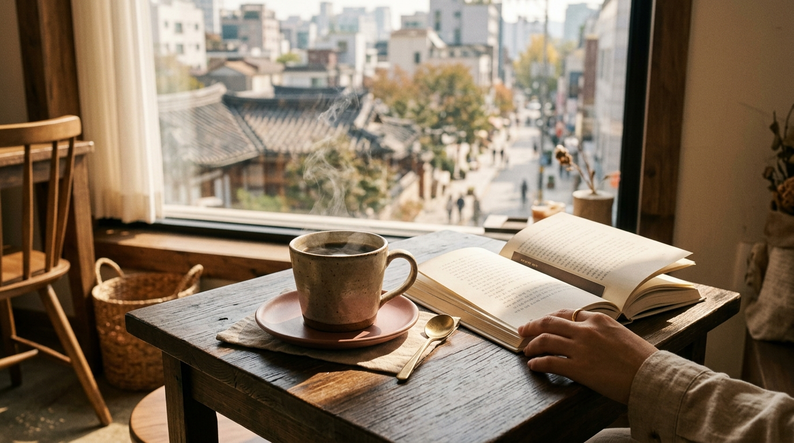

こんにちは、SEOUL TRIP NOTE の J です。

ソウルの若者の街として知られる弘大（ホンデ）は、カフェやグルメスポットが豊富で、日本の渡韓女子にも人気のエリアです。活気にあふれる繁華街だからこそ、「ひとりご飯やカフェは入りにくいのでは？」と不安に思う方もいるかもしれません。

このエリアはカウンター席のある軽食店や大型カフェが多く、お店のジャンルや時間帯を意識すれば、ひとりでも快適に過ごせます。キオスク注文のポイントなど、具体的なコツをまとめました。

### 【結論】この記事の要点まとめ

*   **ひとりご飯・カフェに意外と便利**: 学生街のため、単身で気軽に利用できるお店も豊富です。
*   **入りやすいお店のジャンル**: キンパ専門店、麺類、フードコート形式、大型カフェなどがおすすめ。
*   **時間帯選びが重要**: ランチやディナーのピークタイムを避けることで、スムーズに入店できます。
*   **注文はキオスクやモバイルオーダーも活用**: 非対面での注文方法を把握しておくと安心です。

---

### 1. 弘大でひとりご飯を楽しむための基本ルールとお店選びのコツ

単身で入りやすいお店を見極めるには、街の特性と店舗タイプの把握が役立ちます。

#### エリアの特性を理解する

若者文化の中心地として夜まで賑わう街です。おしゃれなレストランやカフェが並ぶ一方で、安くてボリュームのある学生向けの食堂も点在しています。特に週末や夜間は混雑するため、ピークを外して訪れるのが無理のない過ごし方です。

#### ひとりご飯しやすいお店のジャンル

食事をするなら、以下のようなジャンルのお店が利用しやすい傾向にあります。

*   **キンパ専門店や軽食店**: カウンター席がある店舗が多く、手早く食事を済ませたい時に便利です。テイクアウトにも対応しています。
*   **麺類（ラーメン、冷麺、ククスなど）**: 一人前のメニューが基本で回転率が高いため、気兼ねなく入れます。
*   **フードコート形式のお店**: 複数の店舗から好きな料理を注文でき、座席数も多いため自分のペースで食事が楽しめます。
*   **セルフサービス形式のお店**: キオスクで注文・会計を済ませ、料理を自分で受け取るスタイルの店舗です。店員とのやり取りが少なく、言葉に不安がある場合でも使いやすい形態です。
*   **チェーン店のファストフード**: ハンバーガーやサンドイッチ、チキンなど、韓国ならではのチェーン店も充実しています。

#### お店の雰囲気チェックポイント

入店前に、外から店内の様子を観察してみましょう。

*   **カウンター席の有無**: 一人客向けの席があれば、周囲を気にせず座れます。
*   **一人客の比率**: すでに一人で食事をしている人がいれば、ひとり客を受け入れ慣れている目安になります。
*   **テーブルの配置**: 4人掛けテーブルが主体の店は相席になる可能性があるため、避けるのが無難です。
*   **回転率**: 食事の提供が早く、客の入れ替わりが活発なお店は一人でも入りやすい雰囲気があります。

> **ポイント**
> 食事をする際は、ランチ（12時～13時半）やディナー（18時～20時）のピークを避け、少し早めか遅めの時間帯を狙うのがおすすめです。特に平日の午後は比較的ゆったり過ごせます。

### 2. くつろげるひとりカフェの選び方

※ AIで生成したイメージ画像です

カフェ激戦区でもあるため、コンセプトカフェから大型店舗まで選択肢は豊富です。

#### ひとり利用しやすいカフェのタイプ

*   **大型チェーンカフェ**: 席数が多く、電源やWi-Fiが整っている店舗がほとんどです。PC作業や読書をする人も多く、周囲の目を気にせず過ごせます。
*   **窓際席やカウンター席があるカフェ**: 外の景色を眺めながら過ごせる設計の店舗は、一人でも落ち着いて席に着けます。
*   **アート系・ギャラリーカフェ**: 美大のお膝元である弘大らしさを味わえる空間で、展示を鑑賞しながら静かに過ごせます。
*   **テイクアウト専門店**: 街歩きの合間や、公園で休憩したい時に手軽に利用できます。

※なお、韓国のいわゆる「スタディカフェ（勉強カフェ）」は無人運営が多く、入室機で韓国国内の電話番号による認証が求められるケースがほとんどのため、旅行者には一般的な大型カフェの利用が向いています。

> **ポイント**
> カフェは週末の午後から夕方にかけて混雑が目立ちます。特定の人気店へ向かう場合は、午前中の開店直後や夜遅めの時間帯、もしくは平日を選ぶと席を確保しやすくなります。

### 3. 移動と支払いの基本

地下鉄2号線、空港鉄道、京義・中央線が交差する弘大入口駅を中心に、街が広がっています。

#### 移動手段

*   **地下鉄**: 弘大入口駅からは主要な観光地へ乗り換えなし、または少ない回数で移動できます。交通系ICカード（T-moneyなど）を準備しておくと改札もスムーズです。
*   **徒歩**: 弘大エリアは弘益大学周辺をはじめ坂道や起伏が多いため、歩きやすいスニーカーなどで散策するのがおすすめです。路地に入ると段差や階段も多く見られます。

#### 支払い方法と注文のコツ

キャッシュレス決済が広く普及しており、現金を使う場面は少なくなっています。

*   **クレジットカード**: 主要ブランド（Visa、Mastercard、JCBなど）は幅広く利用可能です。
*   **交通系ICカード**: 交通機関だけでなく、コンビニや一部のチェーン飲食店でも決済に使えます。
*   **キオスク（無人注文機）**: 多くの店舗に導入されています。言語選択で日本語や英語に切り替えられる機械も増えており、画面の案内に沿って注文と支払いを完了させます。
*   **モバイルオーダー**: 専用アプリから事前決済する仕組みですが、会員登録に韓国の電話番号が必要な場合もあるため、旅行者には店頭のキオスク利用が無難です。

> **ポイント**
> キオスクの操作に迷った時は、画面の言語設定を「日本語」や「English」に切り替えて操作を進めてみてください。クレジットカード決済がうまく通らない場合や操作がどうしても難しい時は、カウンターにいる店員に直接注文や支払いが可能か確認してみるのもひとつの手です。

---

### よくある質問（FAQ）

**Q1: 弘大でひとりでも入りやすいお店は本当にありますか？**
A1: 学生街という特性上、一人で食事をする学生も多く、ひとりご飯に慣れているお店が豊富にあります。特にキンパ専門店、麺類店、フードコート、大型チェーンカフェなどは一人客の利用が日常的です。外から店内を見渡して、カウンター席の有無や一人客の姿を確認してから入ると安心です。

**Q2: ひとりご飯で避けるべきお店のタイプはありますか？**
A2: 2人前以上の注文が基本となる焼肉店や大型の鍋料理店、席数が少なくグループ客主体の居酒屋などは、一人での利用には不向きです。入店を断られる場合や相席を求められることもあるため、あらかじめ一人前メニューが用意されている店を選びましょう。

**Q3: カフェで長居しても大丈夫ですか？**
A3: 大型チェーンカフェでは、PC作業や読書で数時間過ごす人も珍しくないとされています。一方、席数の限られた個人店や混雑時の人気店では、適度な時間で席を譲る配慮が求められます。長時間の休憩を予定しているなら、フロアが広く席数の多い店舗を選ぶのが安心です。

**Q4: 夜遅くまで開いているひとりご飯のお店はありますか？**
A4: 繁華街のため、チェーンのファストフード店やキンパ専門店、一部の軽食店は深夜まで営業している場合があります。営業時間は変更されることもあるため、執筆時点の目安として捉え、訪問前に地図アプリなどで最新の公式情報を確認してください。