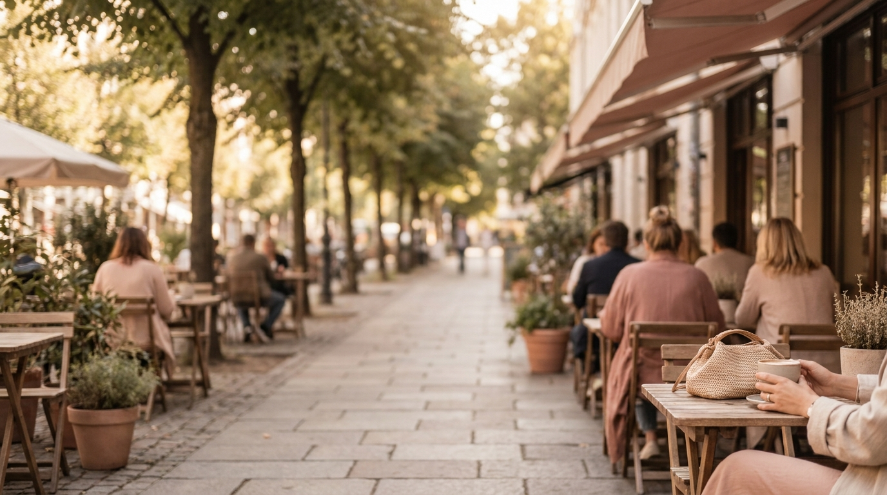
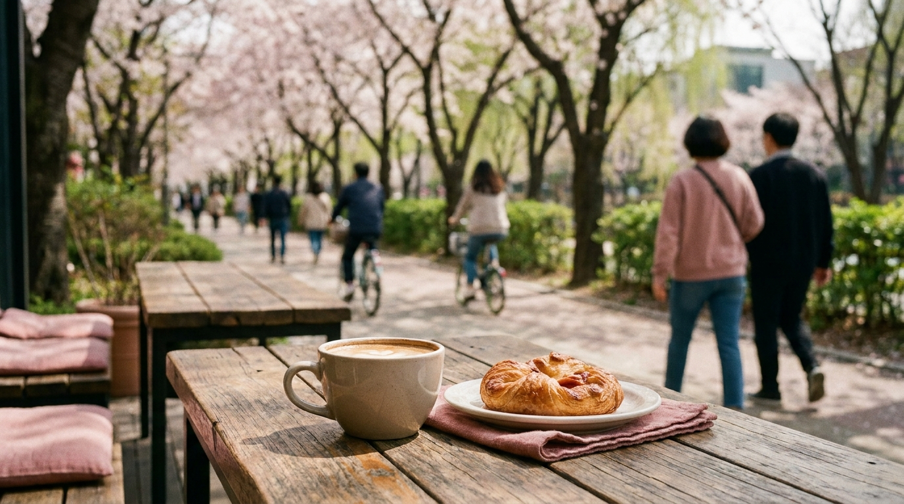

こんにちは、SEOUL TRIP NOTE の J です。

弘大（ホンデ）は、若者のファッションやカフェ、ストリートライブで知られるソウルの繁華街です。仁川空港・金浦空港から空港鉄道で乗り換えなしで行けることもあり、ひとり旅や友達同士の旅行で宿泊先に選ぶ人が増えています。

すぐ隣の延南洞（ヨンナムドン）は、公園沿いに小さなカフェや雑貨店が並ぶ落ち着いた街です。同じ「弘大エリア」でも、泊まる場所によって夜の過ごし方や静かさがかなり違います。駅ごとの特徴と、宿を選ぶときのチェックポイントをまとめました。

> **この記事の要点まとめ**
> - 弘大入口駅は空港鉄道・地下鉄2号線・京義中央線が使え、仁川空港・金浦空港から乗り換えなしで到着できます。
> - 夜まで遊ぶなら弘大の繁華街寄り、静かに休みたいなら延南洞や望遠など少し離れた住宅街寄りが候補。
> - 合井（2・6号線）、上水（6号線）、望遠（6号線）の近くに泊まる選択肢もあります。
> - 繁華街の真ん中は週末の夜に騒がしいことがあるため、口コミで騒音の傾向を確認すると安心です。

---

## 弘大エリアに泊まるメリットと注意点

### メリット

- **空港から乗り換えなし**: 空港鉄道（A'REX）の一般列車が弘大入口駅に停まります。仁川空港からは各駅停車で1時間前後が目安で、スーツケースを持ったまま乗り換えずに着けます。金浦空港とも空港鉄道でつながっているので、羽田・関西など金浦発着の便を使う場合にも便利です。
- **2号線で主要エリアへ**: 地下鉄2号線は環状線で、乙支路入口（明洞の近く）、東大門歴史文化公園、聖水、江南などへ乗り換えなしで行けます。
- **夜も食事に困らない**: 深夜まで営業する飲食店や、24時間営業のコンビニが多く、夜遅くに戻っても食事ができます。

### 注意点

- **週末の夜はにぎやか**: 繁華街の中心部はクラブや飲み屋が多く、週末は深夜まで人通りがあります。
- **景福宮・明洞へは地下鉄で移動**: 王宮や伝統的な街並みが中心の旅なら、鍾路や明洞に泊まるほうが移動が短くなります。
- **坂道や路地**: 繁華街から少し入ると細い路地が多く、宿の入口がわかりにくいこともあります。

ほかのエリアとの比較は[ソウルの宿泊エリア比較｜明洞・弘大・東大門・江南・鍾路](/blog/seoul-hotel-area-comparison/)でまとめています。

---

## 駅ごとの雰囲気｜どの駅の近くに泊まる？

※ AIで生成したイメージ画像です

### 弘大入口駅（2号線・空港鉄道・京義中央線）

弘大エリアの中心となる駅です。空港鉄道を使うなら、この駅の近くが最も移動が楽です。駅の南側、大学へ向かう一帯に繁華街が広がり、ショップやカフェ、路上ライブのスポットが集まっています。反対の北西側には、延南洞方面に続く細長い公園があります。

### 延南洞（ヨンナムドン）側

弘大入口駅の北西側、京義線の線路跡を公園にした「京義線森の道（キョンイソン スプキル）」沿いに広がる街です。公園沿いにカフェやベーカリー、小さなレストランが並び、繁華街に比べて落ち着いた雰囲気です。

- 夜は比較的静かで、ひとり旅や女子旅で「弘大の近くだけど静かに休みたい」場合の候補になります。
- 小規模なゲストハウスやレジデンスタイプの宿が多く、建物によってはエレベーターがないこともあります。
- 弘大入口駅まで歩ける範囲を選ぶと、空港鉄道へのアクセスも保てます。

### 合井駅（2号線・6号線）

弘大の南側にある駅で、2号線と6号線が使えます。駅周辺には大型の商業施設や高層の建物もあり、繁華街の中心より少し落ち着いています。弘大入口駅まで歩ける距離なので、空港鉄道も利用できます。

### 上水駅・望遠駅（6号線）

上水駅は弘大の繁華街の南東側、望遠駅は6号線で合井駅の隣の駅です。望遠駅の近くには地元の人が通う望遠市場があり、漢江の公園にも歩いて行けます。観光地のにぎやかさより、ソウルの日常の雰囲気の中で過ごしたい人に向いています。空港鉄道を使う場合は、弘大入口駅まで移動する必要があります。

---

## 弘大・延南洞の宿を選ぶチェックポイント

### 1. 駅からの距離と出口

弘大入口駅は出口の数が多く、出口によって繁華街側か延南洞側かが変わります。地図アプリで「何番出口から徒歩何分か」を確認しましょう。

### 2. 騒音

繁華街の中心にある宿は、週末の夜に外の音が気になることがあるという声があります。口コミを「騒音」「窓」「週末」などのキーワードで検索して、傾向を見ておくと安心です。

### 3. 宿のタイプ

弘大・延南洞には、ビジネスホテル、レジデンス、ゲストハウス、個室タイプのホステルなど、さまざまなタイプの宿があります。

- **ひとり旅**: 個室のシングルルームや、女性専用ドミトリーのある宿を選ぶ旅行者もいます。
- **友達同士**: ツインやトリプルの部屋、キッチン付きのレジデンスタイプが便利です。
- **長めの滞在**: 洗濯機や冷蔵庫の有無を確認しておくと、荷物を減らせます。

### 4. エレベーターとフロント

小規模な宿では、エレベーターがない、フロントが24時間ではない、セルフチェックインのみ、ということもあります。到着が深夜になる場合は、チェックイン方法を事前に確認しておきましょう。

### 5. アメニティ

韓国では2024年から、一定規模以上の宿泊施設で使い捨てアメニティの無料提供が制限されています。歯ブラシなどは持参するか、近くのコンビニやドラッグストアで用意しましょう。

---

## 弘大・延南洞に泊まる日の過ごし方のヒント

※ AIで生成したイメージ画像です

- **到着日の夜**: 空港鉄道で弘大入口駅に着いたら、チェックイン後に繁華街で夕食。深夜まで開いている店が多いので、到着が遅くても食事ができます。
- **朝**: 延南洞の公園沿いを散歩して、朝から開いているベーカリーやカフェで朝食。ソウルの朝ごはん事情は[ソウルの朝ごはん事情](/blog/korean-breakfast-options/)にまとめています。
- **ひとりご飯**: 弘大には、ひとりでも入りやすいカウンター席の店や大型カフェが多くあります。詳しくは[弘大で女子ひとりご飯・カフェを楽しむ方法](/blog/hongdae-solo-cafe-dining-guide/)をご覧ください。
- **最終日**: 空港鉄道で乗り換えなしで空港へ。早朝便の場合は、始発で間に合うかを事前に確認しましょう。[仁川空港近くのホテルと早朝便の乗り方](/blog/incheon-airport-hotel-early-flight/)も参考になります。

---

## よくある質問（FAQ）

### Q1. 弘大と延南洞、ひとり旅ならどちらに泊まるのがいいですか？

**A.** 夜遅くまで食事や買い物を楽しみたいなら弘大の繁華街寄り、静かに休みたいなら延南洞寄りが向いています。どちらも弘大入口駅まで歩ける範囲を選ぶと、空港鉄道や2号線へのアクセスを保てます。

### Q2. 仁川空港から弘大まではどのくらいかかりますか？

**A.** 空港鉄道の一般列車で、乗り換えなしで弘大入口駅に着きます。所要時間は1時間前後が目安です。直通列車はソウル駅まで停まらないため、弘大へ行く場合は一般列車に乗りましょう。

### Q3. 弘大に泊まって明洞や江南へ行くのは不便ですか？

**A.** 地下鉄2号線で、明洞の近くの乙支路入口駅や江南駅まで乗り換えなしで行けます。江南までは時間がかかりますが、乗り換えがない分移動はシンプルです。

### Q4. 弘大の宿は夜うるさいですか？

**A.** 繁華街の中心部は週末の夜に人通りが多く、にぎやかです。気になる場合は延南洞や合井、望遠など少し離れたエリアの宿を選び、口コミで騒音の評価を確認するのがおすすめです。

---

## まとめ

弘大・延南洞エリアは、空港から乗り換えなしで行けて、夜まで楽しめるのが大きな魅力です。

- 夜まで遊びたい、到着が遅い → **弘大入口駅の繁華街寄り**
- 静かに休みたい、カフェ巡りが好き → **延南洞寄り**
- 少し落ち着いた場所で2号線・6号線を使いたい → **合井駅周辺**
- ソウルの日常の雰囲気を味わいたい → **上水・望遠駅周辺**

宿の設備や条件は施設ごとに違うため、予約前に駅からの距離、エレベーター、チェックイン方法、キャンセル条件を確認してから選んでください。
