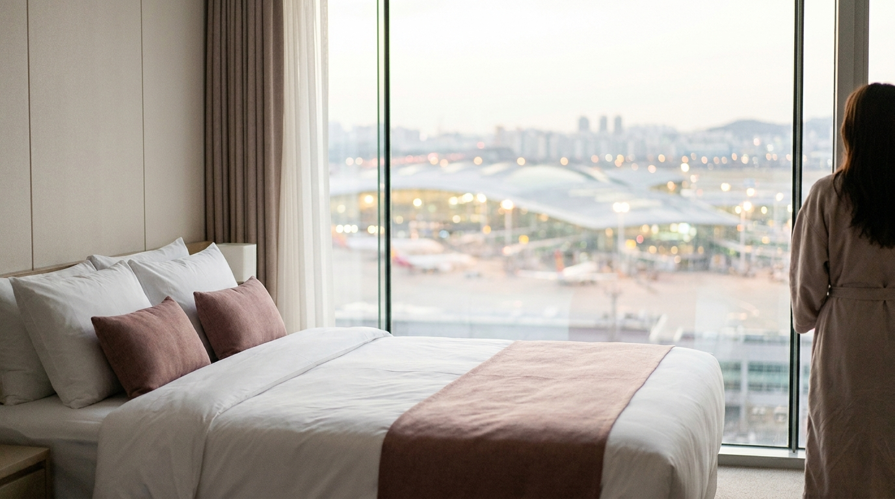
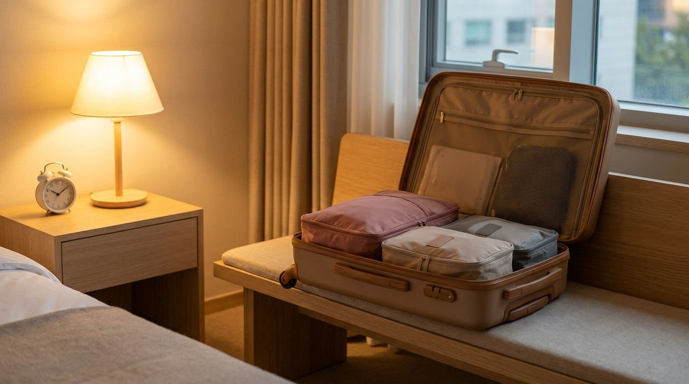

こんにちは、SEOUL TRIP NOTE の J です。

日本へ向かうLCCなどには、朝早い時間に仁川空港を出発する便があります。また、日本を夜に出発して、深夜に仁川空港へ着く便を選ぶ人もいます。こうした日は「ソウル市内から始発で間に合うのか」「空港の近くに泊まるべきか」で迷いやすいところです。

空港の近くに泊まる場合と、ソウル市内に泊まって早朝に移動する場合の違いを、空港鉄道やリムジンバスの公式情報をもとに整理しました。

> **この記事の要点まとめ**
> - 出発の2時間半〜3時間前に空港へ着くのが目安。早朝便では市内からの始発で間に合うかを先に計算しましょう。
> - 確実さを優先するなら、空港ターミナル内の宿泊施設や、空港鉄道の雲西（ウンソ）駅周辺など空港近くのホテルに前泊する方法があります。
> - ソウル市内に泊まるなら、A'REXの終点ソウル駅の周辺が候補。始発時刻と、自分の便のターミナル（第1・第2）を必ず確認を。
> - 深夜に到着する日は、空港近くに1泊して翌朝ソウルへ移動すると、深夜のタクシー移動を避けられます。

---

## まず確認したいこと：何時に空港に着けばいいか

仁川空港の出国手続きは、チェックイン、保安検査、出国審査と進みます。通常期は出発の2時間半〜3時間前、免税品の受け取りやタックスリファンドの手続きがある場合はそれ以上の余裕を見ておくと安心です。早朝の時間帯は便が集中して保安検査が混み合うこともあります。

手続きの流れと到着時間の目安は[仁川空港の出国手続き完全ガイド](/blog/korea-departure-airport-procedure/)で詳しく解説しています。

この「空港に着きたい時刻」から逆算して、ソウル市内からの始発や早朝のリムジンバスで間に合うかどうかを考えるのが、宿泊場所を決める最初のステップです。

> **ポイント**: 仁川空港には第1ターミナル（T1）と第2ターミナル（T2）があり、航空会社によって分かれています。ホテルの送迎バスや空港鉄道の降りる駅もターミナルごとに違うため、Eチケットでターミナル番号を確認しておきましょう。

---

## 選択肢1：空港ターミナル内・ターミナル近くに泊まる

※ AIで生成したイメージ画像です

### ターミナル内の宿泊・休憩施設

仁川空港のターミナル内には、カプセル型の宿泊施設や、シャワー・仮眠ができる休憩施設があります。チェックインカウンターまで歩いて行けるため、早朝便では最も移動の不安が少ない方法です。

ただし、次の点に注意しましょう。

- **施設の場所**: 出国審査の前（一般エリア）にある施設と、乗り継ぎ客向けに出国審査後のエリアにある施設があります。ソウルから出発する場合は、一般エリアの施設が対象になることが多いです。
- **部屋のタイプ**: 一般的なホテルの客室より小さく、シャワーが共用のタイプもあります。
- **予約**: 部屋数が限られるため、繁忙期は早めの予約が安心です。

最新の場所と利用条件は、仁川空港の公式サイトの施設案内で確認してください。

### ターミナル近くのホテル

ターミナルの周辺や空港島の中にも大型ホテルやリゾートがあり、ターミナルとの間で無料のシャトルバスを運行しているホテルもあります。ターミナル内の施設より部屋が広く、家族連れでも泊まりやすいのが利点です。シャトルバスの始発時刻が自分の便に間に合うかは、予約前に必ず確認しましょう。

---

## 選択肢2：雲西（ウンソ）駅周辺など空港近くのエリアに泊まる

空港鉄道（A'REX）の一般列車は、空港を出るとまず空港島（永宗島）の中の駅に停まります。そのひとつ雲西駅の周辺は「空港新都市」と呼ばれる街で、ビジネスホテルや飲食店、コンビニが集まっています。

- **空港までの近さ**: 空港鉄道で数駅の距離です。ホテルによっては空港へのシャトルバスを用意しています。
- **食事のしやすさ**: ターミナル内よりも飲食店の選択肢が多く、前夜にゆっくり食事ができます。
- **注意点**: 早朝は空港鉄道の始発より前にチェックインしたい場合もあるため、ホテルのシャトルバスやタクシーの手配方法を事前に確認しておきましょう。

「空港の近くで、ターミナル内より広い部屋に泊まりたい」という場合に向いている選択肢です。

---

## 選択肢3：ソウル市内に泊まって早朝に移動する

市内観光を最終日まで楽しみたい場合は、空港への移動がしやすいエリアに泊まります。

### ソウル駅周辺

A'REXの直通列車の始発駅で、空港まで乗り換えなしで移動できます。直通列車・一般列車ともに始発は早朝5時台です（時期によって変わるため、空港鉄道の公式サイトで確認を）。第1ターミナルの方が手前の駅なので、第2ターミナルを使う便はさらに数分かかります。

ソウル駅には、対象の航空会社・路線に限ってチェックインと手荷物の預け入れができる「都心空港ターミナル」もあります。ただし受付時間が決まっていて、早朝便では使えないこともあるため、前日までに対象かどうかを確認しておきましょう。

### 弘大入口駅・空港鉄道の沿線

空港鉄道の一般列車は弘大入口駅や孔徳駅などにも停まります。これらの駅の近くに泊まれば、乗り換えなしで空港へ向かえます。各駅停車なので、ソウル駅からの直通列車よりも時間はかかります。弘大エリアの泊まり方は[弘大・延南洞の宿泊ガイド](/blog/hongdae-yeonnam-stay-guide/)で紹介しています。

### 明洞・東大門・江南などリムジンバスの停留所の近く

空港リムジンバスには早朝から運行する路線もあります。ホテルの近くの停留所から始発の時刻を確認し、空港に着きたい時刻に間に合うか逆算しましょう。道路が空いている早朝は所要時間が読みやすい反面、本数は日中より少なくなります。空港への移動手段の比較は[仁川空港からソウル市内へ！A'REXとリムジンバス徹底比較](/blog/incheon-airport-to-seoul-arex-bus/)をご覧ください。

---

## どこに泊まる？早見表

| 状況 | おすすめの宿泊場所 | 理由 |
| :--- | :--- | :--- |
| 早朝便・市内からの始発では間に合わない | ターミナル内の施設、ターミナル近くのホテル | チェックインカウンターまで歩いて、またはシャトルバスで移動できる |
| 早朝便・家族連れや荷物が多い | ターミナル近く、雲西駅周辺のホテル | 部屋が広く、前夜の食事もしやすい |
| 午前中の便・最終日前夜まで観光したい | ソウル駅周辺、空港鉄道の沿線 | 始発〜朝の列車で乗り換えなしに空港へ行ける |
| 深夜に仁川空港へ到着 | ターミナル内の施設、空港近くのホテル | 深夜の長距離移動を避け、翌朝に市内へ移動できる |
| 羽田・関西など金浦空港発着の便 | 金浦空港へ行きやすいエリア | 仁川空港ではなく金浦空港から出発する |

※ 始発時刻、シャトルバスの時刻、施設の場所は変わることがあります。予約前に各公式サイトで最新情報を確認してください。

---

## 早朝便の前日にやっておくこと

※ AIで生成したイメージ画像です

- **ターミナルと出発時刻の再確認**: 航空会社のアプリやEチケットで、ターミナル番号と出発時刻を確認します。
- **移動手段の時刻を確認**: 空港鉄道の始発、リムジンバスの始発、ホテルのシャトルバスの時刻をメモしておきます。
- **チェックアウトの方法**: 早朝でもフロントが開いているか、カードキーの返却方法などを前夜に聞いておくと安心です。
- **液体物の整理**: コスメなど100mlを超える液体物は預け入れ荷物へ。前夜のうちにスーツケースへ入れておきましょう。
- **交通カードの残高**: 空港鉄道の一般列車やリムジンバスで交通カードを使う場合は、残高を確認しておきます。チャージ方法は[T-moneyカードの買い方・チャージ・払い戻しガイド](/blog/tmoney-card-guide/)にまとめています。

---

## よくある質問（FAQ）

### Q1. ソウル市内から始発で早朝便に間に合いますか？

**A.** 便の出発時刻によります。空港鉄道の始発は早朝5時台で、ソウル駅から第1ターミナルまで直通列車で約43分です。出発の2時間半〜3時間前に空港へ着きたい場合、出発がかなり早い便では間に合わないことがあるため、空港近くでの前泊を検討しましょう。

### Q2. 空港の中で夜を過ごすことはできますか？

**A.** 仁川空港は24時間利用できる空港で、ターミナル内にはカプセル型の宿泊施設や休憩施設があります。ベンチで夜を過ごす旅行者もいますが、ゆっくり休みたい場合は宿泊施設や近くのホテルの予約がおすすめです。

### Q3. 深夜に到着したら、そのままソウル市内へ行くべきですか？

**A.** 深夜は空港鉄道の運行が終わっている時間帯があり、深夜バスやタクシーでの移動になります。荷物が多い場合や疲れている場合は、空港近くに1泊して翌朝に移動する方法もあります。

### Q4. 雲西駅周辺のホテルから空港まではどうやって行きますか？

**A.** 空港鉄道の一般列車で数駅です。ホテルによっては空港行きのシャトルバスもあります。早朝便の場合は、空港鉄道の始発やシャトルバスの始発時刻が間に合うかを予約前に確認しましょう。

---

## まとめ

早朝便や深夜着の日の宿泊場所は、「空港に着きたい時刻」から逆算して選ぶのがポイントです。

- 始発では間に合わない早朝便なら **ターミナル内・ターミナル近く**
- 家族連れや前夜にゆっくりしたいなら **雲西駅周辺など空港の近く**
- 最終日前夜まで市内を楽しむなら **ソウル駅周辺・空港鉄道の沿線**
- 深夜に到着する日は **空港近くに1泊**

ソウル市内の宿泊エリア選びは[ソウルの宿泊エリア比較](/blog/seoul-hotel-area-comparison/)もあわせてどうぞ。時刻表や施設の情報は変わることがあるため、出発前に必ず公式情報を確認してください。
