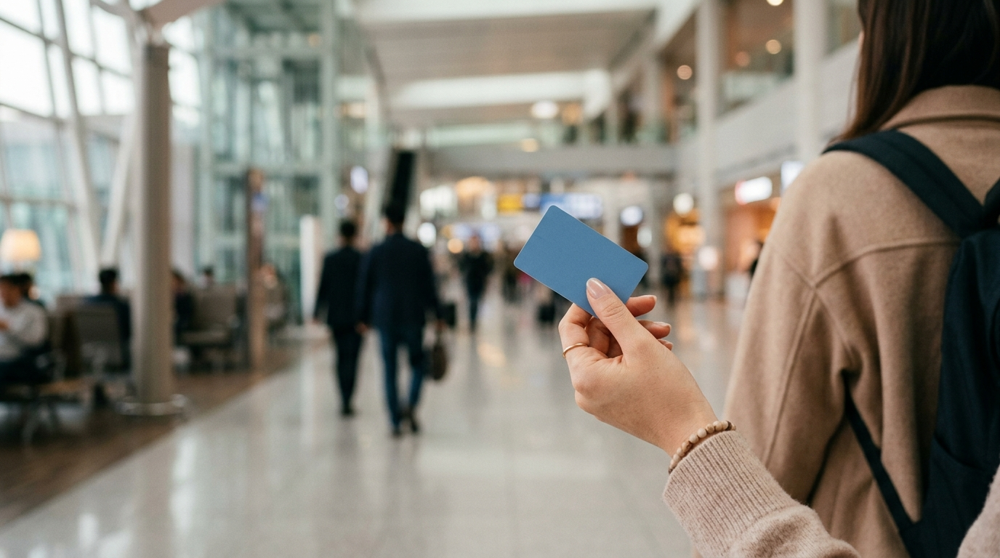

こんにちは、SEOUL TRIP NOTE の J です。

初めての渡韓、または久しぶりの韓国旅行で仁川空港に到着した時、まず考えるのが「どうやってソウル市内へ行くか」ですよね。荷物もあるし、早くホテルに着いて観光を楽しみたい気持ち、とてもよくわかります。

仁川空港からソウル市内へのアクセス方法としては、主に「A'REX（エーレックス）直通列車」と「空港リムジンバス」の2つの選択肢があります。どちらを選べばいいか迷ってしまう方も多いのではないでしょうか。

この記事では、ソウルに住んでいる私 J が、公式情報をもとにA'REXと空港リムジンバスそれぞれの特徴、メリット・デメリット、そして利用方法を詳しくまとめました。この記事を読めば、あなたの旅のスタイルに合った最適な移動手段を見つけることができるでしょう。

## 【結論】仁川空港からソウル市内への移動手段、要点まとめ

まず、A'REXと空港リムジンバス、それぞれの主要な特徴を簡単にまとめました。

*   **A'REX（空港鉄道）直通列車**:
    *   **速さ重視**: 渋滞の心配がなく、最短43分でソウル駅まで到着します。
    *   **目的地**: ソウル駅まで直行。そこから地下鉄やタクシーに乗り換える必要があります。
    *   **利便性**: 事前予約で割引になることがあり、帰国時はソウル駅の都心空港ターミナルを使える場合もあります。
*   **空港リムジンバス**:
    *   **快適さ重視**: 座席が広く、荷物も預けられるため、ゆったり移動できます。
    *   **目的地**: 宿泊先のホテルやその近くの停留所まで直接行ける路線が多いです。
    *   **利便性**: 乗り換えの手間が少ないですが、交通状況によって所要時間が変動します。

ご自身の旅の目的や荷物の量、宿泊先の場所に合わせて、最適な方法を選んでみてください。

## A'REX（空港鉄道）直通列車徹底解説

A'REXは、仁川国際空港とソウル駅を最短で結ぶ高速列車です。特に「速さ」を重視する方におすすめの移動手段です。

### 特徴とメリット

*   **最速の移動手段**: 仁川空港第1ターミナルからソウル駅まで約43分、第2ターミナルからソウル駅まで約51分と、他のどの交通手段よりも早く移動できます。
*   **渋滞の心配なし**: 鉄道なので、道路の渋滞に巻き込まれる心配がありません。フライトの時間が決まっている場合や、時間に余裕がない場合に特に安心です。
*   **広々とした座席**: 全席指定制で、座席間隔も広く快適に過ごせます。
*   **ソウル駅で乗り換え便利**: ソウル駅は地下鉄1号線、4号線、京義・中央線、空港鉄道一般列車の乗り換え駅となっており、ソウル市内の主要エリアへのアクセスが良いです。
*   **都心空港ターミナル（帰国時）**: ソウル駅の都心空港ターミナルでは、対象の航空会社・路線に限ってチェックインや手荷物預け、出国審査ができます。対象の航空会社は時期によって変わるため、空港鉄道（AREX）の公式サイトで最新情報を確認してください。

### デメリット

*   **ソウル駅からの乗り換え**: ソウル駅まで直行しますが、宿泊先がソウル駅周辺でない場合は、地下鉄やタクシーに乗り換える必要があります。大きな荷物を持っての乗り換えは少し大変に感じるかもしれません。
*   **運行時間**: 深夜や早朝には運行していません。最終便の時間を確認しておく必要があります。

### 利用方法と料金の目安

A'REX直通列車は、仁川国際空港第1ターミナル駅と第2ターミナル駅から乗車できます。

1.  **チケット購入**:
    *   **空港窓口**: 仁川空港内のA'REXチケット売り場で購入できます。
    *   **自動券売機**: 英語対応の自動券売機でも購入可能です。
    *   **オンライン予約**: 日本の旅行サイトや韓国の交通アプリなどで事前に予約すると、割引価格で購入できる場合があります。QRコードをかざして乗車できるためスムーズです。
        事前購入の一例として、<a href="https://www.klook.com/ja/activity/1163-airport-to-seoul-city-center-arex-train-incheon/?aid=138920" target="_blank" rel="sponsored noopener">KlookのAREX直通列車チケット</a>があります（料金と利用条件は購入ページで確認してください）。
2.  **乗車**: 購入したチケットまたはQRコードを改札機にかざして入場し、指定された座席に座ります。
3.  **ソウル駅到着**: ソウル駅に到着後、目的地に合わせて地下鉄やタクシーに乗り換えます。

*   **料金の目安**: 片道 大人 11,000ウォン（執筆時点の目安）。直通列車は専用の乗車券が必要で、T-moneyなどの交通カードだけでは乗れません。オンラインの事前購入で割引になることがあります。日本円は最新レートで換算を。

> **ポイント**: 急がない場合は、各駅に停まる「一般列車」もあります。ソウル駅まで1時間ほどかかりますが、交通カードで乗れて料金は直通列車の半額以下（執筆時点の目安で4,000ウォン台）です。

## 空港リムジンバス徹底解説

※ AIで生成したイメージ画像です

空港リムジンバスは、仁川空港からソウル市内の主要なホテルや観光地近くまで、直接アクセスできる便利な交通手段です。

### 特徴とメリット

*   **ホテル近くまで直接アクセス**: 多くの路線があり、宿泊先のホテルやその最寄りのバス停まで乗り換えなしで行ける場合が多いです。大きな荷物を持っての移動が最小限で済みます。
*   **座席が快適**: ゆったりとした座席で、長距離移動でも快適に過ごせます。荷物もバスのトランクに預けられるため、車内で邪魔になりません。
*   **運行本数が多い**: 主要な路線では運行本数が多く、比較的待ち時間が少ないです。
*   **深夜便対応路線も**: 深夜に到着するフライトの場合でも、一部の深夜バスでソウル市内へ移動できます。

### デメリット

*   **交通状況に左右される**: 道路の渋滞によって所要時間が変動する可能性があります。特に通勤時間帯や週末は、時間に余裕を持つ必要があります。
*   **料金がやや高め**: A'REX直通列車と比較すると、料金はやや高めに設定されています。
*   **路線が多数**: 目的地のバス停を正確に把握しておく必要があります。空港の案内所で確認すると良いでしょう。

### 利用方法と料金の目安

仁川空港の各ターミナルから出発するリムジンバスは、到着ロビーのすぐ外にあるバス乗り場から乗車できます。

1.  **路線とバス停の確認**: 宿泊先のホテル名や住所を調べて、どの路線のバスに乗れば良いか、最寄りのバス停はどこかを事前に確認しておきます。空港内の案内所でも尋ねることができます。
2.  **チケット購入**:
    *   **空港窓口**: 到着ロビーにあるチケット売り場で購入します。
    *   **自動券売機**: バス乗り場近くにある自動券売機でも購入できます。
    *   **交通カード**: T-moneyやCashbeeなどの交通カードを利用して乗車することも可能です。
    *   **オンライン**: 路線によっては事前購入もできます。例：<a href="https://www.klook.com/ja/activity/1309-kal-limousine-bus-seoul/?aid=138920" target="_blank" rel="sponsored noopener">Klookの空港リムジンバスチケット（KAL）</a>。
3.  **乗車**: バス乗り場で目的の路線のバスが来るのを待ち、チケットを運転手に見せるか、交通カードをタッチして乗車します。荷物は運転手がトランクに積み込んでくれます。

*   **料金の目安**: 片道 大人 15,000〜18,000ウォン（執筆時点の目安）。路線やバスの種類によって異なります。日本円は最新レートで換算を。

## 【徹底比較】A'REX vs 空港リムジンバス

A'REX直通列車と空港リムジンバス、それぞれの特徴を比較表にまとめました。ご自身の旅の条件と照らし合わせて、最適な選択肢を見つけてください。

| 項目         | A'REX（直通列車）                               | 空港リムジンバス                                  |
| :----------- | :---------------------------------------------- | :------------------------------------------------ |
| **移動時間** | 最短43分（仁川T1-ソウル駅）                     | 60分〜120分以上（交通状況による）                 |
| **料金目安** | 11,000ウォン（事前購入で割引あり）              | 15,000〜18,000ウォン〜（路線による）              |
| **快適さ**   | 全席指定、広々シート、静か                      | ゆったり座席、荷物預け入れ、車窓を楽しめる        |
| **利便性**   | ソウル駅まで直行、地下鉄乗り換えが必要な場合多し | ホテル近くまで直接アクセス、乗り換えなしが多い    |
| **荷物**     | 座席横に持ち込み、または荷物置き場利用          | バス下部のトランクに預け入れ、手ぶらで移動可能    |
| **目的地**   | ソウル駅                                        | ソウル市内の主要エリア・ホテル周辺のバス停      |
| **予約**     | 事前オンライン予約で割引あり                    | 事前予約なしでも乗車可能（混雑時は注意）          |
| **備考**     | 渋滞なし、都心空港ターミナル利用可              | 交通状況に左右される、深夜便対応路線あり          |
| **こんな人に** | スピード重視、ソウル駅から乗り換えに抵抗がない | 荷物が多い、宿泊先まで乗り換えなしで行きたい、ゆったり移動したい |

※上記料金は執筆時点の目安です。最新の料金は各社の公式サイトでご確認ください。日本円は最新レートで換算を。

## 注意点とお得に使うコツ

※ AIで生成したイメージ画像です

仁川空港からソウル市内への移動をよりスムーズでお得にするためのポイントをご紹介します。

> **ポイント**: 交通カード（T-money、Cashbeeなど）は、韓国での公共交通機関の利用に必須のアイテムです。ソウル到着後すぐに利用できるよう、空港のコンビニや地下鉄駅で購入・チャージしておくのがおすすめです。チャージはウォンで行います。

### A'REXをお得に使うコツ

*   **事前オンライン予約で割引**: 日本の旅行サイトや韓国の交通アプリでA'REXのチケットを事前に購入すると、空港窓口で購入するよりも割引が適用されることが多いです。QRコードでスムーズに乗車できます。
*   **交通カードは乗り換え用に**: 直通列車には専用の乗車券が必要ですが、ソウル駅からの地下鉄では交通カードが便利です。空港でチャージしておくと、到着後すぐに乗り換えられます。
*   **都心空港ターミナルを活用**: 帰国便が対象の航空会社・路線なら、ソウル駅でチェックインと出国審査を済ませておくと、仁川空港での手続きを短縮できます。

### 空港リムジンバスをお得に使うコツ

*   **空港内の案内所で路線図を確認**: 仁川空港の到着ロビーには、リムジンバスの案内所があります。宿泊先の住所を伝えれば、最適な路線とバス停、料金を教えてくれます。
*   **深夜バスの活用**: 深夜に到着するフライトの場合でも、ソウル市内へ向かう深夜バスが一部運行しています。路線と時刻は時期によって変わるので、空港の公式サイトや案内所で確認しましょう。
*   **交通カードで支払い**: リムジンバスの運賃も交通カードで支払うことができます。小銭を用意する手間が省け、スムーズに乗車できます。

### 共通の注意点

*   **両替は最小限に**: 空港での両替はレートがあまり良くないことが多いです。空港から市内への交通費や、当面の飲食費に必要な分だけ両替し、残りは市内の両替所で行うのがおすすめです。
*   **最新情報を確認**: 料金や運行時間、免税ルールなどは変更されることがあります。渡航前に必ず各交通機関の公式サイトや韓国観光公社などで最新情報を確認するようにしてください。

## よくある質問（FAQ）

### Q1: 荷物が多い場合、どちらがおすすめですか？

**A**: 荷物が多い場合は、**空港リムジンバス**がおすすめです。バスのトランクに荷物を預けられるため、乗り換えの際に大きな荷物を持って移動する手間が省けます。ホテル近くまで直接行ける路線も多いため、移動が楽になります。

### Q2: 深夜便で到着した場合、どの交通手段がありますか？

**A**: 深夜に仁川空港に到着した場合、A'REX直通列車は運行していません。そのため、**深夜バス**を利用するか、タクシーを利用することになります。深夜バスは路線が限られるので、宿泊先の近くに停まるか事前に確認しておきましょう。タクシーは料金が高くなりますが、直接目的地まで行けるメリットがあります。

### Q3: 交通カード（T-moneyなど）はどこで買えますか？

**A**: 交通カードは、仁川空港の到着ロビーにあるコンビニエンスストア（GS25、CU、セブンイレブンなど）や、空港鉄道の駅で購入できます。カード自体は数千ウォンで、別途チャージが必要です。チャージはコンビニや地下鉄駅の券売機で行えます。

### Q4: 予約は必須ですか？

**A**: A'REX直通列車も空港リムジンバスも、基本的に事前予約なしで乗車できます。ただし、A'REXは事前オンライン予約で割引が適用される場合が多く、座席指定もできるため、特に週末や連休など混雑が予想される時期は予約しておくと安心です。リムジンバスは満席の場合に乗車できない可能性もゼロではありませんが、運行本数が多いため、次のバスを待つことになるでしょう。

## まとめ＆最後に

仁川空港からソウル市内への移動は、A'REX（直通列車）と空港リムジンバスのどちらを選ぶかによって、旅のスタートが大きく変わります。

*   **A'REX**は、**とにかく速くソウル駅まで行きたい方**や、**時間を優先したい方**におすすめです。ソウル駅からの乗り換えは必要ですが、都心空港ターミナルの利用も魅力です。
*   **空港リムジンバス**は、**荷物が多くて乗り換えを避けたい方**や、**宿泊先のホテル近くまで直接行きたい方**、**ゆったりと移動したい方**におすすめです。

ご自身の旅のスタイルや、宿泊先の場所、荷物の量、予算、そして何よりも「何を優先したいか」を考えて、最適な移動手段を選んでくださいね。

この情報が、皆さんのソウル旅行をより快適で楽しいものにする一助となれば嬉しいです。
それでは、素敵な渡韓になりますように！

SEOUL TRIP NOTE の J でした。