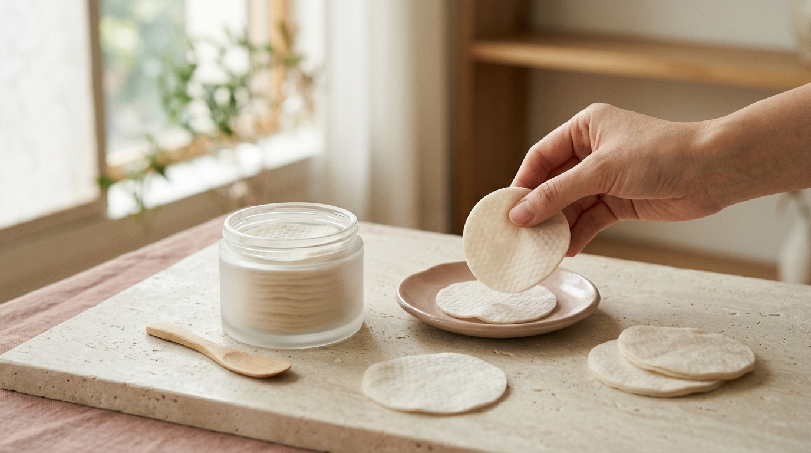

この記事は、SEOUL TRIP NOTE 運営者のJが各ブランドの公式情報と、オンライン上の口コミの傾向をもとにまとめたものです。

「渡韓したらオリヤンへ」という方も多いのではないでしょうか。日本の20代〜30代の間でも定番化しつつある「トナーパッド」。マスク荒れや季節の変わり目でゆらぎやすい肌、生理前のニキビや赤みに悩んでいる声もよく耳にします。

今回は、オリーブヤングで人気の「赤み・ニキビ肌向けトナーパッド」の中から、注目度の高い4種類を成分や特徴から比較します。店頭で迷ったときの選び方の目安や、賢い買い方もあわせて整理しました。

### 【結論】この記事の要点まとめボックス

*   **トナーパッドは時短ケアに便利なアイテム。** 赤み・ニキビ肌には、鎮静・角質ケア系の成分を含むものが選ばれる傾向があります。
*   **オリヤンで人気の4種を比較。** COSRX、MEDIHEAL、Abib、Torridenの中から、肌悩みに合わせて選ぶ目安をまとめました。
*   **セール時期を狙ってまとめ買い。** オリヤンでは定期的に大型セールがあるので、タイミングを確認しておくとお得です。
*   **即時還付も忘れずに。** 1万5千ウォン以上の購入でその場で免税を受けられるため、上手に活用しましょう。

---

## なぜ今、渡韓女子は「トナーパッド」に注目しているの？

韓国スキンケアの中でも特に定着しているトナーパッド。人気の理由は、手軽さと多機能性にあります。

朝の忙しい時間でも、洗顔後に一枚で拭き取るだけで、角質ケアと保湿、そして次に使うスキンケアのなじみをサポート。さらに、部分パックとして気になる部位に数分乗せておき、集中ケアができるのも魅力です。

赤みやニキビに悩む肌にとっては、パッドで優しく拭き取ることで肌表面の不要な角質や汚れを取り除き、配合成分を届けやすくなる点が大きなメリット。「シカトナーパッド」や「ティーツリートナーパッド」のように鎮静系の成分を配合したものが多く、敏感になった肌を穏やかに整える使い方が支持されています。

「時短」と「肌管理」を両立しやすい実用性が、選ばれ続けている理由といえます。

## 【比較レビュー】オリヤンで人気！赤み・ニキビ肌向けトナーパッド4選

※ AIで生成したイメージ画像です

オリーブヤングで特によく見かける人気のトナーパッド4種類をピックアップしました。いずれも赤みやニキビ、肌荒れが気になる方向けとして親しまれているアイテムです。

### 1. COSRX（コスアールエックス）ワンステップオリジナルクリアパッド

*   **特徴**: サリチル酸（BHA）とティーツリー葉油を配合し、角質ケアと皮脂コントロールを目的としたパッドです。エンボス面とソフト面で使い分けができます。
*   **おすすめポイント**: ニキビや毛穴の詰まりが気になる方に人気。毎日使いやすいマイルドな使い心地で、肌のキメをなめらかに整える効果が期待できます。
*   **口コミの傾向**: さっぱりした使用感で、ベタつきが苦手な方から高評価を得ています。エンボス面で拭き取るとザラつきが気にならなくなるという意見や、爽快感のあるティーツリーの香りが朝のスキンケアにぴったりという声も寄せられています。
*   **価格帯目安**: 定価19,500ウォン（執筆時点の目安。セール時は変動します。最新情報は店頭・公式情報をご確認ください）

### 2. MEDIHEAL（メディヒール）ティーツリーカーミングエッセンスパッド

*   **特徴**: 定番のティーツリーマスクパックのエッセンスをパッドにしたアイテム。ティーツリー成分が肌荒れや赤みを穏やかに落ち着かせ、たっぷりと水分を補給します。
*   **おすすめポイント**: 敏感に傾いた肌をいたわりたい時や、突発的な肌荒れ、赤みの集中ケアにぴったり。薄手のパッドなので、気になる部分にピタッと密着させる部分パックとしても重宝します。
*   **口コミの傾向**: パッドひたひたのエッセンス量と密着感の高さが好評です。スーッとした心地よい清涼感があり、使用後は肌がしっとり落ち着くといった感想が多く、乾燥もニキビも気になる肌質の方から支持されています。
*   **価格帯目安**: 定価17,000ウォン（執筆時点の目安。企画セットやリフィル付きなど形態により定価が異なる場合があります）

### 3. Abib（アビブ）ドクダミスポットパッド カーミングタッチ

*   **特徴**: 鎮静成分として知られるドクダミエキスを配合。肌への刺激を抑えつつ、肌のバリア機能をサポートしながら健やかな肌状態へ導きます。
*   **おすすめポイント**: 季節の変わり目や環境の変化で肌がゆらぎやすい方、刺激に弱い敏感肌の方のデイリーケアに最適です。赤みを帯びた肌をマイルドにいたわりたい時の頼もしい味方になります。
*   **口コミの傾向**: パッドがふんわりと厚手で、摩擦を感じにくい優しい肌あたりが絶賛されています。とろみのあるエッセンスによる確かな保湿力や、ドクダミ特有の香りが気にならず使いやすい点も好印象を持たれています。
*   **価格帯目安**: 定価24,000ウォン（執筆時点の目安）

### 4. Torriden（トリデン）ダイブインマルチパッド

*   **特徴**: 公式情報によると、5種類の低分子ヒアルロン酸を配合し、角質層への水分補給に特化したパッドです。弱酸性の低刺激処方で、肌の水分バリアを健やかに保ちます。
*   **おすすめポイント**: 乾燥による肌荒れや、インナードライが引き起こす皮脂トラブルに悩む方にうってつけ。みずみずしい潤いで肌を満たし、メイク前のコンディションを整えたいときにも活躍します。
*   **口コミの傾向**: 薄手でありながら水分保持力に優れ、肌に吸い付くようにフィットすると好評です。ベタつかずにすっと角質層まで浸透して潤いを実感できる点や、荒れがちな肌でも刺激なく使えたという声が目立ちます。
*   **価格帯目安**: 定価22,000ウォン（執筆時点の目安）

## オリーブヤングで賢くゲット！お得な買い方＆チェックポイント

せっかく渡韓するなら、オリヤンでお得に手に入れたいところ。押さえておきたいポイントを整理しました。

### 1. セール時期を狙う

オリーブヤングは、定期的に大規模なセール（「올영세イル / オリョンセイル」）やブランドごとのセールを実施しています。特に四半期ごとの大型セール期間は定価より大幅に安くなるチャンスです。渡韓の時期と重なるか、事前に公式サイトやSNSで確認しておくとスムーズです。人気商品は「1+1（ワンプラスワン）」などのセットで並ぶことも珍しくありません。

### 2. 企画セットはお得になりやすい

セール期間以外でも、人気商品には「企画セット」がよく登場します。本体に詰め替え用パッドやミニサイズのトナー、美容液などが付属している限定品です。単品価格と変わらない値段、あるいは少しの上乗せでお得に購入できるケースが多いため、棚のポップをよく見比べてみてください。

### 3. 免税（即時還付）を活用

オリヤンでは、1店舗で15,000ウォン以上購入すると、レジでその場で税金分を差し引いてもらえる「即時還付」サービスが利用できます。パスポートを提示するだけで適用されるため、忘れずに提示しましょう。

> 💡 **Jの豆知識：即時還付の具体的なステップ**
>
> 1. レジで会計をする際に「텍스프리 해주세요 (テクスプリ ヘジュセヨ / 免税してください)」と伝えます。
> 2. パスポートを提示します。
> 3. その場で税金分が差し引かれた金額で決済されます。
>
> 手続きは非常にシンプルです。ただし、一部の小規模店舗などでは取り扱いが異なる場合もあるため、会計時に確認しておくと安心です。

### 4. テスターは積極的に活用

気になるトナーパッドを見つけたら、まずはテスターでパッドの厚みやエッセンスのテクスチャー、香りなどを確かめましょう。直接触れてみることで、摩擦感の好みや肌なじみを判断しやすくなります。刺激が心配な方は、腕の内側などで試してみるのが安心です。

## 【徹底比較】赤み・ニキビ肌向けトナーパッド4種比較表

| 製品名 | 主要成分 | 期待できる効果 | パッドの特徴 | テクスチャー | 価格帯目安（ウォン） | こんな人におすすめ |
| :--- | :--- | :--- | :--- | :--- | :--- | :--- |
| COSRX ワンステップオリジナルクリアパッド | サリチル酸(BHA), ティーツリー | 角質ケア、皮脂コントロール、ニキビ予防 | エンボス面/ソフト面、薄手、やや硬め | さっぱり | 定価 19,500W | ニキビ、毛穴の詰まり、肌のザラつきが気になる方 |
| MEDIHEAL ティーツリーカーミングエッセンスパッド | ティーツリーエキス、シカ | 赤み・ニキビ鎮静、水分補給 | 薄手、柔らかめ、ひたひた | しっとり | 定価 17,000W | 突発的なニキビ、肌の赤み、敏感になった肌を落ち着かせたい方 |
| Abib ドクダミスポットパッド カーミングタッチ | ドクダミエキス | 鎮静、肌バリア強化、保湿 | 厚手、非常に柔らかい、なめらか | とろみ、しっとり | 定価 24,000W | 敏感肌、乾燥による赤み、肌のゆらぎが気になる方 |
| Torriden ダイブインマルチパッド | 5D低分子ヒアルロン酸 | 深層保湿、水分バリア強化、低刺激 | 薄手、柔らかい、たっぷり水分 | さっぱり、潤う | 定価 22,000W | インナードライ、乾燥による肌荒れ、しっかり水分補給したい方 |

※価格は執筆時点の定価目安です。セールや企画セットにより実売価格は変動します。効果の感じ方には個人差があります。

---

> ⚠️ **注意点：肌質に合わせた選び方**
>
>* **オイリー肌・ニキビができやすい方**：COSRXやMEDIHEALのような、皮脂コントロールや鎮静をうたうものが候補になります。
>* **乾燥肌・敏感肌の方**：AbibやTorridenのような、低刺激で保湿や肌バリア機能のサポートに重点を置いたものが扱いやすいでしょう。
>
>肌の状態を観察しながら、優先したいケアに合わせて選んでみてください。

---

## ❓ よくある質問（FAQ）

### Q1. トナーパッドは毎日使っていいの？

> A. 多くの製品は毎日の使用を想定していますが、角質ケア成分（BHAなど）が配合されているものは、肌の様子を見ながら週に2〜3回から始めて、徐々に使用頻度を上げていくのが無難です。刺激を感じる場合は使用間隔を空けるか、保湿・鎮静に特化した製品に切り替えましょう。

### Q2. 朝と夜、どっちに使うのが効果的？

> A. 朝夜それぞれに使い道があります。
> * **朝**: 洗顔後の肌を整え、メイクノリを良くする効果が期待できます。さっぱりタイプのパッドで軽く拭き取ると、就寝中に分泌された余分な皮脂や角質をオフできます。
> * **夜**: クレンジング後の肌を整え、美容液などの浸透を助けます。乾燥や赤みが気になる部分に数分乗せて部分パックにする使い方も効果的です。

### Q3. 敏感肌でも使えるトナーパッドはありますか？

> A. 敏感肌向けに設計された製品も豊富です。今回取り上げた中では、**Abib ドクダミスポットパッド カーミングタッチ**や**Torriden ダイブインマルチパッド**は刺激感が少なく使いやすいという評価が集まっています。購入前にテスターでパッドの摩擦感や成分表示を確認することをおすすめします。

### Q4. オリーブヤングで一番安く買う方法は？

> A. 四半期ごとの大型セール期間中に「1+1（ワンプラスワン）」などの企画セットを狙うのが最も効率的です。また、15,000ウォン以上購入して即時還付サービスを利用すれば、その場で税金分が引かれます。渡韓前にオリヤンの公式アプリなどで最新のイベント情報をチェックしておくと無駄がありません。

## まとめ

手軽に肌のキメを整えられるトナーパッド。今回取り上げたCOSRX、MEDIHEAL、Abib、Torridenは、いずれも赤みやニキビのケアアイテムとして現地でも長く支持されている定番品です。

肌質や季節によって最適な成分は異なります。明洞や弘大などの大型店は夕方以降混み合ってテスターが見づらくなることもあるため、午前中など比較的空いている時間帯に立ち寄り、質感や香りを確かめながら選んでみてください。

（SEOUL TRIP NOTE・J）
