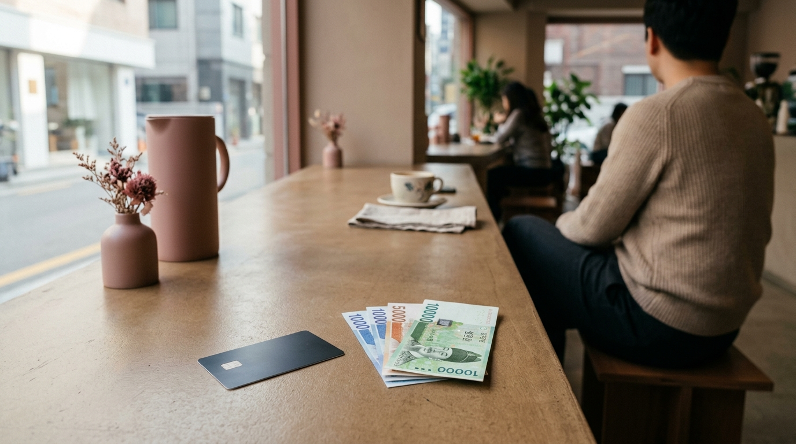

こんにちは、SEOUL TRIP NOTE の J です。

韓国の美容クリニックで施術を受ける際、料金体系や支払い方法の事前確認は欠かせません。「提示額より実際の請求が高かった」「免税されると思っていたら対象外だった」といったトラブルを避けるためにも、現地の最新事情を把握しておく必要があります。

見積もりのチェックポイント、支払い時の注意点、そして制度終了に伴い注意が必要なタックスリファンドの現状を解説します。

### 【結論】渡韓美容の費用で損しないための要点まとめ

*   **見積もりは施術内容・内訳・追加料金を細かく確認する**：麻酔代やアフターケア代が含まれているか、カウンセリング時に疑問点を残さないようにします。
*   **支払いはウォン建て決済を選び、カード手数料も把握しておく**：日本円建て（DCC）決済は手数料が割高になる傾向があります。
*   **美容医療のタックスリファンド（免税）は2025年末で終了**：施術費用の税金還付特例は終了したため、免税を見越した予算組みは避ける必要があります。

---

### 渡韓美容の見積もり、ここをチェック！

美容クリニックの施術費用は、クリニックの規模や施術内容によって大きく異なります。後から予算オーバーにならないよう、見積もりの段階で内訳を精査しましょう。

#### 1. 施術内容と料金の確認

カウンセリングでは提示された金額に何が含まれているのか、明確に確認することが大切です。

*   **基本料金に含まれるもの**: 施術代金だけでなく、麻酔代、処方箋代、鎮静管理、アフターケア（パックやLED照射など）が含まれているか確認します。これらがすべてオプション料金として加算されるクリニックも珍しくありません。
*   **パッケージ料金と単体料金**: 複数のレーザーや注入系を組み合わせたパッケージプランはお得に見えますが、自分にとって不要な施術が含まれていないか精査が必要です。
*   **カウンセリング時の質問リスト**:
    *   「提示された料金に麻酔代やアフターケア代は含まれていますか？」
    *   「施術後に別途発生する可能性のある費用はありますか？」
    *   「万が一、腫れやアレルギーなどのトラブルが出た場合の再診・処置費用はどうなりますか？」

#### 2. 追加料金の確認

見積もり以外に発生しやすい費用も想定しておきましょう。

*   **再診料・経過観察費用**: 抜糸や経過観察で再来院が必要な場合、再診料がかかるか確認します。
*   **通訳費用**: 日本語スタッフや医療通訳が常駐しているクリニックでは無料の場合が多いですが、外部通訳の手配や一部クリニックでは別途通訳料が設定されていることもあります。

#### 比較：クリニック選びのチェックポイントと料金目安（ウォン）

| チェックポイント           | 詳細                                                                                                                                                                                              | 料金目安（ウォン）                                                 |
| :------------------------- | :------------------------------------------------------------------------------------------------------------------------------------------------------------------------------------------------ | :----------------------------------------------------------------- |
| **カウンセリングの丁寧さ** | 施術内容、リスク、料金について十分に説明してくれるか。不要な施術を無理に勧めてこないか。                                                                                                          | 多くのクリニックで無料（一部有料の場合あり）                       |
| **施術料金の透明性**       | 見積もりが明瞭で、追加料金の有無が明確か。パッケージ料金と単体料金の内訳が分かりやすいか。                                                                                                          | 施術内容によるが、基本的なレーザーや管理は10万〜50万ウォン台が目安 |
| **アフターケアの充実度**   | 施術後のケアプランが提供されるか。再生クリーム塗布、鎮静パック、経過観察などが含まれるか。                                                                                                        | 施術料金に含まれる場合と、別途数万ウォン程度かかる場合あり         |
| **日本語対応の有無**       | 日本語が話せるスタッフや通訳者が常駐しているか。専門用語を伴うリスク説明を正しく理解できるか。                                                                                                    | サービスに含まれる場合が多いが、有料の場合もある                   |
| **免税対応について**       | 外国人観光客向けの美容医療付加価値税還付特例は2025年12月31日で終了。施術費用に対する税金還付は不可。                                                                                              | 還付なし（一般物品の免税とは異なります）                         |

> **ポイント**
> 同一の医療機器や薬剤であっても、ショット数や注入量、担当医の技術料によって価格差が生じます。極端に安価なクリニックはショット数が少ないケースもあるため、価格だけでなく施術の規格まで比較することをおすすめします。

---

### 支払い方法と注意点｜ウォン建てがお得？

※ AIで生成したイメージ画像です

支払い方法の選択によっても、最終的な日本円での支払額が変わってきます。

#### 1. 主要な支払い方法

*   **現金（ウォン）**: 明洞などの公認両替所であらかじめ両替したウォンで支払う方法です。両替の手間や多額の現金を持ち歩くリスクがあります。
*   **クレジットカード**: VISA、Mastercard、JCBなど主要ブランドが広く利用可能です。
*   **デビットカード・海外プリペイドカード**: 口座直結型やアプリチャージ型のカードも普及しています。事前に利用限度額やチャージ残高を確認しておきましょう。

#### 2. ウォン建て決済のメリット

クレジットカードで決済する際、端末上で「日本円（JPY）」か「韓国ウォン（KRW）」の選択を求められることがあります。これはDCC（Dynamic Currency Conversion＝自国通貨決済）と呼ばれる仕組みです。

原則として**「ウォン建て」を選ぶ方が手数料を抑えられます**。

*   **ウォン建て決済**: 現地通貨で決済し、カード会社が定める基準レートで後日日本円に換算されます。
*   **日本円建て決済（DCC）**: その場で日本円の支払額が確定する利便性はありますが、店舗側や決済代行会社が独自に設定した割高な為替レートが適用され、数パーセントの手数料が上乗せされるケースが一般的です。

また、カード会社各社が設定する海外事務手数料にも留意しましょう。近年各社で手数料の改定が行われており、一般的に利用金額の1.6%〜3.85%程度（カードによっては4%以上）が上乗せされます。手持ちのカードの手数料体系を事前に確認しておくと安心です。

#### 3. 為替レートの変動

クレジットカードのウォン建て決済では、決済日ではなくカード会社の決済センターにデータが届いた日（数日後）のレートが適用されます。円安・円高の動向によって請求額が前後する点は考慮しておきましょう。

---

### 【重要】美容医療のタックスリファンド（税金還付）は2025年末で終了

渡韓美容の費用計画において、特に注意が必要なのが税金還付の扱いです。

#### 1. 美容医療免税制度の終了について

韓国では、外国人観光客を対象に美容整形や皮膚科施術の付加価値税（10%）の一部を還付する「外国人観光客美容医療付加価値税還付特例制度」が長年実施されていました。しかし、**この特例制度は2025年12月31日をもって終了しました**。

現在、韓国の皮膚科や美容クリニックで施術を受けても、施術費用に対するタックスリファンドは受けられません。過去の情報をもとに「施術代から約7〜8%戻ってくる」と計算していると予算オーバーの原因になります。

#### 2. 一般ショッピングの免税（事後免税制度）との違い

美容医療の免税特例は終了しましたが、コスメショップやマート、百貨店などで行われている一般的な物品の「事後免税（Tax Refund）」制度は継続しています。

*   **一般物品の免税基準**: 執筆時点の目安として、1店舗につき1回1万5000ウォン以上の買い物が対象です。
*   **クリニックで販売されるドクターズコスメ**: クリニック自体が一般の免税加盟店として登録している場合、院内で購入した市販のスキンケア用品や化粧品に限り、一般物品として免税レシートが発行されるケースがあります。物販の免税可否は各院の対応状況によるため、購入時に確認してください。

---

### よくある質問（FAQ）

**Q1: 事前のカウンセリングは日本語でできますか？**
A1: ソウルの外国人受け入れ実績が多いクリニックでは、日本人スタッフや専任の日本語通訳が常駐しているケースが一般的です。公式LINEなどを通じて予約する段階で、日本語対応を希望する旨を伝えておくとスムーズに案内されます。

**Q2: 支払い時に分割払いは可能ですか？**
A2: 韓国現地の決済端末では、日本のクレジットカードの分割払いは選択できません。原則として「一括払い」での決済となります。分割払いを希望する場合は、決済完了後に日本のカード会社のウェブサイトやアプリから「あとから分割」「あとからリボ」へ変更手続きを行う形になります（所定の手数料が発生します）。

**Q3: 美容医療のタックスリファンドは現在も利用できますか？**
A3: 利用できません。外国人観光客向けの美容医療付加価値税還付制度は2025年12月31日に終了しました。現在、施術代金に対する還付申請書の発行は行われていません。

**Q4: クリニックで購入した化粧品は免税対象になりますか？**
A4: 施術代金そのものは免税対象外ですが、院内で販売されているスキンケア製品やコスメなどの物品は、そのクリニックが一般の「事後免税店（Tax Refund加盟店）」として登録されていれば、1回1万5000ウォン以上の購入で免税対象となる場合があります。希望する場合は会計時に免税手続きが可能か窓口で確認してください。

---

### まとめ

渡韓美容をスムーズに進めるためには、事前の総額把握と現地での決済管理が重要です。

*   基本料金に含まれる項目（麻酔・鎮静・アフターケア）を見積もり時に確認する
*   クレジットカード決済時は「ウォン建て」を指定し、カード会社の海外事務手数料も考慮する
*   美容医療のタックスリファンド制度は終了しているため、免税前提の予算組みを避ける

制度や為替の状況を正しく把握したうえで、無理のない施術計画を立ててください。