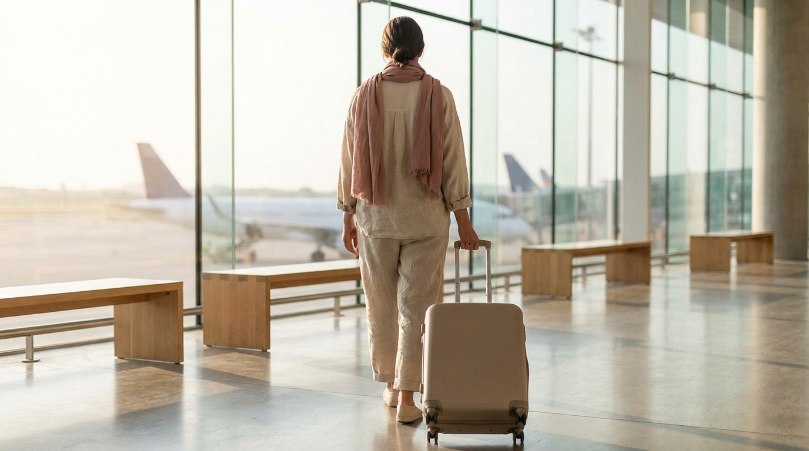
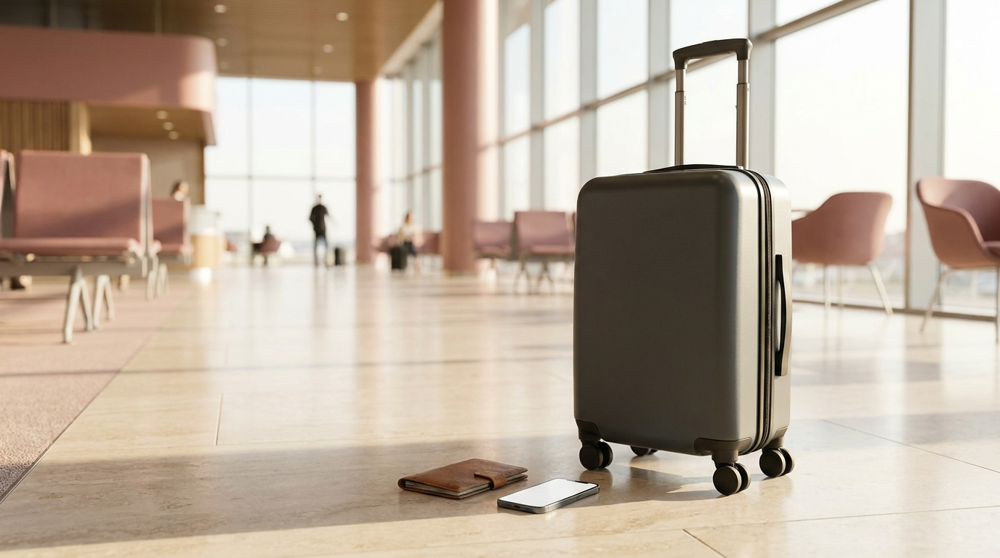

こんにちは、SEOUL TRIP NOTE の J です。

ソウル旅行の最終日、多くの旅行者が悩むのが空港への到着時間や免税手続きの進め方です。仁川国際空港は敷地が非常に広く、時間帯によっては保安検査場やチェックインカウンターに長い列ができます。

仁川空港出国の基本ステップ、到着時間の目安、オンライン免税店の受取場やタックスリファンドの手順、コスメなどの液体物に関する注意点について、公式情報と実際の動線をもとに整理しました。

> **この記事の要点まとめ**
> - 到着目安：通常期は**フライト出発の2時間半〜3時間前**、連休や免税手続き・受取が多い場合は**3時間〜3時間半前**が安心です。
> - 第1ターミナルと第2ターミナルで利用航空会社が分かれているため、事前にEチケットでターミナル番号を必ず確認してください。
> - コスメ・トナーパッド・ジェル状シートマスクなどの液体物は、100mlを超える容器の場合、必ずスーツケースに入れて預け入れる必要があります。
> - オンライン免税店で購入した免税品の引き渡し場は「出国審査を通過した後の制限エリア」にあります。

---

## 仁川空港には何時間前に到着すべき？ターミナルと混雑傾向

仁川空港出国では、航空会社のチェックインカウンターが混み合うだけでなく、保安検査や出国審査、さらに免税手続きの移動距離も長くなります。

### 到着時間の目安（執筆時点の目安）

- **通常期のフライト**: 出発の**2時間半〜3時間前**
- **大型連休・長期休暇・早朝便**: 出発の**3時間〜3時間半前**
- **免税品の受け取りやタックスリファンドがある場合**: 最低でも**3時間前**

仁川空港は、午前中（7:00〜9:30頃）と夕方（16:00〜18:30頃）に便が集中し、保安検査場が混み合いやすい傾向があります。ソウル市内から仁川空港への移動にも空港鉄道A'REXの直通列車で約43分〜51分、一般列車やリムジンバスで約60分〜80分以上かかります。移動方法の選び方は、[仁川空港からソウル市内へ！A'REXとリムジンバス徹底比較](/blog/incheon-airport-to-seoul-arex-bus/)でも詳しく解説しています。

### 利用ターミナル（第1 vs 第2）を必ず確認

仁川空港には「第1旅客ターミナル（T1）」と「第2旅客ターミナル（T2）」があり、運行する航空会社によって分かれています。航空会社の再編や移転が進んでいるため、過去の記憶だけで判断せず、必ず最新情報を確認してください。

- **第1ターミナル（T1）**: チェジュ航空、ティーウェイ航空、イースター航空、エアプレミア、海外航空会社（一部除く）など
- **第2ターミナル（T2）**: 大韓航空、アシアナ航空、ジンエアー、エアプサン、エアソウル、デルタ航空、エールフランス、KLMオランダ航空など

※アシアナ航空は2026年1月より第2ターミナルへ移転しました。ジンエアー、エアプサン、エアソウルも第2ターミナルを利用します。

ターミナル間を移動する無料連絡バスは運行していますが、移動に15〜20分程度かかるため、ターミナルを間違えると搭乗時刻に遅れる原因になります。予約時の航空券情報（Eチケット）で事前に確認しておきましょう。

---

## 仁川空港の出国手続き 5つの基本ステップ



<p class="img-cap">※ AIで生成したイメージ画像です</p>

仁川空港に到着してから飛行機に搭乗するまでの基本的な流れです。

```
ステップ1：搭乗手続き（チェックイン）＆ 預け入れ手荷物預け
    ↓
ステップ2：税金還付（タックスリファンド）の税関申告（必要な場合）
    ↓
ステップ3：保安検査（手荷物検査・ボディチェック）
    ↓
ステップ4：出国審査（自動化ゲート等）
    ↓
ステップ5：制限エリア（免税品受け取り・タックスリファンド払戻・搭乗）
```

### ステップ1：搭乗手続きと荷物預け

空港の出発ロビー（3階）にある航空会社のカウンター、またはセルフチェックイン機（キオスク）で搭乗券を発券し、スーツケースを預けます。

受託手荷物を預けた後は、X線検査が行われるため、カウンター周辺で**約5〜10分待機**するよう案内されるのが一般的です。荷物にリチウムイオンバッテリーやライターなどの危険物が混入していないことが確認されたら、次のステップへ進みます。

### ステップ2：税金還付（タックスリファンド）の事前手続き

市内のオリーブヤングやコスメショップで「事後免税（Tax Refund）」の書類を受け取っている場合、出国前にKIOSK（自動キオスク端末）でパスポートとレシートを読み取らせます。

1件あたりの還付税額が一定基準を超える高額商品や税関確認が必要と表示された場合は、税関検査カウンターで現物提示を求められることがあります。そのため、高額な免税品はスーツケースを預ける前に確認端末へ通すのが安全です。免税の全体像や市内即時還付との違いは、[韓国の免税ショッピング完全ガイド](/blog/korea-tax-free-shopping-guide/)および[オリーブヤングの免税（タックスリファンド）完全ガイド](/blog/oliveyoung-tax-refund-guide/)で整理しています。

### ステップ3：保安検査

搭乗券とパスポートを提示して保安検査場へ入場します。上着を脱ぎ、ノートパソコンやタブレット端末、液体物はカバンから出してトレーに載せます。

### ステップ4：出国審査

韓国の出国審査は自動化ゲートが普及しており、パスポートの読み取りと指紋・顔写真の照合で通過できるケースが一般的です。

### ステップ5：制限エリア（免税品受取・搭乗）

出国審査を抜けたエリアが制限エリア（免税エリア）です。ここでタックスリファンドの現金受取や、インターネット免税店で購入した商品の引き取り、免税店での買い物を済ませ、指定された搭乗ゲートへ向かいます。

---

## 免税手続きとオンライン免税店の受け取り方法

空港での免税手続きには「タックスリファンドの払戻」と「免税店購入品の受け取り」の2種類があります。

### 1. タックスリファンド（空港還付）の受け取り

市内の店舗でその場で免税されず、空港での還付用レシートをもらっている場合の流れです。

1. **保安検査前**: 出発階（3階）のKIOSK端末でレシートのバーコードとパスポートをスキャン
2. **出国審査後**: 制限エリア内の「Tax Refundカウンター」または「還付KIOSK端末」へ行く
3. **払戻し**: 現金（ウォンや日本円など）またはクレジットカードへの返金を受け取る

### 2. オンライン免税店（ロッテ・新世界など）の品物受取

ロッテインターネット免税店や新世界免税店のアプリで購入した商品は、出国審査を通過した後の「免税品引渡場（Duty Free Pick-up Desk）」で受け取ります。

- **引渡場の場所**: 第1ターミナルは43番・45番ゲート付近の上階（4階）や、コンコース（搭乗棟119番ゲート付近）など複数箇所に分かれています。第2ターミナルは252番ゲート付近の上階などに設置されています。
- **受け取りに必要なもの**: パスポート、搭乗券（またはモバイル搭乗券）、アプリ等の受取番号（交換券バーコード）
- **注意点**: 朝の混雑時は受取窓口で整理券が配られ、受け取りまでに待機列ができるケースもあります。購入時の案内画面で指定された引渡場の位置を事前に確認しておきましょう。

---

## 液体物持ち込み・預け入れ荷物の重要ルール

コスメの買い出しが多い渡韓では、液体物の機内持ち込み制限に特に注意が必要です。

### 機内持ち込み手荷物の液体物ルール

国際線の機内持ち込みルールは厳格に定められています。

- **容器の容量**: 1つの容器あたり**100ml（または100g）以下**
- **透明ジッパー付き袋**: 容量**1リットル以下**（縦横合計40cm以内、透明プラスチック製ジッパー袋）に、すべての容器が余裕を持って収まること
- **数量**: 1人につき**1袋のみ**持ち込み可能

> **旅行者が間違えやすい液体物の一例**
> - シートマスク（美容液がたっぷり入ったパウチは液体物とみなされる場合があります）
> - トナーパッド（容器内に大量のエッセンスが入っているため液体物扱いです）
> - チューブ入りコスメ（日焼け止め、BBクリーム、ハンドクリーム、リップグロス）
> - ペースト状の食品（コチュジャン、キムチ、味噌、缶詰など）

100mlを超える容器に入った化粧水やクリーム、トナーパッドの大容量ボトルなどは、**必ずチェックイン時に預けるスーツケース（受託手荷物）**に入れてください。中身が半分以下に減っていても、容器自体の表記が100mlを超えていると機内持ち込み保安検査で破棄対象になります。

### オンライン免税店で購入した液体物について

出国審査後の免税品引渡場で受け取った化粧水や香水などの液体物は、空港が密閉する「不正開封防止袋（STEBs）」に入れられています。

- 日本への直行便であれば、この袋を開封せずにそのまま機内に持ち込むことができます。
- 乗り継ぎ便（経由便）を利用する場合は、乗り継ぎ地の空港の保安検査で没収される恐れがあるため注意が必要です。

---

## 【比較】出国関連手続きの所要時間と注意点

空港到着後の各手続きにかかる時間の目安とポイントです。

| 手続き項目 | 場所 | 所要時間の目安（執筆時点の目安） | 混雑時の目安（連休等） | チェックポイント |
| :--- | :--- | :--- | :--- | :--- |
| **航空会社チェックイン & 荷物預け** | 一般エリア 3階出発ロビー | 15〜30分 | 45〜60分以上 | モバイルチェックインを済ませておくと専用カウンターで短縮可能 |
| **タックスリファンド税関確認** | 一般エリア 3階KIOSK | 5〜10分 | 15〜20分 | 高額品（単価高額レシート）は荷物を預ける前にKIOSKで確認 |
| **保安検査 & 出国審査** | 各出国口（ゲート） | 15〜30分 | 45〜60分以上 | 事前にスマートパス（Smartpass）を登録しておくと専用レーンを利用可能 |
| **オンライン免税品受け取り** | 制限エリア 引渡場 | 10〜15分 | 20〜35分以上 | 引渡場のゲート番号を購入アプリで事前確認。整理券が必要な場合あり |
| **タックスリファンド払戻受取** | 制限エリア 還付カウンター | 5〜10分 | 15〜25分 | 現金（ウォン・円等）またはカード返金を選択 |
| **搭乗ゲートへの移動** | 制限エリア内 | 10〜15分 | 15〜25分 | コンコース（搭乗棟）へ移動する場合はシャトルトレイン利用で＋15分以上 |

※所要時間は当日の便の混雑度や時間帯によって大きく変動します。

---

## スムーズに出国するための2つの時短ワザ



<p class="img-cap">※ AIで生成したイメージ画像です</p>

### 1. ICNスマートパス（Smartpass）アプリの活用

仁川空港では顔認証技術を活用した「スマートパス」サービスが導入されています。
事前に専用アプリ「ICN Smartpass」にパスポート情報と顔写真、搭乗券を登録しておくと、保安検査場への入場時に専用レーンから顔認証のみで入場できます。一般レーンの列が長い場合に時間短縮が期待できるとされています。
ただし、保安検査そのものや搭乗口ではパスポートと搭乗券の実物確認が必要となるため、手元には必ず用意しておきましょう。

### 2. ソウル駅の都心空港ターミナル（事前搭乗手続き）の利用

当日に仁川空港発のフライトを利用し、対象となる航空会社かつA'REX直通列車の利用券をお持ちの場合、**ソウル駅地下2階の都心空港ターミナル**で事前にチェックインと荷物預け、出国審査を完了できます。

- ソウル駅で荷物を預けて身軽になれる
- 空港到着後は一般の出国口ではなく専用出国通路を利用できるため、保安検査の待ち時間を大幅に削減できる

利用可能な航空会社や受付締切時刻（出発便の3時間〜3時間20分前までなど、執筆時点の目安）に条件があるため、最新の運行基準を公式サイトで確認してください。

---

## よくある質問（FAQ）

### Q1. オリーブヤングで買ったコスメは手荷物とスーツケースのどちらに入れるべきですか？
A. 100ml（または100g）を超える容器に入ったトナー、クレンジングオイル、クリーム、トナーパッドなどは、すべてスーツケース（受託手荷物）に入れて預けてください。100ml以下の小さなコスメのみ、1リットル以内の透明ジッパー付き袋にまとめて機内へ持ち込めます。

### Q2. 第1ターミナルのコンコース（搭乗棟）とは何ですか？
A. 第1ターミナルから地下のシャトルトレイン（無料移動列車）に乗って移動する離れの搭乗棟です。主に一部の海外航空会社などが使用します。一度シャトルトレインでコンコースへ移動すると第1ターミナル本館には戻れないため、本館での免税品受け取りや買い物をすべて終えてから移動してください。

### Q3. 空港免税店での買い物にパスポートは必要ですか？
A. はい、制限エリア内の免税店であっても、商品の会計時にはパスポートと搭乗券の提示が毎回求められます。すぐに取り出せるよう手元に準備しておくとスムーズです。

### Q4. タックスリファンドの現金受取は日本円と韓国ウォンのどちらが良いですか？
A. 空港の還付カウンターでは受け取る通貨を選べることが多いです。次回も韓国旅行の予定がある場合は両替手数料がかからないウォンでの受け取りが便利ですが、端数が出た場合は日本円で受け取るか、クレジットカードへの後日返金を選択する旅行者が多いとされています。

---

## まとめ

仁川空港での出国は、空港の規模の大きさと利用者の多さから移動と待ち時間が発生しやすいのが実情です。

1. **基本は出発の2時間半〜3時間前（免税受け取りがある場合は3時間以上前）に到着する**
2. **利用航空会社の就航ターミナル（T1またはT2）を事前に確認する**
3. **液体物（トナーパッドや大容量シートマスク含む）はスーツケースに入れて預ける**
4. **オンライン免税店の受け取り場所と搭乗ゲートの場所を出国後すぐに確認する**

事前にターミナルや荷物のルールを把握し、余裕を持ったスケジュールで動きましょう。フライト情報や各窓口の営業状況は変更される場合があるため、出発前には各航空会社や仁川空港の公式サイトで最新情報を確認してください。