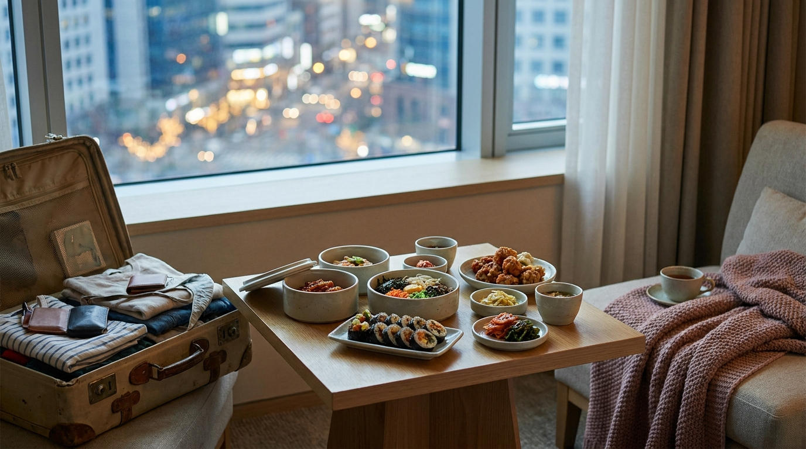
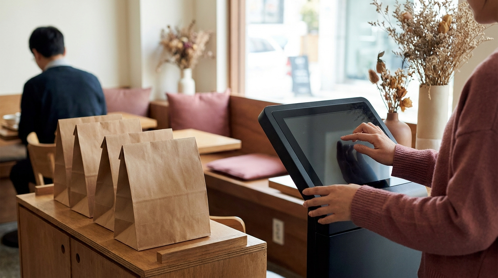

こんにちは、SEOUL TRIP NOTE の J です。

韓国旅行の夜、買い物を終えて疲れたあとに「ホテルで出前を取ってチキンやトッポッキを食べたい」と考える方は多いのではないでしょうか。ドラマやSNSで目にする韓国のペダル（配達）文化は、渡韓グルメの醍醐味のひとつです。

いざアプリをダウンロードしてみると「本人確認ができない」「日本のクレジットカードが使えない」というトラブルに直面することが少なくありません。

旅行者が韓国の配達アプリを使える条件、ホテルでの受け取り手順、アプリが使えないときの代わりの方法について整理しました。

> **この記事の要点まとめ**
> - 一般的な韓国の出前アプリは「韓国内で通話・SMSが受信できる電話番号」や「韓国の本人確認」が必要な場合が多い。
> - 旅行者向けに海外クレジットカード決済に対応したサービスや、多言語対応の注文プラットフォームも登場している。
> - ホテルで出前を頼む際は、客室前までの配達が禁止されているケースが多く、ロビーでの受け取りが基本。
> - アプリの利用が難しい場合は、お店での「ポジャン（テイクアウト）」やフロントへの相談が確実な代替手段になる。

---

## 旅行者が韓国の配達アプリを使う際のハードル

韓国にはさまざまな出前アプリがあり、地元では日常に欠かせないインフラです。一方で、旅行者が利用しようとするといくつかの制限にぶつかるのが一般的とされています。

### 1. 韓国の本人確認システム（実名認証）
多くのアプリでは、会員登録時に韓国内の通信会社を通じた本人確認（PASS認証やSMS認証）が求められます。日本の通信キャリアのローミングや、データ通信専用のeSIMでは認証を通過できないケースがほとんどです。

### 2. 決済手段の制限
決済画面で韓国内で発行されたクレジットカードや現地の電子決済しか選べない仕組みになっていることがあります。海外発行のVISAやMastercardに対応していない場合、注文を完了できません。

### 3. 配達員からの連絡手段
韓国の出前では、建物の入り口がオートロックの場合や住所が分かりにくい際、配達員から電話がかかってくることが日常的です。通話可能な電話番号がないと、商品を受け取れないトラブルにつながるリスクがあります。

旅行中に通信環境を準備する際は、データ通信だけでなく受信用電話番号が付いているかどうかも重要です。通信手段の選び方については、[韓国旅行eSIMおすすめ比較！無制限・電話番号付き・設定方法を解説](/blog/korea-travel-esim-recommendation-2026/)でも詳しく解説しています。

---

## 旅行者がホテルで出前を楽しむための3つの方法

※ AIで生成したイメージ画像です

「アプリが使えないなら出前は諦めるしかないのか」というと、そうではありません。旅行者がホテルでグルメを楽しむには主に3つのアプローチがあります。

### 方法1：海外発行カードに対応した旅行者向けサービスを利用する
外国人観光客向けに、海外発行のクレジットカードで決済できるサービスや多言語対応の注文導線を用意する動きが広がっています。
一部の出前サービスでは、グローバルカード（海外VISA/Mastercard等）での事前決済を選択できる機能が段階的に導入されています。注文ごとに利用規約や対応言語、必要な情報（SMS認証の有無など）が異なるため、最新の公式情報を確認することが大切です。

### 方法2：宿泊先のフロントに相談・代行を依頼する
小規模なホテルやレジデンス、ゲストハウスなどでは、フロントのスタッフが出前注文を手伝ってくれる場合があります。
食べたいメニューや店舗をあらかじめ控えておき、フロントで「出前の注文をお願いできますか？（배달 주문 부탁드려도 될까요?）」と相談してみる方法です。代金はその場でスタッフに現金やカードで直接支払う形になります。すべての宿泊施設が対応してくれるわけではないため、混雑時を避けて丁寧に確認しましょう。

### 方法3：店頭で「ポジャン（テイクアウト）」して持ち帰る
もっとも確実でトラブルが少ないのが、店舗に直接行ってテイクアウト（韓国語で「ポジャン / 포장」）する方法です。
ホテルの近くにあるチキン専門店や粉食（トッポッキやキンパ）のお店なら、店内で食べるよりも待ち時間が短く、持ち帰り用のパッケージに梱包してくれます。自分の目でメニューを確認でき、支払いにWOWPASSや日本のクレジットカードがそのまま使える安心感があります。

---

## 出前とテイクアウトの比較

旅行者が夜食や部屋ご飯を用意する際の選択肢をまとめました。

| 項目 | 旅行者向け出前サービス | ホテルフロント代行 | 店頭ポジャン（持ち帰り） |
| :--- | :--- | :--- | :--- |
| **言語対応** | 英語・日本語（サービスによる） | 韓国語・英語（日本語対応宿も） | 指差し・簡単な韓国語 |
| **決済方法** | 海外クレジットカード | 現金（ウォン）など | 海外カード・現金・WOWPASS |
| **配達料の目安** | 約3,000〜5,000ウォン前後（執筆時点の目安） | 配達料が商品代金に加算 | なし（テイクアウト割引がある店も） |
| **受取場所** | ホテルのロビーまたは外 | フロント | 店頭カウンター |
| **失敗のリスク** | SMS認証や通話の壁がある | 混雑時は断られることがある | 最も低く確実 |

※配達料や対応状況は店舗やエリア、利用するサービスにより変動します。最新情報は公式案内をご確認ください。

---

## ホテルで出前を受け取るときのルールと注意点

無事に注文できた場合でも、受け取り時には韓国ならではのルールがあります。

> **出前を利用する際の注意ポイント**
> - **客室階へは立ち入り禁止のホテルが多い**: セキュリティの観点から、配達員がエレベーターに乗って客室の前まで行くことを禁止しているホテルがソウル市内には多くあります。
> - **受取場所は「1階ロビー」または「ホテル正面入口」**: 配達状況をアプリで確認し、到着予定の数分前に1階で待機するのがマナーとされています。
> - **住所表記は正確に**: ホテル名だけでなく、道路名住所（キル名）と建物番号を正確に入力する必要があります。

ゴミの分別にも気を配りましょう。韓国はゴミの分別基準が厳格です。チキンの骨は一般ゴミ、プラスチック容器は水で軽く洗ってリサイクルゴミとして分けるのが基本です。ホテルの客室内に放置せず、所定のルールに従ってまとめる配慮が求められます。

---

## アプリが難しくても大丈夫！お店での注文のコツ

※ AIで生成したイメージ画像です

「アプリの設定が難しそう」「電話がかかってきたら韓国語で話せない」という場合は、無理に配達アプリを使わず、ホテル周辺の飲食店でテイクアウトする方が気楽なことも多いという声が寄せられています。

飲食店の店頭にはキオスク（タッチパネル式券売機）が設置されている店舗が増加中です。言語を日本語や英語に切り替えられる機械も多く、店員と長い会話を交わさずに注文を完了できます。

対面で注文する場合は、以下の短いフレーズを覚えておくとスムーズです。

- **「ポジャン ヘジュセヨ（포장해 주세요）」**：持ち帰りにしてください
- **「メニュパン イッソヨ？（메뉴판 있어요?）」**：メニュー表はありますか？

一人で外食するのが不安な方や、店内で食べる際のルールを知りたい場合は、[ソウルで「ひとりご飯」を楽しむ！入りやすい店の見分け方と注文のコツ](/blog/solo-dining-seoul-tips/)や、[韓国の食堂でスマートに注文！初心者も安心の呼び出しベル・おかわり・会計ガイド](/blog/korean-restaurant-ordering-guide/)も参考にしてみてください。

---

## よくある質問（FAQ）

### Q1. 配達員から韓国語で電話がかかってきたらどうすればいいですか？
住所が正確に入力されていれば電話なしでロビーに到着することも多いですが、到着時に確認連絡が来ることがあります。もし電話に出て言葉が通じない場合は、「ロビーエ イッソヨ（로비에 있어요 / ロビーにいます）」と伝えるか、ホテルの1階に降りて待機している姿を見せるのがスムーズとされています。

### Q2. 漢江（ハンガン）公園でも出前は頼めますか？
漢江公園での配達注文は有名ですが、公園内には「ペダルゾーン（배달존）」と呼ばれる指定の受取場所が設置されています。公園の広い敷地内のどこにでも届くわけではなく、指定エリアまで取りに行く必要があります。受取場所での混雑や電話連絡が必須になるため、旅行者にとってはホテルロビーでの受取よりも難易度が高めです。

### Q3. 出前アプリを使わずにチキンを食べる一番簡単な方法は？
宿泊するホテルの徒歩圏内にあるチキン専門店やチェーン店を地図アプリ（NAVERマップなど）で検索し、直接お店に行ってポジャン（テイクアウト）するのがもっとも簡単で確実です。出来立てを受け取って部屋に戻れば、温かいまま楽しめます。

---

## まとめ

韓国の出前アプリは、旅行者にとって本人確認や電話番号、決済方法の面でハードルが高い部分があります。

旅行者向けサービスの活用やホテルフロントへの相談、店舗でのポジャン（持ち帰り）など、選択肢はひとつではありません。旅程や状況に合った方法を選び、ソウルでの夜食を楽しんでみてください。