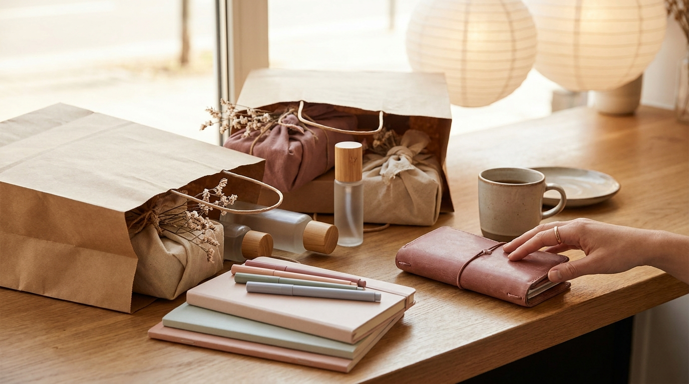

こんにちは、SEOUL TRIP NOTE の J です。ソウル在住の立場から、韓国を訪れる旅行者の皆さんに役立つ実用情報をお届けしています。

渡韓が決まったら楽しみなことのひとつがショッピングですが、旅の後半になると「誰に何を買えばいいかわからない」「荷物の重量や持ち帰りのルールが心配」と悩む方が少なくありません。職場や友人へのばらまき用、自分へのご褒美など、目的によって選ぶべきアイテムや購入場所は大きく異なります。

この記事では、食品・コスメ・雑貨のジャンル別に見る韓国お土産の定番や選び方のコツ、日本へ持ち帰る際に知っておくべき税関・航空ルールをわかりやすく整理しました。計画的なお土産選びの参考にしてみてください。

> **この記事の要点まとめ**
> - 食品（韓国お菓子など）は大型マートやコンビニで個包装タイプを選ぶとばらまきに便利です。
> - 韓国コスメはオリーブヤングでのセット購入や企画セットを狙うとコストパフォーマンスが高くなります。
> - 100mlを超える液体物（シートマスクの大量持ち込みやジェル状コスメ含む）は機内持ち込みができません。必ず受託手荷物（預け入れ）に入れましょう。
> - 牛肉・豚肉・鶏肉エキスを含むレトルトや加工食品は日本の検疫規則により持ち込みが制限されているため、事前の原材料確認が必須です。

---

## ジャンル別に見る韓国お土産の選び方

お土産選びは、渡す相手の好みや持ち帰りやすさを考慮してジャンル別に探すのが効率的です。旅行者からの支持が高い3つのジャンルについて、特徴と選び方のポイントを整理しました。

### 1. 定番の韓国お菓子＆食品（大型スーパー・コンビニ）

食品は、職場や友人へのばらまき用として最も需要が高いカテゴリーです。ソウル市内の大型マート（ロッテマート、イーマート、ホームプラスなど）や街中のコンビニで手軽に購入できます。

- **個包装の韓国お菓子**：
  バターワッフル、チョコパイ類、薬果（ヤックァ）などは、箱の中に個包装で入っているものが多く、配布用として重宝されています。特に伝統菓子の薬果を現代風にアレンジしたクッキーやスナックは、近年若い世代を中心に口コミで注目を集めています。
- **海苔スナック・伝統海苔**：
  定番の韓国海苔だけでなく、アーモンドや玄米を挟んだクリスピーな海苔スナックは軽量でかさばりにくく、スーツケースの重量を圧迫しにくい点がメリットです。
- **スティックタイプの飲料**：
  インスタントのミックスコーヒー（Maximなど）や、水や炭酸水に溶かして飲むコンブチャの粉末スティックは、軽くて日持ちがするためまとめ買いに適しています。

### 2. オリヤンで探す人気の韓国コスメ・スキンケア

オリーブヤング（オリヤン）は、トレンドの韓国コスメを一度にチェックできる代表的なショップです。旅行者向けのプロモーションや1+1（1つ買うともう1つ無料）イベントが頻繁に行われています。

- **シートマスク（パック）**：
  水分補給系、シカ（CICA）成分配合系、ビタミン系のシートマスクは、ばら売りだけでなく10枚〜20枚の箱入りセットが充実しています。セール時期には大幅な割引が適用されることもあります。
- **リップケア・ハンドクリーム**：
  持ち運びに便利なサイズでパッケージデザインが洗練されたハンドクリームやリップバームは、親しい友人や同僚へのギフトとして人気です。
- **ポイントケアアイテム**：
  ニキビパッチやスポットケア製品は、実用性が高くプチプラで購入できるため、自分用の渡韓購入品としても定番となっています。

オリーブヤングでお得にお買い物をする際は、事前に免税の仕組みを把握しておくとスムーズです。詳しくは[オリーブヤングの免税（タックスリファンド）完全ガイド【即時還付vs空港還付】](/blog/oliveyoung-tax-refund-guide/)をあわせて確認してください。

### 3. 韓国ダイソーやライフスタイルショップで狙うプチプラ雑貨

限られた予算でユニークなアイテムを探したいときは、韓国のダイソーや弘大（ホンデ）・聖水（ソンス）エリアに点在するライフスタイル雑貨店が便利です。

- **韓国ダイソーの専売アイテム**：
  500ウォン〜5,000ウォン程度の均一価格で展開されており、韓国限定のキャラクターグッズやハングルモチーフの文房具、ポーチなどが手に入ります。近年は大手コスメブランドとコラボレーションしたミニサイズの基礎化粧品も注目されています。ダイソーでのお買い物の特徴は[韓国ダイソーの買い物ガイド｜価格帯・人気コスメ・日本との違いを解説](/blog/daiso-korea-shopping-tips/)で解説しています。
- **デザイン雑貨・ステッカー**：
  韓国の若手デザイナーが手がけるステッカーやポストカード、キーホルダーは、薄くて軽いためパッキングの手間がかかりません。

---

## 【比較】購入場所ごとの特徴と予算目安

※ AIで生成したイメージ画像です

お土産を買う場所によって、品揃えの傾向や価格帯、受けられるサービスが異なります。旅程に合わせて立ち寄り先を計画しましょう。

| 購入場所 | 主な取扱商品 | 予算目安（1点あたり） | メリット | 注意点 |
| :--- | :--- | :--- | :--- | :--- |
| **大型マート** （ロッテマート等） | 韓国お菓子、ラーメン、調味料、大袋食品 | 2,000〜15,000ウォン程度 | 大容量・まとめ買いが安く、種類が豊富 | 箱ものが多くスーツケースのスペースを占有しやすい |
| **オリーブヤング** | スキンケア、メイクアップ、サプリメント | 3,000〜35,000ウォン程度 | トレンド商品が揃い、即時免税に対応する店舗が多い | 週末や夕方以降はレジが混雑しやすい |
| **韓国ダイソー** | 文具、生活雑貨、プチプラコスメ、コラボ商品 | 500〜5,000ウォン程度 | 圧倒的な低価格でばらまき雑貨が調達できる | 店舗によってコスメやキャラクターの在庫差が大きい |
| **空港免税店** | 高級コスメ、伝統酒、高級食品セット | 15,000ウォン以上〜 | 出国審査後に買えるため受託手荷物の重量を気にせず済む | 市内店舗に比べて小分け・プチプラ商品の選択肢は限定的 |

※価格帯や取扱商品は執筆時点の目安です。店舗規模や為替レート（日本円は最新レートで換算してください）により変動します。

---

## 渡韓購入品を持ち帰る際の重要な注意点

お土産を購入した後のパッキングや帰国手続きでは、航空保安基準や検疫法に従う必要があります。没収などのトラブルを避けるため、以下の3点は必ず確認しておきましょう。

> **持ち帰り時の重要チェックポイント**
> 1. **液体物の機内持ち込み制限**：100ml（g）を超える容器に入った液体・ジェル状のものは機内持ち込みが禁止されています。シートマスクの大量パック、水分クリーム、トナー、コチュジャンなどのペースト状食品は必ず受託手荷物（預け入れスーツケース）に入れましょう。
> 2. **肉製品の持ち込み禁止（動植物検疫）**：日本へ入国する際、牛・豚・鶏などの肉類およびその加工品（ジャーキー、ソーセージ、肉エキス入りレトルト、インスタント麺の一部）の持ち込みは法律により厳しく制限されています。違反した場合は処罰の対象となるため、成分表示に「牛肉」「豚肉」などの表記がないか注意が必要です。
> 3. **免税範囲と免税手続き**：韓国国内で即時還付（Immediate Tax Refund）を受けずに空港で事後還付を受ける場合、購入レシートと未開封の商品を提示するよう求められることがあります。パッキング時にすぐ取り出せる場所へまとめておくと安心です。

空港での詳しい出国手続きや保安検査の流れについては、[仁川空港の出国手続き完全ガイド｜何時間前に着く？免税受け取りと液体物ルール](/blog/korea-departure-airport-procedure/)で詳しく解説しています。

---

## よくある質問（FAQ）

### Q1. シートマスクは手荷物として飛行機の中に持ち込めますか？
個包装のシートマスク（1枚あたり20〜30ml程度）は、容量1リットル以下の透明プラスチック袋に収まる数であれば機内持ち込みが可能です。ただし、ジッパー袋に入れずに手荷物に入れたり、袋に入りきらない束・箱ごとの持ち込み、また美容液総量が100mlを超える大容量BOXタイプ（30枚入りなど）は機内持ち込み不可（没収対象）となります。そのため、購入したシートマスクは預け入れスーツケースに入れるのが確実です。

### Q2. 韓国お菓子をたくさん買うとスーツケースに入りきらない場合の対策は？
かさばるスナック菓子の箱は、現地のホテルで開封して中身の個包装を取り出し、ジッパー付き保存袋に小分けしてパッキングすると容積を大幅に減らせます。また、最終日に空港の出国エリア内にある免税店やコンビニで購入すれば、保安検査を通過した後の手荷物として機内に持ち込むことも可能です（各航空会社の機内持ち込み個数制限にご注意ください）。

### Q3. お土産の支払いは現金とカード（またはWOWPASS）どちらが便利ですか？
ソウル市内の大型マート、オリーブヤング、ダイソーの多くではキャッシュレス決済（クレジットカード、WOWPASSなど）が広く導入されています。特に免税（タックスリファンド）を受ける際はパスポートの提示とカード決済を組み合わせるケースが多いため、現金よりもカード決済を用意しておく方がスムーズにお買い物を進められます。

---

## まとめ

韓国お土産をスムーズに選ぶコツは、食品・コスメ・雑貨それぞれの購入場所をあらかじめ決めておき、旅程の動線に合わせて効率よく調達することです。

- **食品・韓国お菓子**：大型マートで個包装やスティックタイプを中心に選ぶ
- **コスメ**：オリーブヤングで企画セットやミニサイズを狙う
- **雑貨**：韓国ダイソーで限定アイテムやハングル文具をチェックする

また、渡韓購入品を日本へ持ち帰る際は、液体物の預け入れルールや肉類加工品の持ち込み制限に十分配慮してください。ルールをしっかり守って、帰国後も旅の余韻を楽しめる素敵なお土産を見つけてみてください。