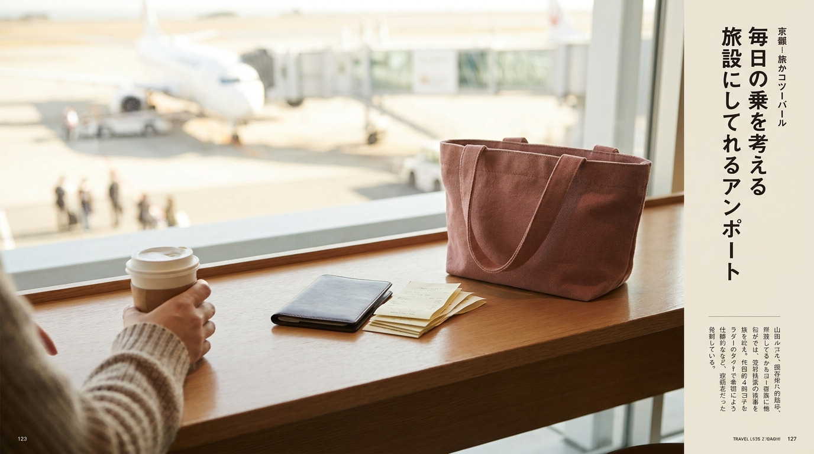

こんにちは、SEOUL TRIP NOTE の J です。

韓国旅行の大きな楽しみのひとつが、コスメやファッションアイテムのお買い物です。オリーブヤングや路面店、デパートなどで買い物をするとき、多くの方が利用するのが「タックスリファンド（事後免税制度）」です。

「レジでパスポートを見せるだけで安くなる場合と、空港で手続きが必要な場合の違いがわからない」「最低いくらから免税になるのか知りたい」と迷う旅行者の方も少なくありません。

韓国免税の仕組み、即時還付と空港還付の違い、対象金額の基準や手続きのステップについて、公式情報をもとに整理しました。

> **この記事の要点まとめ**
> - 韓国のタックスリファンドは、1店舗あたりの決済額が15,000ウォン以上から対象になります（執筆時点の制度基準）。
> - 還付方法には、レジで消費税分がその場で引かれる「即時還付」と、出国時に空港で受け取る「空港還付」の2種類があります。
> - 即時還付を受けるには、会計時にパスポート（原本）の提示が必須です。
> - 市内還付機（キオスク）を利用する場合は、保証金（デポジット）としてクレジットカードが必要になります。

---

## 韓国免税（タックスリファンド）の基本と対象基準

韓国でお買い物をするときに受けられる免税制度には、空港などの「デューティーフリー（Duty Free）」と、市内の一般店舗で適用される「タックスリファンド（Tax Refund）」があります。

旅行者が日常的に利用するのは、街中のお店で支払った付加価値税（VAT：約10%）の一部が戻ってくるタックスリファンドです。

### 免税の対象となる条件
韓国の税制規定に基づき、タックスリファンドの対象となる主な条件は以下の通りです。

- **滞在期間**: 韓国滞在期間が6か月未満の外国人旅行者
- **1回あたりの購入金額**: 15,000ウォン以上（1回の上限は店舗や制度により最大100万ウォンまで）
- **全体の購入上限額**: 1回の旅行（滞在）あたり合計500万ウォンまで即時還付が可能
- **対象品目**: 韓国国内で消費・使用せず、未開封のまま国外へ持ち出す物品

※制度や金額の基準は改定される場合があります。最新情報は韓国関税庁や韓国観光公社の公式発表をご確認ください。

コスメや雑貨を多く購入する予定の方は、あらかじめ各エリアのショップ事情を把握しておくとスムーズです。ソウル市内の買い物スポットについては、[ソウルのショッピングエリア比較｜明洞・弘大・聖水・東大門・江南の違い](/blog/seoul-shopping-area-comparison/)でも詳しく解説しています。

---

## 「即時還付」と「空港還付」の違い

※ AIで生成したイメージ画像です

タックスリファンドには大きく分けて、お会計の現場で引かれる「即時還付」と、帰国時の空港で手続きを行う「空港還付」があります。それぞれの特徴を表にまとめました。

| 項目 | 即時還付（レジ対応） | 空港還付（事後還付） |
| :--- | :--- | :--- |
| **手続き場所** | 対象店舗のレジカウンター | 仁川・金浦などの国際空港 |
| **還付のタイミング** | 会計時（税金分が引かれた額を支払う） | 出国手続き前後（現金またはカード返金） |
| **必要なもの** | パスポート原本、購入商品 | パスポート、免税レシート、購入商品、航空券 |
| **1回の対象金額** | 15,000ウォン以上 〜 100万ウォン未満 | 15,000ウォン以上（上限制限なし） |
| **メリット** | 空港での手続きが不要で最も手軽 | 即時還付非対応の店舗や高額商品も対象 |
| **注意点** | パスポート原本がないと適用不可 | 空港で税関確認や受取機に並ぶ時間が必要 |

※金額基準は執筆時点の目安です。実際の換算レートや店舗側の端末状況により、手続き方法が制限される場合があります。日本円への換算は最新の為替レートをご確認ください。

---

## 即時還付の手順とスマートに買い物するコツ

即時還付（Immediate Tax Refund）は、もっとも手間がかからない方法です。オリーブヤングの大型店や大型マート、主要百貨店などで広く導入されています。

### 即時還付の流れ
1. **店舗が免税対応か確認**: 店頭やレジ周辺に「Tax Free」のロゴがあるか確認します。
2. **合計金額を15,000ウォン以上にする**: セール品などを含め、1回の会計が基準額を満たしているか確かめます。
3. **パスポートを提示する**: 会計前に「Tax Refund, please（タックスリファンド ヘジュセヨ）」と伝え、パスポート原本を店員に渡します。
4. **差額のみ支払う**: レジの端末でパスポート情報が読み取られ、最初から税金分が差し引かれた金額が請求されます。

特に人気のオリーブヤングでの免税ルールや対象店舗の詳細は、[オリーブヤングの免税（タックスリファンド）完全ガイド【即時還付vs空港還付】](/blog/oliveyoung-tax-refund-guide/)に詳しくまとめています。

> **注意点：パスポートのコピーや画面写真は利用できません**
> 即時還付システムは、税関のサーバーとパスポート情報をリアルタイムで照合します。スマートフォンの写真やコピーでは機械が読み取れないため、必ず原本を携帯してください。

---

## 空港還付（事後還付）の手順

個人経営のショップや、路面店などで即時還付の端末がない場合は、空港で手続きを行う「事後還付」を利用します。なお、外国人観光客に対する美容皮膚科などの美容医療へのタックスリファンド特例制度は2025年12月31日をもって終了しており、現在は還付の対象外となっています（制度終了に伴う注意点については、[渡韓美容の費用で損しない！見積もり・支払い・タックスリファンド終了の注意点](/blog/korea-clinic-tax-refund-procedure/)をご参照ください）。

### ステップ1：店舗で「免税書類（リファンドチェック）」をもらう
お会計時にパスポートを提示し、「Tax Freeのレシートをください」と伝えます。通常のレシートとは別に、バーコードやQRコードが印刷された免税専用伝票が発行されます。

### ステップ2：空港の税関・キオスクでスキャンする
仁川国際空港や金浦国際空港の出発フロアには、セルフ式の「Tax Refund KIOSK（自動手続き機）」が設置されています。

- 航空会社のチェックイン前、またはチェックイン後にキオスクへ向かいます。
- 画面で日本語を選択し、パスポートをスキャンします。
- 手持ちの免税レシートのバーコードを1枚ずつ読み取らせます。
- 画面に「承認（OK）」と表示されれば事前登録は完了です。

### ステップ3：出国審査後の受取カウンターで現金または送金受取
出国審査を通過して免税エリアに入った後、各ターミナルにある「Tax Refund 窓口」または「受取専用キオスク」へ向かいます。そこでパスポートを再度スキャンすると、ウォン現金や米ドル、または指定のクレジットカード口座への返金として税金が戻ってきます。

> **税関検査の基準**
> 1件あたりの還付税額が高額な場合（または購入額が一定基準を超える場合）は、キオスクで「税関検査（Customs Inspection）」の案内が表示されます。その場合、スーツケースを開けて実物商品を税関職員に見せる必要があるため、高額商品は預け荷物に入れず、手荷物にしておくか、チェックイン前に税関カウンターへ立ち寄る必要があります。

---

## 渡韓買い物で損しないための注意点

※ AIで生成したイメージ画像です

### 1. レシートは帰国まで確実に保管する
空港還付用の免税レシートを紛失した場合、基本的に再発行はできません。お買い物をしたら、パスポートケースや専用のポーチにまとめて保管しておくのが便利です。

### 2. 未使用・未開封が原則
タックスリファンドは「韓国内で消費せず、国外に持ち出すこと」を前提に税金が免除される制度です。原則として商品は未使用・未開封の状態で出国する必要があります。空港で税関検査の対象になった際、開封済みであったり使用の形跡があったりすると、還付が取り消される場合があるとされています。

### 3. 空港には余裕を持って到着する
連休や旅行シーズンは、仁川空港のタックスリファンドカウンターやキオスクに長い行列ができる傾向があります。空港還付を予定している場合は、搭乗時刻の3時間前を目安に空港へ到着しておくと安心です。

---

## よくある質問（FAQ）

### Q1. クレジットカードやWOWPASSでの支払いでも免税されますか？
現金、クレジットカード、WOWPASS、デビットカードなど、どの決済手段を利用しても免税の対象になります。即時還付の場合は、決済手段に関わらずその場で税金分が引かれます。空港還付の場合、返金先を現金（ウォンなど）にするか、利用したカード口座にするかを選択できます。

### Q2. 免税手続きのキオスク（KIOSK）は日本語に対応していますか？
仁川国際空港や金浦国際空港をはじめ、ソウル市内に設置されている主要なタックスリファンド機は、日本語の画面表示と音声案内に対応しています。画面右上の言語選択で「日本語」を選べば、迷わず操作できます。

### Q3. コスメはスーツケース（預け荷物）に入れても大丈夫ですか？
100mlを超える液体コスメ（トナー、美容液、クリームなど）は機内持ち込みができないため、スーツケースに入れて預ける必要があります。高額な購入品がない通常のコスメ類であれば、チェックイン時に預け荷物に入れてしまっても、キオスクのスキャンだけでスムーズに承認されるという声が多いです。ただし、1件あたりの還付税額が75,000ウォン以上（購入金額の目安として約100万ウォン以上）の高額商品がある場合は、チェックイン時に「タックスリファンドの品物が入っている」と航空会社カウンターで申告し、税関確認を受けてから預けるのが安全です。

### Q4. コンビニやダイソーの買い物でも免税になりますか？
一部の観光地（明洞や空港など）にある店舗では免税に対応している場合がありますが、一般的な街中のコンビニや小型のダイソー店舗では対応していないことが多いです。店頭に「Tax Free」のステッカーが貼られているかどうかを確認するか、お会計時に店員さんに確認してみてください。

---

## まとめ

韓国でのショッピングを無駄なく楽しむためには、タックスリファンドの活用が欠かせません。

- 1店舗15,000ウォン以上のお買い物で対象
- パスポート原本を常に持ち歩き、レジで「即時還付」を利用するのが最も手軽
- 即時還付ができない店舗では免税レシートを受け取り、空港のキオスクで手続き

基本ルールを押さえておくだけで、帰国時の手続きもスムーズに進みます。お気に入りのコスメや洋服を見つけたら、忘れずにパスポートを提示して、賢くタックスリファンドを活用してください。