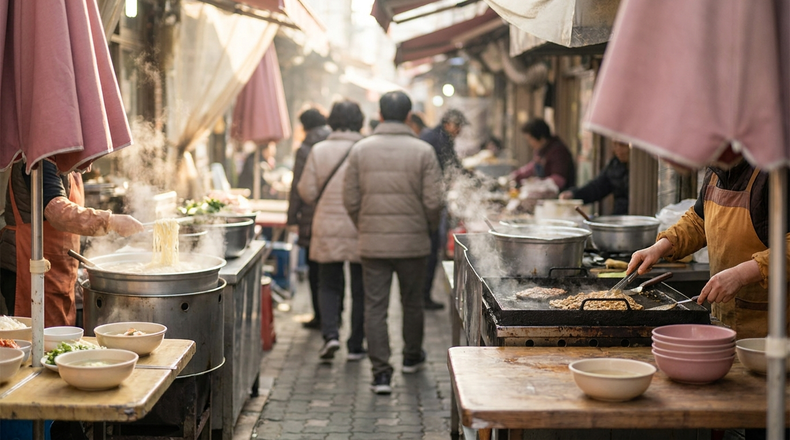
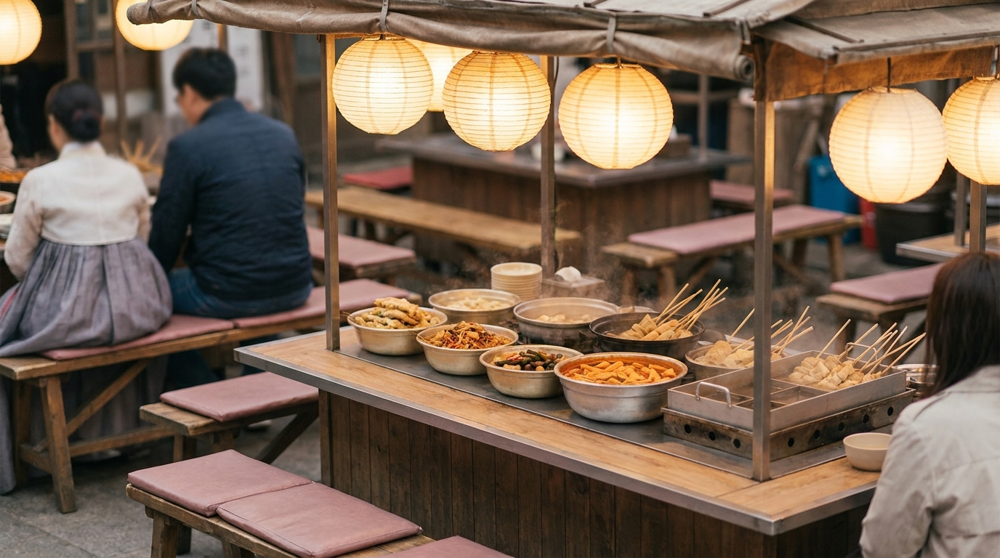

こんにちは、SEOUL TRIP NOTE の J です。ソウルに住みながら、日本からの旅行者のみなさんが現地で困りやすい交通や買い物、食事のルールなどを調べて発信しています。

ソウル旅行の醍醐味といえば、活気あふれる「伝統市場」での食べ歩きや買い物です。なかでも旅行者に大人気なのが「広蔵市場（クァンジャンシジャン）」と「南大門市場（ナンデムンシジャン）」の2大スポット。

「市場の韓国屋台はクレジットカードが使えるの？」「どちらの市場に行けばいい？」「注文や席取りのマナーはある？」など、初めて訪れる際は戸惑うことも多いはずです。

今回は、公開データや現地での利用傾向をもとに、広蔵市場と南大門市場の違い、代表的なソウル市場グルメ、支払い方法やトラブルを防ぐマナーをまとめました。

> **この記事の要点まとめ**
> - **広蔵市場**: 夜遅くまで営業する「うまいもの通り」が中心。ピンデトッ（緑豆チヂミ）、ユッケ、麻薬キンパなどグルメ重視派におすすめ。
> - **南大門市場**: 朝から活気がある巨大卸売市場。カルグクス通りやホットク、子供服、雑貨・お土産探しを兼ねたい派にぴったり。
> - **支払い**: 固定店舗はカード対応が増加傾向ですが、屋台の少額決済は現金や口座振込（韓国在住者向け）が中心。現金の小銭・千ウォン札の準備が必須。
> - **移動のコツ**: 地下鉄駅直結または徒歩圏内。市場めぐりには交通カードを活用すると便利です。

---

## 広蔵市場（クァンジャンシジャン）の特徴と名物グルメ

広蔵市場は、100年以上の歴史を持つソウル中心部（鍾路区）の伝統市場です。布地や韓服の卸売でも知られますが、旅行者のメインは中央の十字路に広がる「うまいもの通り（モクチャコルモッ）」です。

夕方から夜にかけて特に賑わい、屋台のベンチに座って熱々の料理を楽しむ熱気にあふれています。

### 広蔵市場でチェックしたい代表的なソウル市場グルメ

- **ピンデトッ（緑豆チヂミ）**  
  水に浸した緑豆を石臼で挽き、もやしや豚肉などを混ぜて多めの油でカリッと揚げ焼きにしたチヂミです。1枚あたり5,000〜6,000ウォン程度が目安で、玉ねぎ入りの酢醤油につけて食べるとさっぱりいただけます。
- **ユッケ・タコの踊り食い（サンナッチ）**  
  市場内の路地に「ユッケ通り」があり、新鮮な牛肉のユッケや生きたタコを刻んだサンナッチを提供する専門店が並んでいます。スープやレバー・センマイが付く店も多くあります。
- **コマキンパ（麻薬キンパ）**  
  たくあんやにんじんを巻いた細巻きの海苔巻きに、からし醤油をつけて食べる軽食です。一口サイズで食べ歩きにも適しています。

広蔵市場の最寄り駅は、地下鉄1号線の鐘路5街（チョンノオガ）駅（8番出口すぐ）、または地下鉄2号線・5号線の乙支路4街（ウルチロサガ）駅です。東大門エリアからも徒歩圏内のため、[東大門ショッピング完全ガイド](/blog/dongdaemun-shopping-guide/)と合わせて夜の観光ルートに組み込む旅行者も多く見られます。

---

## 南大門市場（ナンデムンシジャン）の特徴と名物グルメ

※ AIで生成したイメージ画像です

南大門市場は、明洞（ミョンドン）の西側に位置するソウル最大規模の総合市場です。約1万軒以上もの店舗がひしめき合っており、衣料品、アクセサリー、キッチン用品、高麗人参、子供服など、幅広い商品が並びます。

南大門市場は朝早くから開いており、午前中の食べ歩きや朝ごはんスポットとしても定番です。朝食の選択肢に迷ったときは、[ソウルの朝ごはん事情](/blog/korean-breakfast-options/)も参考にしてみてください。

### 南大門市場で人気の名物グルメ

- **カルグクス通りの手打ち麺**  
  ビニールカーテンで仕切られた細い路地に、手打ちカルグクス（韓国風うどん）の屋台が密集しています。カルグクスを頼むと、ミニサイズのビビンバや冷麺がセットで付いてくるボリューム満点のスタイルが名物です（約8,000〜9,000ウォン前後が目安）。
- **野菜ホットク（ヤチェホットク）**  
  市場のゲート付近などで行列ができる名物です。黒糖やシナモンが入った甘いホットクだけでなく、炒めたチャプチェ（春雨と野菜）をパン生地に包んで揚げ焼きにした「野菜ホットク」が人気を集めています。
- **タチウオ横丁（カルチジョリムコルモッ）**  
  ピリ辛の特製タレで太刀魚と大根を甘辛く煮込んだ「カルチジョリム」の専門店が集まる路地です。ご飯が進むしっかりした味付けが特徴です。

南大門市場の最寄り駅は、地下鉄4号線の会賢（フェヒョン）駅（5番出口すぐ）です。明洞の繁華街からも歩いて10〜15分程度で移動できます。

---

## 【徹底比較】広蔵市場 vs 南大門市場

どちらの市場を訪れるべきか迷ったときは、旅行のスケジュールや目的に合わせて選ぶのがおすすめです。

| 比較項目 | 広蔵市場（クァンジャンシジャン） | 南大門市場（ナンデムンシジャン） |
| :--- | :--- | :--- |
| **主な特徴** | 飲食屋台（うまいもの通り）が中心 | 巨大な総合市場（服飾・雑貨・食品） |
| **おすすめの時間帯** | 夕方〜夜（17:00〜21:00頃） | 朝〜午後（8:00〜16:00頃） |
| **代表グルメ** | ピンデトッ、ユッケ、コマキンパ | カルグクス、野菜ホットク、太刀魚煮付け |
| **ショッピング** | 韓服、生地、布団、食品土産（海苔など） | 子供服、アクセサリー、日用雑貨、お土産 |
| **最寄り駅** | 地下鉄1号線 鐘路5街駅 / 乙支路4街駅 | 地下鉄4号線 会賢駅 |
| **おすすめの旅行者** | 夜に屋台飲み・ディナーを楽しみたい方 | 朝ごはん、雑貨や子供服の買い物をしたい方 |

※営業時間や定休日は店舗ごとに異なります。市場全体の一般的な傾向として参考にしてください。

---

## 屋台の支払い事情：現金・クレジットカード・WOWPASS

ソウルの街中は世界屈指のキャッシュレス社会ですが、伝統市場の路面屋台では事情が少し異なります。

### 屋台での支払いの現実
建物を構えている固定店舗（ユッケ専門店や食堂など）では、一般的なクレジットカードやWOWPASSが問題なく使える店がほとんどです。

しかし、通路の中央に並ぶテント形式の韓国屋台では、以下の点に注意が必要です。

- **少額の屋台グルメは現金が原則スムーズ**: ホットク1枚（1,500〜2,000ウォン程度）やトッポッキ1人前などでは、カード端末を置いていない屋台や、現金支払いを求められるケースがあります。
- **1,000ウォン札・5,000ウォン札を用意しておく**: 50,000ウォン札を出すとお釣りがない場合があるため、市場へ行く前にコンビニなどで崩しておくと親切です。
- **カード対応マークの確認**: 最近では屋台でもカードリーダーを導入している場所が増えていますが、端末の通信状況によって決済に時間がかかることがあります。

ソウル市内の移動や決済カードの使い分けについては、[渡韓旅行者必見！気候同行カードとWOWPASS徹底比較ガイド](/blog/climate-card-vs-wowpass-comparison/)でも詳しく解説しています。

---

## 市場を楽しむためのマナーと注意点

※ AIで生成したイメージ画像です

伝統市場は観光地であると同時に、現地の人々が日常的に買い物や食事をする生活の場でもあります。気持ちよく過ごすための基本ルールを確認しておきましょう。

> **市場でのマナーとトラブル防止チェック**
> - **席の利用と注文数**: 屋台のベンチは席数が限られています。複数人で1つの席に座り、1人前だけを頼んで長時間居座るのは避けましょう。混雑時は「1人1品以上の注文」を意識するのがマナーとされています。
> - **写真撮影の配慮**: 調理中の手元や並んでいる料理を撮る際は、店員さんや周囲のお客さんの顔が大きく写り込まないよう配慮しましょう。混雑時に通路をふさいで立ち止まるのも危険です。
> - **ウェットティッシュの持参**: 屋台ではおしぼりが出ないことや、簡易的なナプキンのみの場所が多いです。除菌ウェットティッシュを携帯しておくと重宝します。
> - **価格表記の確認**: 注文前にメニュー表に価格が明記されているか確認しましょう。近年は行政の指導により価格表示が徹底されていますが、不明な場合は「オルマエヨ？（いくらですか？）」と確認してから注文すると安心です。

市場での食事に慣れておくと、街中の一般食堂でもスムーズに振る舞えます。一般的な飲食店での注文や会計の流れは、[韓国の食堂でスマートに注文！初心者も安心の呼び出しベル・おかわり・会計ガイド](/blog/korean-restaurant-ordering-guide/)も役立ちます。

---

## よくある質問（FAQ）

### Q1. 韓国語が話せなくても屋台で注文できますか？
多くの屋台ではメニューに料理の写真や日本語・英語の表記が添えられています。指差しで「イゴ ジュセヨ（これください）」と伝えるだけで十分に注文可能です。個数は指で示せば伝わります。

### Q2. 雨の日でも市場観光は楽しめますか？
はい、楽しめます。広蔵市場も南大門市場の主要通りも、通路の頭上に大きなアーケード（屋根）が設置されているエリアが多く、小雨程度であれば傘を差さずに移動や食事が可能です。

### Q3. トイレは市場内にありますか？清潔さはどうですか？
市場内の案内所や公衆トイレ、または隣接する地下鉄駅のトイレが利用できます。清掃は定期的に行われていますが、利用者が多いため、トイレットペーパーが切れている場合があります。水に流せるポケットティッシュを持参しておくと安心です。

### Q4. 市場での食べ残しは持ち帰り（ポジャン）できますか？
ピンデトッやチキン、マンドゥ（餃子）などは、お願いすれば簡易容器や袋に入れてテイクアウト用にしてくれる店が多いです。「ポジャン ヘジュセヨ（持ち帰りにしてください）」と伝えてみてください。ただし、夏場の生もの（ユッケなど）は衛生面から持ち帰りを断られることがあります。

---

## まとめ

ソウルの伝統市場は、現地の熱気と美味しいソウル市場グルメをリーズナブルに体感できる特別な場所です。

- **夕方から夜にかけて名物グルメやお酒を楽しみたいなら「広蔵市場」**
- **朝ごはんや手打ち麺、お土産や服飾の買い物も楽しみたいなら「南大門市場」**

というように、旅のプランに合わせて行き先を選んでみてください。財布には小額の現金を準備し、マナーを守りながら活気あふれる韓国屋台の魅力を満喫してください。