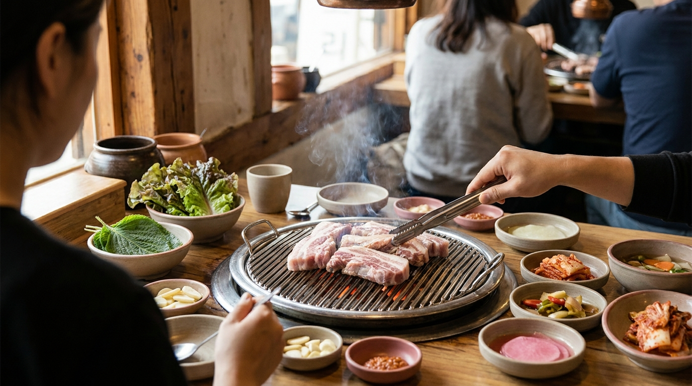
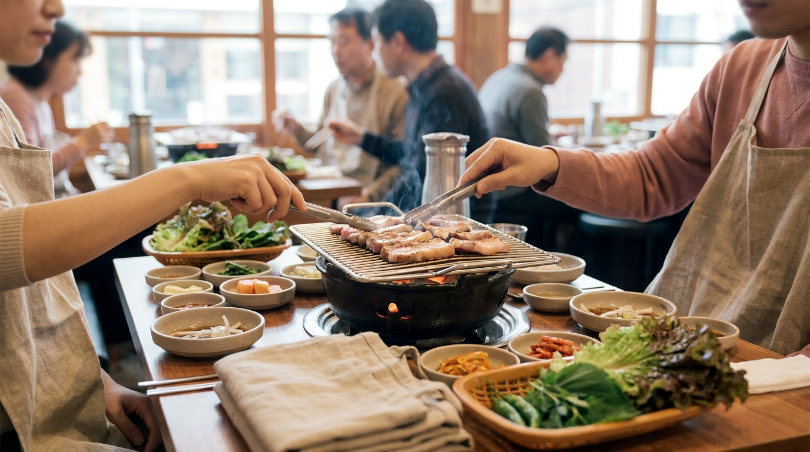

こんにちは、SEOUL TRIP NOTE の J です。

韓国旅行（渡韓）の楽しみとして、本場の韓国焼肉を挙げる旅行者はとても多いです。一方で、日本の旅行系コンテンツやSNSを見ていると、「1人でも入れるのか」「お肉は何人前頼めばいいのか」「自分たちで焼くべきなのか」といった注文ルールで迷ってしまうケースをよく目にします。

韓国の焼肉店には、日本の焼肉チェーン店とは少し異なる注文単位や食事の流れがあります。ソウルグルメを代表するサムギョプサルやカルビをスムーズに楽しむために知っておきたい注文方法、焼き方のマナー、定番の締め料理までを詳しくまとめました。

> **韓国焼肉の基本ポイント**
> - 初回注文は「同じお肉を2人前から」が基本ルールです（1人客の場合も2人前注文が必要な店舗が多いです）。
> - キムチやサンチュなどのパンチャン（おかず）は無料でおかわりできる店舗が一般的です。
> - お肉を焼き終えた後に注文する「締め（食事メニュー）」が韓国スタイルの定番です。

## 注文の基本ルールと知っておきたい「2人前」の原則

韓国の焼肉店に入店して席に着いたら、まずは人数とお肉のメニューを決めます。ここで知っておくべき最も大切なルールが「注文単位」です。

### 1. 初回注文は原則「2人前（イインブン）」から
韓国の多くの専門店では、最初の注文時に「同じ部位を2人前以上」で指定することが基本となっています。たとえば、豚バラ肉（サムギョプサル）と首肉（モクサル）を1人前ずつ組み合わせる注文は、初回では断られるケースが珍しくありません。
メニュー表に記載されている価格（執筆時点の目安：15,000〜18,000ウォン程度）は、基本的に「1人前（約150g〜180g）」の単価です。初回は記載価格の2倍が最低注文額の目安となります。最新の価格は各店舗のメニューをご確認ください。

### 2. 追加注文は1人前から可能な店が多い
最初にお肉を食べ進めたあと、「もう少し食べたい」という場合の追加注文は、1人前単位で受けてくれるお店が一般的です。追加時であれば、最初に頼んだものとは別の部位を指定することも可能です。

### 3. 一人旅（ひとり焼肉）の場合
ソウルでも一人焼肉を受け入れる店舗は増えていますが、入店自体は可能でも「注文は2人前から」という条件が課される店舗が大多数を占めます。1人で訪問する場合は、最初から2人前の料金を支払って食べ切る計画を立てておくと安心です。

## お肉の種類と選び方

※ AIで生成したイメージ画像です

韓国焼肉は、大きく分けると「豚肉（テジコギ）」と「牛肉（ソコギ）」に分かれます。街中に多いのは豚肉の専門店です。

### サムギョプサル（豚バラ肉）
脂身と赤身が三層になっている韓国焼肉の王道部位です。香ばしくジューシーな味わいが特徴で、脂をしっかり落としながらカリカリに焼いて食べるのが好まれます。

### モクサル（豚首肉・肩ロース）
サムギョプサルに比べて脂身が少なく、赤身の旨味と適度な弾力が楽しめます。脂っこいものが苦手な方や、さっぱりとお肉の味を楽しみたい方に選ばれる傾向があります。最近のソウルの専門店では、厚切りのモクサルを看板メニューにする店も多く見られます。

### テジカルビ（味付け豚カルビ）
醤油、砂糖、果物、ニンニクなどをベースにした甘辛いタレ（ヤンニョム）に漬け込んだ豚肉です。ご飯との相性が非常によく、焦げ付きやすいため後述する焼き方に少し注意が必要です。

### ソカルビ（牛カルビ）
牛肉の骨付きカルビや味付けカルビです。豚肉に比べて価格帯は高めになりますが、柔らかく深い旨味があります。専門店は高級感のある落ち着いた店構えのところが多くなります。

## 焼き方の基本マナーと流れ

席に座ると、練炭、炭火、あるいはガスコンロの鉄板が用意され、サンチュやエゴマの葉、パジョリ（ネギの和え物）、ニンニク、サムジャン（味付け味噌）などのパンチャン（おかず）が並びます。

### 店員さんが焼いてくれる店か確認する
ソウルの人気焼肉店では、店員さんがテーブルについてお肉をハサミで切り、食べ頃まで焼いてくれる「グリルサービス（グリルリングサービス）」の店舗が主流になりつつあります。
- **店員さんが焼く店**: 厚切りのお肉を専門とする店に多く、触らずに待っているのがマナーです。
- **自分で焼く店**: 薄切りのお肉を出す店や、大衆的なテジカルビ店では自分たちでトングを持って焼く必要があります。

店員さんがお肉を鉄板に置いたあと、立ち去ってもトングやお肉に触れず、戻ってくるのを待つのが自然です。もし鉄板の火力が強すぎて焦げそうな場合は、店員さんを呼ぶか、火を少し弱めても問題ありません。

### 食べ方のステップ
1. 焼き上がったお肉は、鉄板の端や専用の小網の上にまとめられます。「どうぞ」と合図があったら食べ始めます。
2. 最初の一口は、塩やワサビだけをつけてお肉本来の味を確かめるのが最近のトレンドです。
3. 次に、サンチュやエゴマの葉の裏側（表面よりザラザラしていて具材が滑りにくい）を上に向け、お肉、パジョリ、サムジャン、焼きニンニクなどを一口サイズに包んで食べます。

> **焼き方の注意点**
> 味付け肉（テジカルビなど）は、タレに含まれる糖分で鉄板が非常に焦げやすくなります。鉄板が黒くなってきたら、店員さんに「パン カラ ジュセヨ（または、パン パックォ ジュセヨ＝鉄板を替えてください）」と声をかけて交換してもらうのが韓国の一般的な食事マナーです。

## 定番の締め（食事系メニュー）の頼み方

韓国では、お肉をある程度食べたあとに「シクサ（食事）」と呼ばれるご飯ものや麺類を頼んで食事を締めくくります。注文時ではなく、お肉の終盤に声をかけて頼むのが基本です。

- **テンジャンチゲ（韓国味噌汁）**: 焼肉のお供の定番です。ご飯（コンギパプ）を別に頼んで、スープに浸しながら食べます。
- **ネンミョン（冷麺）**: スープのある「ムルネンミョン」と、甘辛いタレで和えた「ビビンネンミョン」があります。残しておいたお肉を冷麺の麺で巻いて食べるのが韓国で非常に好まれる食べ方です。
- **ポックンパ（炒めご飯）**: 鉄板の形状が平たい店では、残った具材やタレに刻み海苔とご飯を混ぜて鉄板の上で炒めてくれるポックンパが頼めます。網焼きの店では提供されないことが多いため、メニュー表に記載があるか確認しましょう。

## 主なお肉の部位・価格帯・特徴の比較

ソウルの一般的な専門店におけるお肉のスペックをまとめました。

| 部位名（韓国語表記） | 主な肉種 | 特徴 | 1人前の相場目安（執筆時点） | おすすめの締めメニュー |
| :--- | :--- | :--- | :--- | :--- |
| サムギョプサル（삼겹살） | 豚肉 | ジューシーで香ばしい、定番の部位 | 15,000〜19,000ウォン | テンジャンチゲ、ポックンパ |
| モクサル（목살） | 豚肉 | 赤身が多く柔らかい、肉の旨味が強い | 15,000〜19,000ウォン | ビビンネンミョン |
| テジカルビ（돼지갈비） | 豚肉 | 甘辛いタレ漬け、ご飯が進む味付け | 14,000〜18,000ウォン | ムルネンミョン、白ご飯 |
| ソカルビ（소갈비） | 牛肉 | 柔らかくリッチな旨味、骨付きが多い | 30,000〜50,000ウォン | ムルネンミョン |
| チャドルバギ（차돌박이） | 牛肉 | 牛あばら肉の薄切り、火の通りが早い | 18,000〜25,000ウォン | テンジャンチゲ |

※価格は執筆時点におけるソウル市内の一般的な飲食店の目安です。店舗の立地やブランド豚の使用有無などによって変動するため、公式情報や店頭のメニュー表をご確認ください。日本円への換算は最新の為替レートの確認をおすすめします。

## 注意点とお得に使うコツ

※ AIで生成したイメージ画像です

### ピークタイムの混雑とウェイティング
ソウルの焼肉店は、平日の18:30〜20:30、週末の17:30〜20:00が最も混雑します。地元の人は開店直後や21時以降などピークを外して訪れることも多いです。人気店では店頭のタッチパネル（Catch Tableなど）で電話番号を入力して待つシステムが一般的です。韓国の電話番号がない旅行者の場合、店頭の店員さんに声をかけると直接呼出番号を発行してくれる店舗が見られます。

### エプロン（アプチマ）の活用
焼肉の脂やキムチの汁は衣服に飛び散りやすいため、多くの店に使い捨てまたは布製のエプロンが用意されています。店内の壁にかかっていることが多いですが、見当たらない場合は「アプチマ ジュセヨ（エプロンをください）」と伝えると持ってきてくれます。

### おかず（パンチャン）のセルフバー
お肉と一緒に提供される野菜やニンニク、キムチは無料でおかわりできます。大衆的な店では「セルフバー（셀프바）」が店内に設置されており、トングを使って自分で好きな分だけ取りに行くシステムになっている店舗も多いです。

## よくある質問（FAQ）

### Q1. 韓国語が話せなくても注文できますか？
ソウル中心部（明洞、弘大、聖水、江南など）の焼肉店では、日本語や英語が併記されたメニューを用意している店が多くあります。また、指差しでメニューの「2」を示せば「2人前」として理解してもらえます。最近はテーブル上のタブレット端末で多言語注文できる店舗も増えています。

### Q2. 網焼きの店と鉄板焼きの店の違いは何ですか？
主に提供するお肉の種類によって分かれます。炭火の網焼きは、余分な脂を落としやすく香ばしさがつきやすいため、厚切りモクサルやタレ漬けカルビによく使われます。平らな鉄板は、豚の脂でキムチを一緒に焼いたり、最後にポックンパ（炒めご飯）を作ったりするのに適しています。

### Q3. お肉は野菜に包んで一口で食べないといけませんか？
一口で食べるのが韓国の伝統的なマナーとされています。包んだサンチュを途中で噛み切ると中の具材や汁がこぼれやすいため、無理のない小さめのサイズに包んで一口で食べるのがきれいに食べるコツとされています。

### Q4. お酒を頼まなくても入店できますか？
問題ありません。韓国でも焼肉と一緒にコーラやサイダー（炭酸飲料）を楽しむ人は多くいます。席に着くと基本的に無料のお水（冷水ポット）とコップが提供されます。

## まとめ

韓国焼肉は、「初回は同じ部位を2人前から」「店員さんが焼いてくれる店が多い」「締め料理まで楽しむ」という3つのポイントさえ押さえておけば、戸惑うことなくスムーズに楽しめます。

ソウルには昔ながらの煙が立ち込める大衆店から、洗練された厚切り肉の専門店まで幅広いスタイルの店舗が存在します。好みの部位やお店のスタイルに合わせて、本場の焼肉を選んでみてください。