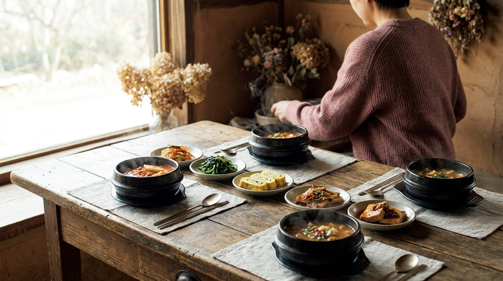

こんにちは、SEOUL TRIP NOTE の J です。ソウル在住の立場から、旅行者の方が現地で困りやすいポイントを調べてわかりやすくまとめています。

「ソウル旅行の朝、ホテルの近くで何を食べたらいいかわからない」「韓国のカフェや一般の飲食店はお昼近くまで開かないと聞いて不安」という声は少なくありません。

確かにソウルでは、おしゃれな個人カフェや一般の食堂は11時ごろにならないと開店しないケースが目立ちます。しかし、朝早くから営業している業態を知っておけば、旅の時間を無駄にせず充実した韓国朝食を楽しむことができます。

ソウル朝ごはんの定番メニュー、朝から開いているお店の種類、注文時の注意点などを整理してお届けします。

> **ポイント**  
> ソウルではカフェや一般食堂の開店が11:00前後の遅めであることが多い一方、スープ料理専門店やキンパなどを扱う粉食（プンシク）店は朝7:00台や24時間営業している店舗が多く存在します。朝食の選択肢は「業態」で探すのが効率的です。

---

## ソウル朝ごはんの基本事情：営業時間の傾向

ソウルの街を歩いてみると、朝の時間帯（7:00〜9:00頃）に開いている店と閉まっている店がはっきり分かれています。

1. **24時間営業または早朝営業の店**  
   クッパ（スープご飯）専門店、ヘジャンクク（酔い覚ましスープ）店、ソルロンタン店、大手チェーンの粉食店などは、早朝や24時間営業が基本です。出勤前の会社員や、夜勤明けの人々が日常的に利用しています。

2. **テイクアウト中心のスタンド・チェーン店**  
   韓国風トースト専門店やベーグル専門店、駅ナカのコーヒースタンドは朝7:30〜8:00頃からオープンすることが多いです。

3. **朝は閉まっていることが多い店**  
   聖水（ソンス）や漢南洞（ハンナムドン）などのトレンドエリアにあるデザインカフェ、パスタ店、焼肉店、サムギョプサル店などは、ほぼ11:00〜12:00オープンです。朝早くに行っても街全体が静まり返っていることがあるため、午前中のスケジュールには注意が必要です。

---

## 朝から食べられる定番メニュー4つの特徴

※ AIで生成したイメージ画像です

ソウル旅行グルメとして朝食にぴったりなメニューを4つのジャンルに分けて紹介します。

### 1. スープご飯（クッパ・ソルロンタン・コンナムルクッパ）

韓国朝食の代表格といえば温かい汁物です。胃にやさしいメニューも多く、秋冬の冷え込むソウルの朝にも適しています。

- **ソルロンタン**: 牛の肉や骨を長時間煮込んだ乳白色のスープ。塩分が入っていない状態で提供されることが多いため、テーブルにある塩・コショウで自分好みの味に調整して食べます。
- **コンナムルクッパ（豆もやしのクッパ）**: 煮干しや昆布などの出汁にシャキシャキの豆もやしが入った、あっさりとしたスープ。辛くないものと、刻み青唐辛子が入ったピリ辛のものがあります。
- **テジクッパ・スンデクッパ**: 豚肉やスンデ（韓国風ブラッドソーセージ）が入ったコクのあるスープ。お好みでタテギ（唐辛子ベースの薬味）やアミの塩辛を加えて味を整えます。

食堂での基本的な注文方法やおかずの追加ルールについては、[韓国の食堂でスマートに注文！初心者も安心の呼び出しベル・おかわり・会計ガイド](/blog/korean-restaurant-ordering-guide/) で詳しくまとめています。

### 2. 粉食（プンシク）のキンパ・マンドゥ

手軽に済ませたいときや、朝からしっかり炭水化物を補給したいときは「粉食（プンシク）」と呼ばれる軽食店が便利です。看板に「김밥（キンパ）」と書かれたお店の多くは、朝早くから営業しています。

野菜キンパ、ツナマヨ（チャムチ）キンパ、チーズキンパなど種類が豊富で、1本あたり3,500〜5,000ウォン程度（執筆時点の目安）と手頃です。スープ（オデンスープや味噌汁風のスープ）やたくあん、キムチはセルフサービスで取れる店舗が多く、一人でも気兼ねなく入れます。テイクアウト（ポジャン）してホテルで食べるのもおすすめです。

一人で気軽に入れるお店の探し方は、[弘大で女子ひとりご飯・カフェを楽しむ方法｜入りやすいお店の選び方](/blog/hongdae-solo-cafe-dining-guide/) も参考にしてみてください。

### 3. 韓国トースト（ホットサンド）

鉄板でバターを溶かし、食パン、千切りキャベツ入りの卵焼き、ハムやチーズを挟んで焼き上げる韓国スタイルのトーストです。仕上げに甘い特製ソースやケチャップ、グラニュー糖を振るのが特徴で、甘じょっぱい独特の味わいが楽しめます。

注文を受けてからその場で焼いてくれるため、出来立ての温かい状態を受け取れます。駅の出口付近や繁華街の路地によく見られます。

### 4. アワビ粥・野菜粥（チュク）

移動疲れや胃の調子を整えたい朝には、お粥（韓国語でチュク）が人気です。ごま油の風味が効いたアワビ粥や、カボチャ粥、キノコと牛肉のお粥などがあります。

お粥専門店は繁華街を中心に朝8:00〜9:00頃から開店している店舗が多く、小鉢の塩辛や水キムチと一緒に運ばれてきます。

---

## 朝食メニューの比較まとめ

代表的な朝食メニューの特徴と価格帯を一覧に整理しました。

| メニュー | 価格帯の目安（ウォン） | 辛さの目安 | 提供スピード | おすすめのシーン |
| :--- | :--- | :--- | :--- | :--- |
| **ソルロンタン** | 10,000〜14,000 | なし（自分で調整） | 早い（3〜5分） | 寒さをしのぎたい朝、胃を温めたいとき |
| **コンナムルクッパ** | 7,000〜9,000 | 控えめ〜ピリ辛 | 早い（3〜5分） | 前夜にお酒を飲んだ朝、あっさり食べたいとき |
| **キンパ（1本）** | 3,500〜5,500 | なし（具材による） | 注文後すぐ〜数分 | 時間がない朝、テイクアウトしたいとき |
| **韓国トースト** | 3,500〜5,000 | ほぼなし | 焼きたて（5〜7分） | 甘じょっぱい軽食を片手に移動したいとき |
| **アワビ粥** | 12,000〜18,000 | なし | ややゆっくり（10分程度） | 落ち着いた空間でやさしい味を楽しみたい朝 |

*※価格は執筆時点におけるソウル市内の一般的な目安です。店舗やエリアにより異なります。最新の日本円換算レートは為替アプリ等でご確認ください。*

---

## ソウルで朝食をとるときの注意点

現地でスムーズに朝ごはんを楽しむための実践的なチェックポイントです。

> **注意点**  
> ネイバーマップ（NAVER Map）で開店時間を事前に確認する場合でも、日曜日の朝や韓国の連休（チュソク・旧正月）は営業時間が変更になることがあります。「営業中」の表示を確認してから向かうか、営業していない場合の第2候補を決めておくと安心です。

### 1. キオスク（無人券売機）の利用

最近のトースト専門店やチェーンの粉食店では、店頭のタッチパネル（キオスク）で注文と決済を済ませる方式が増えています。

- 画面右上で言語を「日本語」または「英語」に切り替えられる機械が多いです。
- 店内飲食（매장／メジャン）か持ち帰り（포장／ポジャン）を選択してからメニューを選びます。
- 支払いはクレジットカードやWOWPASSが主流です。現金が使えないキオスクもあるためカードを手元に用意しておきましょう。

交通系カードや決済手段の準備については、[渡韓旅行者必見！気候同行カードとWOWPASS徹底比較ガイド【2026年最新】](/blog/climate-card-vs-wowpass-comparison/) をチェックしておくと移動から食事までスムーズになります。

### 2. 朝の出勤ラッシュと重なる時間帯

平日の朝8:00〜8:40頃は、地下鉄駅構内のコーヒースタンドやトースト店、キンパ店が通勤途中の地元の人で混み合います。少し時間を前後にずらして（7:30前、または9:00以降）訪問すると、並ばずに席を確保しやすくなります。

---

## よくある質問（FAQ）

### Q1. 韓国の朝ごはんは一人でも入りやすいですか？
**A.** クッパ専門店、ソルロンタン店、粉食店、お粥店は、基本的に1人前のセットで提供されるため、おひとりさまでも問題なく利用できます。ソウル市内でも出勤前に一人で手早く食事を済ませる会社員の姿が多く見られます。

### Q2. 辛いものが苦手でも食べられる朝食はありますか？
**A.** ソルロンタン、アワビ粥、卵トースト、一般的な野菜キンパやツナマヨキンパは辛味調味料が入っていないため、辛いものが苦手な方でも安心して食べられます。クッパを頼む際、赤い薬味（タテギ）が最初から乗って提供される店もあるため、不要な場合は「タテギ ペジュセヨ（薬味を抜いてください）」と伝えるか、混ぜる前にスプーンで取り分けると調整できます。

### Q3. 明洞や東大門などの観光エリアなら朝早くからカフェも開いていますか？
**A.** 大手カフェチェーン店は朝7:00〜8:00頃から開いていることが多いですが、映え系や個性的な個人カフェは11:00以降のオープンがほとんどです。「朝からおしゃれカフェでブランチ」を予定している場合は、訪問したい店舗の営業開始時刻を事前に公式SNSや地図アプリで必ず確認してください。

---

## まとめ

ソウル旅行の朝は、開いているお店の業態をあらかじめ把握しておくことで、時間を有効に使いながら美味しい韓国朝食を満喫できます。

- 体を温めたいなら、早朝から営業している**クッパやソルロンタン**
- 手軽に済ませてすぐ移動したいなら、**キンパや韓国トースト**
- 胃を休めたい朝は、やさしい味付けの**お粥**

宿泊先の周辺にあるスープ専門店や粉食店を地図アプリで探して、地元ソウルの朝ごはん文化を味わってみてください。