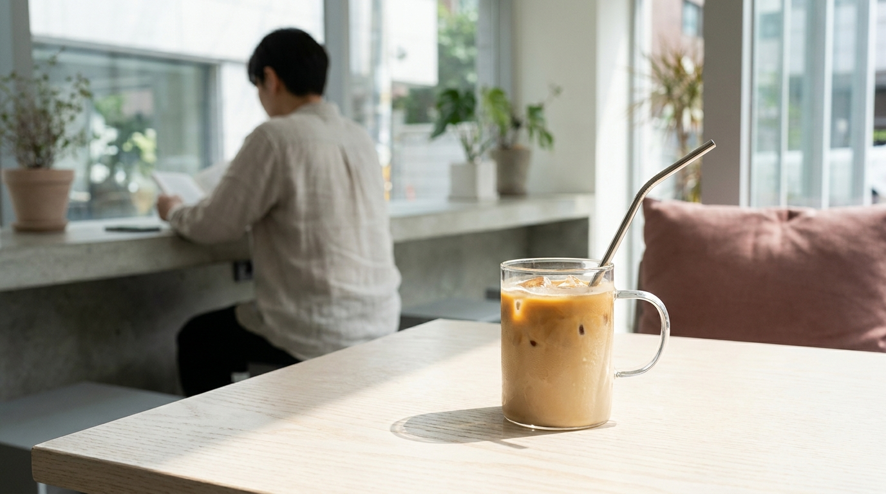

こんにちは、SEOUL TRIP NOTE の J です。ソウルで暮らしながら、日本の方向けに韓国旅行の実用的な情報を発信しています。

韓国旅行の大きな楽しみのひとつがカフェ巡りです。街中には個性的でおしゃれなカフェから、リーズナブルで大容量なコーヒースタンドまで無数の店舗が並んでいます。

いざ店内に入ると、タッチパネルのキオスク端末の操作やサイズ選び、店内利用のルールに迷うこともあります。

韓国のカフェ文化の背景から、店頭の無人キオスク端末の具体的な操作ステップ、カウンター注文で使える基本フレーズ、法律によるカップ利用のルールまで詳しく整理しました。

> **この記事の要点まとめ**
> - 韓国では季節を問わず「アイスアメリカーノ（아아／アア）」が圧倒的な定番メニュー
> - 多くのチェーン店では無人注文機（キオスク）が導入されており、言語切り替えやカード決済が基本
> - 韓国の資源節約法により、店内飲食時は使い捨てプラスチックカップの提供が原則禁止されている
> - 大容量系チェーンと個人カフェではサイズ感や注文の流れが異なるため事前の把握がおすすめ

---

## なぜ真冬でも冷たい？韓国のアイスアメリカーノ文化

韓国のカフェに入ると、真冬の氷点下の日でも多くの人が冷たいドリンクを手にしています。この現象を表す言葉として、韓国では「凍え死んでもアイスアメリカーノ」を略した「オルジュガ（얼죽아）」という新造語が定着しています（なお、アイスアメリカーノ自体の略称は「アア（아아）」と呼ばれます）。

### 韓国でアメリカーノが選ばれる理由

韓国のカフェにおいて、ドリップコーヒーよりもエスプレッソをお湯や冷水で割った「アメリカーノ（아메리카노）」が主流となった背景には、食文化や生活習慣が関係しているといわれています。

- **食後の口直し**: ニンニクや唐辛子、ごま油を多く使った濃い味付けの韓国料理を食べたあと、すっきりと苦味のある冷たいアメリカーノを飲む習慣が根付いています。
- **水分補給とスピード**: エスプレッソマシンで素早く抽出できるため待ち時間が短く、タンブラー感覚でゴクゴク飲める点が忙しい現代人のライフスタイルに合致しています。
- **価格の手軽さ**: 最もベーシックなメニューとして設定されており、他のラテやスムージーに比べて手頃な価格帯で提供されています。

[弘大で女子ひとりご飯・カフェを楽しむ方法](/blog/hongdae-solo-cafe-dining-guide/)でも触れていますが、街歩きの合間に気軽に立ち寄って水分補給ができるのもカフェの利点です。

---

## 初めてでも安心！キオスク（無人注文機）の操作手順

※ AIで生成したイメージ画像です

現在、ソウル市内の多くのカフェチェーンやファストフード店では、店頭にタッチパネル式の「キオスク（키오스크）」が設置されています。韓国語が話せなくても画面を見ながら注文できる便利なシステムですが、独特の選択肢や確認画面があります。

基本的な注文の流れは以下のステップです。

### ステップ1：利用場所の選択（店内か持ち帰りか）
画面の最初の画面または注文の最後に、利用場所を選ぶボタンが表示されます。
- **매장（メジャン）**: 店内飲食
- **포장（ポジャン）**: テイクアウト（持ち帰り）

### ステップ2：メニュー選択とオプション設定
飲みたいメニューの写真をタップすると、詳細オプションの選択画面に進みます。
- **ICE / HOT**: 温度の選択
- **샷 추가（シャッチュガ）**: エスプレッソショットの追加
- **연하게（ヨナゲ）**: コーヒーを薄めにする指定
- **디카페인（ディカフェイン）**: カフェインレスへの変更（対応店舗のみ）
- **얼음 양（オルム ヤン）**: 氷の量（多め・普通・少なめ）

### ステップ3：決済方法の選択
注文内容を確認したら決済画面に進みます。キオスクは原則として**クレジットカードまたはプリペイドカード専用**となっている店舗が大半です。現金で支払いたい場合はカウンターのスタッフに声をかける必要があります。

画面で「신용카드（クレジットカード）」を選択し、端末の下部にある差込口にカード（またはWOWPASSなどのプリペイドカード）をしっかり差し込みます。

韓国旅行中の店舗決済（WOWPASSなど）や交通カードの準備については、交通専用である気候同行カードとの違いも含めて解説した[気候同行カードとWOWPASSの比較ガイド](/blog/climate-card-vs-wowpass-comparison/)も参考にしてください（※気候同行カードは公共交通機関専用のため、カフェなどの一般店舗決済には利用できません）。

### ステップ4：レシートと呼び出し番号の受け取り
決済が完了すると、レシートと注文番号（呼び出し番号）が印字された用紙が出てきます。受け取りカウンターのモニターに自分の番号が表示されるか、店員さんに番号を呼ばれたら商品を受け取ります。

---

## カウンター注文で役立つ韓国語単語とサイズ表現

個人経営のカフェや[聖水の人気カフェ巡り](/blog/seongsu-cafe-best-selection-2026/)などでは、キオスクではなくカウンターで対面注文する店舗も多くあります。最低限覚えておくと役立つ単語をまとめました。

### 注文時に使えるキーワード

| 韓国語表記 | 読み方（目安） | 意味 |
| :--- | :--- | :--- |
| 아이스 아메리카노 | アイス アメリカノ | アイスアメリカーノ |
| 따뜻한 아메리카노 | タットゥタン アメリカノ | 温かいアメリカーノ |
| 한 잔 주세요 | ハンジャン ジュセヨ | 1杯ください |
| 드시고 가세요? | トゥシゴ カセヨ？ | 店内でお召し上がりですか？ |
| 가져가실 건가요? | カジョガシル コンガヨ？ | お持ち帰りですか？ |
| 영수증 | ヨンスジュン | 領収書・レシート |

カウンターで「アイスアメリカーノを店内で1杯」と伝えたい場合は、画面やメニューを指差しながら「アイス アメリカノ ハンジャン、メジャンエソ モッコガルケヨ（店内飲食）」と伝えるか、単語で「メジャン（店内）」と伝えるだけでも十分に通じます。

---

## 韓国カフェの業態別特徴・サイズ・価格比較

ソウル市内にあるカフェは、大きく分けると「格安大容量チェーン」「大手・中堅チェーン」「個人経営・コンセプトカフェ」の3つに分類できます。目的に応じて使い分けるのが便利です。

| 項目 | 格安大容量チェーン | 大手・中堅チェーン | 個人経営・コンセプトカフェ （聖水・漢南洞・延南洞など） |
| :--- | :--- | :--- | :--- |
| **主な注文方法** | 店頭のキオスク端末が中心 | キオスクまたはカウンター | カウンター対面注文が中心 |
| **基本サイズ** | 約590ml〜680ml（約20〜24oz）の超大容量 | レギュラー（約350ml）〜ラージ | 店舗固有のグラス（250〜350ml前後） |
| **アメリカーノ価格目安** | 1,500〜2,000ウォン前後 | 3,200〜4,500ウォン前後 | 5,000〜6,500ウォン前後 |
| **店舗の過ごし方** | テイクアウト中心、短時間の休憩 | 座席数が多く長時間の作業・休憩向き | インテリアや写真撮影、スイーツ鑑賞向き |
| **日本語対応** | キオスクに英語/日本語切替がある場合あり | 店舗によりキオスク対応あり | 基本は韓国語または英語メニュー |

※価格は執筆時点の目安です。実際の価格は各店舗の公式情報や店頭表示をご確認ください。また日本円換算はご利用時の最新レートで計算してください。

---

## 知っておくべき店内カップ規制と利用マナー

※ AIで生成したイメージ画像です

韓国旅行中にカフェを利用する際、旅行者が最も戸惑いやすいのがカップの利用に関する法律ルールです。

> **環境保護に関する法律による注意点**
> 韓国では「資源の節約とリサイクル促進に関する法律」に基づき、カフェ店内で飲食する場合、原則として使い捨てプラスチックカップの提供が禁止されています。違反した場合、店舗側に高額の過料が科されるため、お店側は厳格に管理しています。

### よくあるトラブルと対策

1. **「テイクアウト」で注文して店内の席に座ること**
   持ち帰り（ポジャン）用としてプラスチックカップで受け取ったあと、そのまま店内の席に座って飲む行為は法律違反となります。店員さんから「店内で飲む場合はマグカップに移し替える必要があります」と注意されることがあります。少しでも店内で座る可能性がある場合は、最初から「매장（店内飲食）」を選びましょう。

2. **店内で飲んでいたが途中で移動したくなった場合**
   店内でガラスやマグカップで飲んでいて、時間がなくなって持ち出したい場合は、カウンターに持って行き「テイクアウト用に移し替えてほしい（テイクアウッ ヨンギエ タマジュセヨ）」とお願いすれば、紙カップやプラスチックカップに移してくれます。

3. **返却口（トレイリターン）の利用**
   飲み終わったあとのトレイやグラスは、テーブルにそのまま置かず、受け取り口の横などにある「반납대（返却台 / Return台）」へ戻すのが基本マナーです。

---

## よくある質問（FAQ）

### Q1. 韓国語が全く話せなくても注文できますか？
**A.** キオスク端末には画面下部に言語選択ボタン（韓国語・英語・日本語・中国語）が用意されていることが多く、英語や日本語に切り替えて操作できます。また、カウンター注文でもメニューを指差しながら「This one, please」や「これ 1杯（イゴ ハンジャン）」と伝えればスムーズに対応してもらえます。

### Q2. コーヒーが苦手な場合、どのようなメニューがありますか？
**A.** 韓国のカフェはノンコーヒーのメニューが非常に充実しています。特に「エイド（에이드）」と呼ばれるフルーツシロップを炭酸水で割ったドリンク（グレープフルーツ、レモン、青ぶどうなど）や、穀物を使った「ミスカル（미숫가루）ラテ」、各種ハーブティーやミルクティーが定番です。

### Q3. カフェで無料Wi-Fiやコンセントは使えますか？
**A.** ソウル市内の多くのカフェで無料Wi-Fiが提供されています。パスワードはレシートの最下部に印字されているか、カウンター周辺の壁やナプキン置き場に記載されているケースが一般的です。また、壁際の席を中心に充電用コンセントが充実している店舗が多いですが、形状は韓国仕様（CタイプまたはSEタイプ）のため変換プラグが必要です。

### Q4. 1人1杯の注文は必須ですか？
**A.** 多くのカフェで「1인 1음료（1人1ドリンク注文）」のルールが掲げられています。デザート（ケーキやベーカリーなど）を頼んだ場合でも、ドリンクは人数分注文することが求められるケースが一般的ですのでご注意ください。

---

## まとめ

韓国のカフェは、手頃で美味しいコーヒーが楽しめるだけでなく、独自の空間デザインやスピード感のあるサービスが魅力です。

- 「アア（아아）」は旅行中の気分転換や水分補給の定番
- キオスクでは「利用場所（店内・持ち帰り）」「メニュー・オプション」「カード決済」の順に進める
- 店内で過ごす際は使い捨てカップではなくマグカップ提供のルールを守る

この3つのポイントを押さえておくだけで、現地のカフェ巡りが快適になります。行きたいカフェのメニューや利用スタイルに合わせて、充実したソウルのカフェタイムを過ごしてください。