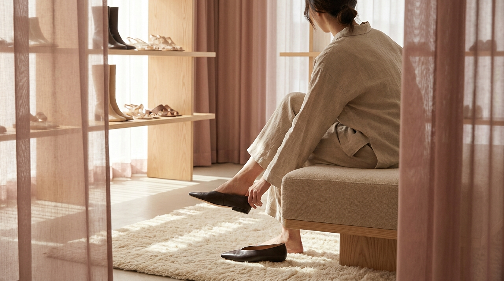

こんにちは、SEOUL TRIP NOTE の J です。ソウルで暮らす立場から、日本の旅行者の方に向けて韓国の役立つ情報を発信しています。

韓国旅行での大きな楽しみのひとつが、トレンドを取り入れた韓国ファッションのお買い物です。高速ターミナルの地下街（GO TO MALL）や弘大、聖水のセレクトショップ、東大門のファッションビルなど、魅力的なショッピングスポットがたくさんあります。

一方で、日本の旅行者の方からよく耳にするのが「数字のサイズ表記の意味がわからない」「靴のサイズが日本と違って選べない」「試着を断られてしまった」という戸惑いの声です。韓国と日本では、服の号数や靴の単位、さらには試着に関する文化的なマナーにいくつかの違いがあります。

今回は、公開データや一般的なアパレル基準をもとに、韓国服サイズ・韓国靴サイズの対応関係と、渡韓買い物で失敗しないための実用的なポイントをまとめました。

> **この記事の要点まとめ**
> - 韓国のレディース服は「44・55・66」などの数字表記が主流（55が日本のMサイズ相当）。
> - 韓国の靴は「mm（ミリメートル）」で表記される（24.0cm＝240）。
> - フリーサイズ（FREE / F）は日本よりも細身・丈短めの設計が多い傾向がある。
> - 白いトップスやニット類は試着不可の店舗が多い。
> - 帰国後の返品・交換は難しいため、購入前のサイズ確認と縫製チェックが大切。

## 韓国服サイズの基本表記と日本サイズとの違い

韓国のアパレルショップを訪れると、日本の「S・M・L」や「7号・9号・11号」とは異なる数字を目にすることがあります。韓国のレディース服で伝統的に用いられているのが、胸囲や体型基準から名付けられた「44・55・66」という表記です。

### 44・55・66表記の目安

公式な国家規格（KS規格）や一般的なアパレル業界の目安では、以下のように対応しています。

- **44サイズ（XS〜S相当）**：細身の方向け。日本の5号〜7号前後に近い寸法です。
- **55サイズ（S〜M相当）**：韓国の標準的な基準サイズ。日本の9号に近い基準で作られています。
- **66サイズ（M〜L相当）**：ゆとりを持たせたサイズ。日本の11号前後に該当します。
- **77サイズ以上（L〜XL相当）**：大きめサイズを扱う専門店や大型マートなどで見られます。

一般的なブティックや地下街のハンガーにかかっている服は、この「55」をベースに設計されているものが多く見られます。

### フリーサイズ（FREE / F）のサイズ感

韓国のトレンド服やプチプラ服の多くは、ワンサイズ展開（FREEまたはF）です。ここで注意したいのが、韓国のフリーサイズは「誰でもゆったり着られる」という意味ではない点です。

韓国の若者向けブランドや地下街の商品は、全体的に身幅が細め、着丈や袖丈が短めに仕立てられている傾向があります。日本のMサイズを想定してフリーサイズを購入すると、肩幅やバスト周りが予想以上にタイトに感じられるケースが少なくありません。

デザインによってオーバーサイズ（ゆったりシルエット）とクロップド（短め丈・タイト）が明確に分かれているため、タグのFREEという表記だけで判断せず、肩幅や身幅の実寸を意識することが重要です。

各エリアのショップの特徴や回り方については、[ソウルのショッピングエリア比較｜明洞・弘大・聖水・東大門・江南の違い](/blog/seoul-shopping-area-comparison/)でも詳しく解説しています。

## 韓国靴サイズの基本表記と選び方

※ AIで生成したイメージ画像です

韓国では、靴のサイズをセンチメートル（cm）ではなく「ミリメートル（mm）」で表記します。店頭の靴底や箱には「235」「240」といった3桁の数字が記載されています。

### ミリメートル（mm）表記の読み方

計算方法は単純で、日本のセンチ表記に10を掛ける（または小数点をなくす）だけです。

- 23.0cm → 230
- 23.5cm → 235
- 24.0cm → 240
- 24.5cm → 245

このように表記自体の読み方は難しくありませんが、実際のフィッティングには韓国ならではの傾向があります。

### 幅と甲の作りに注意

韓国のレディースシューズは、足先がシャープに見えるデザインが多く、靴幅（ワイズ）が細め（日本でいうD〜E程度）で甲が低めに作られている商品が目立ちます。

そのため、幅広・甲高の足の形をしている方や、厚手の靴下・タイツを合わせる予定のブーツなどを選ぶ際は、普段の日本サイズより「5mm（ワンサイズ）上」を選ぶと無理なく履けるケースが多いとされています。サンダルやストラップ付きのパンプスなど、素足で履く靴はジャストサイズで問題ない場合が多いですが、スニーカーやローファーは試着時のソックスの厚みも考慮する必要があります。

## 【比較】日本と韓国の服・靴サイズ対応表

服（レディース）と靴（レディース）のサイズ対応関係を一覧表にまとめました。メーカーやブランドによって個体差があるため、目安として参考にしてください。

| 日本サイズ（服） | 韓国サイズ表記 | 国際表記（参考） | バスト目安（cm） | ウエスト目安（cm） |
| :--- | :--- | :--- | :--- | :--- |
| 5号〜7号（XS〜S） | 44 | XS | 79〜82 | 60〜64 |
| 7号〜9号（S〜M） | 55 | S〜M | 82〜88 | 64〜70 |
| 9号〜11号（M〜L） | 66 | M〜L | 88〜94 | 70〜76 |
| 13号以上（L〜LL） | 77〜88 | L〜XL | 94以上 | 76以上 |

| 日本サイズ（靴・cm） | 韓国表記（靴・mm） | 選び方の目安 |
| :--- | :--- | :--- |
| 22.5 cm | 225 | 足幅が広めの方は230も検討 |
| 23.0 cm | 230 | 標準サイズ |
| 23.5 cm | 235 | 標準サイズ（甲高は240推奨） |
| 24.0 cm | 240 | 標準サイズ |
| 24.5 cm | 245 | ブーツ類は250も視野に |
| 25.0 cm | 250 | 取り扱い店舗が限られる場合あり |

> **靴選びの注意点**
> 韓国の一般的な靴店や市場では、レディースのサイズ展開が「225〜250mm」となっていることがほとんどです。220mm以下や255mm以上のサイズは取り扱いが少ない店舗があるため、大型の靴量販店やスニーカーブランド直営店を探すのがスムーズです。

東大門の靴卸売市場やファッションビルを回る予定がある方は、[東大門ショッピング完全ガイド｜卸売とファッションビルの違い・営業時間・買い方](/blog/dongdaemun-shopping-guide/)も併せて確認しておくと、買い物の流れが把握しやすくなります。

## 韓国のショップでの試着ルールと知っておきたいコツ

韓国の服屋さんでは、日本とは試着に関するルールや習慣が異なる場面があります。トラブルを防ぎ、気持ちよくお買い物をするためのポイントを整理しました。

### 1. 試着できるアイテムとできないアイテムがある

韓国では、以下のようなアイテムは「試着不可（피팅 불가 / Fitting 不可）」とされている店舗が多くあります。

- 白・アイボリー・ベージュなどの薄い色のトップス
- 首元が詰まったニットやTシャツ
- キャミソール、タンクトップなどのインナー類
- セール品や地下街の特価品（10,000ウォン均一など）

ファンデーションやリップが付着するのを防ぐため、特に白いトップスは厳格に断られる傾向があります。一方で、ジャケットやコートなどのアウター類、ボトムス（パンツ・スカート）は試着可能な場合が一般的です。

### 2. 必ず店員さんにひと声かける

ハンガーにかかっている服を持って勝手に試着室に入るのはマナー違反とみなされることがあります。試着したいときは、服を指差しながら店員さんに確認を取るのが原則です。

簡単な韓国語フレーズを覚えておくと便利です。

- 「これ、着てみてもいいですか？」（イゴ、イボバド デヨ？ / 이거 입어봐도 돼요?）
- 「靴を履いてみてもいいですか？」（シノバド デヨ？ / 신어봐도 돼요?）
- 「ワンサイズ大きいものはありますか？」（ハンサイズ クンゴ イッソヨ？ / 한 사이즈 큰 거 있어요?）

韓国語が不安な場合でも、服を見せながら「Fitting OK?」とジェスチャーを交えて尋ねれば通じます。試着室に入る際は、フェイスカバー（フェイスシート）の着用を求められることがありますので、店員さんの指示に従ってください。

### 3. メジャーや普段の服の寸法を把握しておく

試着ができない店舗（特に地下街や東大門の卸売ビルなど）で買い物をする場合は、あらかじめ「自分がぴったり着られる手持ちの服の平置き寸法」をメモしておくのが確実な裏ワザです。

スマートフォンに肩幅・身幅・総丈・ウエストの数値を控えておき、小さな巻き尺（メジャー）を持参すれば、試着不可の服でも身体に当てたり測ったりして失敗を防げます。

## 渡韓買い物での注意点とお得に楽しむコツ

※ AIで生成したイメージ画像です

旅行中のショッピングでは、後からトラブルにならないよういくつか確認しておくべき点があります。

### 返品・交換のルールについて

韓国の店舗では、レシートがあれば一定期間内の交換を受け付ける文化がありますが、旅行者の場合は「翌日には帰国してしまう」「ホテルから店舗が遠い」といった理由から、実質的に返品・交換が困難です。

特に地下街や小規模な個人店では「セール品は交換・返金不可（교환/환불 불가）」と明記されていることも少なくありません。購入を決める前に、以下の点をその場で確認しましょう。

- ファスナー（チャック）の開閉がスムーズか
- ボタンの欠けや縫製のほつれがないか
- 左右で袖や裾の長さが極端に違わないか
- 生地に汚れや色ムラがないか

### 免税（タックスリファンド）の対象になるか確認

一定額以上の買い物をする場合、免税制度を利用できる店舗があります。パスポートを提示することでその場で税金が差し引かれる「即時還付」や、空港で手続きを行う「事後還付」に対応しているか、会計時に確認してみるのがおすすめです。

免税手続きの詳しい条件や手順については、[韓国の免税ショッピング完全ガイド｜即時還付と空港還付の比較と手続き手順](/blog/korea-tax-free-shopping-guide/)でまとめています。

## よくある質問（FAQ）

### Q1. 韓国の服は全体的に日本より小さいですか？
A. 全体的に細身でタイトなシルエットのものが多く、日本の同じサイズ表記と比べると小さめに感じられる傾向があります。特に肩幅、腕周り、胸周りがコンパクトに作られているデザインが多いため、ゆったり着たい場合は普段よりワンサイズ上を選ぶか、オーバーサイズ仕様の商品を探すのがおすすめです。

### Q2. 地下街（GO TO MALLなど）で試着はできますか？
A. 高速ターミナルなどの地下街では、通路が狭く回転率を重視するため、試着室自体を置いていない店舗が大多数です。アウターを羽織る程度なら可能な店もありますが、ボトムスやトップスを着替えて試すことは基本的にできません。購入前に鏡で身体に合わせ、丈感や幅をしっかり確認する必要があります。

### Q3. 韓国でメンズ服を買うときのサイズ表記はどうなっていますか？
A. メンズ服の場合、胸囲を基準にした「95（M相当）」「100（L相当）」「105（XL相当）」「110（XXL相当）」という数字表記が一般的に用いられます。ユニセックス（男女兼用）のストリートブランドなどでは、日本と同様に「S・M・L」表記を採用している店舗も増えています。

### Q4. 靴のサイズが合わなかったとき、中敷きなどで調整できますか？
A. 少し大きめのサイズを購入してしまった場合は、街中の均一価格生活雑貨店やドラッグストアなどで靴の中敷き（インソール）やつま先用クッション、かかとパッドが手に入ります。生活雑貨店であれば執筆時点の目安として1,000〜3,000ウォン程度の手頃な価格で購入可能です。旅行中に靴擦れしそうな場合にも重宝します。

## まとめ

韓国ファッションの買い物では、日本とのサイズ表記の違いや試着のルールを事前に知っておくだけで、失敗や戸惑いを大きく減らすことができます。

- レディース服は「55」がMサイズ相当の基準。フリーサイズは実寸のゆとりを意識する。
- 靴は「mm表記」。幅狭・甲低のデザインが多いため、靴下や足幅を考慮してサイズを選ぶ。
- 白い服やニットは試着不可の店が多いため、手持ちの服の寸法メモやメジャーがあると便利。
- 帰国後の返品・交換は難しいため、購入前の縫製・ファスナーチェックを忘れずに行う。

ルールとマナーを押さえて、ソウルでの充実したショッピングを楽しんでください。