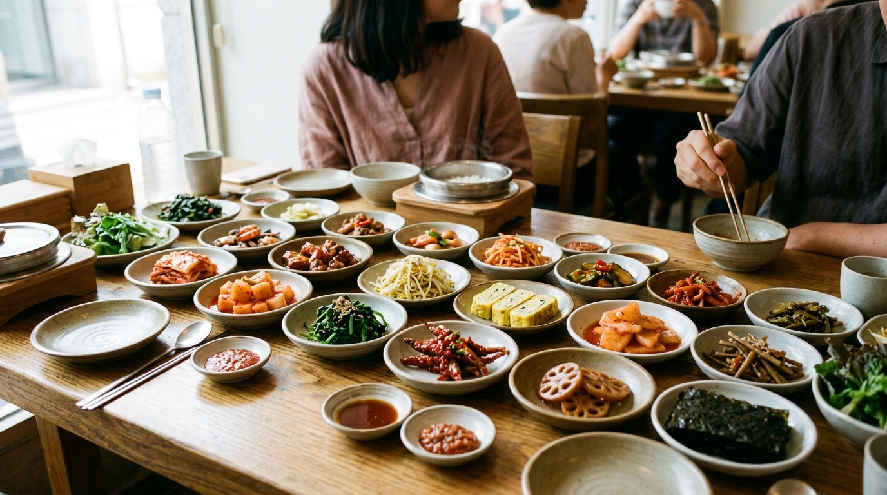
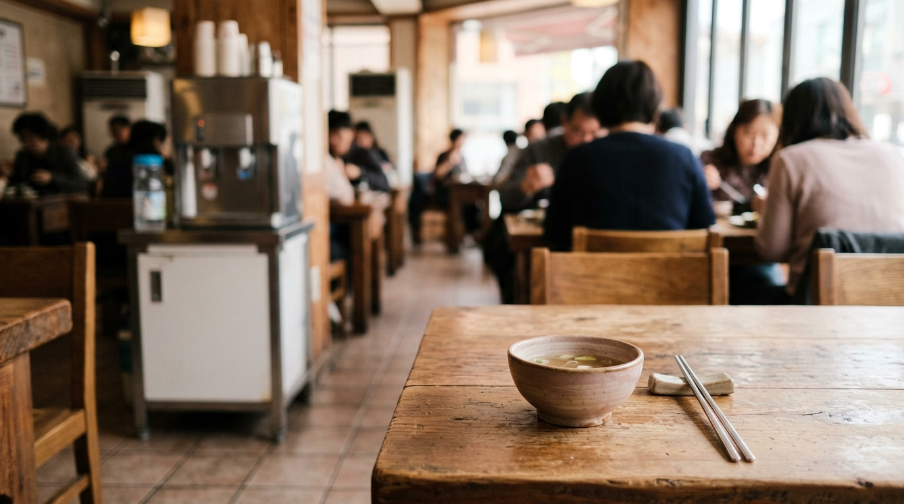

こんにちは、SEOUL TRIP NOTE の J です。

韓国の食堂に入ると、席に着くなり次々と小皿（パンチャン）が並び、テーブルの側面には謎のボタン。いざ会計しようと思っても、日本のようにテーブルで店員を呼ぶべきなのか迷う旅行者は少なくありません。

注文時のベルの使い方から無料おかわり（パンチャン）の頼み方、そしてレジ会計やテーブル決済の流れまで、現地のリアルな仕組みをまとめました。

### 【結論】要点まとめ

*   **入店後**: 案内されるか空いている席へ。メニューは卓上や壁面に掲示されていることが多い。
*   **注文時**: 卓上や側面の**呼び出しベル**を押す。指差し注文で十分通じる。
*   **パンチャン**: 基本は**無料でおかわり可能**。セルフバー方式と口頭注文方式がある。
*   **会計**: **伝票を持ってレジへ行く店**と、**卓上タブレットでそのまま決済する店**がある。
*   **支払い**: カード社会のためクレカが主流。チップ文化はなし。

---

### 入店から注文まで「呼び出しベル」を使いこなそう

店に入ったら、まずは席の確保です。店員が案内してくれる場合もありますが、混雑していなければ空いている席に自由に座って良いケースも多く見られます。

#### 席に着いたらメニューをチェック

テーブルにメニューが置かれているか、壁一面に大きく掲示されているのが一般的です。写真付きのメニューも多いため、韓国語が読めなくても指差しで注文できます。

注意したいのが「最低注文数」。サムギョプサルなどの焼肉やタッカンマリ、大鍋料理などは「2人前以上から注文可能」と定められている店が目立ちます。人数分の注文が必要か事前に確認しておくと安心です。

#### 呼び出しベルの探し方と使い方

注文が決まったら店員を呼びます。現地の飲食店では、声を出して呼ぶよりもテーブルのベルを使うスタイルが定着しています。

*   **ベルの場所**: テーブルの天板の角、もしくは**テーブル側面のカトラリー引き出し付近**に埋め込まれているケースがよくあります。
*   **使い方**: ボタンを押すと「ピンポン」と電子音が鳴り、ホールの電光掲示板にテーブル番号が表示されます。
*   **店員が来たら**: メニューを指差しながら「イゴ ジュセヨ（これください）」と伝えれば十分です。

> **ポイント：簡単な韓国語フレーズ**
> 「チョギヨ（すみません）」：ベルがない店や店員に声をかけるとき。
> 「イゴ ジュセヨ（これください）」：メニューを指差しながら。
> 「ムル ジュセヨ（水ください）」：お水が欲しいとき（セルフサービスの店も多い）。
> 「メウンゴ アンデヨ（辛くないもの）」：辛い料理を避けたいとき。

#### 混雑時の注文のコツ

ランチタイムなどの混雑時は、ベルを押してもすぐに対応できないことがあります。何度も連打せず少し待ち、近くを通ったタイミングで軽く手を挙げて「チョギヨ」と声をかけるのが自然です。

---

### 無料おかわり「パンチャン」の楽しみ方とマナー

※ AIで生成したイメージ画像です

韓国料理の魅力といえば、メインを頼むと自動的についてくる小皿のおかず「パンチャン（반찬）」。キムチやカクテキ、ナムル、練り物（オムク）炒めなどが並びます。

#### パンチャンとは？

メイン料理に付随するおかずで、日本の小鉢料理のような位置づけです。品数は店によって異なり、一般的な定食屋なら3〜4品、韓定食や専門店ではテーブルを埋め尽くすほど並ぶこともあります。

#### おかわりはどこまで無料？

大半の食堂で、パンチャンは**無料でおかわり可能**とされています。提供スタイルは主に2通りです。

*   **セルフバーの場合**: 店内の一角に「셀프바（セルフバー）」と書かれたコーナーがある場合、空いた小皿を持って自分で取りに行きます。食べ切れる量だけ取るのがマナーです。
*   **店員に頼む場合**: セルフバーがない店では、空いた小皿を指差しながら「イゴ ト ジュセヨ（これ、もっとください）」と伝えます。

なお、カンジャンケジャンや肉類、手の込んだチヂミなどがパンチャンとして出てきた場合、それらの高級なおかずはおかわり不可、または追加料金が必要なケースもあります。迷ったら「リピル ドェヨ？（おかわりできますか？）」と確認してみてください。

---

### スムーズな会計方法と食後の流れ

食事が終わったあとの会計手順は、日本の居酒屋やファミレスと異なる部分があります。

#### 会計のタイミングと場所：レジ会計とテーブル決済

近年は**卓上タブレットで注文から決済まで完了する「テーブル決済」**を導入する店舗が急増しています。一方で、昔ながらの**食後に伝票を持ってレジへ向かう店**も依然として多く、店舗によって手順が分かれます。

*   **テーブル決済の場合**: 卓上のタブレット端末で注文し、端末下部のカードリーダーにクレジットカードを差し込んでその場で支払いを済ませます（先払い方式が主流）。食後はそのまま退店して問題ありません。
*   **レジで会計する場合**:
    1.  **伝票を確認**: 注文完了時、店員がテーブルに細長い伝票を置いていくか、バインダーに挟んで卓上に置きます。
    2.  **伝票を持ってレジへ**: 席で店員を呼んで会計を頼む習慣はありません。食べ終わったら伝票を手に取り、出入り口付近にあるレジ（계산대）へ直接向かいます。伝票がない店（POSレジで管理している店）は、そのままレジへ行きテーブル番号を伝えるか指差せば問題ありません。
    3.  **レジで支払い**: 伝票を渡し、支払いを済ませて退店します。

一般的なお店では、食後に席でデザートや追加ドリンクを頼んで長居する文化はありません。食後にコーヒーを飲みたい場合は、レジ横に設置されている無料の小型自販機（甘いインスタントコーヒー）を利用するか、近くのカフェに移動するのが現地では定番です。

#### 支払い方法

*   **クレジットカード**: 完全なキャッシュレス社会のため、ほぼすべての食堂で利用可能です。執筆時点の目安としてVISAやMastercardなどの主要国際ブランドが広く使えます。
*   **現金**: 利用自体は可能ですが、屋台や一部の市場を除けばカード決済のほうがスムーズな場面が多いとされています。
*   **チップ**: 日本と同様に**チップ文化はありません**。表示金額をそのまま支払えば完了です。

レシート（ヨンスジュン）が必要な場合は「ヨンスジュン ジュセヨ」と伝えると発行してもらえます。請求金額と注文内容に間違いがないか、受け取った際に確認しておくと安心です。

---

### 【比較】食堂の種類別：注文・おかわり・会計の傾向

| 食堂の種類           | 注文方法                                    | パンチャンのおかわり | 会計方法                        | 特徴                                                              |
| :------------------- | :------------------------------------------ | :------------------- | :------------------------------ | :---------------------------------------------------------------- |
| **一般的な食堂**     | 呼び出しベル、または口頭で注文。             | 無料（店員注文またはセルフ）| 伝票を持ってレジへ直行。         | チゲ、定食など日常的なメニュー。提供が早い。                      |
| **大型チェーン店**   | 卓上タブレット、または呼び出しベル。         | 無料（セルフバー形式が多い）| 卓上端末でのテーブル決済、またはレジ会計。 | タブレットで日本語切り替えができる店舗も増加中。                  |
| **粉食（プンシク）・軽食店**| 卓上の注文票に数量を記入、キオスク、または口頭。 | たくあん・スープ等はセルフ   | 先払い、または食後にレジへ。     | キンパ、トッポッキなど。サクッと一人で食べるのに最適。            |
| **焼肉・鍋専門店**   | 呼び出しベルで注文。初回は2人前以上の店が多い。| 無料（店員注文またはセルフ）| 伝票を持ってレジへ。             | 肉の追加注文は1人前からOKな場合が多い。                          |

---

### 注意点と知っておきたいこと

※ AIで生成したイメージ画像です

> **最低注文数のルール**
> 焼肉、タッカンマリ、プデチゲなどの大鍋料理は「2人前〜」の注文が基本です。一人旅で訪れる場合は、メニューに「1인분（1人前）」の表記があるか確認するか、クッパ専門店や定食を一人前ずつ出してくれるペッパンチプ（定食屋）、粉食店（プンシクチプ）などを選ぶと断られる心配がありません。

> **カトラリーとお水のセルフサービス**
> テーブルの上にスプーンや箸が見当たらないときは、テーブル側面の引き出しを開けてみてください。紙ナプキンと一緒に収納されています。また、お水は「물은 셀프（水はセルフ）」と書かれている店が多く、ウォーターサーバーから自分で注ぐスタイルが一般的です。

---

### よくある質問（FAQ）

**Q1: 一人でも入りやすい食堂はありますか？**
A1: キンパやラーメンを扱う「粉食（プンシク）」店、クッパ専門店、チェーンのチゲ店などは一人客が非常に多く、気兼ねなく利用できます。現地でも一人飯（ホンパプ）が定着しているため、オフィス街のランチ時を少し外せば気軽に入店できる店が大半という声が多いです。

**Q2: 注文時に日本語は通じますか？**
A2: 明洞や弘大などの観光地では日本語対応スタッフがいる店もありますが、ローカルな食堂では基本的に韓国語のみです。指差しや翻訳アプリを活用するのが確実とされています。

**Q3: パンチャンのおかわりは何度でもできますか？**
A3: 無料のパンチャンはおかわり可能ですが、残さず食べ切るのが前提のマナーです。2回程度を目安とし、必要な小皿だけを指定して頼むと無駄がありません。

**Q4: 会計は食後すぐで良いですか？**
A4: 卓上タブレットで先払いを済ませている場合はそのまま退店して問題ありません。レジ会計の店では、食事を終えたら卓上の伝票を持ってそのままレジへ向かってください。席で店員を待つ必要はありません。

---

現地の食堂のルールは「ベルで呼び、パンチャンを楽しみ、卓上またはレジで決済する」という流れさえ押さえておけば難しくありません。地元の人で賑わう食堂に、ぜひ足を運んでみてください。