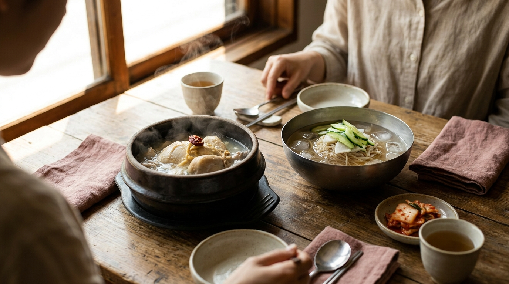
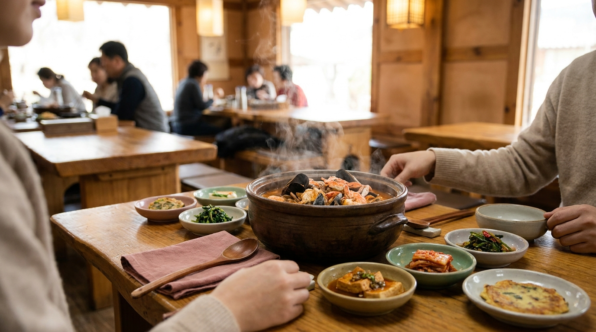

こんにちは、SEOUL TRIP NOTE の J です。

韓国旅行の大きな楽しみといえば食事。日本と同じように、韓国にもそれぞれの季節に食べる定番料理や旬の味覚がたくさんあります。韓国料理には「医食同源」の考え方が根付いており、暑い時期には暑さで弱った体をいたわる料理を食べ、寒い冬には体を芯から温める温熱料理を囲む文化が受け継がれてきました。

せっかく現地を訪れるなら、その時期に一番おいしく食べられる旬のメニューを選びたいところです。ソウル在住の立場から、春・夏・秋・冬それぞれの季節に親しまれている代表的な韓国季節料理と、旬の食材を分かりやすく整理しました。旅行計画の参考にしてみてください。

> **この記事の要点まとめ**
> - **春（3〜5月）**: チュクミ（イイダコ）や春ナムル、旬のイチゴを使ったスイーツが定番。
> - **夏（6〜8月）**: 「伏日（ポンナル）」に食べるサムゲタン（参鶏湯）や、冷たいコングクス、冷麺で暑さを乗り切る。
> - **秋（9〜11月）**: コッケ（ワタリガニ）やテハ（大エビ）、チョノ（コハダ）など海鮮の旬が充実。
> - **冬（12〜2月）**: 屋台のおでんやホットク、温かいソルロンタンなど、体が温まる韓国冬グルメが中心。

---

## 春（3月〜5月）：苦味と香りで春の訪れを感じる料理

寒さが和らぎ、市場やマート（スーパー）に山菜や新鮮な海産物が並び始める春。冬の間に落ちていた食欲を刺激するような、香りの高い食材やピリ辛の料理が好まれます。

### チュクミ（イイダコ）
春の韓国で外せない海産物が「チュクミ（イイダコ）」です。春先（3月から4月頃）は産卵期前で身が柔らかく、頭部に米粒のような卵（パパル）が詰まっているのが特徴とされています。甘辛いコチュジャンベースのタレで野菜やサムギョプサルと一緒に炒める「チュクミポックム」が定番で、辛いものが好きな人に広く親しまれています。

### 春ナムル（ポムナムル）
タッレ（ヒメニラ）、ネンイ（ナズナ）、ツルマンネングサ（トルナムル）など、春に芽吹く山菜を使ったおかずが食堂のパンチャン（小皿料理）に登場します。独特のほろ苦さと爽やかな香りがあり、テンジャンチゲ（味噌チゲ）に入れたり、ビビンバの具材として楽しむのが一般的です。

カフェやスイーツの分野では、春先まで韓国産イチゴ（タルギ）を使った限定メニューが多く展開されます。春のソウルを散策するなら、季節の気候を事前に確認しておくと安心です。詳しい気候については[ソウル旅行のベストシーズンはいつ？月別の気温・服装・混雑しやすい韓国祝日ガイド](/blog/seoul-best-season-weather/)でも解説しています。

---

## 夏（6月〜8月）：以熱治熱のサムゲタンと冷たい麺料理

※ AIで生成したイメージ画像です

韓国の夏には、「以熱治熱（熱をもって熱を治す）」という有名な言葉があります。暑いときに熱いものを食べて汗を流し、体の巡りを整える健康法です。一方で、ひんやりとした冷たい麺料理も夏の風物詩として定着しています。

### サムゲタン（参鶏湯）
韓国には「伏日（ポンナル）」と呼ばれる、日本の土用の丑の日にあたる日が夏に3回（初伏・中伏・末伏）あります。この日を中心に滋養食として食べられるのがサムゲタンです。若鶏のお腹にもち米、高麗人参、ナツメ、ニンニクなどを詰めてじっくり煮込んだスープ料理で、刺激が少なく、旅の疲労回復メニューとしても選ばれています。

> **混雑の注意点**
> 伏日（7月中旬〜8月中旬の計3日）当日は、ソウル市内の有名サムゲタン店周辺に大行列ができます。昼時や夕食時は1〜2時間待ちになることもあるため、伏日当日の訪問はピーク時間を避けるか、日程を前後にずらすのが賢明です。

### コングクスとネンミョン（冷麺）
さっぱりした食事を取りたい日には、大豆をすりつぶして作った冷たいスープに麺を入れて食べる「コングクス」が人気です。クリーミーで濃厚な大豆の風味があり、塩または砂糖（地域によって好みが分かれます）で味を調えて食べます。また、氷が浮いた冷たいスープの水冷麺（ムルレンミョン）や、辛いタレを絡めて食べるビビン冷麺（ビビンネンミョン）も夏場の定番です。

食堂での基本的な注文の仕方は、[韓国の食堂でスマートに注文！初心者も安心の呼び出しベル・おかわり・会計ガイド](/blog/korean-restaurant-ordering-guide/)に詳しくまとめています。

---

## 秋（9月〜11月）：海鮮と実りの秋を味わうメニュー

韓国の秋は空気が澄んで過ごしやすく、食欲の秋にふさわしい旬の味覚が揃います。特に西海岸沿いを中心に、カニやエビなどの海産物が最もおいしい時期を迎えます。

### コッケ（ワタリガニ）
秋のワタリガニはオスが身をぎっしり蓄える時期とされています（内子が入ったメスは春が旬です）。身が甘く詰まった秋のカニは、コチュジャンベースの辛いスープで煮込む「コッケタン」や、醤油漬けの「カンジャンケジャン」などで親しまれています。

### テハ（天然大エビ）とチョノ（コハダ）
秋の定番グルメとして韓国全土で人気なのが「テハグイ（エビの塩焼き）」です。鍋いっぱいに粗塩を敷き詰め、その上でエビを蒸し焼きにして食べます。また、「秋のコハダは家出した嫁も帰ってくる」という韓国のことわざがあるほど、脂が乗ったチョノ（コハダ）のお刺身や焼き魚も秋の風物詩として知られています。

市場や海鮮街で新鮮な食材を楽しみたいときは、ソウル市内のグルメ通りを散策してみるのもおすすめです。[ソウルのグルメ通りをエリア別に紹介｜鍾路・乙支路・新林の特徴と歩き方](/blog/seoul-food-alley-by-area/)もチェックしてみてください。

---

## 冬（12月〜2月）：冷え込む季節に恋しくなる韓国冬グルメ

ソウルの冬は氷点下まで気温が下がる日が多く、乾燥した冷たい風が吹きます。そのため、韓国冬グルメは湯気が立ち上るアツアツの汁物や、屋外で手軽につまめる屋台料理が主役になります。

### 屋台おでんとホットク
街角や地下鉄の駅近くに並ぶ屋台（ポジャンマチャ）から漂うおでん出汁の香りは、冬のソウルの象徴的な風景です。串に刺さった練り物（オムク）を食べながら、紙コップに注いだ熱いおでんスープを飲むと冷えた体が温まります。また、黒糖やシナモン、ナッツを生地に包んで油で揚げ焼きにした甘い「ホットク」も、冬になると行列ができる定番おやつです。

### ソルロンタン・コムタン
牛の骨や肉を長時間じっくり煮込んで白濁させたソルロンタンは、冷え切った朝や夜の食事に最適です。味付けがされていない状態で提供されることが多いため、テーブルにある塩・胡椒・刻みネギを自分で加えて好みの味に調整して食べます。刺激が少なく胃に優しいため、旅行中の朝ごはんとしても選ばれています。

---

## 季節別・韓国定番料理の特徴比較

それぞれの季節を代表する料理について、特徴や辛さの目安、価格帯をまとめました。

| 季節 | 料理名 | 主な特徴 | 辛さの目安 | 価格帯の目安（1人前） |
| :--- | :--- | :--- | :--- | :--- |
| **春** | チュクミポックム | イイダコの甘辛炒め。春は身が柔らかい | 中辛〜大辛 | 14,000〜18,000ウォン |
| **夏** | サムゲタン（参鶏湯） | 若鶏にもち米や漢方素材を詰めた滋養スープ | 辛くない | 16,000〜22,000ウォン |
| **夏** | コングクス | 冷たい豆乳スープで食べるヘルシーな麺 | 辛くない | 10,000〜14,000ウォン |
| **秋** | コッケタン | 旬のワタリガニと野菜の辛口鍋 | 中辛 | 20,000〜30,000ウォン（※2人前〜） |
| **冬** | ソルロンタン | 牛骨を煮出した白濁スープ。塩で味付け | 辛くない | 11,000〜15,000ウォン |
| **冬** | 屋台おでん（オムク） | 練り物串と温かいお出汁 | 辛くない（一部辛い味あり） | 1,000〜2,000ウォン（1本） |

※価格はソウル市内における執筆時点の一般的な目安です。店舗や時期により変動するため、店頭のメニュー表で最新情報をご確認ください。

---

## 季節料理を食べる際の注意点とお得な楽しみ方

※ AIで生成したイメージ画像です

旬の韓国料理を快適に楽しむために、知っておきたいポイントがいくつかあります。

> **海鮮メニューの注文ルールと価格表記**
> コッケタンやテハグイなどの旬の海鮮料理は、2人前以上からの注文が基本となる食堂が多いです。また、水産市場や一部の専門店では「シッカ（時価）」と表記されている場合があり、日によって価格が変わります。注文前に1人前または1キロあたりの価格を店員さんに確認しておくと安心です。

屋台やローカル店で季節の軽食を楽しむ際は、現金のみ対応の店舗や、韓国のプリペイドカード・決済アプリが推奨される店舗もあります。事前に交通系カードや決済手段の準備を整えておきましょう。

---

## よくある質問（FAQ）

### Q1. サムゲタンは夏以外でも食べられますか？
はい、通年で提供している専門店がほとんどです。韓国では夏のスタミナ料理として有名ですが、冬に体を温めるために食べる地元の人も多く、一年中いつでもおいしく食べられます。

### Q2. 辛いものが苦手でも春のチュクミは食べられますか？
チュクミポックムは炒め物の中でも比較的辛さが強い料理です。辛さを控えめにできるか注文時に尋ねるか（韓国語で「トル メプケ ヘジュセヨ」など）、チーズをトッピングできるお店を選ぶと辛さが和らぎます。

### Q3. コングクスは一年中注文できますか？
コングクスは「夏期限定メニュー」として5月〜9月頃のみ提供する食堂が多いです。有名なコングクス専門店の中には通年提供している店舗もありますが、一般的な粉食店や食堂では夏以外の季節にはメニューにない場合があるため注意してください。

### Q4. 屋台のおでんスープはおかわりできますか？
はい、基本的におでんスープ（オムククンムル）はセルフサービス、または店員さんに頼んで紙コップについでもらう形で自由に飲むことができます。おでんを注文した人への無料サービスとなっているのが一般的です。

---

## まとめ

韓国には、その時期ならではの気候に合わせた美味しい食材と料理文化があります。

- **春**: 柔らかいチュクミや爽やかな春ナムル
- **夏**: スタミナ満点のサムゲタンと冷たいコングクス
- **秋**: 脂がのったカニやエビなどの海鮮
- **冬**: 温かいソルロンタンや湯気の立つ屋台フード

旅行の時期に合わせた韓国季節料理を取り入れると、旅の満足度が一段と高まります。渡航日程の旬の味をチェックして、思い出に残る食事の時間を楽しんでください。