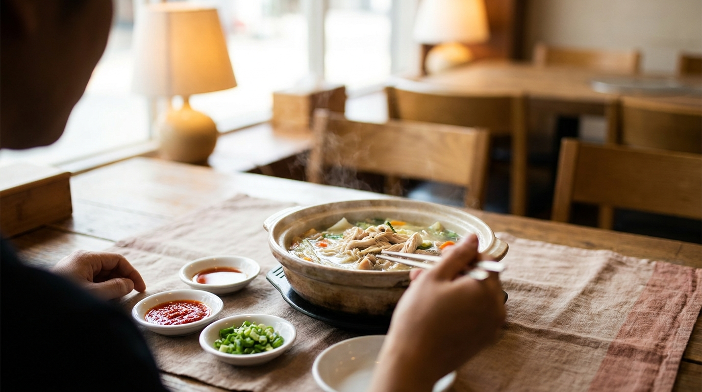
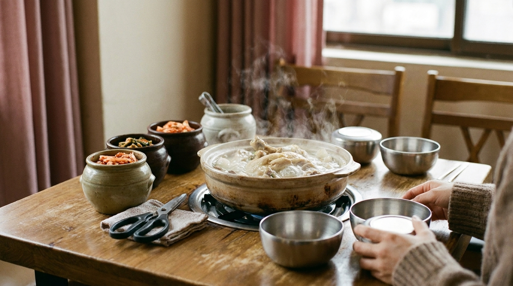

こんにちは、SEOUL TRIP NOTE の J です。

韓国旅行の楽しみといえば、滋味あふれるスープ料理を思い浮かべる方も多いのではないでしょうか。東大門の名物として知られる「タッカンマリ」や、朝ごはんの定番である「ソルロンタン」は、日本からの旅行者にも非常に人気が高いメニューです。

しかし、テーブルに運ばれてきた料理を前にして、「味がついていないけれど、どう味付けすればいいの？」「タデギ（唐辛子調味料）はどう使うの？」「スープにご飯を入れて食べるのはマナー違反にならない？」と戸惑ってしまう場面も少なくありません。

日本の飲食店ではあらかじめ完成された味付けで提供されることが多い一方、韓国のスープ料理は「客が自分の好みに合わせて卓上で味を完成させる」という食文化が根付いています。

ソウル在住の視点から旅行者が迷いやすいポイントを整理し、タッカンマリやソルロンタンを最後まで美味しく味わうための手順や調味料の使い方、締めの頼み方を解説します。

> **この記事の要点まとめ**
> - **ソルロンタン**：提供時は塩気がほぼゼロ。卓上の粗塩、胡椒、刻みネギを少しずつ加えて自分好みの塩加減に整える。
> - **タッカンマリ**：鶏肉につけるタレは卓上の「タデギ・醤油・酢・マスタード」を各自の小皿で調合して作る。
> - **ご飯の投入**：韓国ではスープにご飯を入れて食べる（クッパにする）のは通常のマナーであり、全く失礼にあたらない。
> - **締め**：タッカンマリは「カルグクス（うどん）」、残ったスープにはお粥（チュッ）を追加するのが定番。

---

## 味が薄い？ソルロンタンの食べ方と卓上調味料の使い方

牛の肉や骨を長時間じっくり煮込んで作る「ソルロンタン」は、乳白色の優しいスープが特徴です。辛いものが苦手な方や、胃を休めたい朝ごはんとしても選ばれています。

朝からソルロンタンを楽しみたい方は、あわせて[ソウルの朝ごはん事情｜朝から開いている店の種類と定番メニュー](/blog/korean-breakfast-options/)も参考にしてみてください。

### 1. まずはスープ本来の味をひと口確認する
料理が運ばれてきたら、調味料を入れる前にスプーンでスープをひと口すくって味わってみてください。ソルロンタンの多くは厨房で塩分をほとんど加えていません。そのため、最初は「味が薄い」「お湯のよう」と感じるのが一般的です。

### 2. 粗塩と胡椒で味の輪郭を決める
テーブルの上には、大きめの壺に入った粗塩（ソグム）と胡椒（フチュ）が置かれています。
- **粗塩**：スプーンの先を使って、少しずつスープに溶かしていきます。一気に入れると塩辛くなり元に戻せなくなるため、味見をしながら数回に分けて調整してください。
- **胡椒**：お好みで2〜3振り加えると、牛骨特有の香りが引き締まります。

### 3. ネギをたっぷり加える
卓上にネギが山盛り入った容器が用意されている店舗では、好みの量をスープに投入します。熱々のスープでネギがしんなりとし、甘みと爽やかな風味が加わります。

### 4. カクテキの汁（クンムル）を入れる文化
ソウルの食堂では、付け合わせのカクテキ（大根キムチ）の赤い漬け汁をスプーンですくい、スープに回し入れて食べるスタイルも親しまれています。
酸味と辛味が加わり、さっぱりとした味に変化します。最初から入れるのではなく、半分ほどプレーンな味を楽しんだ後の味変として試してみるのがおすすめです。

---

## タッカンマリの食べ方とタデギ（辛味調味料）の黄金比



<p class="img-cap">※ AIで生成したイメージ画像です</p>

鶏一羽を丸ごと煮込む鍋料理「タッカンマリ」は、特に東大門周辺の専門通りが有名です。ショッピング前後の食事としても親しまれています。周辺の散策計画を立てている方は、[東大門ショッピング完全ガイド｜卸売とファッションビルの違い・営業時間・買い方](/blog/dongdaemun-shopping-guide/)も併せてチェックしてみてください。

### 鍋の火入れと鶏肉をカットするタイミング
テーブルに鍋が運ばれると、大きな丸ごとの鶏肉が入っています。多くの店では店員さんがハサミで一口大に切り分けてくれますが、混雑時はそのまま置かれることもあります。
鶏肉に火が通るまで強火で煮込み、具材のトック（떡／餅）がスープの表面に浮き上がってきたら食べごろの合図です。まずは柔らかくなったトックから食べ始め、しっかりと火の通った鶏肉やジャガイモをいただきます。

### 自分で作る特製タレ（ソース）の黄金比率
タッカンマリは、鍋のスープに直接濃い味をつけるのではなく、小皿に作ったタレに鶏肉をつけながら食べるのが基本です。卓上には以下の調味料が並んでいます。

- **タデギ（다대기）**：唐辛子やニンニクなどを練り合わせた赤い辛味ペースト
- **カンジャン（간장）**：タッカンマリ専用の薄口醤油ダレ
- **シクチョ（식초）**：お酢
- **キョジャ（겨자）**：からし（マスタード）
- **刻みキャベツやニラ**：タレの器に入れる野菜

一般的な調合の比率は以下の通りです。

```text
【タッカンマリ用タレの目安比率】
・タデギ：スプーン半分〜1杯（辛さに応じて調整）
・醤油ダレ：大さじ1〜2
・お酢：小さじ1
・からし：少々（お好みで）
```

これらを小皿でよく混ぜ合わせ、刻みキャベツを加えてタレを絡めます。煮上がった鶏肉にこのキャベツとタレをたっぷりのせて食べるのが、現地で定番のスタイルです。

> **タデギ使い方の注意点**
> タッカンマリ専門店のタデギは、見た目以上に辛味が強い場合があります。最初から大量に小皿や鍋に入れないよう注意してください。まずは少量から味を見て、徐々に辛さを足していくのが失敗しないコツです。

---

## 韓国スープにご飯を入れるマナーと「クッパ」の楽しみ方

日本ではご飯をスープや味噌汁に入れる行為がマナー違反とされる場面もありますが、韓国では日常的かつ正統な食べ方のひとつです。

### 「タロクッパ」とご飯の投入スタイル
韓国では、スープ料理とご飯の提供形式や食べ方にいくつかのアプローチがあります。

1. **タロクッパ（따로국밥）**：ご飯とスープが別々の器で提供される形式
2. **通常のクッパ（국밥）**：最初からスープの中にご飯が入った状態で提供される形式

別々に出されたご飯をスープに入れて食べる行為は「マラモッタ（말아 먹다）」と呼ばれ、親しまれている食べ方です。

ソルロンタンやコムタンを注文すると、ご飯が別添えのステンレス器（コンギパプ）で提供されることが多いです。最初から全量を入れるとご飯がスープを吸って冷めやすくなるため、まずはスープと具材をそのまま楽しみ、後半にご飯を半分ずつスープに入れて食べる方法がよく推奨されます。

また、スプーン（スッカラ）の使い方にも特徴があります。韓国では器を手で持ち上げて食べるのはマナー違反とみなされるため、器はテーブルに置いたまま、スプーンですくって口へ運ぶのが正しい作法です。

韓国の飲食店全般での注文や食事のマナーについて詳しく知りたい方は、[韓国の食堂でスマートに注文！初心者も安心の呼び出しベル・おかわり・会計ガイド](/blog/korean-restaurant-ordering-guide/)もご覧ください。

---

## スープ料理を締めくくる麺とお粥の注文手順

スープ料理の最後には、旨味が凝縮されたスープを使って麺やご飯を楽しむ「締め」が欠かせません。

### タッカンマリの締め：カルグクス（生うどん）
鶏肉を食べ終えたら、店員さんに「カルグクス サリ（칼국수 사리／うどん麺の追加）」を注文します。
残ったスープに生麺を入れ、強火で煮込みます。スープが煮詰まって塩辛くなっていたり少なくなっていたりする場合は、店員さんに「ユックス チョム ト ジュセヨ（육수 좀 더 주세요／スープをもう少し足してください）」と伝えると、無料でダシを追加してもらえます。

### お粥（チュッ）の追加
麺を食べた後、または麺の代わりに「チュッ（お粥）」を頼むことができるお店もあります。ご飯、刻み海苔、ごま油、卵などを残った鶏ダシのスープと合わせて店員さんが目の前で仕上げてくれます。濃厚なダシを吸ったお粥は、タッカンマリの締めくくりにぴったりです。

---

## 【比較】韓国の人気スープ料理 特徴・味付け・締め一覧

韓国旅行でよく食べられる代表的なスープ料理の特徴をまとめました。それぞれ味付けの方法や締めのスタイルが異なります。

| 料理名 | 主な具材 | 提供時のスープの味 | 卓上調味料による味付け | 代表的な締め |
| :--- | :--- | :--- | :--- | :--- |
| **ソルロンタン** | 牛肉、素麺 | 味付けなし（薄味） | 粗塩、胡椒、刻みネギ、キムチ汁 | ご飯を投入（クッパ） |
| **タッカンマリ** | 鶏一羽、餅、ジャガイモ | 澄んだ薄味の鶏ダシ | 小皿でタデギ・醤油・酢・からしを調合 | カルグクス（うどん）、お粥 |
| **コムタン** | 牛肉、内臓 | ほんのり下味あり | 粗塩、胡椒、刻みネギ | ご飯を投入（クッパ） |
| **テジクッパ** | 豚肉（茹で豚のスライス）、内臓 | 店舗により薄味〜味付き | セウジョッ（アミの塩辛）、タデギ、ニラ | ソミョン（素麺）、ご飯を投入 |
| **タットリタン** | 鶏肉、野菜 | 最初から濃厚な甘辛味 | 基本的に卓上調整は不要 | 炒めご飯（ポックンパ）、ラーメン |

※提供スタイルや取り扱いメニューは店舗や地域により異なります。最新情報は店頭でご確認ください。

---

## 韓国のスープ食堂で知っておきたい注意点



<p class="img-cap">※ AIで生成したイメージ画像です</p>

### 1. タッカンマリは基本的に「2人前」から
ソルロンタンやコムタンは1人前ずつ器で提供されるため一人旅でも気軽に入れますが、タッカンマリは鶏を丸ごと鍋で煮込む特性上、2人前からの注文が基本となります。一人で訪れる場合は、メニューに「タッパンマリ（닭반마리／半羽分）」や1人用メニューの記載があるか事前に確認することをおすすめします。

### 2. キムチのハサミ利用ルール
テーブルに壺ごと置かれているキムチやカクテキは、食べ残しを防ぐためトングとハサミを使って自分で食べやすい大きさに切って小皿に取り分けます。壺の中に直接箸を入れたり、切らずにそのまま口に運んだりしないよう配慮しましょう。

---

## よくある質問（FAQ）

### Q1. タッカンマリの鍋の中にタデギを直接入れてもいいですか？
鍋のスープに直接タデギを入れて辛い鍋にして食べることも可能です。ただし、一度入れてしまうと元の澄んだ優しい味に戻すことができません。最初は小皿のタレで澄んだスープを楽しみ、後半のカルグクスを入れるタイミングでスープにタデギを溶かして味を変える方法がおすすめです。

### Q2. ソルロンタンに入っている麺とご飯はどちらを先に食べるべきですか？
器の中に最初から少量の素麺（ソミョン）が入っている場合、時間が経つと麺がスープを吸って伸びてしまいます。そのため、まずは味を整えたあとに麺から先に食べるのが一般的です。その後にご飯を入れてクッパとして楽しむと美味しくいただけます。

### Q3. スープの追加（お代わり）は有料ですか？
タッカンマリなどの鍋料理で、煮詰まったスープにダシ（ユックス）を足してもらうのは基本的に無料とされています。ソルロンタンなどの一杯完結型の料理では店によって対応が異なり、有料となる場合や少量のスープをサービスしてくれる場合があります。

### Q4. 辛いものが苦手でもタッカンマリは楽しめますか？
十分に楽しめます。タッカンマリのベースとなる鍋のスープ自体には唐辛子が入っておらず、ニンニクやネギが効いた優しい鶏ガラスープです。小皿に作るタレのタデギを抜いて、「醤油＋お酢＋少量のからし」だけでタレを作れば、辛味を気にせずに味わえます。

---

## まとめ

韓国のスープ料理は、自分の手で塩加減を調整したり、オリジナルのタレを作ったりと、味を完成させていくプロセスそのものに醍醐味があります。

- ソルロンタンは粗塩とネギで少しずつ自分好みの味に仕立てる
- タッカンマリはタデギとお酢・醤油を調合した特製タレで鶏肉を味わう
- ご飯をスープに入れてクッパとして食べるのは自然な食文化
- 最後はカルグクスやお粥（チュッ）を追加して旨味を余すところなく楽しむ

調味料の使い方や締めのルールをあらかじめ知っておけば、現地の食堂でも焦らずに落ち着いて食事ができます。ぜひ渡韓の際は、滋味深い本場のスープ料理を味わってみてください。