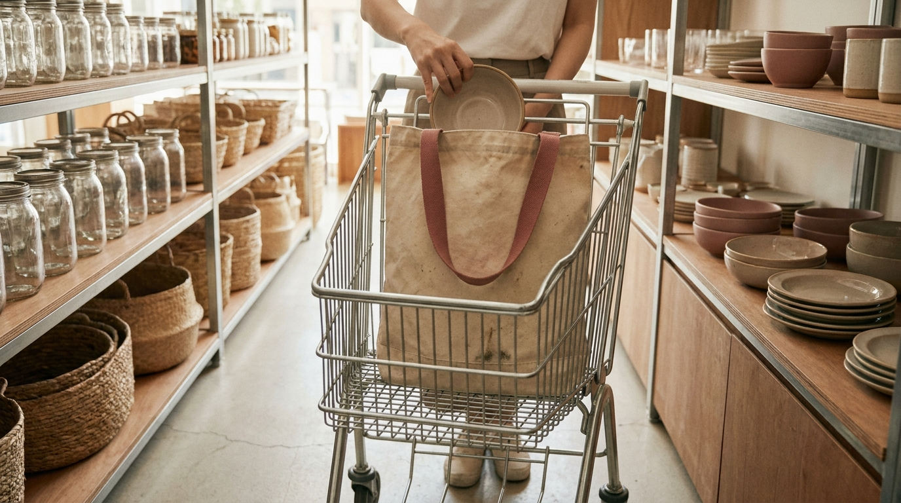
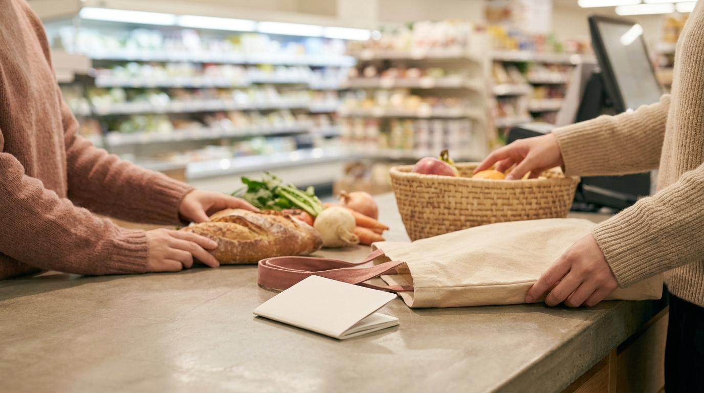

こんにちは、SEOUL TRIP NOTE の J です。

渡韓中の楽しみのひとつが、地元のスーパーマーケット巡りです。コスメやファッションのショッピングだけでなく、韓国スーパーにはお菓子やラーメン、調味料など、旅行者にとって魅力的な韓国食品がたくさん並んでいます。

一方で、「カートの使い方が日本と違う」「レジ袋が有料と聞いたけれどどうすればいい？」「免税（タックスリファンド）はスーパーでも受けられるの？」といった疑問を持つ旅行者の方も多いようです。

ソウルに暮らす立場から、韓国スーパーでの入店から会計までのステップ、レジ袋のルール、お土産として選ばれる定番食品、そして旅行者が知っておくべき定休日の法律ルールまで整理しました。

> **この記事の要点まとめ**
> - 韓国の大型マート（大型スーパー）は、法律により**原則として毎月「第2・第4日曜日」が休業日**に指定されています。旅行の日程を組む際は曜日の確認が必須です。
> - カートを利用する際は**100ウォン硬貨**が必要です（返却時に戻ります）。
> - 使い捨てレジ袋は環境規制により原則提供されません。エコバッグを持参するか、店舗で有料のごみ袋・不織布バッグを購入します。
> - 一部の大型スーパーでは、パスポートを提示することでその場で免税（即時還付）が受けられます。

---

## 韓国の大型スーパー（マート）の種類と特徴

韓国にはいくつかの主要なスーパーマーケットチェーンがあります。渡韓買い物で食品をまとめて購入したい場合、品揃えが豊富な大型マートの利用が便利です。

1. **Eマート（E-mart / 이마트）**
   韓国最大手のスーパーマーケットチェーンです。プライベートブランド「No Brand（ノーブランド）」や「PEACOCK（ピーコック）」を展開しており、手頃な価格でパッケージがおしゃれな食品が揃っています。

2. **ロッテマート（Lotte Mart / 롯데마트）**
   ソウル駅店をはじめ、旅行者がアクセスしやすい立地に大型店舗が多いのが特徴です。外国人旅行者向けの案内や免税対応レジ、お土産コーナーが充実している店舗が多く見られます。

3. **ホームプラス（Homeplus / 홈플러스）**
   独自のプライベートブランド「シグネチャー」などを持ち、セール品や大容量の食品が豊富です。合井（ハプチョン）や東大門（トンデムン）などの主要エリアにも店舗があります。

これら大型マートのほかに、街中には「No Brand」の単独路面店や、駅前の中小型スーパー（Eマートエブリデイ、ロッテスーパーなど）もあります。日程やホテルの場所に合わせて選ぶと移動時間を短縮できます。

---

## 入店から会計まで｜韓国スーパーの買い物の流れ

※ AIで生成したイメージ画像です

日本のスーパーとよく似ていますが、韓国独自のルールや手順がいくつかあります。

### 1. カートとロッカーの使い方
大型スーパーの入り口付近に並んでいるショッピングカートは、チェーンでロックされています。手元の投入口に**100ウォン硬貨**を1枚入れるとロックが外れる仕組みです。買い物後にカートを元の位置に戻し、チェーンの鍵を差し込むと100ウォンが返却されます。

小銭がない場合は、カート置き場の近くに設置されている両替機を利用するか、案内カウンターで両替を依頼してください。手持ちのバッグが大きい場合、入店前に無料ロッカーへ預けるよう案内されることもあります。

### 2. レジ袋のルールと持ち帰り方
韓国では環境保護法に基づき、スーパーやコンビニでの使い捨てプラスチックレジ袋の提供・販売が禁止されています。お買い物の際は以下のいずれかの方法で持ち帰ります。

- **マイバッグ（エコバッグ）を持参する**: 最も手軽でおすすめの方法です。
- **従量制ごみ袋（종량제봉투 / チョンニャンジェボントゥ）を購入する**: レジで「ポントゥ ジュセヨ（袋をください）」と伝えると、ソウル市各区の公式ごみ袋（有料・執筆時点の目安として数百ウォン程度）を購入できます。頑丈なビニール袋で、ホテルで出たごみをまとめる袋としても再利用できます。
- **大型の不織布ショッピングバッグを購入する**: 各スーパーのロゴが入った頑丈なリサイクルバッグ（執筆時点の目安として1,000〜3,000ウォン程度）を購入できます。
- **梱包用ダンボールを利用する**: レジの外側に、無料のダンボール箱が置かれたパッキングコーナーが設置されている店舗があります。ただし環境規制によりテープや結束用プラスチック紐の提供は廃止されているため、利用する場合はテープを持参するか店内で購入する必要があります。

### 3. 会計と支払い方法
韓国はキャッシュレス決済が極めて普及しています。スーパーのレジでは、海外発行のクレジットカードのほか、旅行者向けプリペイドカードも利用可能です。夕方から夜にかけての時間帯は地元住民の買い物でレジが混み合う傾向があるため、ゆったり回りたい場合は午前中や午後の早い時間を狙うのがおすすめです。

交通系プリペイドカードや決済機能の選択については、[渡韓旅行者必見！気候同行カードとWOWPASS徹底比較ガイド【2026年最新】](/blog/climate-card-vs-wowpass-comparison/)でも詳しく解説しています。

---

## 韓国スーパーで選ばれている人気のお土産食品

韓国スーパーは、オリーブヤングやコンビニよりも大容量かつ割安に韓国食品を購入できる場所です。旅行者の間で特に選ばれている代表的なカテゴリを整理しました。

| カテゴリ | 代表的な商品例 | 特徴と選ばれる理由 |
| :--- | :--- | :--- |
| **袋麺（インスタントラーメン）** | 辛ラーメン、ノグリ、ブルダック炒め麺、ジンラーメンなど | 日本未発売の限定フレーバーや、4〜5袋セットのマルチパックがお得な価格で購入できます。 |
| **韓国海苔** | エゴマ油海苔、オリーブ油海苔、海苔ふりかけ（チュモッパ用やジャバン海苔など） | かさばりますが軽量で配りやすい定番品です。缶入りや個包装タイプが人気を集めています。 |
| **スナック・お菓子** | ハニーバターチップ、薬菓（ヤックァ）、チョコパイ、No Brand菓子 | 韓国の伝統菓子である薬菓の現代風アレンジや、プライベートブランドの大容量スナックが注目されています。 |
| **調味料・ペースト** | コチュジャン、サムジャン、ごま油、チゲ用だしパック | 本格的な韓国料理を自宅で再現したい方向け。チューブタイプのコチュジャンは使い勝手が良いと評判です。 |
| **お茶・スティック飲料** | コーン茶（オクスス茶）、柚子茶、マキシム（Maxim）モカゴールド | スティックタイプのミックスコーヒーや、ティーバッグ入りの伝統茶は職場や友人へのばらまきに適しています。 |

お土産全体のジャンル別の選び方や、スーツケースへのパッキングのコツについては、[韓国お土産の選び方完全ガイド｜食品・コスメ・雑貨のジャンル別と持ち帰りの注意点](/blog/korea-souvenir-guide/)に詳しくまとめています。

---

## 大手スーパー3社の特徴比較

旅行者が利用しやすい主要3大マートのサービスや特徴を比較しました。

| 項目 | Eマート（E-mart） | ロッテマート（Lotte Mart） | ホームプラス（Homeplus） |
| :--- | :--- | :--- | :--- |
| **代表的なPBブランド** | No Brand, PEACOCK | 오늘좋은（オヌルチョウン）、요리하다（ヨリハダ） | シグネチャー（Homeplus Signature） |
| **旅行者が行きやすい店舗** | 往十里店、麻浦店、清渓川店など | ソウル駅店、金浦空港店、蚕室店など | 合井店、東大門店、新道林店など |
| **即時免税の対応** | 主要店舗で対応 | ソウル駅店など外国人多数店舗で対応 | 主要店舗で対応 |
| **特徴の傾向** | PBのコスパと品質評価が高い。食品から生活雑貨まで幅広い。 | 空港直結・ターミナル駅立地が多く、お土産用陳列やEMS配送窓口が充実。 | セールや1+1（1個買うと1個無料）企画が多く、広々とした売り場構成。 |

※免税制度の適用条件や導入状況は店舗規模により異なる場合があります。

---

## スーパーでの買い物で気をつけるべき注意点

※ AIで生成したイメージ画像です

### 1. 法律で定められた定休日（大型マート休業日制度）
韓国では、伝統市場や小規模商店の保護を目的とした法律（流通産業発展法）により、一定規模以上の大型マートに対して**原則として毎月「第2・第4日曜日」を休業日**とすることが義務付けられています。

一部の自治体では休業日を水曜日に変更する動きも見られますが、ソウル市内の多くの主要店舗では依然として第2・第4日曜日が休みとなります。旅行最終日に大型スーパーへ行こうとして閉まっていた、という失敗が起きやすいため、訪問予定の店舗の営業カレンダーを事前に確認しておくことが欠かせません。

### 2. 即時還付（タックスリファンド）の条件
大型スーパーの多くは事後免税（Tax Refund）制度に対応しています。

- レジ会計時にパスポートを提示すると、その場で付加価値税（VAT）が差し引かれた金額で支払う「即時還付」が受けられる店舗が増えています。
- 1回あたりの購入金額に下限（執筆時点の目安として15,000ウォン以上。最新の基準は公式情報をご確認ください）と上限が設定されています。
- 会計時に免税処理を希望する場合は、レジを通す前に「タックスフリー プリーズ」と伝え、パスポートを提示してください。

免税制度の詳しい金額基準や空港での手続きとの違いは、[韓国の免税ショッピング完全ガイド｜即時還付と空港還付の比較と手続き手順](/blog/korea-tax-free-shopping-guide/)で解説しています。

> **肉類加工品の持ち込み規制に関する注意**
> 韓国スーパーで販売されているソーセージ、ジャーキー、肉入りレトルトパウチ、牛骨エキス入りラーメンなどの一部商品は、日本の動植物検疫の規制により日本国内へ持ち込むことが法律で禁止・制限されています。食品のお土産を購入する際は、原材料表記に肉エキスや肉片が含まれていないか、農林水産省動物検疫所の最新基準を必ず事前に確認してください。

---

## よくある質問（FAQ）

### Q1. 韓国スーパーの営業時間は何時までですか？
大型マートの営業時間は、一般的に午前10:00〜午後22:00または23:00頃までとされています。深夜営業は行われていないことが多いため、夕食後などに向かう場合は各店舗の公式案内で閉店時間をご確認ください。

### Q2. スーパーの支払いに日本のクレジットカードは使えますか？
VISA、Mastercard、JCBなど、国際ブランドのついた日本のクレジットカードの多くがそのまま利用可能です。セルフレジでもカード決済に対応していますが、ICチップの読み取りエラーが発生した場合は有人レジの利用が推奨されます。

### Q3. 「1+1（ワンプラスワン）」はスーパーでも適用されますか？
韓国スーパーでは「1+1（1個買うともう1個無料）」や「2+1」の割引プロモーションが頻繁に行われています。同じ棚に対象商品が2個束ねられてテープで留められている場合と、自分で同じ商品を2個カゴに入れてレジへ持参する場合の両方があります。値札POPの表記をよく確認してレジへお持ちください。

### Q4. 購入した荷物を日本へ直接送ることはできますか？
ロッテマートソウル駅店など、外国人旅行者の利用が多い一部の店舗には、郵便局（EMS）の配送受付カウンターが設置されている場合があります。送料は重量や為替によって変動するため、店頭のカウンターで最新の配送料金と梱包ルールをご確認ください。

---

## まとめ

韓国スーパーは、地元の食文化に触れながらリーズナブルにお土産を揃えられる場所です。

- **第2・第4日曜日の定休日に気をつけて日程を組む**
- **カート用の100ウォン硬貨とエコバッグを持参する**
- **パッキングコーナーを使う場合はテープを持参する**
- **パスポートを持参して即時還付制度を活用する**
- **肉類などの日本への持ち込み制限品に注意して選ぶ**

基本のルールを押さえておけば、大型マートでも迷うことなくスムーズにお買い物を楽しめます。スケジュールを立てる際は、お近くの大型スーパーの営業日を事前にチェックしてみてください。