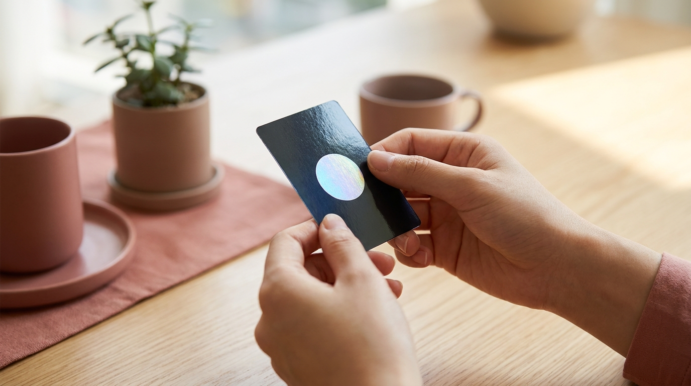
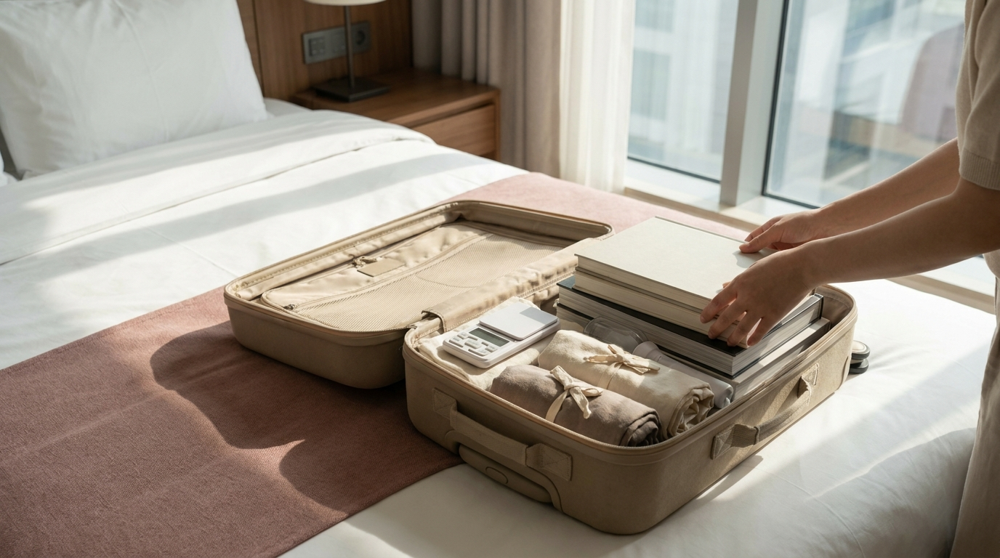

こんにちは、SEOUL TRIP NOTE の J です。ソウル在住の立場から、旅行で訪れるみなさんに役立つ実用情報を整理してお届けしています。

「渡韓オタ活で推しのアルバムや公式グッズを揃えたいけれど、どこへ行けば公式品が手に入るのかわからない」「明洞の地下街などで見かけるグッズは公式なのか見分けがつかない」と悩む旅行者は少なくありません。

韓国アイドルグッズは、大型書店のCDコーナー、所属事務所の公式ショップ、街中のレコードショップ、地下鉄の地下街など、さまざまな場所で販売されています。ただし、販売場所によって公式品を中心に取り扱う店と非公式品が混在する店に分かれています。

主要エリアの特徴、公式品と非公式品を見分ける具体的なポイント、アルバム購入時の注意点をまとめました。

> ポイント
> K-POPアルバムを購入する際は、韓国の音楽チャート（HANTEOチャートやCIRCLEチャート）加盟店で購入すると、推しの公式記録に反映されます。また、公式グッズには公式ライセンスを示すホログラムシールが貼付されているのが一般的です。

---

## ソウル推し活で巡りたい主要エリアと店舗の特徴

ソウル市内でK-POPグッズを探す場合、エリアごとに集まっているショップの傾向が異なります。効率よく回るために、それぞれの特徴を押さえておきましょう。市内を移動する際は、[渡韓旅行者必見！気候同行カードとWOWPASS徹底比較ガイド【2026年最新】](/blog/climate-card-vs-wowpass-comparison/)を参考に移動手段を準備しておくとスムーズです。

### 1. 明洞（ミョンドン）エリア：CDショップと地下街

明洞は観光客が多く訪れるエリアで、CDやグッズを扱う店舗が密集しています。

*   **大型百貨店・書店のCDコーナー**: デパート内の大型レコード店や明洞駅近くのCDショップでは、チャート加盟の公式アルバムや最新の公式ペンライト（応援棒）が揃いやすいとされています。
*   **明洞駅の地下ショッピングセンター**: 改札を出た地下通路には、アイドル写真のポスター、カレンダー、キーホルダー、アクリルスタンドなどを並べる店舗が並んでいます。ただし、こうした地下街で売られているグッズの多くは「非公式品（ファンアートや独自印刷物）」である点に留意が必要です。公式のCDやトレカを一部置いている店もありますが、見極めが求められます。

ショッピング全体の回り方については、[ソウルのショッピングエリア比較｜明洞・弘大・聖水・東大門・江南の違い](/blog/seoul-shopping-area-comparison/)もあわせて確認してみてください。

### 2. 弘大（ホンデ）〜合井（ハプチョン）エリア：若者カルチャーと限定ストア

弘大は若者の街として知られ、アイドル関連のポップアップストアやコラボカフェ、中古トレカの専門店などが点在しています。

*   **大型商業施設の公式ストア**: 弘大入口駅直結の複合ビル内には、大手エンターテインメント企業の公式MDショップやK-POP専門フロアが入居していることがあります。
*   **トレカ・フォトカード専門ラウンジ**: ファン同士の交流や、目当てのトレカを探せる専門店が集まっています。

### 3. 光化門（クァンファムン）・江南（カンナム）エリア：大型書店と事務所ショップ

*   **大型書店のCD・レコードフロア**: 光化門や江南などにある超大型書店の文具・CDコーナーは、公式アルバムの在庫数が豊富です。最新作から過去のアルバムまで幅広く取り扱われており、多くの店舗がHANTEOチャート加盟店とされています。
*   **事務所直営スペース**: 江南や龍山（ヨンサン）、城東区（ソンス周辺）などには、各芸能事務所の社屋近くに直営の公式フラッグシップストアやグッズショップが併設されている場合があります。

---

## 公式グッズと非公式品の見分け方



<p class="img-cap">※ AIで生成したイメージ画像です</p>

街中でK-POPグッズを探す際、購入しようとしているアイテムが所属事務所の監修を受けた「公式グッズ（オフィシャル）」か、第三者が製作した「非公式品」かを見分ける基準を整理しました。

```
【公式・非公式のチェック手順】
1. 裏面・底面の「公式ホログラムシール」を確認する
2. 著作権表示（© 表記や所属事務所名）を確認する
3. 販売価格が定価と比べて不自然に安すぎないか確認する
4. 写真の印刷クオリティ・ロゴのフォントを確認する
```

### 1. 公式ホログラムシールの有無

判別基準として広く知られているのが、商品の外箱や台紙の裏面に貼られている「認証ホログラムシール」です。

韓国の音楽著作権協会（KOMCA）のステッカーや、所属事務所のロゴが入った立体的に輝くホログラムシールが貼られていれば、公式に製造・ライセンスされた商品である可能性が極めて高いといえます。非公式品にはこのシールが貼られていないか、単なる銀色の紙シールになっているケースが見られます。

### 2. コピーライト表記（著作権表示）

公式商品には、パッケージの裏面や側面に「© [事務所名] All Rights Reserved」といった著作権表示が印字されているのが基本です。バーコードや製造元の会社名、カスタマーセンターの連絡先が明記されているかもチェックしてください。非公式品はこれらの表記が省かれているか、文字が潰れて不鮮明な印刷になっていることがあります。

### 3. 価格とアイテムのラインナップ

公式のペンライトやツアーグッズは、定価がウォン単位で明確に設定されています。定価の半額以下など不自然に安価で売られているペンライトは、Bluetooth連動ができない模倣品のリスクが懸念されます。

また、公式写真集の画像を無断印刷した靴下、うちわ、布製スローガン、透明トレカのセットなどは、非公式グッズであるケースが一般的です。

> 注意点
> ペンライト（応援棒）を購入する際は、会場での遠隔操作（無線コントロール）に対応している公式品かどうかが重要です。フリマアプリや非公式ルートの格安品は、外見が酷似していても公演会場の座席ペアリングに対応しないトラブルが報告されています。信頼できる大型店や公式ストアでの購入をおすすめします。

---

## アルバムを購入する際のステップと注意点

韓国現地でアルバムを購入する場合、持ち帰るまでの手順や免税制度を活用しましょう。

### チャート反映店のロゴを確認する

推しの初動売上やランキングに貢献したい場合、店頭に「HANTEO CHART FAMILY」や「CIRCLE CHART」の認定マークが掲示されている店舗で購入してください。大型書店のCD売り場や大手のレコードチェーンは、基本的に加盟店となっていることが多いです。

### 免税（タックスリファンド）の適用

一定額以上のアルバムや公式グッズを購入する場合、外国人旅行者向けの免税手続きが利用できる店舗があります。パスポートを提示してその場で値引きされる「即時還付」に対応している店舗か、空港で手続きする還付レシートを発行してもらいましょう。詳しい免税の仕組みは、[韓国の免税ショッピング完全ガイド｜即時還付と空港還付の比較と手続き手順](/blog/korea-tax-free-shopping-guide/)で解説しています。

---

## 【比較】購入場所別の特徴と取り扱いアイテム一覧

購入したいアイテムに応じて適した店舗を選びましょう。

| 購入場所のタイプ | 主な取り扱いアイテム | 公式品の確実性 | チャート反映 | 免税対応の目安 |
| :--- | :--- | :--- | :--- | :--- |
| **大型書店のCDコーナー**<br>（光化門・江南など） | アルバム全般、雑誌、一部の公式文具 | 極めて高い（公式品中心） | 原則反映（加盟マーク要確認） | 対応店舗が多い |
| **事務所直営公式ストア**<br>（所属事務所周辺など） | 公式ペンライト、ツアーMD、アパレル、限定トレカ | 極めて高い（直営公式品） | グッズ中心（CD取扱は店舗による） | 店舗により対応 |
| **明洞・弘大の路面CD店**<br>（観光客向け専門店） | アルバム、公式ペンライト、特典付きCD | 高い（加盟マーク要確認） | 多くの店舗で反映 | 即時還付対応店あり |
| **地下鉄駅の地下街ショップ**<br>（明洞地下街など） | 写真入り雑貨、カレンダー、ポスター、靴下 | 混在（非公式品が中心） | 店舗ごとに要確認 | 非対応の店が多い |

※店舗の運営状況や取り扱い商品は執筆時点の目安です。訪問前に最新情報をご確認ください。

---

## 渡韓オタ活で後悔しないための注意点



<p class="img-cap">※ AIで生成したイメージ画像です</p>

### スーツケースの重量とスペースの管理

K-POPアルバムはフォトブックを兼ねている仕様が多く、1冊あたり500g〜1kg前後の重さになることも珍しくありません。複数バージョンをまとめ買いすると、航空会社の受託手荷物許容量（一般的に15kg〜23kg程度が執筆時点の目安）を超過しがちです。手荷物用の携帯デジタルスケールを持参するか、ホテルの計量器で事前に重さを測っておくと安心です。

### ペンライトの電池ルール

公式ペンライトの多くは単4乾電池を使用しますが、スーツケースの中で誤ってスイッチが入り点灯・発熱することを防ぐため、搭乗前に本体から電池を抜いておくことが推奨されます。また、リチウムイオンバッテリー内蔵タイプの商品は電源を完全にオフにすれば預け入れも可能ですが、精密機器の破損やトラブル防止のため機内持ち込み手荷物にするのが安心です（なお、モバイルバッテリー等の予備電池は預け入れ不可で機内持ち込みのみとなります）。航空各社の規定を事前に確認しておきましょう。

---

## よくある質問（FAQ）

### Q1. 明洞の地下街で売っているグッズは買ってはいけないのですか？

公式のライセンス観点では、所属事務所の許可を得ていない非公式品が多く含まれています。個人の記念品として買い求める旅行者も見られますが、アーティスト本人の収益や公式チャートには反映されません。公式品のみを集めたい場合は、大型書店や公式ストア、認証シールの貼られた商品を選ぶのが無難です。

### Q2. 韓国のCDショップで購入しても、日本のオリコンチャートには反映されますか？

韓国現地の店舗で購入したアルバムは、基本的に韓国の「HANTEO（ハント）チャート」および「CIRCLE（サークル）チャート」に反映されます。日本のオリコンチャートに反映されるのは、日本国内の対象店舗やオリコン協力店で購入した場合に限られるとされています。

### Q3. 公式ペンライトの価格相場はどのくらいですか？

グループによって異なりますが、一般的な公式ペンライトの定価は 35,000ウォン〜55,000ウォン 程度が目安です（執筆時点の相場）。特殊な機能や限定パーツが付いたものはそれ以上になることもあります。購入時のレートや公式サイトのアナウンスをご確認ください。

### Q4. アルバムの予約特典（店舗特典トレカ）は店頭でももらえますか？

店舗やイベントの開催状況によります。カムバック（新曲発売）直後の特定のプロモーション期間中であれば、店頭購入でも店舗限定フォトカードが付属することがあります。ただし、特典はなくなり次第終了となるケースが多いため、各CDショップの公式SNSなどで最新情報を確認するのが確実です。

---

## まとめ

ソウルでのK-POPグッズ探しは、目的のアイテムに合わせて行き先を使い分けるのがポイントです。

*   **CD・アルバム**: 光化門や江南の大型書店のCDフロア、明洞のチャート加盟CDショップ
*   **公式ペンライト・限定MD**: 事務所直営ショップや大手商業施設の公式ストア
*   **公式品の目印**: 裏面の立体ホログラムシールとコピーライト表記を必ずチェック

事前の下調べを丁寧に行い、信頼できる店舗を選んでソウルでの推し活を快適に楽しんでください。