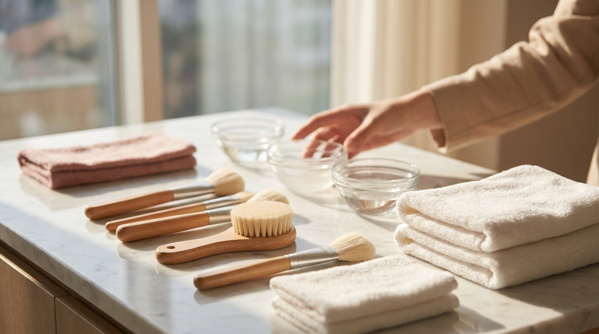
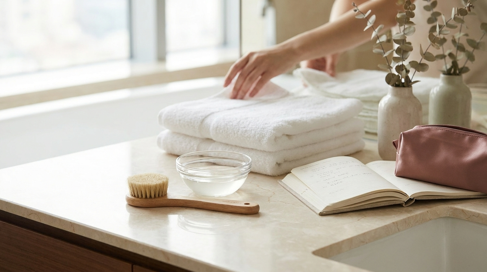

こんにちは、SEOUL TRIP NOTE の J です。

韓国旅行の計画を立てる際、「渡韓肌管理」として美容クリニックの予約を検討する方が増えています。そのなかでも特に名前をよく見かける施術のひとつが「ララピール（LHAピーリング）」です。

「痛くないって本当？」「従来のピーリングと何が違うの？」「旅行中に受けてもメイクや観光に影響はない？」といった疑問を持つ方も多いのではないでしょうか。

この記事では、ララピールの基本的な仕組みや期待される効果、従来のピーリングとの違い、施術当日の注意点までを公式情報や一般的な施術プロトコルをもとに整理して解説します。

> **この記事の要点まとめ**
> - ララピールは肌を剥離させずに角質を満たして満たす「第4世代ピーリング」と呼ばれる施術です。
> - 主成分であるLHA（リポヒドロキシ酸）は分子が大きく、刺激や皮むけ（剥離）が起こりにくい特徴があります。
> - ダウンタイムがほとんどないため、短期間の渡韓スケジュールにも組み込みやすい施術です。
> - 当日は強い日焼け・サウナ・過度なアルコールを避け、高保湿と紫外線対策を徹底する必要があります。

---

## ララピール（LHA）とは？剥がさない第4世代ピーリングの仕組み

ララピール（LHALALA PEEL）は、韓国の製薬会社などによって開発されたピーリング剤で、美容医療分野では「第4世代ピーリング」と呼ばれることがあります。

従来のピーリングは、酸の力で古い角質を溶かして剥がす（剥離させる）アプローチが主流でした。そのため、施術後に赤みが出たり、数日後に皮がポロポロとむけたりするダウンタイムが生じることがありました。

一方、ララピールは「角質を無理に剥がすのではなく、正常化させながら肌を保護する」というコンセプトで作られています。

### 主な有効成分の働き

ララピールには、主に以下のような成分が配合されています。

1. **LHA（カプリロイルサリチル酸 / リポヒドロキシ酸）**  
   従来のサリチル酸（BHA）よりも分子量が大きく、油分になじみやすい性質を持っています。肌の奥へ急激に浸透せず、表皮の角質層へ均一にゆっくりと作用するため、刺激感が少ないとされています。
2. **P-Sol（アルカリ成分）**  
   特許技術により配合されたアルカリ成分で、角質層のタンパク質を緩やかに軟化させ、有効成分の浸透をサポートします。
3. **LIPIDS（脂質成分）**  
   細胞間脂質に似た成分で、バリア機能が低下した肌表面を保護し、施術後の乾燥を防ぐ役割を果たします。

酸性度を極端に高めて溶かすのではなく、アルカリ成分と脂質成分を組み合わせることで、肌のバリア機能を守りながらキメを整える仕組みになっています。

---

## ララピールで期待できる効果と口コミの傾向

※ AIで生成したイメージ画像です

渡韓肌管理としてララピールが選ばれている背景には、刺激の少なさと施術直後からの扱いやすさがあります。

### 期待できる主な肌へのメリット

- **肌のキメとツヤ感の向上**：角質表面が滑らかに整うことで、いわゆる「水光肌」のような自然なツヤが出やすくなります。
- **毛穴・皮脂バランスのケア**：脂溶性のLHAが毛穴の詰まりや余分な皮脂にアプローチします。
- **低刺激な角質ケア**：敏感肌や乾燥肌で、従来のピーリングでピリピリしやすい方でも受けやすい施術設計です。

### 現地や旅行者の口コミに見られる傾向

クリニックのレビューや旅行者の体験談を調べると、以下のような評価の傾向が見られます。

- 「施術中のピリピリ感がほとんどなく、専用ブラシで塗られる感触が心地よかった」という声が多く見られます。
- 「施術直後から肌表面が滑らかになり、翌日のメイクのりが良くなったと感じた」という意見が目立ちます。
- 一方で、「重度のニキビ跡や深い色素沈着を一回で劇的に消す施術ではない」という冷静な指摘もあります。

マイルドな施術であるため、1回で劇的な変化を求めるというよりは、定期的なメンテナンスや、渡韓中の肌コンディションの底上げとして取り入れる人が多い傾向にあります。

---

## 従来のピーリングとのスペック比較

ピーリングには世代ごとの進化があり、使われる酸の種類や肌への作用が異なります。代表的なピーリングとの違いを表にまとめました。

| 項目 | 第1〜2世代（AHA / BHA） | 第3世代（PHA） | 第4世代：ララピール（LHA） |
| :--- | :--- | :--- | :--- |
| **主な作用** | 角質を溶かして剥離させる | 水分を抱え込みながら穏やかに角質除去 | 角質を剥がさず満たし、バリアを整える |
| **刺激・痛み** | ピリピリ感や赤みが出やすい | 刺激は比較的穏やか | 刺激感が非常に少ない |
| **ダウンタイム** | 数日〜1週間の皮むけや赤み | ほぼない（人により軽い赤み） | ほぼない（皮むけしにくい） |
| **適した肌質** | 脂性肌、角質肥厚肌 | 乾燥肌、敏感肌 | 乾燥肌、敏感肌、全肌質向け |
| **施術後のメイク** | 当日は控えることが多い | 翌日から可能な場合が多い | 当日または数時間後から可能 |

※施術後のメイク可否やダウンタイムの有無は、同時に受けるレーザー機器やクリニックの指導によって異なる場合があります。

---

## 施術の流れと当日のスケジュール調整

※ AIで生成したイメージ画像です

韓国のクリニックでララピールを受ける際の一般的な手順と、旅行日程への組み込み方のポイントです。

### 基本的な施術ステップ

1. **洗顔・クレンジング**：専用の弱酸性フォームなどでメイクや皮脂を落とします。
2. **ララピール1剤の塗布**：ブラシを使って顔全体や首筋に塗布し、角質を柔らかくします。
3. **ララピール2剤の塗布**：さらに有効成分を浸透させるための液を重ねて塗布します。
4. **鎮静・浸透管理**：専用のゲルマスクやクライオ（冷却導入）、LDM（高密度超音波）機器などを組み合わせて鎮静させることが一般的です。
5. **仕上げ**：保湿クリームや日焼け止めを塗布して完了します。

施術時間はおよそ40分〜60分程度が目安です。

韓国での美容医療を検討している方は、エリアごとの特徴や予約のコツをまとめた [2026年版｜江南・明洞で日本語対応の美容皮膚科を選ぶコツと予約方法](/blog/gangnam-skin-clinic-japanese-friendly/) も参考にしてください。

### 施術当日の注意点

> **ララピール施術前後の注意点**
> - **施術前後の刺激成分を避ける**：施術の前後数日間は、高濃度レチノール、ビタミンC美容液、スクラブ剤などの使用を控えることが推奨されます。
> - **日焼け止めを必ず塗る**：角質ケア後の肌は紫外線に対して無防備になりやすいため、日焼け止めをこまめに塗り直してください。
> - **当日の過度な温熱を避ける**：チムジルバン、サウナ、長時間の激しい運動、過度な飲酒は肌の赤みや炎症を引き起こす恐れがあるため控えましょう。

施術後のスキンケアには低刺激で保湿力の高いアイテムが適しています。普段のケアに使えるパッド類をお探しの場合は、[赤み・ニキビ肌向け｜韓国オリーブヤングで人気のトナーパッド4種を口コミと成分で比較](/blog/korea-cica-toner-pad-comparison/) で成分をチェックしてみるのもおすすめです。

また、クリニックでの会計時に必要な手続きについては、[渡韓美容の費用で損しない！見積もり・支払い・タックスリファンド終了の注意点](/blog/korea-clinic-tax-refund-procedure/) で事前に確認しておくとスムーズです。

---

## よくある質問（FAQ）

### Q1. ララピールは施術当日にメイクをしても大丈夫ですか？
多くのクリニックでは、施術直後から日焼け止めや軽いメイクが可能と案内されています。ただし、肌を休ませるため、できれば当日はパウダーや日焼け止め程度にとどめ、クレンジングによる摩擦を減らすことが推奨される場合もあります。

### Q2. 施術の費用（価格帯）はどれくらいですか？
クリニックの立地や組み合わせる鎮静管理（パック単体か、LDM超音波付きかなど）により異なりますが、ソウル市内の一般的な相場は1回あたり70,000ウォン〜150,000ウォン程度が目安です。最新の価格やイベント情報は各クリニックの公式サイトで確認してください（日本円への換算は最新レートをご確認ください）。

### Q3. 旅行の日程のどのタイミングで受けるのがおすすめですか？
ララピールは皮むけやダウンタイムが極めて少ない施術のため、旅程の前半〜中盤に受けても観光に支障が出にくいのが魅力です。ただし、施術直後に屋外を長時間歩き回る予定がある場合は、紫外線対策を徹底できるよう日傘や帽子を準備しておくことをおすすめします。

### Q4. 他の美容医療（レーザーやポテンツァ）と同日に受けられますか？
施術内容によっては同日施術が可能なケースもあります。たとえば、鎮静や肌のトーンケアとしてレーザーと組み合わせるプログラムを用意しているクリニックもあります。ただし、肌への負担を考慮して医師の診察が必要となるため、カウンセリング時に必ず相談してください。

---

## まとめ

ララピールは、従来のピーリングのような皮むけや赤みのリスクを抑えつつ、肌のツヤ感やキメを整えることができる人気の施術です。

ダウンタイムが短いため、限られた滞在日数でスケジュールを組む旅行者にとって受けやすい選択肢といえます。ただし、刺激が少ないとはいえ肌をケアする医療行為ですので、当日の紫外線対策や前後のスキンケアには十分気をつけて渡韓美容を楽しんでください。