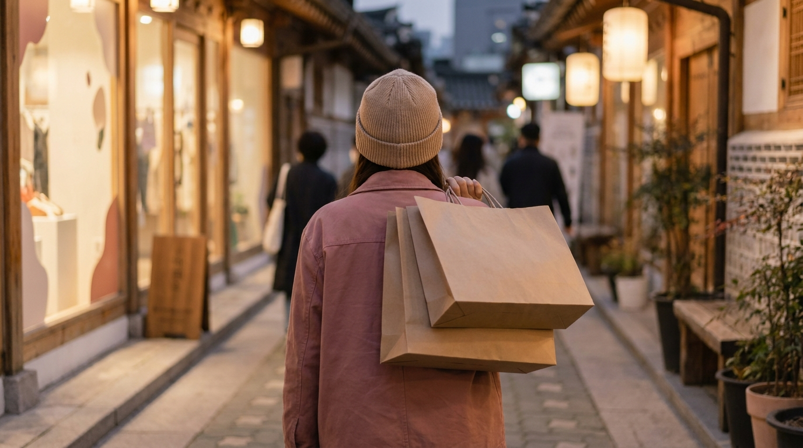
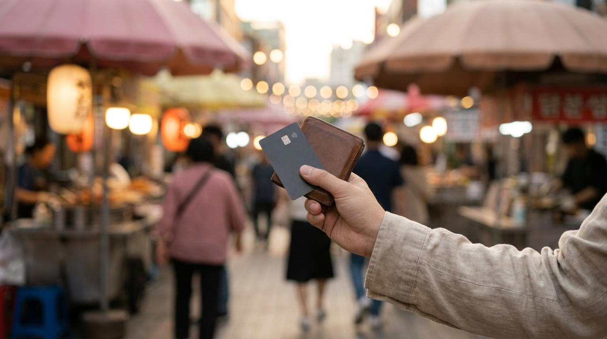

こんにちは、SEOUL TRIP NOTE の J です。

初めての渡韓はもちろん、リピーターにとってもソウル定番の街として外せないのが「明洞（ミョンドン）」です。コスメショップやファッションビルが立ち並び、夕方からは名物の屋台通りが賑わいを見せます。さらに、ソウル市内でも両替レートが良いとされる公認両替所が集まっているため、旅の拠点として訪れる旅行者が多いエリアです。

しかし、「屋台ではカードが使えるのか」「両替はどこでするのが安心なのか」「効率よく買い物を楽しむにはどう回ればいいのか」など、気になる点も少なくありません。

ソウル在住の視点から公開データや旅行者の声をもとに、明洞観光の効率的な回り方、ショッピングのポイント、屋台利用時の注意点、両替の基本ルールを整理しました。

> **この記事の要点まとめ**
> - **屋台の営業**: 夕方（16:00〜17:00頃）から本格的に並び始め、22:00〜23:00頃まで営業。近年は決済端末を導入してクレジットカードが使える屋台が増加しているものの、一部未対応の店舗や機器トラブルに備えて現金の用意も推奨。
> - **ショッピング**: 大型店舗やフラッグシップ店が集中。即時免税（タックスリファンド）を受けられる店舗が多いので、パスポートの携帯が必須。
> - **両替**: 中国大使館前の公認両替所が集まる通りが有名。街中にはWOWPASS対応端末も点在し、現金とキャッシュレスの使い分けが便利。
> - **回り方**: 昼は混雑の少ないコスメや大型店で買い物・両替を済ませ、夕方以降に屋台通りや夜景を楽しむスケジュールが効率的。

---

## 明洞観光の基本と効率的な回り方

明洞は地下鉄4号線の「明洞駅」と、2号線の「乙支路入口（ウルチロイック）駅」に挟まれたコンパクトな街です。徒歩で南北・東西を横断できる広さですが、時間帯によって街の表情は一変します。

### 昼と夜でスケジュールを分けるのがおすすめ

1. **昼（11:00〜16:00頃）: 落ち着いて買い物と両替**
   午前中から昼過ぎにかけては、メインストリートも比較的歩きやすく、コスメ店や衣料品店も混雑が緩やかです。夕方の混雑前に両替を済ませ、かさばる買い物を先に片付けておくと身軽に動けます。
2. **夕方〜夜（17:00〜22:00頃）: 屋台とナイトショッピング**
   夕方になると中央通りを中心に屋台が次々と設営されます。ネオンが灯り活気あふれる夜景が楽しめますが、歩道が混み合い歩行スピードは一気に落ちます。手荷物はコンパクトにしておくのが賢明です。

滞在ホテルの立地も観光効率に直結します。明洞周辺の宿泊を検討中の方は、[明洞のホテルの選び方｜駅・リムジンバス停からの距離と旅のスタイル別チェックポイント](/blog/myeongdong-hotel-how-to-choose/)も参考にしてください。

---

## 明洞ショッピングのチェックポイント

※ AIで生成したイメージ画像です

明洞は韓国コスメ、ファッション、雑貨の大型路面店が密集しているショッピングエリアです。

### 1. コスメショップ巡りとフラッグシップ店
明洞にはブランドごとの路面店だけでなく、ヘルス＆ビューティーストアの大型店舗が複数あります。特に大規模な店舗では、一般店では取り扱いの少ないブランドや限定企画セットが並ぶことがあります。

購入金額が1回あたり15,000ウォン以上の場合、その場で消費税分が引かれる「即時還付」に対応している店舗がほとんどです。店頭でパスポートを提示する必要があるため、買い出しの際は忘れずに持参しましょう。免税制度の全体像については、[韓国の免税ショッピング完全ガイド｜即時還付と空港還付の比較と手続き手順](/blog/korea-tax-free-shopping-guide/)で詳しく解説しています。

### 2. 大型雑貨店やライフスタイルショップ
明洞駅前には多層階からなる大型生活雑貨店など、お土産探しに便利な施設が揃っています。フロアごとにコスメ、文房具、キャラクター雑貨などが分かれており、まとめ買いに便利です。

---

## 明洞屋台の楽しみ方と支払いの注意点

夕方になるとメインストリートに現れる屋台は、ソウル定番の食べ歩き体験として人気です。トッポッキ、ホットク、おでんなどの伝統的な屋台フードから、ロブスター焼き、フルーツ飴（タンフル）、チーズ焼き串などトレンドを反映したメニューまで多種多様に並びます。

### 屋台利用で知っておくべきこと

- **価格帯の目安（執筆時点の目安）**:
  定番のおでんやホットクは2,000〜4,000ウォン程度、肉類や海鮮を使った創作メニューは8,000〜15,000ウォン以上になることもあります。一般的な食堂と比べて割安とは限らないため、メニュー表の価格表示を確認してから注文するのが確実です。
- **支払い方法**:
  行政主導の対策により、現在では多くの屋台に決済端末が導入され、海外発行のクレジットカードやプリペイドカードが利用できる店舗が増加しています。ただし、一部に現金専用の屋台が残っているほか、通信不良等のトラブルに備えて千ウォン札や五千ウォン札を用意しておくと安心です。
- **ゴミの処理**:
  食べ歩きの際に出た串やカップは、購入した屋台の回収ボックスに返すのが基本マナーです。街中のゴミ箱は少ないため、持ったまま歩き回らず、お店の近くで食べて容器を返却するとスマートです。

> **屋台通りの注意点**
> 人通りが非常に多いため、バッグは体の前に抱えるように持ち、スリや落とし物に十分注意してください。また、混雑した通路での食べ歩きは服を汚すリスクもあるため、お店の脇のスペースに寄って食べるのが推奨されます。

---

## 明洞での両替事情とキャッシュレス決済

ソウル市内で日本円をウォンに両替する場合、空港や銀行よりも明洞の民間公認両替所のレートが良い傾向にあります。

### 有名な両替エリア
地下鉄明洞駅の5番・6番出口側から北西に進んだ「中国大使館」周辺の小道には、複数の公認両替所が密集しています。各店舗の店頭に当日の為替レートが電光掲示板で表示されているため、数軒見比べてから利用できます。

両替時にはパスポートの提示を求められるのが原則です。受け取ったウォンはその場で金額が合っているか必ず数えて確認しましょう。

### キャッシュレス決済（WOWPASSなど）との組み合わせ
現在、ソウルの一般店舗やカフェ、ドラッグストア（H&Bストア）ではクレジットカードやプリペイドカードが広く使えます。明洞駅周辺の主要ホテルや駅構内には、日本円から直接チャージできるWOWPASS端末も多数設置されています。

屋台でもカード決済対応店が増えていますが、端末未導入の屋台や不測の通信エラーに備え、公認両替所で少額の現金を確保しつつカードと併用するのが無理のない方法です。カード選びについては、[渡韓旅行者必見！気候同行カードとWOWPASS徹底比較ガイド【2026年最新】](/blog/climate-card-vs-wowpass-comparison/)も参考にしてみてください。

---

## 明洞での主な決済手段と特徴の比較

※ AIで生成したイメージ画像です

旅行中のシーンに応じた決済手段の使い分けをまとめました。

| 決済手段 | 屋台での利用 | コスメ・一般店舗 | メリット | 注意点 |
| :--- | :--- | :--- | :--- | :--- |
| **現金（ウォン）** | 利用可能（未対応店で必須） | 利用可能 | どの場所でも確実に支払える | 多額の持ち歩きは盗難リスクがある |
| **クレジットカード** | 対応店舗が増加（一部未対応店あり） | 原則利用可能 | 高額決済や免税手続きに便利 | 海外事務手数料がかかる場合がある |
| **プリペイドカード (WOWPASS等)** | 端末設置屋台で利用可能 | 原則利用可能 | アプリで残高管理ができ、交通カード機能付き | 端末未導入の屋台もあるため現金も併用が必要 |

---

## よくある質問（FAQ）

### Q1. 屋台は何時頃から開いて、何時頃閉まりますか？
店舗や天候によって前後しますが、多くの屋台は16:00〜17:00頃から準備を始め、22:00〜23:00頃に片付けを始めるとされています。雨天時や悪天候の日は出店数が少なくなることがあります。

### Q2. 明洞の店舗では日本語が通じますか？
コスメ店や大型免税店、有名飲食店には日本語が話せるスタッフが在籍している割合が高いエリアです。ただし、個人商店や一部の屋台では韓国語または簡単な英語でのやり取りが基本となります。

### Q3. 明洞でタックスリファンド（免税）を受けるには何が必要ですか？
店舗で「即時還付」を受ける場合は、パスポートの実物原本が必要です（コピー不可の場合が多い）。会計時に「Tax Free Please」と伝え、パスポートを提示すると、その場で税金が差し引かれた金額で決済されます。

---

## まとめ

明洞は、ショッピング、グルメ、両替がすべて徒歩圏内で完結する、旅行者にとって利便性の高いエリアです。

- **昼間**に公認両替所で両替を済ませ、混雑の少ない店内で免税ショッピングを楽しむ
- **夕方以降**に賑やかな屋台通りで定番のグルメを楽しむ

この基本スケジュールを意識し、店舗用のカード決済を基本にしつつ、屋台の未対応店やトラブルに備えて少額の現金を携帯しておくとスムーズに観光を満喫できます。混雑時の手荷物管理に気をつけながら、ソウルの活気あふれる街歩きを楽しんでください。