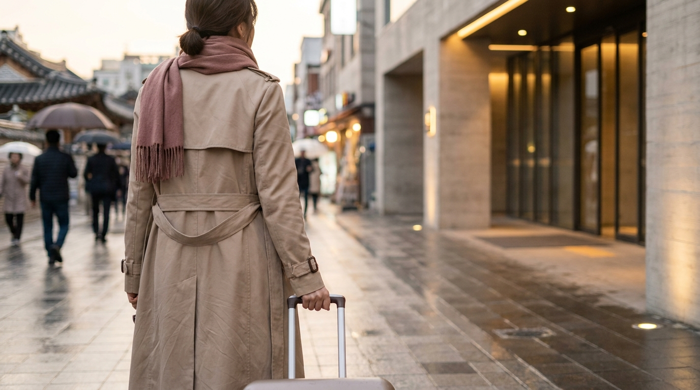
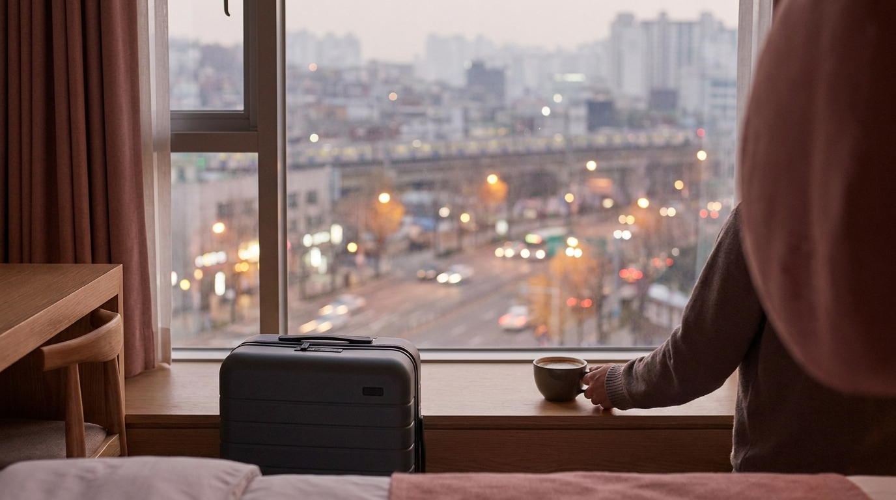

こんにちは、SEOUL TRIP NOTE の J です。

明洞（ミョンドン）は、初めての渡韓で宿泊先に選ばれることが多いエリアです。コスメショップや両替所、屋台が集まり、空港からのリムジンバスの路線もあるため、短い日程でも動きやすいのが理由です。

ただ、ひと口に「明洞のホテル」といっても、最寄り駅や通りによって、空港からの行きやすさ、夜の騒がしさ、坂道の多さが変わります。予約前にチェックしておきたいポイントを、地図と公式の交通情報をもとに整理しました。

> **この記事の要点まとめ**
> - 「明洞エリア」のホテルは、明洞駅（4号線）・乙支路入口駅（2号線）・会賢駅（4号線）・忠武路駅（3・4号線）など複数の駅に分かれます。
> - 空港からは、ホテル近くに停まるリムジンバスか、A'REXでソウル駅へ出て4号線に乗り換える方法が中心です。
> - 明洞駅の南側は南山に向かって上り坂が多く、スーツケースを引く場合は地図で高低差も確認を。
> - ひとり旅は「駅近・夜道の明るさ」、ファミリーは「部屋の広さ・エレベーター・ベビーカーでの動線」を優先すると選びやすくなります。

---

## 明洞エリアの最寄り駅は4つ｜それぞれの特徴

明洞のホテルは、予約サイトでは同じ「明洞」として表示されても、実際の最寄り駅が違うことがよくあります。代表的な駅と周辺の雰囲気は次のとおりです。

### 明洞駅（4号線）

明洞のショッピング街の南東側にある駅です。コスメショップや屋台が並ぶメインストリートにすぐ出られます。4号線はソウル駅・東大門・恵化（大学路）方面へ乗り換えなしで行けるので、空港鉄道でソウル駅に着いた場合も1回の乗り換えで到着できます。

### 乙支路入口駅（2号線）

明洞の北側、ロッテ百貨店の近くにある駅です。2号線は弘大入口・聖水・江南などを結ぶ環状線なので、明洞を拠点に他のエリアへ出かける日が多い人には便利です。周辺は百貨店やオフィスビルが多く、夜はメインストリートより落ち着いています。

### 会賢駅（4号線）

明洞の南西側、南大門市場の近くにある駅です。ソウル駅から1駅で、空港鉄道からの乗り換えが短く済みます。明洞の中心部へは歩いて行ける距離です。

### 忠武路駅（3号線・4号線）

明洞駅の東隣の駅で、3号線を使うと景福宮・安国（仁寺洞・北村方面）や新沙（カロスキル方面）へ乗り換えなしで行けます。

> **ポイント**: ホテルの住所を地図アプリで開き、「どの駅の何番出口から徒歩何分か」を必ず確認しましょう。駅名が同じでも出口によって歩く距離がかなり変わります。韓国では Google マップよりも NAVER マップなど韓国の地図アプリのほうが徒歩ルートが詳しいことが多いです。

---

## 空港から明洞のホテルへの行き方

※ AIで生成したイメージ画像です

仁川空港から明洞へは、主に次の2つの方法があります。それぞれの料金や所要時間の目安は[仁川空港からソウル市内へ！A'REXとリムジンバス徹底比較](/blog/incheon-airport-to-seoul-arex-bus/)で詳しく比較しています。

### リムジンバスで行く

明洞方面へ向かう空港リムジンバスの路線があり、明洞周辺の大きなホテルの前や近くに停留所があります。スーツケースをトランクに預けたまま座って移動できるのがメリットです。

- 予約前に「ホテルの最寄りの停留所はどこか」「停留所からホテルまで何分か」を確認しておきましょう。ホテルの公式サイトの「アクセス」ページに、利用できるリムジンバスの路線が書かれていることもあります。
- 路線や停留所は見直されることがあるため、出発前に空港リムジンバスの公式サイトや、空港の到着ロビーにある案内カウンターで確認するのが確実です。
- 道路が混む時間帯は所要時間が延びます。

### A'REX（空港鉄道）＋地下鉄4号線で行く

A'REXでソウル駅まで行き、地下鉄4号線に乗り換えて会賢駅・明洞駅へ向かう方法です。渋滞の影響を受けないので、到着時間が読みやすいのが利点です。ただし、ソウル駅での乗り換えは通路が長く、階段やエスカレーターの移動もあります。荷物が多い日はリムジンバス、荷物が少ない日は鉄道、と使い分ける旅行者も多いです。

地下鉄の乗車には交通カードが便利です。買い方とチャージ方法は[T-moneyカードの買い方・チャージ・払い戻しガイド](/blog/tmoney-card-guide/)にまとめています。

---

## 予約前に確認したい5つのチェックポイント

### 1. 坂道と階段

明洞駅の南側は南山（ナムサン）に向かって上り坂になっていて、ホテルによっては駅から坂を上る必要があります。地図アプリの航空写真やストリートビューで、ホテルまでの道に急な坂や階段がないか見ておくと安心です。

### 2. 夜の騒がしさ

メインストリート沿いは夜まで人通りが多く、屋台の営業時間帯はにぎやかです。静かに休みたい場合は、乙支路入口駅寄りのオフィス街側や、メインストリートから一本入った通りのホテルを選ぶ旅行者もいます。口コミで「騒音」「窓」などのキーワードを検索して傾向を見るのも一つの方法です。

### 3. 部屋の広さとベッドの種類

明洞は観光客向けのホテルが多い一方、都心なので客室がコンパクトなホテルも少なくありません。スーツケースを2つ広げられるか、ツインかダブルかなど、部屋の面積とベッドの種類を予約画面で確認しましょう。

### 4. 荷物の預かりとチェックイン時刻

早朝に到着する便や、チェックアウト後に買い物をしてから空港へ向かう日は、ホテルで荷物を預かってもらえるかが大切です。多くのホテルでは預かりに対応していますが、条件は宿によって違うので予約前に確認しておきましょう。

### 5. アメニティと設備

韓国では2024年から、一定規模以上の宿泊施設で使い捨てアメニティ（歯ブラシなど）の無料提供が制限されています。必要なものは持参するか、明洞のコンビニやドラッグストアで購入しましょう。洗濯機の有無や、電子レンジ・冷蔵庫の有無も、長めの滞在では確認しておきたいポイントです。

---

## ひとり旅とファミリー、それぞれの選び方

### ひとり旅・女子旅の場合

- **駅から近く、夜道が明るいこと**を優先します。大通り沿いで、駅から歩いて数分のホテルなら夜の買い物帰りも安心です。
- シングルルームやコンパクトなダブルルームのある宿を選ぶと、料金を抑えやすくなります。
- 夜遅くまで屋台やコスメショップを回りたい場合は、明洞駅寄りのホテルが便利です。ひとりで食事をするコツは[ソウルで「ひとりご飯」を楽しむ！](/blog/solo-dining-seoul-tips/)も参考にしてください。

### ファミリー・グループ旅行の場合

- **3人以上で泊まれる部屋**（トリプルルーム、ファミリールーム、キッチン付きのレジデンスタイプなど）があるかを確認します。
- ベビーカーを使う場合は、坂道の少なさ、エレベーターの有無、ホテルから駅までのエレベーターのある出口を確認しておきましょう。明洞のメインストリートは週末にとても混雑するため、ベビーカーでの移動は時間に余裕を持つのがおすすめです。
- 子ども連れで夜は部屋で食事をしたい場合、デリバリーアプリをホテルで使う方法もあります。詳しくは[韓国出前アプリは旅行者も使える？](/blog/korea-food-delivery-app-guide/)をご覧ください。

---

## 明洞以外も比べたいときは

※ AIで生成したイメージ画像です

「乗り換えなしで空港へ行きたい」「夜は静かな場所に泊まりたい」など条件によっては、明洞以外のエリアが合うこともあります。

- 早朝便で帰る日だけ、A'REXの直通列車が出るソウル駅周辺に泊まる
- 夜遅くまで遊ぶなら、空港鉄道で乗り換えなしの弘大に泊まる

エリアごとの違いは[ソウルの宿泊エリア比較｜明洞・弘大・東大門・江南・鍾路](/blog/seoul-hotel-area-comparison/)で比較表にまとめています。

---

## よくある質問（FAQ）

### Q1. 明洞のホテルは空港リムジンバスで直接行けますか？

**A.** 明洞方面へ向かうリムジンバスの路線があり、明洞周辺の大きなホテルの近くに停留所があります。ただし、すべてのホテルの前に停まるわけではないため、予約前にホテルの最寄りの停留所と、停留所からの徒歩時間を確認しておきましょう。

### Q2. 明洞駅と乙支路入口駅、どちらの近くが便利ですか？

**A.** 空港鉄道でソウル駅から向かうなら、4号線の明洞駅・会賢駅が乗り換え1回で便利です。弘大・聖水・江南など他のエリアへよく出かけるなら、2号線の乙支路入口駅の近くが移動しやすくなります。

### Q3. 明洞は夜うるさいですか？

**A.** メインストリート沿いは夜まで人通りが多く、にぎやかです。静かに休みたい場合は、オフィス街側やメインストリートから少し離れた通りのホテルを選び、口コミで騒音についての評価を確認するのがおすすめです。

### Q4. ファミリーで泊まるときに気をつけることは？

**A.** 都心のホテルは客室がコンパクトなことがあるため、3人以上で泊まれる部屋タイプとベッドの数を確認しましょう。ベビーカーを使う場合は、坂道の少なさとエレベーターの有無も大切なポイントです。

---

## まとめ

明洞のホテル選びは、次の順番で絞り込むと失敗が少なくなります。

1. **最寄り駅**: 空港からの行き方と、よく使う路線（4号線か2号線か）で選ぶ
2. **駅・停留所からの道**: 徒歩分数に加えて、坂道や階段がないか確認する
3. **夜の静かさ**: メインストリート沿いか、一本入った通りか
4. **部屋と設備**: 広さ、ベッド、荷物預かり、アメニティ

リムジンバスの停留所やホテルの条件は変わることがあるため、予約前に公式サイトと予約サイトの最新情報を確認してください。
