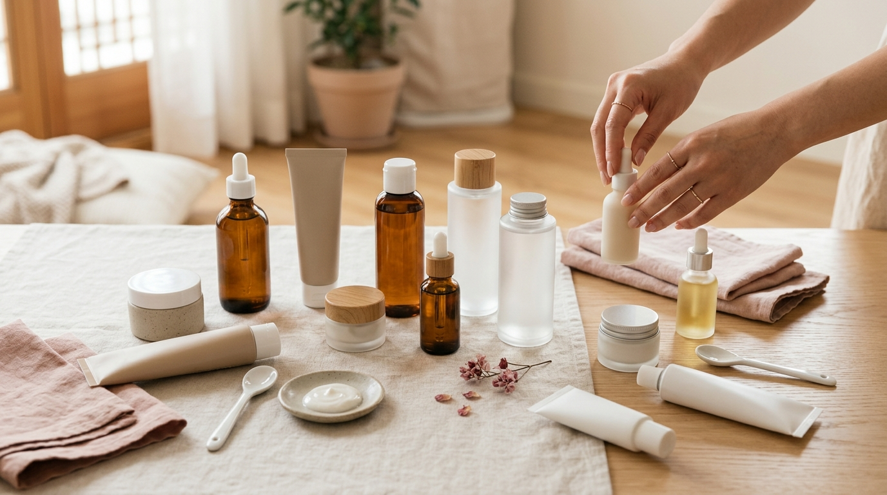

こんにちは、SEOUL TRIP NOTE の J です。

渡韓が決まったら、まずチェックしたいのが「オリーブヤング（通称オリヤン）」のセール情報ではないでしょうか。オリヤンは韓国コスメを幅広く扱うドラッグストアで、旅行者にとっても外せない立ち寄り先です。

「オリヤンセールはいつ開催される？」「旅行者でもお得に買える？」といった疑問を持つ方に向けて、公式発表や過去の開催時期、オンライン上の口コミ傾向をもとに**2026年のオリヤンセール開催時期を予想**します。実店舗でのお買い物のコツもまとめました。

ここで紹介する日程は過去のパターンに基づく**予想**です。確定した開催日程は、渡韓前に必ずオリーブヤング公式サイト等でご確認ください。

---

### 【結論】要点まとめ

*   **開催時期の予想**: 過去の傾向から、年に4回、**3月、6月、9月、12月の上旬頃**に開催される可能性があります（予想。正式な日程は公式サイト等で要確認）。期間は約1週間が目安です。
*   **割引率の目安**: ブランドやアイテムにより異なりますが、**最大70%OFF**になるアイテムもあります。人気商品は30〜50%OFFが目安です。
*   **賢いお買い物術**:
    *   事前に欲しいものリストを作成し、通常価格を把握しておく。
    *   グローバル版サイトやSNSで気になるアイテムの情報をチェック。
    *   品切れを避けるため、セール開始直後や開店直後の時間帯に店舗へ。
    *   **パスポート提示で即時還付（Tax Refund）**を利用する。
*   **狙い目アイテム**: スキンケア（美容液、シートマスク、クリーム）、ヘアケア、インナービューティー商品。

---

## 2026年オリヤンセール時期を予想！渡韓計画の参考に

旅行日程を合わせるためにも、セール時期の把握は欠かせません。過去の開催実績から2026年のスケジュールを予測します。

### セールは年に4回、各季節の変わり目が目安

オリーブヤングの大規模セールは、過去の傾向を見ると**年に4回、各季節の変わり目**に開催されています。具体的には**3月、6月、9月、12月の上旬頃**です。

この大型セールは「올영세일（オリヤンセール）」という名称で開催され、店内の幅広いブランドが割引対象になります。

| セール名称（時期）     | 開催時期の目安（2026年・予想） | 特徴                                                 |
| :--------------------- | :----------------------------- | :--------------------------------------------------- |
| **春のオリヤンセール**   | 3月1日（日）〜3月7日（土）頃 | 新生活・新学期に向けたスキンケア、メイクアップが充実 |
| **夏のオリヤンセール**   | 6月1日（月）〜6月7日（日）頃 | 夏の肌トラブル対策、UVケア、ひんやりコスメが人気     |
| **秋のオリヤンセール**   | 9月1日（火）〜9月7日（月）頃 | 乾燥対策、保湿ケア、季節の変わり目アイテムが豊富     |
| **冬のオリヤンセール**   | 12月1日（火）〜12月7日（月）頃 | クリスマス・年末年始の特別セット、インナーケアも充実 |

※上記の日程は過去の開催パターンからの予想であり、確定情報ではありません。正式な日程は公式サイト等の告知をご確認ください。

**💡 ワンポイント**
過去の傾向では、月初め（1日〜7日頃）にスタートすることが多いとされています。ただし、開始曜日や日数は回によって前後します。セール期間は約1週間と短いため、公式発表が出たら旅程と重なっているかすぐ確かめましょう。

### セール期間中の割引率の目安

割引率は商品やブランドごとに設定されます。執筆時点における過去セールの一般的な目安は以下のとおりです。

*   **人気定番商品**: 30%〜50%OFF
*   **新商品・企画セット**: 10%〜20%OFF
*   **一部在庫処分品・旧パッケージ品**: 最大70%OFF

クリニックで施術を受けたあとに使う鎮静・保湿系コスメを、セールに合わせて調達する旅行者も多く見られます。Torriden（トリデン）やDr.G（ドクタージー）、Round Lab（ラウンドラボ）といった定番ブランドもセール対象に並びやすい傾向です。

## セールを上手に活用！狙い目アイテムと事前準備

※ AIで生成したイメージ画像です

店舗に入ってから迷わないよう、事前の下調べが大切です。

### セールで狙いたい人気アイテムの傾向

セール期間中に割引になりやすいアイテム、旅行者に選ばれやすい商品は次のとおりです。

1.  **スキンケア（美容液、シートマスク、クリーム）**:
    *   **Torriden（トリデン）**: ダイブインセラム、ダイブインクリーム
    *   **Dr.G（ドクタージー）**: レッドブレミッシュクリアスージングクリーム
    *   **Abib（アビブ）**: グミシートマスク、ドクダミエッセンス
    *   **Round Lab（ラウンドラボ）**: 1025ドクドトナー、白樺モイスチャライジングサンクリーム
    *   **BIOHEAL BOH（バイオヒールボ）**: プロバイオダームリフティングクリーム
    看板商品は割引対象になりやすいため、最優先でチェックしたいところです。

2.  **ヘアケア**:
    *   **mise en scène（ミジャンセン）**: パーフェクトセラム
    *   **LABO-H（ラボエイチ）**: スカルプシャンプー
    重量はありますが、消耗品のお得なセット買いに向いています。

3.  **インナービューティー・健康食品**:
    *   コラーゲンゼリー、乳酸菌サプリ、ベーグルチップなど。
    手軽なお土産や自分用のケアアイテムとして支持されています。

### 渡韓前の事前準備リスト

準備を整えておくことで、限られた滞在時間を有効に使えます。

1.  **欲しいものリストの作成**:
    *   日本の通販サイトやオリーブヤングのグローバル版サイトを見て、普段の価格を把握しておきます。現地で本当に安いかどうかを判断しやすくなります。
    *   購入必須のアイテムを絞り込んでおくと、店内での迷いが減ります。

2.  **グローバル版アプリやサイトのチェック**:
    *   韓国版のオリヤンアプリは韓国の通信会社による本人認証が必要なため、一般的な旅行者は会員登録ができません（実店舗でのポイント付与も旅行者は対象外です）。
    *   日本から閲覧可能な「オリーブヤング グローバル版」のアプリやWebサイトを活用し、人気ランキングや配合成分、口コミを事前に確認しておくと重宝します。

3.  **SNSでの情報収集**:
    *   オリヤン公式SNSや韓国美容を発信するアカウントでは、セール直前に注目アイテムの紹介が活発に行われます。

## セール期間中に実践したい！お得な買い方と即時還付

店頭でスムーズに買い物をするためのポイントをまとめました。

### 店舗での賢いお買い物術

*   **早い時間帯を狙う**: 人気アイテムは棚からすぐ消えてしまうことも珍しくありません。混雑を避けたい場合は、開店直後の午前中に訪れるのが無難です。
*   **品揃えなら大型店へ**: 明洞や弘大、江南などのフラッグシップストアや大型店舗は在庫数が多く、限定セットも並びやすい傾向にあります。
*   **棚のポップ表示を確認する**: 「1+1（1点買うともう1点無料）」や増量企画セットは、通常品よりも実質的な割引率が高くなります。

### 即時還付（Tax Refund）でさらにお得に

オリーブヤングの多くの店舗では、外国人旅行者向けの「即時還付（Tax Refund）」に対応しています。会計時に免税が適用され、その場で税金分が差し引かれるため、空港で還付手続きをする手間が省けます。

#### 即時還付のステップ

1.  **パスポートを持参する**: 原本が必要です。忘れると免税処理を受けられません。
2.  **購入金額を確認する**: 執筆時点の制度では、1回の会計で1万5000ウォン以上、100万ウォン未満の購入が即時還付の対象となります（基準は変更される場合があるため最新情報をご確認ください）。
3.  **レジで提示する**: 会計時にパスポートを出し、免税希望の旨を伝えます。
4.  **その場で減額決済**: 税金分が差し引かれた合計額を支払います。

**⚠️ 注意点**
*   一部の小規模店や、百貨店・マート内に入っている店舗などでは即時還付に非対応の場合があります。店頭のタックスリファンド表示を確認するか、会計前に店員へご確認ください。
*   還付される実質的な割合は購入金額帯により異なりますが、およそ5〜8%程度が執筆時点の目安とされています。

## 【比較】オリヤンセールで注目したい人気ブランド＆アイテム

※ AIで生成したイメージ画像です

セール時に注目される代表的なブランドと特徴をまとめました。

| ブランド名           | 代表アイテム（商品例）             | 割引率の目安 | 口コミの傾向                                                                 |
| :------------------- | :--------------------------------- | :--------------- | :------------------------------------------------------------------------------- |
| **Torriden** (トリデン) | ダイブイン セラム、ダイブイン クリーム | 30〜50%          | 保湿力が高く、ベタつきにくい使い心地が好評。肌質問わず取り入れやすいという声が多い。 |
| **Dr.G** (ドクタージー) | レッドブレミッシュクリアスージングクリーム | 30〜40%          | 刺激を受けた肌の鎮静ケアとして支持が厚い。水分感のあるジェル状クリーム。 |
| **Abib** (アビブ)     | グミシートマスク、ドクダミ エッセンス | 20〜40%          | シートの密着感に対する評価が高い。肌荒れ予防としてストック買いする人が多い。   |
| **Round Lab** (ラウンドラボ) | 1025ドクドトナー、白樺モイスチャライジングサンクリーム | 30〜50%          | 低刺激でデイリー使いしやすいとの評価。日焼け止めもキシキシしないと人気。         |
| **BIOHEAL BOH** (バイオヒールボ) | プロバイオダームリフティングクリーム | 30〜50%          | エイジングケアを意識する層から「ハリ感が出る」と根強い支持を集めている。       |
| **CLIO** (クリオ)     | プロアイパレット、キルカバークッション | 20〜30%          | 発色の良さやカバー力への信頼感が高く、メイクアップの定番として選ばれている。     |

※割引率は過去のセール実績に基づく目安です。

## ❓ よくある質問（FAQ）

### Q1: オリヤンセールで一番お得な時期はいつですか？

A1: 年4回のセールの中でも、12月上旬の冬セールはホリデーシーズン向けの限定企画セットや大容量パッケージが多く登場する傾向があります。ただ、春夏秋のセールでも人気アイテムの割引率は大きく変わらないため、旅行のタイミングに合わせて訪れるのが合理的です。

### Q2: セール品は返品・交換できますか？

A2: 公式情報によると、未開封・未使用の状態でレシートがあれば購入後15日以内は対応可能とされています。ただし、店舗の判断やセール対象品の種別によって返品不可となる場合もあるため、会計時にレシート記載の注意事項を確認しておくのが安全です。

### Q3: オンラインストアでもセール価格で購入できますか？

A3: 韓国版の公式オンラインストアは韓国国内の電話番号による本人認証や韓国内決済手段が必要なため、短期滞在の旅行者がホテル配送等で利用することは実質的に困難です。旅行者の場合は実店舗へ足を運んで購入するのが確実といえます。日本国内から購入したい場合は、日本へ直送対応している「オリーブヤング グローバル版ストア」を利用する方法があります。

### Q4: 即時還付はどうすれば受けられますか？

A4: パスポートを持参し、会計時に提示するだけでその場で税金分が引かれます。執筆時点の基準では1回のお買い物が1万5000ウォン以上で対象となります。空港での申請作業が不要になるため、旅行者にとって利用価値の高い仕組みです。

## まとめ

オリヤンセールは3月、6月、9月、12月の上旬に開催されるパターンが続いています。

2026年の開催日程はあくまで予想となるため、旅行日が近づいたら公式サイト等の最新情報をチェックしてください。欲しい商品をリストアップし、パスポートを忘れずに持参して、お得なお買い物を楽しんでください。
