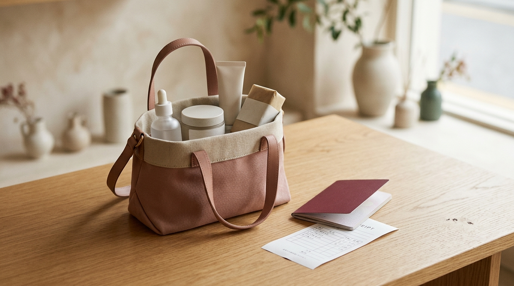

こんにちは、SEOUL TRIP NOTE の J です。

肌寒くなってきて、そろそろ次の渡韓計画を立てている方も多いのではないでしょうか。渡韓の楽しみのひとつといえば、「オリーブヤング（オリヤン）」でのコスメ選びですよね。

「種類が多すぎて何を買えばいいか分からない」「結局いつも同じものを選んでしまう」という声もよく聞かれます。

そこで今回は2026年版として、各ブランドの公式情報やオンライン上の口コミの傾向をもとに、オリーブヤングで人気の**スキンケアアイテム7選**を成分と肌悩み別に整理しました。あわせて、渡韓時に知っておきたい**免税手続きの流れとお得に買うコツ**もまとめています。

次の渡韓でのオリヤンショッピングの参考に、ぜひ最後まで読んで購入リスト作りに役立ててください。

### 【結論】この記事の要点まとめボックス

*   2026年時点でオリーブヤングで人気のスキンケア7選を、成分と口コミの傾向から厳選。
*   各アイテムの主要成分、公式にうたわれている効果、価格帯（日本円目安）を解説。
*   肌悩み（鎮静・保湿・美白・毛穴・弾力）に合わせたアイテム選びの目安がわかる。
*   オリーブヤングでの即時還付・事後免税の基本的なステップと、お得に買うコツを紹介。
*   セールや企画セットなど、オリヤンを上手に活用するための豆知識もまとめています。

## 2026年版 オリーブヤングで人気のスキンケア7選

ここからは、口コミでの評価が高く、定番として名前が挙がることの多いスキンケアアイテムを7つご紹介します。それぞれの特徴と、どんな肌悩み向けとされているのかを見ていきましょう。

### 1. Anua (アヌア) ドクダミ77スージングトナー

鎮静ケアの定番として知られるトナーです。肌荒れや敏感肌が気になる方から支持されています。

*   **主要成分**: ドクダミエキス77%
*   **期待できる効果**: 肌の赤み鎮静、肌荒れ緩和、保湿、肌バリア強化
*   **おすすめ肌タイプ**: 敏感肌、脂性肌、ニキビ肌
*   **価格帯**: 250ml / 約27,000ウォン (約2,970円)
*   **口コミの傾向**: 季節の変わり目など、肌がゆらぎやすい時期に使っているという声が多く見られます。みずみずしいテクスチャーでなじみが良いという評価や、コットンパックに使いやすいという意見もよく挙がっています。

### 2. Torriden (トリデン) ダイブインセラム

韓国で「国民的セラム」と呼ばれることもある人気の高保湿美容液です。乾燥肌やインナードライが気になる方向けとされています。

*   **主要成分**: 5D-複合ヒアルロン酸、パンテノール、アラントイン
*   **期待できる効果**: 深層保湿、肌の水分バリア強化、乾燥による小じわ改善
*   **おすすめ肌タイプ**: 乾燥肌、インナードライ肌、全ての肌タイプ
*   **価格帯**: 50ml / 約36,000ウォン (約3,960円)
*   **口コミの傾向**: とろみがあるのにベタつきにくいという声が多く、翌朝までうるおいが続く、メイク前に使いやすいといった評価が目立ちます。リピート購入しているというレビューも多いアイテムです。

### 3. Round Lab (ラウンドラボ) 1025独島トナー

韓国の海洋深層水を使用した、低刺激・高保湿をうたうトナーです。敏感肌の方にも人気があります。

*   **主要成分**: 鬱陵島海洋深層水、パンテノール、アラントイン、ベタイン
*   **期待できる効果**: 敏感肌鎮静、水分補給、角質ケア、肌のキメ改善
*   **おすすめ肌タイプ**: 敏感肌、乾燥肌、全ての肌タイプ
*   **価格帯**: 200ml / 約20,000ウォン (約2,200円)
*   **口コミの傾向**: 刺激を感じにくく毎日使いやすいという声が多く、やさしい角質ケアとして取り入れているという意見も見られます。大容量でコスパが良い点も評価されています。

### 4. numbuzin (ナンバーズイン) 3番 うるツヤ発酵トナー

「肌のキメ改善」を特徴とする、発酵成分を配合した美容液のようなトナーです。ツヤ感のある肌を目指したい方向けとされています。

*   **主要成分**: 50種類の発酵成分（ビフィダ、ガラクトミセスなど）、ナイアシンアミド
*   **期待できる効果**: 肌のキメ・トーン改善、弾力ケア、ツヤ肌効果、毛穴ケア
*   **おすすめ肌タイプ**: くすみ肌、ハリ不足肌、毛穴が気になる肌
*   **価格帯**: 200ml / 約28,000ウォン (約3,080円)
*   **口コミの傾向**: ツヤ感が出やすいという声が多く、ベースメイクが薄くても済むようになったというレビューも見られます。発酵系コスメが好きな方からの評価が高い傾向にあります。

### 5. Dr.G (ドクタージー) レッドブレミッシュクリアスージングクリーム

敏感肌やニキビ肌の方から支持されている鎮静保湿クリームです。ベタつきにくい、さっぱりとした使用感が特徴とされています。

*   **主要成分**: 5-シカコンプレックス、β-グルカン、EGCG
*   **期待できる効果**: 赤み鎮静、肌荒れケア、水分保湿、肌バリア機能強化
*   **おすすめ肌タイプ**: 敏感肌、ニキビ肌、脂性肌、混合肌
*   **価格帯**: 70ml / 約36,000ウォン (約3,960円)
*   **口コミの傾向**: 肌荒れや赤みが気になる時に使っているという声が多く、ジェルに近いテクスチャーでなじみやすいという評価が目立ちます。朝のメイク前にも使いやすいという意見もあります。

### 6. COSRX (コスアールエックス) RXザ・ビタミンC23セラム

純粋ビタミンCを23%配合した、美白・弾力ケア向けの美容液です。シミやハリ不足が気になる方向けとされています。

*   **主要成分**: 純粋ビタミンC 23%、スーパービタミンE、ヒアルロン酸
*   **期待できる効果**: シミ・そばかす改善、肌トーンアップ、弾力アップ、抗酸化ケア
*   **おすすめ肌タイプ**: くすみ肌、エイジングサインが気になる肌、シミ・そばかすが気になる肌
*   **価格帯**: 20ml / 約28,000ウォン (約3,080円)
*   **口コミの傾向**: 高濃度ビタミンCのわりに刺激が少なく使いやすいという声が多く、肌のトーンやハリ感の変化を感じたという評価も見られます。開封後は冷蔵庫での保存をすすめる声もあります。

### 7. BIO HEAL BOH (バイオヒールボ) プロバイオダームリフティングクリーム

オリーブヤングのプライベートブランドの商品で、弾力ケアに特化した高機能クリームとして人気があります。

*   **主要成分**: プロバイオダーム™（乳酸菌発酵物）、ペプチド、アデノシン
*   **期待できる効果**: 肌の弾力アップ、ハリ改善、しわケア、栄養補給
*   **おすすめ肌タイプ**: エイジングサインが気になる肌、ハリ不足肌、乾燥肌
*   **価格帯**: 50ml / 約42,000ウォン (約4,620円)
*   **口コミの傾向**: プライベートブランドながら完成度が高いという評価が多く、濃厚なテクスチャーで肌に密着する、ハリ感が出やすいといった声が見られます。翌朝の肌のふっくら感を評価するレビューもあります。

## 【徹底比較】肌悩み別！おすすめスキンケアアイテム比較表

今回ご紹介した7つのアイテムの中から、特に人気の高いものをピックアップして、肌悩み別に比較しました。ご自身の肌に合うアイテム選びの参考にしてください。

| アイテム名                           | 主要成分             | 期待できる効果           | 価格帯（ウォン目安） | おすすめ肌悩み         |
| :----------------------------------- | :------------------- | :----------------------- | :------------------- | :--------------------- |
| Anua ドクダミ77スージングトナー     | ドクダミエキス77%    | 赤み鎮静、肌荒れ緩和     | 27,000               | 敏感肌、肌荒れ、赤み   |
| Torriden ダイブインセラム            | 5Dヒアルロン酸       | 深層保湿、水分バリア強化 | 36,000               | 乾燥肌、インナードライ |
| numbuzin 3番 うるツヤ発酵トナー      | 発酵成分、ナイアシン | キメ・トーン改善、ツヤ感 | 28,000               | くすみ、ハリ不足、毛穴 |
| Dr.G レッドブレミッシュクリアクリーム | 5-シカコンプレックス | 赤み鎮静、水分保湿       | 36,000               | 敏感肌、ニキビ、赤み   |
| BIO HEAL BOH リフティングクリーム    | プロバイオダーム™    | 弾力アップ、ハリ改善     | 42,000               | エイジング、ハリ不足   |

## 賢くお得に！オリーブヤングでの免税手続きとコツ

※ AIで生成したイメージ画像です

せっかく渡韓するなら、免税制度を上手に利用して、お得に韓国コスメを購入したいですよね。ここでは、オリーブヤングでの免税手続きの基本と、お得に買うためのコツをご紹介します。

### 免税手続きの基本：即時還付と事後免税

韓国の免税制度には、大きく分けて「即時還付（Tax Refund）」と「事後免税（事後還付）」の2種類があります。

1.  **即時還付（Tax Refund）**:
    *   **対象**: 1回の買い物で30,000ウォン以上、500,000ウォン未満（税抜き）購入した場合。
    *   **手続き**: 会計時にパスポートを提示するだけで、その場で免税額を差し引いた金額で決済されます。手続きが簡単なため、利用しやすい方法です。
    *   **注意点**: パスポートを忘れずに持参しましょう。コピーや写真では受け付けてもらえない場合が多いです。

2.  **事後免税（事後還付）**:
    *   **対象**: 1回の買い物で30,000ウォン以上購入した場合。
    *   **手続き**: 店頭で発行される免税書類（Tax Refund Form）とレシート、購入品を空港のTax Refundカウンターまたはキオスクに持参し、手続きを行います。
    *   **注意点**: 購入品は未開封のまま持ち込む必要があります。出国手続き後、現金やクレジットカードへ還付されます。

**💡 Jのメモ**
> オリーブヤングでは多くの店舗が「即時還付」に対応しているとされています。レジでパスポートを提示するだけなので、忘れずに利用しましょう。総額が500,000ウォンを超えそうな場合は、複数回に分けて会計するか、事後免税と組み合わせる方法もあります。

### 免税以外にも！お得にオリヤンで買い物するコツ

1.  **「今日の特売（오늘의 특가）」をチェック**
    *   オリヤンでは、特定のアイテムが割引になる「今日の特売」を実施しています。アプリや店頭のPOPでチェックして、狙っていた商品が対象になっていれば購入のチャンスです。
2.  **「企画セット（기획세트）」を見逃さない**
    *   人気のスキンケアアイテムは、大容量版やミニサイズのおまけが付いた「企画セット」として販売されることがよくあります。通常価格よりお得になる場合が多いので、店頭で探してみましょう。
3.  **オリーブヤングアプリをインストール＆会員登録**
    *   事前にアプリをダウンロードして会員登録しておくと、オンライン限定クーポンやイベント情報を受け取れます。店舗で使えるクーポンが配布されることもあるので、渡韓前に準備しておくと便利です。
4.  **セール期間に合わせて渡韓する**
    *   年に数回、「オリーブヤングフェスタ」などの大規模なセールが開催されます。この期間は普段割引にならない商品も安くなることがあります。渡韓時期を調整できる方は検討してみてください。（※セール時期は変動するため、渡韓前に公式情報を確認しましょう）
5.  **外国人観光客向けクーポンを活用**
    *   「Visit Korea」などの観光情報サイトや、免税店カウンターなどで、外国人観光客向けの割引クーポンが配布されていることがあります。渡韓前に情報収集しておきましょう。

**⚠️ 注意点**
> 免税手続きの際は、パスポートの提示が必須です。また、即時還付は一回あたりの購入金額に上限があるため、高額な買い物の際は注意が必要です。購入したコスメは、帰国まで未開封のままにしておくと、万が一の際にスムーズです。

## ❓ よくある質問（FAQ）

### Q1. オリーブヤングのセールはいつ開催されますか？

A1. オリーブヤングでは、毎月のように何らかのセールやプロモーションが実施されています。大規模なセールとしては、年に数回（3月、6月、9月、12月頃）開催される「オリヤンビッグセール（올영세일）」がよく知られており、大幅な割引になる商品もあります。正確な日程は直前に発表されることが多いので、渡韓前にオリーブヤングの公式アプリやSNSをチェックするのがおすすめです。

### Q2. どこで買うのが一番お得ですか？明洞店と他の店舗で違いはありますか？

A2. 基本的にオリーブヤングの価格設定は全店舗共通ですが、店舗によってセール品の在庫状況や限定セットの有無が異なります。明洞店や弘大店、江南店などの大型店舗は品揃えが豊富で、外国人観光客向けのサービスが充実している場合が多いです。一方で、地元の人が利用する小さめの店舗でも、在庫が残っていることがあります。即時還付は多くの店舗で利用できるので、ご自身の旅程に合わせて都合のよい店舗を選んで問題ありません。

### Q3. 韓国コスメは肌に合うか心配です。試供品はもらえますか？

A3. オリーブヤングでは、購入前に試供品（サンプル）をもらうのは難しい場合が多いです。ただし、店頭にはテスターが豊富に用意されているので、気になる商品は実際に肌に塗って試してみることをおすすめします。トナーやセラムは、手の甲だけでなく首元などで試すと、肌との相性が分かりやすいとされています。また、企画セットにミニサイズが入っていることも多いので、まずはミニサイズで試してみるのもひとつの方法です。

### Q4. 日本のオリーブヤングと韓国のオリーブヤングで、価格や品揃えに違いはありますか？

A4. はい、違いがあります。日本ではまだ取り扱いのないブランドやアイテムが韓国には多数あり、品揃えは韓国のオリーブヤングの方が豊富です。価格に関しても、為替レートにもよりますが、韓国で購入する方が安くなるケースが多いです。さらに、韓国では頻繁にセールや1+1（ワンプラスワン）イベントが開催され、免税手続きも利用できるため、トータルで見ると韓国での購入がお得になりやすいです。

## まとめ＆最後に

今回は、2026年版としてオリーブヤングで人気のスキンケア7選と、免税手続き・お得に買うコツについてまとめました。

*   **Anua**や**Torriden**、**Dr.G**などの定番人気アイテムから、**numbuzin**や**BIO HEAL BOH**といった注目アイテムまで、肌悩みに合わせて選びやすいラインナップです。
*   **即時還付**を忘れずに利用すること、そして**セールや企画セット**を狙うことで、お得に「渡韓購入品」をそろえやすくなります。

韓国コスメは新しい成分やテクノロジーを取り入れたアイテムが次々と登場しており、選択肢は年々広がっています。肌質には個人差があるため、気になるアイテムはテスターで試してから選ぶのがおすすめです。

この記事が、次の渡韓でのコスメ選びの参考になれば幸いです。オリヤンでのショッピングをぜひ楽しんでください。

※価格は記事作成時点の目安です。最新の価格や商品情報は、オリーブヤングの店頭や公式サイトでご確認ください。
