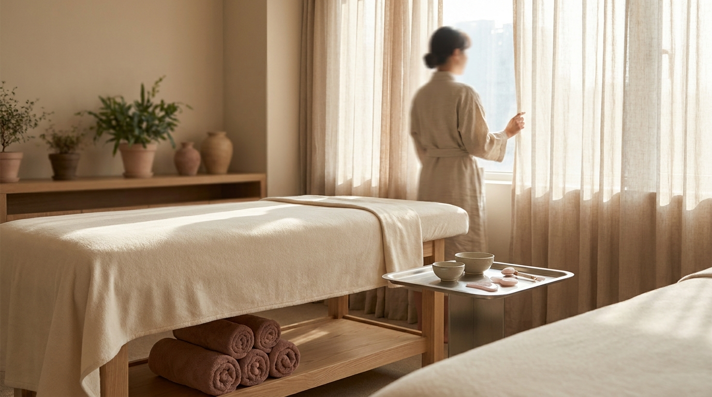

こんにちは、SEOUL TRIP NOTE の J です。ソウル在住の立場から、渡韓旅行に役立つ確かな情報を調べて整理しています。

韓国の美容クリニックで施術を受ける「渡韓美容」を計画する際、必ずといっていいほど名前が挙がるのが「リジュラン」と「ジュベルック」です。どちらも肌の根本的なコンディションを整える韓国スキンブースターとして知られていますが、「どちらが自分に合っているのか」「痛みが強いのはどっちか」「旅行中のダウンタイムはどう違うのか」と迷う方が少なくありません。

各メーカーの公式公開情報や現地の皮膚科で共有されている施術データ、利用者の口コミ傾向をもとに、2つの施術の違いを客観的に比較してまとめました。限られた旅行日程の中で後悔のない選択をするための判断材料としてお役立てください。

> **この記事の要点まとめ**
> - **リジュラン**：サーモン由来のポリヌクレオチド（PN）が主成分。肌の油水分バランス調整やバリア機能の回復、小じわのケアに向いているとされています。手打ち注入時の痛みが強く、数日間のエンボス（凹凸）が出やすい傾向があります。
> - **ジュベルック**：生分解性ポリマー（PDLLA）と非架橋ヒアルロン酸（HA）が主成分。自身のコラーゲン生成を促し、毛穴の開きや肌の弾力、ニキビ跡の凹凸改善を目指す方に選ばれる傾向があります。機械打ちの選択肢も多く、エンボスの持続期間は比較的短いとされています。
> - **施術の選び方**：乾燥や赤み、肌の菲薄化が気になるならリジュラン、毛穴の引き締めや全体的なハリ感を求めるならジュベルックを検討するケースが一般的です。

## リジュランとジュベルックの主成分と効果の違い

スキンブースターとは、有効成分を皮膚の真皮層などに直接届けることで肌の再生や保水力をサポートする施術の総称です。リジュランとジュベルックは、アプローチの仕組みと主成分が異なります。

### リジュラン（PN製剤）の特徴と期待される効果

リジュラン（Rejuran）の主成分は、サーモン（サケ）のDNAから抽出・精製された「ポリヌクレオチド（PN）」です。生体適合性が高く、異物反応が起きにくい成分として医療現場でも活用されています。

公式情報や臨床データによると、真皮層の線維芽細胞を活性化させ、傷んだ肌の組織再生や毛細血管の新生を促すとされています。これにより、以下のようなリジュラン効果が期待されると説明されています。

- 乱れた油水分バランスの正常化
- 肌バリア機能の強化と菲薄化（肌が薄くなる状態）の改善
- 目元や口元などの浅い小じわのケア
- 赤みやゆらぎ肌の鎮静サポート

即効性というよりも、肌自体の自己再生力を高めるアプローチのため、一般的には2〜3週間おきに3回以上の施術を受けることで肌質変化を実感しやすいと案内されることが多いです。

### ジュベルック（PDLLA＋HA製剤）の特徴と期待される効果

ジュベルック（Juvelook）は、トウモロコシやサトウキビのデンプンから抽出されるポリ乳酸の一種「PDLLA（ポリ-D,L-乳酸）」と、保水力に優れた「非架橋ヒアルロン酸（HA）」を組み合わせたハイブリッド製剤です。

体内に注入されると、まずヒアルロン酸が水分を補給し、その後微粒子のPDLLAが周囲の線維芽細胞を長期間にわたって刺激します。これにより自身のコラーゲンやエラスチンの生成が促される仕組みです。主な期待効果は以下の通りです。

- 頬や鼻周りの開き毛穴の引き締め
- 肌全体のハリ・弾力の向上
- ニキビ跡やクレーターの凹凸改善（高濃度のジュベルックボリューム等が使われる場合もあります）
- 自然なボリューム感と小じわの改善

PDLLAは時間をかけて水と二酸化炭素に自然分解されて体外へ排出されるため、持続的なコラーゲン生成が期待できる点にジュベルック比較の強みがあるとされています。

## 痛み・注入方法・渡韓美容ダウンタイムの比較

※ AIで生成したイメージ画像です

渡韓中に施術を受ける場合、観光や食事の予定に影響するため「痛み」と「ダウンタイムの期間」は非常に重要な判断基準です。

### 痛みの度合いと注入方法の違い

痛みの感じ方には個人差がありますが、一般的には「リジュランの手打ち」が最も痛みが強いと評価される傾向にあります。

- **リジュランの手打ち**：医師が極細針を用いて皮膚の浅い層（真皮浅層）に直接細かく注射していきます。粘度のある製剤が皮膚を押し広げるような圧迫痛があり、麻酔クリームを塗布しても「強い痛みを感じた」という口コミが多く見られます。痛みを軽減するため、冷却器の併用や睡眠麻酔を選択できるクリニックもあります。
- **ジュベルックの注入**：手打ちのほか、機械打ち（ハイコックスやダーマシャインなどの水光注射マシン、またはポテンツァのポンピングチップ）で導入されるケースが一般的です。均一な深さに素早く注入できるため、手打ちリジュランと比べると痛みの負担が軽いと評価される傾向にあります。

### ダウンタイムと術後の経過

渡韓美容ダウンタイムの計画を立てる際、最も確認しておきたいのが肌の見た目の変化です。

リジュランを浅く手打ちした場合、蚊に刺されたような小さな膨らみが顔全体に点々と並ぶ「エンボス現象」がほぼ確実に生じます。このエンボスは、通常24時間から48時間程度で製剤が吸収されて平らになっていきますが、人によっては3日ほど目立つことがあります。また、針穴の赤みや内出血が数日から1週間ほど残るリスクもあります。

一方、ジュベルックを機械打ちやポテンツァで導入した場合は、エンボスが目立ちにくく、当日〜翌日には赤みが引くケースが多いとされています。ただし、針を使用するため軽度の内出血や点状の赤みが生じる可能性は同様に存在します。

> **旅行日程の組み方の注意点**
> 施術を受けた当日は、洗顔やメイク、長時間の入浴、激しい運動、サウナ、飲酒が制限されることが一般的です。写真をたくさん撮りたい観光やカフェ巡りは施術前の日程に組み込み、クリニックの予約は旅行の後半（帰国の前日など）に設定する旅行者が多い傾向にあります。

ソウルのクリニック選びや予約の手順については、[2026年版｜江南・明洞で日本語対応の美容皮膚科を選ぶコツと予約方法](/blog/gangnam-skin-clinic-japanese-friendly/)で詳しく解説していますので参考にしてください。

## 【比較】リジュラン vs ジュベルック スペック比較表

2つの製剤の基本的な特徴を比較表にまとめました。費用は韓国・ソウル市内の一般的な皮膚科で案内されている執筆時点の目安（ウォン表記）です。クリニックの規模、使用する機器、医師の技術料によって変動します。

| 項目 | リジュラン（Rejuran） | ジュベルック（Juvelook） |
| :--- | :--- | :--- |
| **主成分** | ポリヌクレオチド（PN） | PDLLA（ポリ乳酸）＋非架橋ヒアルロン酸 |
| **主なアプローチ** | 肌組織の再生・バリア機能回復 | コラーゲン生成促進・弾力改善 |
| **向いている悩み** | 乾燥、敏感肌、赤み、小じわ、薄い肌 | 毛穴の開き、ハリ不足、ニキビ跡 |
| **一般的な注入法** | 手打ち（医師の手技）、水光注射 | 機械打ち、ポテンツァ、手打ち |
| **痛みの傾向** | 強い（痛みに弱い方は対策が必要） | 中程度（注入方法によって異なる） |
| **エンボスの目安** | 1〜3日程度（手打ちの場合） | 半日〜1日程度（機械打ちは目立ちにくい） |
| **目安費用（1回）** | 2cc：約20万〜35万ウォン | 1回：約25万〜45万ウォン（機器併用時） |
| **推奨施術回数** | 2〜3週間に1回を3〜4回 | 4週間に1回を3回程度 |

※金額は執筆時点の目安です。日本円に換算する際は最新の為替レートをご確認ください。別途、付加価値税（VAT 10%）が加算される場合と、内税表記の場合があります。

## 施術を受ける際の注意点と後悔しないコツ

### 1. 自身の肌状態に合わせた診断を受ける

SNSや口コミで「ジュベルックで毛穴が消えた」「リジュランで水光肌になった」といった体験談を目にすることが多いですが、肌の厚み、皮脂の分泌量、悩みの原因は一人ひとり異なります。

事前のカウンセリングで、現在の肌が「バリア機能の低下によるトラブル」なのか「真皮層のコラーゲン減少によるたるみ・毛穴」なのかを医師に正しく見極めてもらうことが大切です。無理にどちらか一方と決め打ちせず、カウンセリング時に相談して製剤を変更できる柔軟なクリニックを選ぶと安心です。

### 2. 費用の総額とVAT（付加価値税）の確認

韓国の美容クリニックで支払う際、提示された金額に税金（VAT）が含まれているかどうかを確認してください。外国人観光客を対象とした美容医療のタックスリファンド（VAT還付制度）は2025年12月末で終了しているため、還付を前提にせず、提示金額がVAT（10%）込みか別途加算されるかを事前に確認しておく必要があります。費用の考え方や支払い時の注意点については、[渡韓美容の費用で損しない！見積もり・支払い・タックスリファンド終了の注意点](/blog/korea-clinic-tax-refund-procedure/)で事前に把握しておくと安心です。

## よくある質問（FAQ）

### Q1. リジュランとジュベルックを同日に一緒に受けることはできますか？
クリニックの医師の判断によりますが、目的に応じて同日に併用されるケースもあります。例えば、目元や皮膚の薄い部位にはリジュランを手打ちし、頬や鼻の毛穴が気になる部分にはジュベルックを機械で導入するといった組み合わせです。ただし、肌への刺激やダウンタイムが重なるため、初めて受ける場合は肌への負担を考慮して慎重に相談することをおすすめします。

### Q2. 痛みに耐えられるか不安です。どのような対策がありますか？
多くのクリニックでは、麻酔クリームの塗布時間を長め（30分〜40分程度）に確保したり、振動器や冷却装置を当てながら注射したりする工夫が行われています。また、手打ちではなくクーリング機能付きのインジェクター（注入マシン）を選択できる場合もあります。痛みに極度に弱い方は、カウンセリング時に麻酔オプションや機器の選択肢について事前に確認しておくと安心です。

### Q3. 施術後のスキンケアで気をつけるべきことは何ですか？
注入直後は針穴から雑菌が入るのを防ぐため、清潔を保つことが最優先です。当日の激しいクレンジングや刺激の強い成分（高濃度レチノール、ビタミンC、ピーリング成分など）の使用は避けてください。肌が一時的に乾燥しやすくなるため、低刺激の保湿クリームや鎮静成分（CICAやパンテノールなど）が含まれた製品で入念に保湿することが推奨されています。

### Q4. 1回だけの渡韓施術でも効果は実感できますか？
スキンブースターは複数回の施術で徐々に土台を整える性質がありますが、1回の施術でも「数日〜1週間ほど経ってから化粧ノリが良くなった」「肌の乾燥感が和らいだ」といった変化を実感する声は多く見られます。ただし、根本的な毛穴改善や深いクレーターの補正などを求める場合は、複数回の渡韓に合わせて継続的に施術を受ける計画を立てるのが一般的です。

## まとめ

リジュランとジュベルックは、どちらも優れた韓国スキンブースターですが、アプローチする肌の課題が異なります。

- 肌の乾燥、赤み、薄さ、バリア機能の乱れを整えたいなら**リジュラン**
- 毛穴の開き、弾力低下、ニキビ跡の凹凸をコラーゲン生成で改善したいなら**ジュベルック**

肌の悩みや痛みの許容度、渡韓中の観光スケジュール（ダウンタイムの許容範囲）を照らし合わせながら、納得のいく施術を選んでみてください。事前の丁寧なカウンセリングを通じて、自身の肌状態に最も適したプランを見極めることが満足度を高める鍵となります。