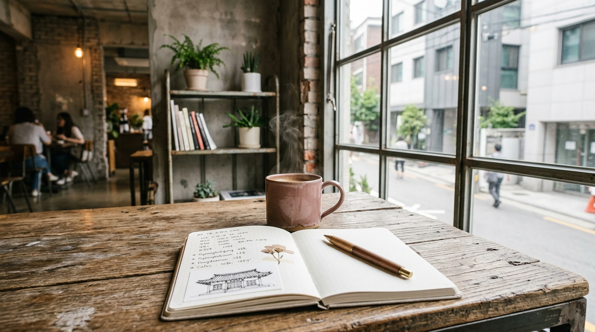
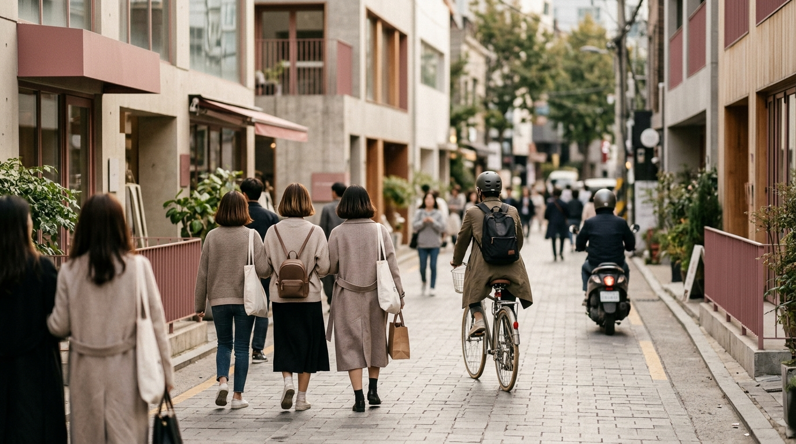

こんにちは、SEOUL TRIP NOTE の J です。

渡韓旅行の計画で、「聖水（ソンス）のカフェ巡りを楽しみたいけど、どこから回ればいいのかわからない」「人気エリアだから混雑が心配…」と感じていませんか？

ソウルに住んでいる私から見ても、聖水洞は新しいお店が次々にできる、変化の早いエリアです。特に、おしゃれなカフェが非常に多く、日本の旅行者の方々にも大変人気があります。

この記事では、聖水エリアの基本的な特徴から、効率的な回り方、そして混雑を避けてスマートにカフェ巡りを楽しむための具体的なコツまで、私が調べた情報をまとめてご紹介します。この記事を読めば、あなたの聖水カフェ巡りがもっと充実したものになるはずです。

### 【結論】聖水（ソンス）カフェ巡りの要点まとめ

まずは、聖水カフェ巡りを楽しむためのポイントを簡潔にまとめました。

*   **エリア特性を理解する**: 元工場街がおしゃれなカフェやショップに生まれ変わった街。メインストリートと路地裏で雰囲気が異なります。
*   **効率的な回り方を計画する**: 行きたいカフェの場所を事前に把握し、エリアを絞って回るとスムーズです。
*   **混雑を避ける工夫をする**: 平日の午前中や、週末なら早めの時間帯を狙うのがおすすめです。
*   **歩きやすい靴で**: 徒歩での移動が多いので、快適な靴を選びましょう。

---

### 聖水（ソンス）ってどんな街？カフェ巡りの前に知っておきたい基本情報

聖水洞（ソンスドン）は、ソウル市東部に位置する、近年特に注目を集めているエリアです。かつては工場や倉庫が立ち並ぶ工業地帯でしたが、再開発によって古い建物を活かしたおしゃれなカフェやギャラリー、セレクトショップが次々とオープンし、「ソウルのブルックリン」とも呼ばれるようになりました。

**聖水エリアの魅力**

*   **レトロとモダンが融合**: 古い建物の趣を残しつつ、現代的なデザインが施された空間が多く、独特の雰囲気が楽しめます。
*   **多様なカフェ**: 工場跡地を改装した広々とした大型カフェから、路地裏にひっそりと佇む隠れ家カフェ、個性的なスイーツを提供するカフェまで、非常にバラエティ豊かです。
*   **フォトジェニックなスポット**: どのカフェも内装や外観にこだわりがあり、写真映えするスポットがたくさんあります。
*   **ファッション・アート**: カフェだけでなく、韓国の若手デザイナーのショップやギャラリーも点在しており、カフェ巡りと合わせて散策するのもおすすめです。

**主なアクセス方法**

聖水洞へのアクセスは、地下鉄2号線が非常に便利です。

*   **聖水駅（성수역）**: カフェやショップが特に集中しているエリアの最寄り駅です。
*   **トゥッソム駅（뚝섬역）**: 聖水駅から徒歩圏内で、ソウルの森方面のカフェへ向かう際に利用すると便利です。

ソウルに住んでいる立場から見ると、聖水洞は特に若い世代の韓国人にも人気のエリアで、週末は特に多くの人で賑わいます。平日でも個性的なカフェが多く、日本の旅番組などでもよく紹介されているのを見かけます。

### 聖水カフェ巡りを効率よく楽しむための回り方とルートのヒント

※ AIで生成したイメージ画像です

聖水エリアは広範囲にカフェが点在しているため、計画なしに回ると移動に時間がかかったり、見逃してしまうスポットが出てくるかもしれません。効率よく楽しむための回り方のヒントをご紹介します。

1.  **テーマを決める**
    *   **レトロ・工場系カフェ**: 広々とした空間で、古い建物の雰囲気を活かしたカフェを巡りたい場合。
    *   **路地裏・隠れ家系カフェ**: 人通りの少ない場所で、静かに過ごせる小さなカフェを探したい場合。
    *   **スイーツ特化型カフェ**: ケーキやパン、ワッフルなど、特定のスイーツを目当てにしたい場合。
    *   **ソウルの森周辺カフェ**: 公園散策と合わせて、自然を感じられるカフェでリラックスしたい場合。
    事前にどんなカフェに行きたいかイメージすると、お店選びがしやすくなります。

2.  **エリアを絞って回る**
    聖水エリアは大きく分けて以下のゾーンがあります。
    *   **聖水駅周辺**: 駅を出てすぐのメインストリート沿いや、そこから一本入った路地裏に多くの人気カフェが集中しています。比較的コンパクトに回れます。
    *   **トゥッソム駅〜ソウルの森方面**: 聖水駅から少し離れますが、ソウルの森公園周辺には、公園の緑を眺められるカフェや、広々とした空間のカフェがあります。

    例えば、「午前中は聖水駅周辺のレトロカフェを2軒、午後はソウルの森で散策してからトゥッソム駅近くの落ち着いたカフェで休憩」といったように、エリアと時間を区切って計画すると良いでしょう。

3.  **移動手段を考慮する**
    聖水エリア内のカフェ巡りは基本的に徒歩が中心となります。しかし、少し離れたエリアへ移動する場合は、地下鉄やバス、タクシーを効率的に利用することも検討しましょう。

    **おすすめの回り方例**
    *   **聖水駅中心ルート**: 聖水駅で降り、駅周辺のメインストリートから一本入った路地裏のカフェを巡る。その後、聖水連邦などの複合施設も訪れる。
    *   **ソウルの森と組み合わせるルート**: トゥッソム駅で降りてソウルの森を散策し、公園周辺のカフェで休憩。その後、聖水駅方面へ移動しながらカフェを巡る。

    ソウルに住んでいる私から見ても、カフェ巡りの途中にセレクトショップや雑貨店を挟んだり、公園で少し休憩したりする時間を入れると、疲れにくく、より充実した時間を過ごせると思います。

### 混雑を避けてスマートに楽しむ！聖水カフェ巡りのコツ

人気の聖水エリアでは、特に週末や時間帯によってはカフェが非常に混雑することがあります。せっかくの旅行で並び疲れてしまわないよう、混雑を避けるためのコツをご紹介します。

*   **時間帯を工夫する**
    *   **平日の午前中**: 最もおすすめです。開店直後や午前中は比較的空いているカフェが多い傾向にあります。
    *   **週末の開店直後**: 週末に訪れる場合は、開店時間に合わせて行くのが賢明です。午後になると一気に混み始めることが多いです。
    *   **遅めの時間帯**: 夕方以降は少し落ち着くカフェもありますが、人気メニューが売り切れている可能性もあります。

*   **曜日を選ぶ**
    *   言うまでもなく、**平日**が最も空いています。可能であれば、週末を避けて平日に聖水カフェ巡りの予定を入れることを強くおすすめします。

*   **情報収集を怠らない**
    *   **SNS（特にInstagram）**: 韓国のカフェでは、リアルタイムの混雑状況や行列の様子がSNSに投稿されることがあります。ハッシュタグ検索で最新情報をチェックしてみましょう。
    *   **NAVERマップ**: 韓国で広く使われている地図アプリで、一部の店舗では混雑状況の目安が表示されることもあります。

*   **穴場を探す**
    *   メインストリートから一本入った路地裏には、まだあまり知られていないけれど魅力的なカフェがたくさんあります。少し冒険して、自分だけの隠れ家カフェを見つけるのも楽しいでしょう。
    *   新しいカフェは常にオープンしています。SNSなどで新しいお店の情報をチェックするのも良い方法です。

*   **テイクアウトの活用**
    *   人気のカフェが満席で入れない場合でも、コーヒーやドリンクをテイクアウトして、近くの公園や別の場所で楽しむのも一つの手です。ソウルの森公園はテイクアウトしたドリンクを楽しむのに最適な場所の一つです。

週末の聖水洞は多くの人で賑わうことで知られています。人気のベーカリーカフェでは、開店前から行列ができることもあるようです。これらのコツを活用して、ストレスなく聖水カフェ巡りを楽しんでくださいね。

---

### 【比較】聖水エリア内の移動手段の比較

※ AIで生成したイメージ画像です

聖水エリアは徒歩での散策が楽しいですが、広い範囲を効率よく回るために、他の移動手段も知っておくと便利です。

| 移動手段 | メリット                                   | デメリット                                     | 所要時間目安（エリア内） | 料金目安（執筆時点） |
| :------- | :----------------------------------------- | :--------------------------------------------- | :----------------------- | :------------------- |
| **徒歩** | 最も柔軟に路地裏まで探索できる。無料。      | 長距離移動は疲れる。天候に左右される。          | 5〜20分（カフェ間）      | 無料                 |
| **地下鉄** | 聖水駅〜トゥッソム駅間の移動に便利。定時性。 | 駅まで歩く必要がある。カフェの近くに駅がない場合も。 | 1駅 約2分                | 1,550ウォン〜        |
| **バス** | 細かいルートがあり、カフェ近くまで行ける場合も。 | 路線が複雑。渋滞の可能性。                      | 5〜15分（乗車時間）     | 1,500ウォン〜        |
| **タクシー** | 目的地まで直行。荷物が多い時に便利。        | 料金が高め。渋滞の可能性。                      | 5〜10分（乗車時間）     | 4,800ウォン〜        |

※上記料金は執筆時点の目安です。最新の料金は現地の交通機関公式サイトなどでご確認ください。また、日本円に換算する際は、最新の為替レートで計算してください。

> **聖水カフェ巡りのポイント**
> *   **歩きやすい靴で**: 徒歩での移動が多いので、履き慣れたスニーカーやフラットシューズを選びましょう。
> *   **充電器・モバイルバッテリー**: おしゃれなカフェが多く、写真をたくさん撮る機会があります。スマートフォンの充電切れに備えて、モバイルバッテリーは必須です。
> *   **韓国語翻訳アプリ**: メニューや店員さんとのコミュニケーションに役立ちます。簡単な挨拶や注文のフレーズを覚えておくと、さらにスムーズです。
> *   **最新情報はSNSや公式サイトで**: 営業時間や定休日、期間限定メニューは頻繁に変わります。出発前や訪問直前に、必ずカフェの公式SNSやNAVERマップなどで最新情報を確認しましょう。
> *   **マナー**: カフェによっては写真撮影のルール（例: 他のお客さんの顔が写らないように、フラッシュ禁止など）があるので、注意書きを確認したり、店員さんに尋ねたりしましょう。

### よくある質問（FAQ）

**Q1: 聖水エリアのカフェはどこに集中していますか？**
A1: 主に「聖水駅」と「トゥッソム駅」周辺に集中しています。聖水駅を出てすぐのメインストリート沿いや、そこから一本入った路地裏に多くのカフェがあります。トゥッソム駅方面へ向かうと、ソウルの森公園周辺にも自然を感じられるカフェが点在しています。事前にNAVERマップなどで位置関係を確認し、行きたいカフェを絞ってからルートを計画することをおすすめします。

**Q2: 聖水カフェ巡りにはどれくらいの時間が必要ですか？**
A2: 巡りたいカフェの数や、各カフェでの滞在時間によって異なりますが、一般的には半日（3〜4時間）から丸一日（5〜7時間）程度を見ておくと良いでしょう。2〜3軒のカフェをゆっくり巡り、途中でショッピングなども楽しむなら、半日〜1日を確保することをおすすめします。

**Q3: 聖水以外におすすめのカフェエリアはありますか？**
A3: はい、ソウルには他にも魅力的なカフェエリアがたくさんあります。
*   **漢南洞（ハンナムドン）**: 聖水と並んで人気のエリアで、おしゃれなセレクトショップやカフェ、レストランが集まっています。
*   **延南洞（ヨンナムドン）**: 弘大（ホンデ）のすぐ隣に位置し、個性的な路地裏カフェや小さなショップが多いエリアです。
*   **狎鴎亭（アックジョン）・清潭洞（チョンダムドン）**: 高級感のあるカフェや、有名ブランドのフラッグシップストアが多いエリアです。
これらのエリアも、それぞれの魅力がありますので、聖水と合わせて計画してみてはいかがでしょうか。

**Q4: カフェでの注文や支払いはどうすればいいですか？**
A4: 韓国のカフェでは、カウンターで直接注文・支払いをするのが一般的です。最近では、キオスク端末でのセルフオーダーや、スマートフォンアプリを使ったモバイルオーダーを導入している店舗も増えています。支払い方法は、クレジットカード（VISA, MasterCardなど）が広く利用でき、T-Moneyカード（交通カード）で払えるお店もあります。現金払いも可能ですが、カード決済が主流です。韓国語での注文が不安な場合は、指差しでメニューを伝えたり、翻訳アプリを活用したりすると良いでしょう。

---

### まとめ＆最後に

聖水（ソンス）エリアでのカフェ巡り、いかがでしたでしょうか？ 元工場街という歴史と、最新のトレンドが融合した聖水洞は、新しいお店が次々に生まれる、歩いて楽しい街です。

今回の記事でご紹介したエリアの特徴や効率的な回り方、混雑を避けるコツを参考に、ぜひあなただけの素敵なカフェ巡りを楽しんでくださいね。ソウルに住んでいる私としては、日本の旅行者の方々が韓国で良い思い出をたくさん作ってくださることを心から願っています。

SEOUL TRIP NOTE では、これからも渡韓旅行者の皆さんの役に立つ、実用的な情報をソウルからお届けしていきます。次回の渡韓計画の際にも、ぜひ参考にしてください。