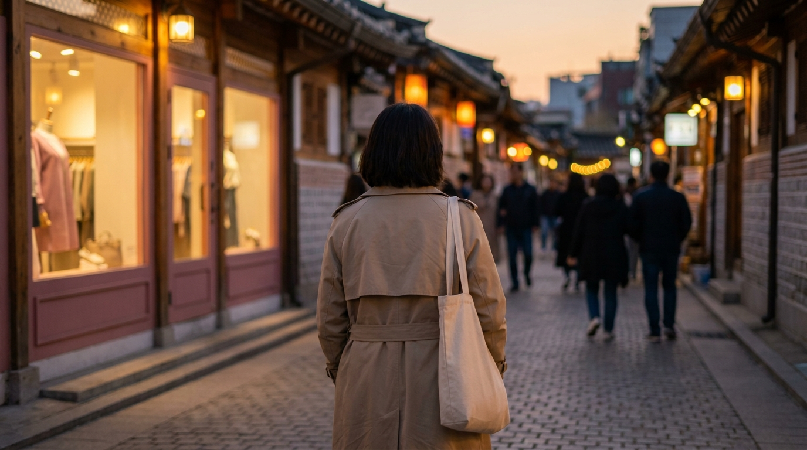

こんにちは、SEOUL TRIP NOTE の J です。ソウルで生まれ育ち、現在は当サイトで韓国旅行に役立つ実用情報を整理してお届けしています。

「初めての韓国旅行、2泊3日でどこをどう回ればいいかわからない」「行きたい場所がたくさんあるけれど、移動にどのくらい時間がかかるの？」と悩む方はとても多いです。ソウルは地下鉄網が発達していて移動しやすい街ですが、漢江（ハンガン）を挟んで南北に広く、エリア同士の位置関係を把握していないと移動だけで時間を消費してしまいます。

この記事では、限られた2泊3日を無駄なく楽しむための王道モデルコースと、主要エリア間の移動時間の目安をまとめました。

> **この記事の要点まとめ**
> - 初めてのソウル観光は、漢江の北側（江北エリア：明洞・弘大・聖水・東大門など）を中心に組むと移動がスムーズです。
> - ソウル市内の主要エリア間の地下鉄移動は、乗り換えを含めて1回あたり20〜30分程度が目安です。
> - 朝・昼・夜で訪問する街の性格（午前はカフェや散策、夜は東大門やナイトショッピング）を合わせると効率が高まります。
> - 空港と市内の移動時間（片道約1時間〜1時間半）をあらかじめ計算に入れてスケジュールを組みましょう。

---

## 2泊3日で押さえたい主要エリアの位置関係と特徴

ソウル観光の計画を立てる際、まずは「どの街がどの方向にあるか」を把握することが大切です。ソウルは中央を流れる「漢江（ハンガン）」によって大きく北側（江北）と南側（江南）に分かれています。

初めての2泊3日旅行では、観光スポットや人気ショッピング街が集中している江北エリアを拠点にすると、移動の負担を大きく減らせます。

それぞれのエリアの特徴は以下の通りです。

- **明洞（ミョンドン）：** コスメショップ、両替所、屋台が集中する定番エリア。初めての渡韓で宿泊先にする旅行者も多い街です。
- **弘大（ホンデ）：** 地下鉄2号線沿線にある学生街。ファッション、雑貨店、夜遅くまで営業する飲食店が集まります。
- **聖水（ソンス）：** 工場地帯をリノベーションしたカフェやフラッグシップストアが並ぶトレンド発信地です。
- **東大門（トンデムン）：** 深夜まで営業する大型ファッションビルや問屋街が集まる眠らない街です。

各エリアの特徴や雰囲気の違いについて詳しく知りたい方は、[ソウルのショッピングエリア比較｜明洞・弘大・聖水・東大門・江南の違い](/blog/seoul-shopping-area-comparison/)も参考にしてみてください。

---

## 初めてのソウル2泊3日モデルコース



<p class="img-cap">※ AIで生成したイメージ画像です</p>

仁川（インチョン）国際空港を午前に到着し、3日目の夕方〜夜の便で帰国する標準的なフライトスケジュールを想定したモデルコースです。

```
【1日目】仁川空港到着 → 明洞で両替＆チェックイン → 弘大でショッピング・夕食
【2日目】聖水でカフェ＆ショップ巡り → カンナムまたは高速ターミナル → 東大門で夜の散策
【3日目】ホテル周辺で朝食 → ソウル駅で事前チェックインまたはお土産購入 → 空港へ
```

### 1日目：到着、明洞での両替、夜の弘大散策

空港に到着したら、まずはソウル市内へ移動します。仁川空港から市内へは空港鉄道（A'REX）またはリムジンバスを利用するのが一般的です。詳しい所要時間や選び方は、[仁川空港からソウル市内へ！A'REXとリムジンバス徹底比較](/blog/incheon-airport-to-seoul-arex-bus/)で解説しています。

- **13:00〜14:30：明洞へ移動・チェックイン**
  明洞の公認両替所で現金を準備し、ホテルに荷物を預けます。
- **15:00〜18:00：明洞散策**
  オリーブヤングの大型店舗やコスメブランドをチェック。歩きながら気になる屋台グルメをつまむのも楽しみ方のひとつです。
- **18:30〜21:30：弘大（ホンデ）へ移動して夕食と夜のショッピング**
  地下鉄2号線で乙支路入口（ウルチロイック）駅から弘大入口（ホンデイック）駅へ移動します（乗車時間約15分）。夜遅くまで賑わうストリートで服やアクセサリーを見ながら、サムギョプサルやタッカルビなどの夕食を楽しみます。

### 2日目：聖水のトレンドスポットと東大門ナイトショッピング

- **10:30〜14:00：聖水（ソンス）でカフェ＆ポップアップ巡り**
  午前中から聖水洞へ向かいます。倉庫を改装したベーカリーカフェや、韓国発ブランドの旗艦店が立ち並びます。土日は混雑しやすいため、午前中の早めの時間帯から動き始めるのがポイントです。カフェの回り方は[聖水（ソンス）カフェ巡り完全ガイド｜エリア特徴からスマートな回り方まで](/blog/seongsu-cafe-best-selection-2026/)に整理しています。
- **14:30〜18:00：高速ターミナル駅（GOTOMALL）でショッピング**
  聖水から地下鉄で南下し、高速ターミナル駅直結の巨大地下街「GOTO MALL」へ。リーズナブルなアパレルやファッション小物を効率よく見られます。
- **18:30〜22:00：東大門（トンデムン）でタッカンマリと深夜ショッピング**
  東大門へ移動し、名物のタッカンマリ通りで夕食をとった後、「現代シティアウトレット」や「DOOTA MALL」などのファッションビルを散策します。

### 3日目：伝統的な街並みの散策と最後のお土産調達

- **09:30〜11:30：安国（アングク）・北村韓屋村の散策**
  伝統家屋が並ぶエリアで朝の散歩を楽しみ、話題のベーカリーカフェなどで軽食をとります。
- **12:00〜14:00：ソウル駅の大型マートでお土産購入**
  ソウル駅隣接のロッテマートでお菓子やラーメン、調味料などをまとめて調達します。
- **14:30以降：空港へ移動**
  フライト出発時刻の2時間半〜3時間前を目安に空港へ向かいます。

---

## 主要エリア間の移動時間と路線目安

ソウル市内の移動は地下鉄が最も時間が読みやすく便利です。主要スポット間の移動時間と利用する路線をまとめました。

| 出発地 | 目的地 | 主な地下鉄路線 | 所要時間の目安（乗換含む） |
| :--- | :--- | :--- | :--- |
| 仁川国際空港（T1） | ソウル駅 | 空港鉄道（A'REX直通） | 約43分 |
| 明洞（乙支路入口駅） | 弘大入口駅 | 地下鉄2号線（直通） | 約15〜20分 |
| 弘大入口駅 | 聖水駅 | 地下鉄2号線（直通） | 約30〜35分 |
| 明洞（明洞駅） | 東大門歴史文化公園駅 | 地下鉄4号線（直通） | 約10分 |
| 聖水駅 | 高速ターミナル駅 | 地下鉄2号線 → 建大入口で7号線へ乗換 | 約20〜25分 |
| 明洞（明洞駅） | 安国駅 | 地下鉄4号線 → 忠武路で3号線へ乗換 | 約15分 |

※所要時間は運行状況や乗り換えの歩行速度によって前後します。

地下鉄の詳しい乗り方や路線図の確認方法については、[ソウルの地下鉄を乗りこなす！路線図の見方・運賃・乗り換えガイド](/blog/seoul-subway-how-to-ride/)で解説しています。

---

## 失敗しないための旅行設計・移動の注意点


<p class="img-cap">※ AIで生成したイメージ画像です</p>

限られた2泊3日をスムーズに過ごすために、以下の注意点を事前に確認しておきましょう。

> **スケジュール設計の注意点**
> 1. **月曜日は休館・休業が多い：** 美術館や一部の個人カフェ、市場の店舗は月曜定休の場合があります。行きたい店舗の営業日は事前に公式SNSや地図アプリで確認してください。
> 2. **通勤ラッシュ時間帯の移動を避ける：** 平日の朝（8:00〜9:00）と夕方（18:00〜19:30）の地下鉄は非常に混雑します。大きなスーツケースを持っての移動はこの時間帯を避けるのが賢明です。
> 3. **タクシー移動は道路渋滞に注意：** 江北から江南へ漢江を渡る橋や、明洞・東大門周辺の幹線道路は夕方に激しい渋滞が発生します。急いでいる時は地下鉄の利用を優先しましょう。

また、韓国内での交通費決済には、交通系ICカード（T-money）や外国人向けプリペイドカードがあると便利です。購入方法や比較については[渡韓旅行者必見！気候同行カードとWOWPASS徹底比較ガイド【2026年最新】](/blog/climate-card-vs-wowpass-comparison/)に詳しくまとめています。

---

## よくある質問（FAQ）

### Q1. 初めての渡韓の場合、宿泊エリアはどこがおすすめですか？
移動の利便性を最優先にするなら「明洞（ミョンドン）」または「東大門（トンデムン）」周辺がおすすめです。空港リムジンバスの停留所が多く、地下鉄も複数路線が乗り入れているため、どの観光地へも20〜30分程度で移動できます。夜遅くまでカフェや買い物を楽しみたい場合は「弘大（ホンデ）」も人気の選択肢です。

### Q2. 2泊3日で江南（カンナム）エリアまで行く時間はありますか？
行くことは十分可能です。ただし、明洞や弘大などの江北エリアから江南エリアまでは地下鉄で片道約30〜45分程度かかります。往復の移動だけで1時間以上かかるため、「2日目の午後にまとめて江南・高速ターミナル方面を回る」といったように、半日単位でスケジュールを確保することをおすすめします。

### Q3. 現金（ウォン）はどのくらい両替しておくべきですか？
韓国はキャッシュレス決済が非常に進んでいるため、コンビニ、飲食店、コスメショップ、大型ファッションビルなどはクレジットカードやWOWPASS等で決済が可能です。ただし、屋台での買い食い、地下鉄カードへの現金チャージ、一部の東大門問屋街などでは現金が必要になります。2泊3日の場合、1人あたり50,000〜100,000ウォン程度の現金を持っておき、残りはカード決済にする旅行者が多い傾向です。日本円からの換算は最新の為替レートをご確認ください。

### Q4. 地図アプリはGoogleマップで大丈夫ですか？
韓国国内では法規制等の影響により、Googleマップの徒歩ナビゲーション機能が十分に動作しません。現地の移動には「NAVERマップ」または「カカオマップ」のアプリを事前にインストールしておくことを強くおすすめします。日本語表示にも対応しており、地下鉄の乗り換え番線やバスのリアルタイム到着情報まで正確に確認できます。

---

## まとめ

初めてのソウル2泊3日旅行を充実させる秘訣は、「同じ方角のエリアをまとめて回る」ことと「無理のない移動時間を確保する」ことです。

- **1日目：** 明洞・弘大（西側〜中心部）
- **2日目：** 聖水・東大門（東側〜トレンドエリア）
- **3日目：** 安国・ソウル駅周辺（午前中の散策とお土産調達）

このように大まかなエリアを日ごとに分けるだけで、地下鉄の往復時間を大幅に削減でき、カフェや買い物をゆったり楽しむ余裕が生まれます。現地の店舗情報や運行スケジュールは変更される場合があるため、出発前には公式案内や地図アプリで最新情報を確認しながら、素敵なソウル旅行を計画してください。