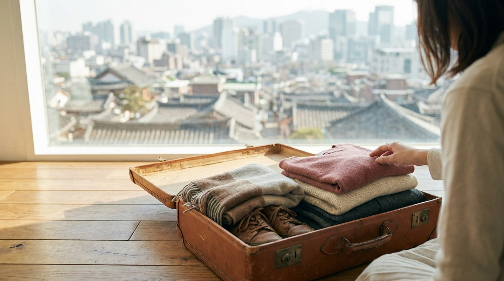
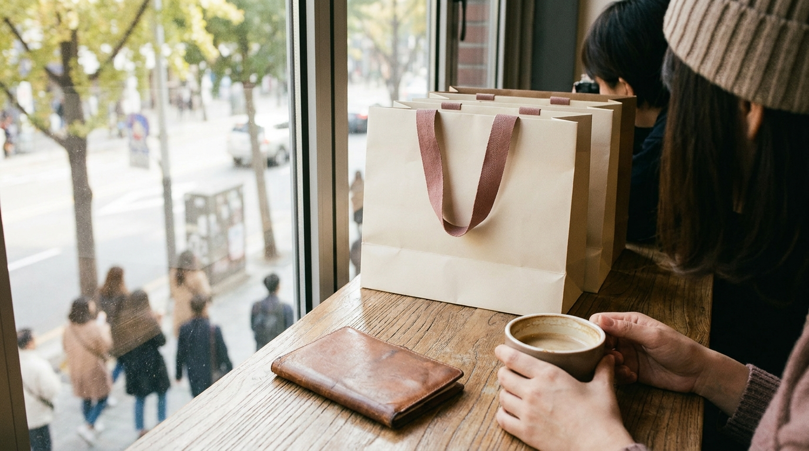

こんにちは、SEOUL TRIP NOTE の J です。

ソウル旅行（渡韓）の計画を立てる際、「どの時期に行くのが一番快適か」「現地の気温に合わせた服装はどう選べばいいか」と迷う方は少なくありません。日本と韓国はお隣の国ですが、ソウルは大陸性気候の影響を強く受けるため、東京や大阪に比べて夏は湿度と雨が多く、冬は氷点下まで厳しく冷え込みます。

また、韓国特有の祝日（特に旧正月や秋夕といった名節）に旅行日程が重なると、行きたかったカフェやショップが一斉に休業してしまうこともあります。

この記事では、ソウル旅行のベストシーズンをはじめ、月別の平均的なソウル気温とソウル服装の目安、渡韓時に避けるべき韓国祝日のスケジュールを整理して解説します。

> **この記事の要点まとめ**
> - **ベストシーズンは春（4月〜5月）と秋（9月下旬〜10月）**。過ごしやすい気候で街歩きやカフェ巡りに最適です。
> - **夏（7月〜8月）は猛暑と梅雨（チャンマ）、冬（12月〜2月）は氷点下10度前後の寒波**に注意が必要です。
> - **旧正月（ソルラル）と秋夕（チュソク）は連休前後に個人店や市場の休業が多い**ため、旅行日程を決める際に事前確認が必須です。

---

## ソウル旅行のベストシーズンは「春」と「秋」

気候の快適さを基準にする場合、ソウル旅行のベストシーズンは**4月〜5月の春**、そして**9月下旬〜10月の秋**です。

### 1. 過ごしやすい春（4月〜5月）
4月に入ると寒さが和らぎ、桜やレンギョウなどの花が街中で咲き始めます。日中の気温は15度〜20度前後まで上がり、アウターを1枚羽織るだけで快適に散策できます。聖水（ソンス）や漢南洞（ハンナムドン）でのカフェ巡りや、屋外のショッピングを楽しむのにぴったりな時期です。

なお、カフェ巡りや街歩きをメインに計画している方は、事前にエリアの特徴を把握しておくと移動がスムーズです。[聖水（ソンス）カフェ巡り完全ガイド｜エリア特徴からスマートな回り方まで](/blog/seongsu-cafe-best-selection-2026/) もぜひ参考にしてみてください。

### 2. 湿度が低く晴天が続く秋（9月下旬〜10月）
秋はソウルで最も天候が安定する時期です。空気が澄んでいて湿度が低く、朝晩は涼しい風が吹きます。10月中旬を過ぎると景福宮（キョンボックン）や南山（ナムサン）の紅葉も見頃を迎えます。日中は長袖シャツや薄手のスウェットで快適に過ごせますが、朝晩の寒暖差（日較差）が10度以上開く日もあるため、着脱しやすい上着が欠かせません。

---

## 【月別】ソウルの気温と服装の目安



<p class="img-cap">※ AIで生成したイメージ画像です</p>

ソウル旅行時期ごとの気候の特徴と、適した服装を季節別に整理しました。

```
【春】 3月〜5月：三寒四温から穏やかな気候へ。朝晩の冷え込み対策が必要
【夏】 6月〜8月：高温多湿。7月前後は梅雨（チャンマ）、8月はスコールや熱帯夜
【秋】 9月〜11月：乾燥して爽やか。11月に入ると急激に冬の冷え込みが始まる
【冬】 12月〜2月：氷点下の厳しい寒さ。ダウンコートと防寒小物が必須
```

### 3月〜5月（春）
- **3月**: まだ冬の名残があり、風が冷たく感じられる日が多いです。ウールのコートや厚手のジャケットが必要です。
- **4月**: 日中は暖かく過ごしやすいですが、朝晩は冷え込みます。トレンチコート、デニムジャケット、カーディガンなどの重ね着が基本です。
- **5月**: 初夏の陽気になり、日中は半袖でも過ごせる日が増えます。日差しが強くなるため、日焼け止めや薄手の羽織ものを用意しましょう。

### 6月〜8月（夏）
- **6月**: 気温が25度を超え、蒸し暑さが増してきます。半袖や通気性の良い服装が適しています。
- **7月〜8月**: 梅雨（チャンマ）による大雨や、急な豪雨（スコールのような局地性大雨）が多くなります。湿度が非常に高く、日中は30度以上になります。室内や地下鉄は冷房が強めに効いているため、冷え対策に薄手の長袖カーディガンを持ち歩くのがおすすめです。

### 9月〜11月（秋）
- **9月**: 上旬は夏の暑さが残りますが、下旬になると急激に朝晩が涼しくなります。
- **10月**: 渡韓に最も適した気候です。長袖トップスに、朝晩用のライダースジャケット、薄手コート、ニットなどが重宝します。
- **11月**: 秋から冬への移行期で、中旬以降は最低気温が氷点下近くまで下がる日があります。厚手のウールコートやショートダウンを準備してください。

### 12月〜2月（冬）
- **12月〜2月**: シベリア高気圧の影響で、気温がマイナス5度〜マイナス15度前後まで下がることが珍しくありません。足元から冷気が伝わるため、ロングダウンコート（ペディン）、裏起毛のインナー、厚手の靴下、手袋、マフラーが必須です。靴は底が厚く滑りにくいスニーカーやブーツを選びましょう。

---

## 【一覧表】月別の平均気温・体感・服装の比較

気象庁などの公開データをもとに、ソウルの月別平均気温の傾向と適したソウル服装をまとめました（気象データは年によって変動するため執筆時点の目安です）。

| 月 | 平均気温の目安 | 平均最高 / 最低（目安） | おすすめの服装・持ち物 |
| :--- | :--- | :--- | :--- |
| **3月** | 約 5℃〜6℃ | 約 10℃ / 1℃ | 冬用コート、厚手ジャケット、ストール |
| **4月** | 約 12℃〜13℃ | 約 18℃ / 7℃ | トレンチコート、薄手ブルゾン、長袖トップス |
| **5月** | 約 17℃〜19℃ | 約 24℃ / 13℃ | 長袖カットソー、薄手カーディガン、半袖（日中） |
| **6月** | 約 22℃〜23℃ | 約 27℃ / 18℃ | 半袖、風通しの良いボトムス、折りたたみ傘 |
| **7月** | 約 25℃〜26℃ | 約 29℃ / 22℃ | 半袖、サンダル、雨具、室内用の薄手羽織もの |
| **8月** | 約 26℃〜27℃ | 約 30℃ / 23℃ | ノースリーブ・半袖、日傘、紫外線対策グッズ |
| **9月** | 約 21℃〜22℃ | 約 26℃ / 16℃ | 長袖Tシャツ、薄手羽織もの、温度調節しやすい服 |
| **10月** | 約 15℃〜16℃ | 約 20℃ / 9℃ | ニット、ジャケット、トレンチコート |
| **11月** | 約 7℃〜8℃ | 約 12℃ / 3℃ | 厚手コート、ライトダウン、保温インナー |
| **12月** | 約 -1℃〜0℃ | 約 4℃ / -4℃ | ロングダウン、マフラー、手袋、カイロ |
| **1月** | 約 -2℃〜-3℃ | 約 2℃ / -6℃ | 最厚手ダウンコート、ヒート系インナー、厚手靴下 |
| **2月** | 約 0℃〜1℃ | 約 5℃ / -4℃ | 防風ダウンコート、防寒ブーツ、ニット帽 |

※上記は過去の観測記録に基づく大まかな傾向です。渡韓直前には必ず現地の週間天気予報を確認してください。

---

## 旅行日程で注意したい韓国の祝日と名節

ソウル旅行の時期を決める際、気温と同じくらい重要なのが「韓国祝日」のスケジュールです。

特に韓国の2大名節である**旧正月（ソルラル）**と**秋夕（チュソク）**は、多くの人々が帰省するため、個人経営の飲食店やカフェ、伝統市場（南大門市場や東大門の卸売市場など）が数日間にわたって休業します。

> **韓国の祝日における注意点**
> - **旧正月（ソルラル）と秋夕（チュソク）**: 陰暦基準のため毎年日付が変わります。当日およびその前後は個人店や市場の休業率が高くなります。
> - **免税店・大型百貨店・オリーブヤング**: 明洞や弘大などの主要観光地にある大型チェーン店は、名節当日を除いて営業している場合が多いですが、時短営業になることがあります。
> - **KTX・高速バスの混雑**: ソウルから地方へ向かう交通機関が帰省ラッシュで完全に満席になります。ソウル市内だけの滞在であれば問題ありませんが、地方都市への移動は避けるのが賢明です。

### 主な韓国祝日の年間スケジュール（目安）

- **1月1日（新正 / シンジョン）**: 元日。公的機関は休みですが、観光地や飲食店は通常営業が多いです。
- **1月下旬〜2月中旬（ソルラル / 旧正月）**: **要注意**。連休期間中は市場や個人店が連休に入ることが一般的です。
- **3月1日（三一節 / サミルジョル）**: 祝日のため公的機関や一部商業施設が休みになります。
- **5月5日（オリニナル / こどもの日）**: 祝日。レジャー施設や大型モールが家族連れで混雑します。
- **5月頃（釈迦誕生日 / ソッカタンシンイル）**: 陰暦4月8日のため年によって変動します。寺院周辺でイベントが行われます。
- **6月6日（顕忠日 / ヒョンチュンイル）**: 追悼の日。公的機関は休業となります。
- **8月15日（光復節 / クァンボッチョル）**: 祝日。都心部で集会や行事が行われることがあります。
- **9月中旬〜10月上旬（チュソク / 秋夕）**: **要注意**。ソルラルと並ぶ大型連休です。個人店を巡る旅行は避けるのが無難です。
- **10月3日（開天節 / ケチョンジョル）**: 祝日。
- **10月9日（ハングルの日 / ハングルナル）**: 祝日。
- **12月25日（聖誕節 / クリスマス）**: 韓国では祝日です。街中のイルミネーションが華やかですが、飲食店や明洞などの繁華街は非常に混雑します。

連休中の移動や買い物には、スムーズな決済・交通手段の準備が不可欠です。交通カードや決済ツールの選び方については、以下の記事も確認してみてください。
- [渡韓旅行者必見！気候同行カードとWOWPASS徹底比較ガイド【2026年最新】](/blog/climate-card-vs-wowpass-comparison/)
- [ソウルの地下鉄を乗りこなす！路線図の見方・運賃・乗り換えガイド](/blog/seoul-subway-how-to-ride/)

---

## 季節別・ソウル旅行をお得で快適に楽しむコツ



<p class="img-cap">※ AIで生成したイメージ画像です</p>

気候や祝日以外の要素として、ショッピングのセール時期や航空券の傾向を押さえておくと、より充実した渡韓になります。

### 1. コスメやファッションのセールを狙うなら
韓国コスメをまとめて購入したい場合、オリーブヤングが年に4回（例年3月、6月、9月、12月）開催する「オリヤンセール（オリーブヤングビッグセール）」の時期を狙う旅行者が多く見られます。また、アパレルの夏物・冬物クリアランスセールもこの時期に重なります。

オリヤンのセール傾向や購入時の免税手続きについては、以下の記事で詳しく解説しています。
- [【2026年版】オリヤンセールはいつ？過去の開催時期から予想する時期と賢いお買い物術](/blog/oliveyoung-big-sale-dates-2026/)
- [オリーブヤングの免税（タックスリファンド）完全ガイド【即時還付vs空港還付】](/blog/oliveyoung-tax-refund-guide/)

### 2. 寒さ・暑さを回避するなら地下街を活用する
真夏や真冬に旅行する場合は、屋外の移動を減らし、地下鉄直結の巨大地下街（高速ターミナルのGO TO MALLやCOEXモールなど）を中心に回るルートを組むと、天候に左右されずに快適に楽しめます。

---

## よくある質問（FAQ）

### Q1. ソウル旅行に最もおすすめできない時期はいつですか？
**A.** 気候の面では「7月〜8月の梅雨・猛暑期」と「1月〜2月の極寒期」、スケジュールの面では「旧正月（ソルラル）」と「秋夕（チュソク）」の連休期間です。街歩きや個人カフェ巡りを楽しみたい場合、気候が厳しく店舗休業が多いこの時期は避けるのが無難とされています。

### Q2. 冬のソウル旅行で足元はどうすればいいですか？
**A.** ソウルの冬は道路が凍結することが多く、足先から冷え込みます。底が薄いスニーカーやヒールは滑りやすく非常に冷えるため避けましょう。靴底に凹凸がある滑りにくいスニーカーや、内側がボア素材のブーツが推奨されます。厚手のウール靴下や靴用カイロを併用すると安心です。

### Q3. 韓国の祝日は地下鉄やバスも運休しますか？
**A.** 地下鉄や市内バスなどの公共交通機関は、祝日や名節であっても基本的に通常運行（または休日ダイヤ）しています。運休することはありませんが、名節期間中はソウル駅や高速バスターミナル周辺が地方へ行き来する人々で混雑します。

### Q4. 雨が多い時期はいつですか？
**A.** 例年6月下旬から7月下旬にかけてが梅雨（チャンマ）の時期にあたり、降水量が集中します。この時期は局地的な豪雨になることも多いため、靴が濡れても大丈夫な防水スニーカーや替えの靴下、しっかりした折りたたみ傘を準備しておく必要があります。

---

## まとめ

ソウル旅行を思い切り楽しむためのベストシーズンは、気候が穏やかで過ごしやすい**4月〜5月**と**9月下旬〜10月**です。

もし真夏や真冬に旅行する場合は、日本の気候感覚よりも一段阶強い防暑・防寒対策を整えておきましょう。また、行きたいお店が閉まっていて困ることがないよう、渡韓日程が旧正月や秋夕などの大型連休と重なっていないかをあらかじめ確認しておくことが大切です。

現地の最新の気象情報や祝日スケジュールを把握して、快適で楽しいソウル旅行を計画してください。