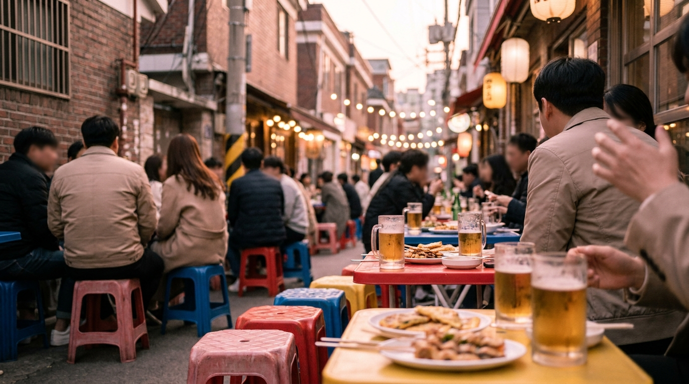
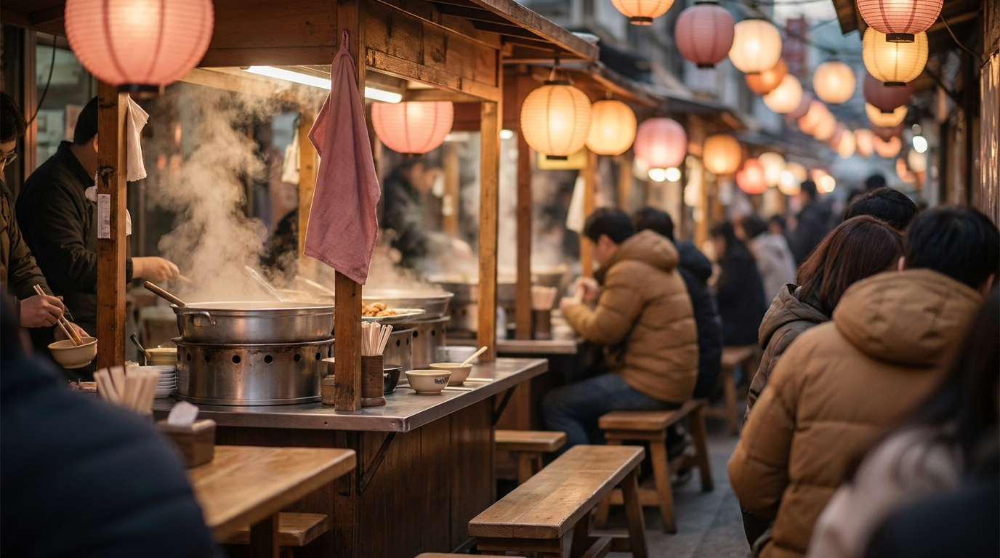

こんにちは、SEOUL TRIP NOTE の J です。ソウル在住の視点から、渡韓旅行者の方に役立つ情報を整理してお届けしています。

韓国旅行の醍醐味といえば、地元の人たちで賑わう活気あふれる食事の時間です。ソウルには同じメニューを扱う食堂がひとつの路地に集まった「特化型のグルメ通り（モッコリコルモク）」が数多く存在します。ただ、どこに行けばどんな料理が食べられるのか、注文ルールはどうなっているのかなど、迷う場面も少なくありません。

鍾路（チョンノ）、乙支路（ウルチロ）、新林（シルリム）など、ソウルを代表する有名なグルメ街の特徴と名物メニュー、現地で戸惑わないための注意点をまとめました。

> **この記事の要点まとめ**
> - **鍾路エリア**: カルメギサル（豚ハラミ）や夕方から並ぶ屋台（ポチャ）が集まる伝統的な大衆グルメ街。
> - **乙支路エリア**: 印刷工場街のレトロな雰囲気の中でノガリ（スケトウダラの幼魚乾物）やコルベンイ（ツブ貝和え）を楽しめる若者にも人気の街。
> - **新林・新堂エリア**: 白スンデ炒めのビルが集まる新林、即席トッポッキが名物の新堂など、1つのメニューに特化した個性派通り。
> - **訪問時の注意**: グループ利用が前提のメニューが多いため、2人前以上の注文ルールや支払いの流れを事前に把握しておくと安心です。

---

## 鍾路エリア｜カルメギサル通りと夕暮れのポチャ通り

ソウルの中心部にある鍾路（チョンノ）は、古くからの歴史と近代的なビル群が共存するエリアです。地下鉄の路線が複数交差しており、アクセス面でも便利です。

### 鍾路3街 カルメギサル通り
地下鉄1・3・5号線が通る鍾路3街（チョンノサムガ）駅の6番出口周辺には、カルメギサル（豚の横隔膜・ハラミ肉）を専門とする焼肉店が連なる細い路地があります。

夕方になると店先の屋外スペースに簡易テーブルが並び、炭火の煙とともに肉を焼く香ばしい匂いが漂います。カルメギサルは脂っこさが少なく、赤身のようなしっかりとした旨味と歯ごたえが特徴の部位です。注文するとサンチュやエゴマの葉、キムチのほか、店によってテンジャンチゲやケランチム（韓国風茶碗蒸し）がセットで提供される傾向にあります。

焼肉の注文手順や焼き方について詳しく知りたい方は、[韓国焼肉の頼み方完全ガイド｜注文ルール・焼き方・締めのメニューまで](/blog/korean-bbq-ordering-guide/)もあわせて参考にしてください。

### 鍾路3街 屋台通り（ポチャ通り）
同じく鍾路3街駅の出入口付近では、日没近くになるとオレンジ色のテントを張った屋台（ポジャンマチャ、通称ポチャ）が一斉に営業を開始します。ソウルの会社員たちが仕事帰りに立ち寄り、お酒と一品料理を楽しむ憩いの場です。

オデン、トッポッキといった軽食だけでなく、コルベンイ（ツブ貝和え）、タコの炒め物、スパム焼きなど、お酒によく合う多様なおつまみが揃っています。

---

## 乙支路エリア｜ノガリ横丁とコルベンイ通り

※ AIで生成したイメージ画像です

鍾路のお隣に位置する乙支路（ウルチロ）は、かつての印刷工場や工具店が並ぶ街並みを活かしたレトロなカフェやバーが増え、「ヒップチロ」として若者にも人気のエリアです。ここにも長い歴史を持つグルメ通りがあります。

### 乙支路 ノガリ横丁
乙支路3街（ウルチロサムガ）駅の周辺には、ノガリ（スケトウダラの幼魚を干したもの）や乾き物をつまみに生ビールが飲める大衆酒場が集まる通りがあります。

夕暮れ時から夜にかけて、屋外の広場一面にプラスチックのテーブルと椅子が並べられる光景は乙支路の名物です。ノガリは1匹あたり手頃な価格（執筆時点の目安で1,500〜2,000ウォン程度）で提供されており、特製のコチュジャンマヨネーズだれにつけて食べるスタイルが一般的です。2軒目や3軒目に軽くお酒を飲みたいときに立ち寄りやすい通りとして知られています。

### 乙支路 コルベンイ通り
ノガリ横丁のすぐ近くには、缶詰のツブ貝を使ったピリ辛和え「コルベンイムチム」を提供する専門店が集まった通りもあります。たっぷりの白髪ネギと唐辛子粉、ニンニクで和えられたツブ貝は刺激的な辛さで、素麺（ソミョン）を追加して混ぜて食べるのが定番の食べ方です。

---

## 新林・新堂エリア｜ひとつのメニューを極めた専門タウン

ソウルには特定の料理だけを専門に扱う店が集まる通りも存在します。

### 新林洞 スンデタウン
地下鉄2号線・新林線が通る新林（シルリム）駅の近くには、「スンデタウン」と呼ばれる複合飲食ビルがあります。ビル内のフロア全体に、スンデ（豚の腸に春雨や香味野菜を詰めた韓国式ソーセージ）の専門店が屋台のようにひしめき合っています。

名物料理は「ペクスンデ（白スンデ炒め）」です。一般的な辛いタレで炒めるスンデポックムとは異なり、スンデ、チョルミョン（コシのある麺）、キャベツ、エゴマの葉などをエゴマ油で香ばしく炒め、中央に置かれた特製のタレにつけて食べます。辛いものが苦手な方でも食べやすい味付けとして口コミでも定評があります。

### 新堂洞 トッポッキタウン
地下鉄2・6号線の新堂（シンダン）駅周辺に広がる「新堂洞トッポッキタウン」は、即席トッポッキ（チョクスクトッポッキ）の発祥地として知られています。

屋台で売られている作り置きのトッポッキとは違い、テーブル上の大きな鍋でトック（餅）、ラーメン、おでん、揚げ餃子（ヤッキマンドゥ）、ゆで卵などを甘辛いタレで煮込みながら食べるスタイルです。鍋の締めにはご飯と韓国海苔、ごま油を加えてポックンパ（炒めご飯）にするのが定番の流れです。

街歩き全体の屋台メニューの価格相場や定番料理については、[ソウル屋台グルメ完全ガイド｜トッポッキ・ホットク定番メニューと価格相場](/blog/seoul-street-food-guide/)で詳しく整理しています。

---

## ソウル主要グルメ街の比較一覧

各グルメ街の最寄駅、看板メニュー、雰囲気や価格帯の目安をまとめました。

| グルメ通り名 | 最寄駅 | 主な看板メニュー | 雰囲気・客層 | 価格帯の目安（1人あたり） |
| :--- | :--- | :--- | :--- | :--- |
| **鍾路 カルメギサル通り** | 地下鉄1・3・5号線 鍾路3街駅 | カルメギサル（豚ハラミ焼肉） | 活気ある路地、地元会社員・観光客 | 約16,000〜22,000ウォン |
| **鍾路3街 ポチャ通り** | 地下鉄1・3・5号線 鍾路3街駅 | 海鮮炒め、卵焼き、おでん | 夜の屋台、お酒を楽しむ大衆的な場 | 約15,000〜25,000ウォン |
| **乙支路 ノガリ横丁** | 地下鉄2・3号線 乙支路3街駅 | ノガリ（乾物）、生ビール | 開放的なビアホール空間、若者・会社員 | 約10,000〜18,000ウォン |
| **新林 スンデタウン** | 地下鉄2号線・新林線 新林駅 | ペクスンデ（白スンデ炒め） | 賑やかな市場のような屋内フロア | 約10,000〜15,000ウォン |
| **新堂 トッポッキタウン** | 地下鉄2・6号線 新堂駅 | 即席トッポッキ鍋 | ファミリー・学生・幅広い年代 | 約9,000〜14,000ウォン |

※価格帯は執筆時点の一般的な目安です。注文する品数や飲み物の量によって変動します。公式情報や店頭の表示をあわせてご確認ください。

ソウル市内の地下鉄移動に不安がある方は、[ソウルの地下鉄を乗りこなす！路線図の見方・運賃・乗り換えガイド](/blog/seoul-subway-how-to-ride/)を事前に確認しておくとスムーズに移動できます。

---

## グルメ街を訪れる際の注意点と歩き方のコツ

※ AIで生成したイメージ画像です

ローカルなグルメ街を満喫するためには、いくつか事前に知っておくべきポイントがあります。

> **訪問時のチェックポイント**
> - **基本は「2人前以上」の注文**: 焼肉や即席鍋、スンデ炒めなどは、1人での利用でも2人前からの注文が基本となる店舗が多いです。
> - **支払いはクレジットカード対応が主流だが屋台は例外も**: 一般の食堂はカード決済が可能ですが、屋外のポチャ（屋台）では現金や送金が推奨される場合があります。小額の現金（1万〜2万ウォン程度）を用意しておくと安心です。
> - **混雑する時間帯**: 金曜日や土曜日の18:30〜20:30頃は地元の会社員や若者で非常に混み合います。少し早い17時台、または21時以降に向かうと比較的席を確保しやすいです。

韓国の一般的な飲食店での注文や追加注文の合図に不安がある方は、[韓国の食堂でスマートに注文！初心者も安心の呼び出しベル・おかわり・会計ガイド](/blog/korean-restaurant-ordering-guide/)に基本的な流れをまとめています。

---

## よくある質問（FAQ）

### Q1. 韓国語が話せなくてもグルメ街の店舗に入れますか？
多くの店舗では壁に写真付きのメニューが貼ってあるか、指差しで注文が可能です。鍾路や乙支路などの人気エリアでは、英語や簡単な日本語表記のメニューを用意している店舗も増えています。翻訳アプリ（Papagoなど）を準備しておくと安心です。

### Q2. ひとり旅（1人ご飯）でも利用できますか？
屋台（ポチャ）や乙支路のノガリ横丁であれば1人でも利用しやすいとされていますが、鍾路のカルメギサル通りや新林のスンデタウンは料理のポーションが大きく、2人前以上の注文が基本となります。1人で訪れる場合は、2人前分を注文して食べるか、比較的空いている時間帯（平日の15〜17時頃など）を選ぶという声が多いです。

### Q3. トイレはどこを利用すればよいですか？
古い路地にある店舗や屋外の屋台では、店内に清潔なトイレがない場合があります。その場合は、店舗が指定する共用ビル内のトイレ（鍵や暗証番号が必要なことが多いです）を利用するか、最寄りの地下鉄駅構内の改札外トイレを利用するのが便利です。

### Q4. 雨の日でも営業していますか？
新林のスンデタウンや新堂のトッポッキタウンは屋内店舗のため、天候に関係なく通常通り営業しています。一方、鍾路のポチャ通りや乙支路のノガリ横丁などの屋外席は、大雨や強風の日は規模が縮小されたり、屋内席のみの営業になることがあります。

---

## まとめ

ソウルのグルメ通りは、エリアごとに看板メニューや街の空気がまったく異なります。

- カルメギサルや韓国らしい屋台の夜を楽しみたいときは**鍾路3街**
- レトロな路地で乾物と生ビールを気軽に味わいたいときは**乙支路**
- 専門性の高い白スンデや即席トッポッキをしっかり楽しみたいときは**新林や新堂**

目当てのメニューや旅行ルートに合わせて訪れるエリアを選んでみてください。最新の営業時間や定休日は変更される場合があるため、訪問前に地図アプリや公式情報で確認しておくことをおすすめします。