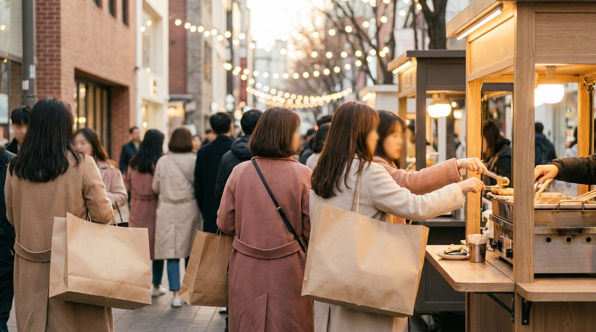
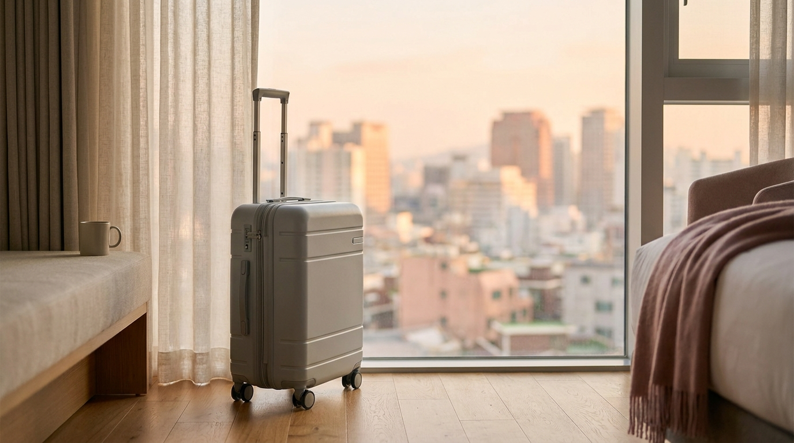

こんにちは、SEOUL TRIP NOTE の J です。

ソウル旅行の準備で、航空券の次に悩みやすいのが「どのエリアのホテルに泊まるか」です。ソウルは地下鉄網が発達しているので、どこに泊まっても主要スポットへは行けます。ただ、空港からの移動のしやすさ、夜の過ごし方、朝の移動時間はエリアによってかなり変わります。

明洞・弘大・東大門・江南・鍾路の5エリアに、ソウル駅周辺を加えて、それぞれの特徴と向いている旅のスタイルを、公式の路線情報や旅行者の口コミの傾向をもとに整理しました。

> **この記事の要点まとめ**
> - **明洞**: 初めての渡韓・短い日程なら最有力。空港リムジンバスの路線があり、買い物・両替・食事が徒歩圏で完結しやすい。
> - **弘大**: 空港鉄道（A'REX）の一般列車で空港から乗り換えなし。夜遅くまでにぎやかで、若い旅行者やひとり旅に人気。
> - **東大門**: 深夜営業のファッションビルが近く、夜型の買い物旅向き。地下鉄3路線が使え移動の起点にもなる。
> - **江南**: 美容クリニックや江南エリアの用事が中心の旅向き。漢江の北側（景福宮・明洞など）へはやや遠い。
> - **鍾路**: 景福宮・仁寺洞・益善洞など歴史散策の拠点。韓屋（ハノク）ステイの選択肢もある。

---

## エリア選びで最初に決めたい3つのこと

エリアを比較する前に、次の3点を決めておくと候補がすぐに絞れます。

1. **旅の目的**: コスメ・買い物中心か、カフェ巡りか、美容クリニックか、歴史散策か。目的地に近いエリアほど移動のロスが減ります。
2. **空港からの移動手段**: 大きなスーツケースを持って地下鉄の乗り換えをしたくない場合は、リムジンバスの停留所や空港鉄道の駅に近いことを優先します。空港からの移動手段の違いは[仁川空港からソウル市内へ！A'REXとリムジンバス徹底比較](/blog/incheon-airport-to-seoul-arex-bus/)で詳しくまとめています。
3. **夜の過ごし方**: 夜遅くまで外で遊ぶなら繁華街の近く、静かに休みたいなら駅から少し離れた通りや、ビジネス街寄りのホテルが向いています。

> **ポイント**: ソウルの地下鉄は路線ごとに色と番号で案内されています。ホテルの最寄り駅が「何号線」なのかを確認しておくと、観光地までの乗り換え回数がイメージしやすくなります。乗り方の基本は[ソウルの地下鉄を乗りこなす！路線図の見方・運賃・乗り換えガイド](/blog/seoul-subway-how-to-ride/)をご覧ください。

---

## 主要5エリア＋ソウル駅周辺の特徴

※ AIで生成したイメージ画像です

### 明洞（ミョンドン）｜初めての渡韓なら最初の候補

- **最寄り駅**: 地下鉄4号線 明洞駅、2号線 乙支路入口駅、2号線 乙支路3街駅、4号線 会賢駅など
- **空港から**: 明洞方面へ向かう空港リムジンバスの路線があります。空港鉄道ならソウル駅まで行き、4号線で2駅です。
- **こんな人に**: 初めての渡韓、2泊3日などの短い日程、コスメの買い物や両替を効率よく済ませたい人。

コスメショップ、両替所、屋台、飲食店が徒歩圏に集まっていて、ホテルの数も多いエリアです。観光客向けの案内が多く、日本語の表示やメニューを見かける機会も比較的多いとされています。一方で、日中から夜まで人が多く、週末の大通りは歩くのに時間がかかります。

詳しいホテルの選び方は[明洞のホテルの選び方｜駅・リムジンバス停からの距離と旅のスタイル別チェックポイント](/blog/myeongdong-hotel-how-to-choose/)にまとめました。

### 弘大（ホンデ）｜空港鉄道で乗り換えなし、夜もにぎやか

- **最寄り駅**: 地下鉄2号線・空港鉄道・京義中央線 弘大入口駅、2号線・6号線 合井駅、6号線 上水駅
- **空港から**: 空港鉄道の一般列車（各駅停車）が弘大入口駅に停まるため、スーツケースのまま乗り換えなしで到着できます。
- **こんな人に**: 若者向けファッションやライブハウス、カフェ巡りを楽しみたい人、ひとり旅、夜遅くまで出歩きたい人。

大学の近くにある繁華街で、路上ライブやクラブ、深夜まで営業する飲食店が多いエリアです。隣の延南洞（ヨンナムドン）は落ち着いたカフェが多く、少し離れると静かな住宅街になります。逆に、繁華街の真ん中のホテルは週末の夜に騒がしく感じることがあるという声もあります。

弘大・延南洞の泊まり方は[弘大・延南洞の宿泊ガイド](/blog/hongdae-yeonnam-stay-guide/)で詳しく解説しています。

### 東大門（トンデムン）｜夜の買い物と移動のしやすさ

- **最寄り駅**: 地下鉄1号線・4号線 東大門駅、2号線・4号線・5号線 東大門歴史文化公園駅
- **空港から**: 東大門方面へのリムジンバスの路線があります。空港鉄道を使う場合はソウル駅から4号線で乗り換えなしです。
- **こんな人に**: 深夜営業のファッションビルを回りたい人、地下鉄の路線を多く使いたい人。

東大門デザインプラザ（DDP）の周りにファッションビルが集まり、夜遅くまで営業するビルが多いのが特徴です。東大門歴史文化公園駅は3路線が乗り入れていて、明洞・弘大・江南方面へも乗り換えが少なく済みます。卸売中心のビルの営業時間や買い方は[東大門ショッピング完全ガイド](/blog/dongdaemun-shopping-guide/)を参考にしてください。

### 江南（カンナム）｜美容クリニックと江南観光が中心なら

- **最寄り駅**: 地下鉄2号線・新盆唐線 江南駅、3号線 新沙駅、7号線 江南区庁駅など
- **空港から**: 江南方面へのリムジンバスの路線があります。地下鉄だけで行く場合は乗り換えが必要です。
- **こんな人に**: 美容クリニックの予約がある人、カロスキルや狎鴎亭、COEX周辺で過ごす時間が長い人。

漢江の南側に広がるビジネス街・商業エリアで、高層ホテルやビジネスホテルが多くあります。美容クリニックが集まるエリアなので、施術の前後に移動を少なくしたい場合に便利です。一方、景福宮や明洞、広蔵市場など漢江の北側の観光地へは、地下鉄で乗り換えを含めて時間がかかります。クリニック選びについては[江南・明洞で日本語対応の美容皮膚科を選ぶコツ](/blog/gangnam-skin-clinic-japanese-friendly/)もあわせてどうぞ。

### 鍾路（チョンノ）・仁寺洞｜歴史散策と韓屋ステイ

- **最寄り駅**: 地下鉄1号線 鍾閣駅、1号線・3号線・5号線 鍾路3街駅、3号線 安国駅・景福宮駅、5号線 光化門駅
- **空港から**: 光化門・鍾路方面へのリムジンバスの路線があります。空港鉄道ならソウル駅から1号線で乗り換えなしです。
- **こんな人に**: 景福宮・北村・仁寺洞・益善洞などを歩いて回りたい人、韓屋ステイを体験したい人。

朝鮮王朝の王宮や伝統的な街並みが集まる、ソウルの歴史の中心です。北村韓屋村の周辺には韓屋を改装したゲストハウスもあります。ただし北村の一部は住民の生活を守るため、観光客が通行できる時間に制限がある区域が設けられています。宿の周りがどのような区域かは、予約前にソウル市・鍾路区の公式案内で確認しておくと安心です。グルメ通りの雰囲気は[ソウルのグルメ通りをエリア別に紹介](/blog/seoul-food-alley-by-area/)でも紹介しています。

### おまけ：ソウル駅周辺｜空港アクセス最優先なら

ソウル駅は空港鉄道の直通列車の終点で、地下鉄1号線・4号線、KTXも発着するターミナル駅です。早朝便で帰る日や、地方へのKTX移動を予定している場合は、ソウル駅周辺のホテルも候補になります。駅の周りは観光地というよりビジネス街なので、夜は明洞や南大門市場まで足をのばすことになります。

---

## ソウル宿泊エリア比較表

| エリア | 主な最寄り駅 | 空港からの行き方（目安） | 夜のにぎやかさ | 向いている旅 | 宿の価格帯の傾向 |
| :--- | :--- | :--- | :--- | :--- | :--- |
| **明洞** | 4号線 明洞駅 2号線 乙支路入口駅 | リムジンバス路線あり／A'REX＋4号線 | 夜も人通りが多い | 初渡韓・買い物・短い日程 | 観光客向けが多く、幅広い |
| **弘大** | 2号線・空港鉄道 弘大入口駅 | 空港鉄道（一般列車）で乗り換えなし | 深夜までにぎやか | ひとり旅・カフェ・夜遊び | 手頃な宿やゲストハウスが多め |
| **東大門** | 1・4号線 東大門駅 2・4・5号線 東大門歴史文化公園駅 | リムジンバス路線あり／A'REX＋4号線 | 深夜営業のビルあり | 夜の買い物・移動重視 | 幅広い |
| **江南** | 2号線 江南駅 3号線 新沙駅 | リムジンバス路線あり／地下鉄は乗り換え | 繁華街は遅くまで | 美容クリニック・江南観光 | 高層ホテルが多く、やや高め |
| **鍾路** | 3号線 安国駅 1・3・5号線 鍾路3街駅 | リムジンバス路線あり／A'REX＋1号線 | 路地の飲み屋街は遅くまで | 歴史散策・韓屋ステイ | 韓屋ステイから大型ホテルまで |
| **ソウル駅** | 空港鉄道・1号線・4号線 | A'REX直通列車で終点 | 比較的落ち着いている | 早朝便・KTX移動 | ビジネスホテル中心 |

※ リムジンバスの路線・停留所、宿の料金は時期によって変わります。予約前に公式サイトと予約サイトで最新情報をご確認ください。価格帯は同じ日程で比べたときの傾向で、具体的な料金ではありません。

---

## 旅のスタイル別おすすめエリア

- **初めての渡韓・2泊3日**: 明洞。空港からの移動、買い物、食事、両替が近くで完結しやすく、移動に使う時間を減らせます。モデルコースは[初めてのソウル2泊3日モデルコース](/blog/seoul-2nights-3days-first-trip/)をどうぞ。
- **ひとり旅・夜まで遊びたい**: 弘大。空港鉄道で乗り換えなしで着けて、夜遅くまで飲食店が開いています。
- **買い物を深夜まで楽しみたい**: 東大門。夜のファッションビルに歩いて行けるのが最大のメリットです。
- **美容クリニックの予約が中心**: 江南。施術後すぐにホテルで休めるので、ダウンタイムがある施術のときは特に便利です。
- **景福宮や伝統的な街並みが好き**: 鍾路・仁寺洞。朝の空いている時間に王宮へ歩いて行けます。
- **帰国便が早朝**: ソウル駅周辺、または仁川空港の近く。詳しくは[仁川空港近くのホテルと早朝便の乗り方](/blog/incheon-airport-hotel-early-flight/)で整理しています。

> **ポイント**: 2つのエリアを両方楽しみたい場合、前半と後半でホテルを分けるのも一つの方法です。たとえば「前半は弘大、最終日前夜はソウル駅近く」のように分けると、帰国日の朝の移動が楽になります。

---

## ホテル予約前のチェックリスト

※ AIで生成したイメージ画像です

- **駅からの距離**: 地図アプリで「最寄り駅の出口から徒歩何分か」を確認します。坂道や階段の多さも、スーツケースを引く場合は重要です。
- **エレベーターの有無**: 小規模な宿やゲストハウスでは、エレベーターがない建物もあります。
- **チェックイン・チェックアウト時刻**: 一般的にはチェックインが午後、チェックアウトが午前〜正午ごろの宿が多いです。到着が早い場合は荷物を預かってもらえるかも確認しましょう。
- **アメニティ**: 韓国では資源の節約のため、2024年から一定規模以上の宿泊施設で使い捨てアメニティの無料提供が制限されています。歯ブラシなどは持参するか、現地のコンビニで買えるようにしておくと安心です。
- **キャンセル条件**: 料金が安いプランほど、キャンセル不可や変更不可の条件がついていることがあります。

予約サイトで検索するときは「明洞駅 徒歩5分」「エレベーターあり」のように、エリアと条件を組み合わせて絞り込むと比較しやすくなります。

---

## よくある質問（FAQ）

### Q1. 初めてのソウル旅行で迷ったら、どのエリアがいいですか？

**A.** 迷った場合は明洞を選ぶ旅行者が多いです。空港からのリムジンバスの路線があり、コスメの買い物、両替、食事、観光地への地下鉄移動がしやすいためです。夜遅くまで遊びたい場合は弘大も候補になります。

### Q2. 明洞と弘大、どちらが空港から行きやすいですか？

**A.** 乗り換えなしで行きたい場合、明洞はリムジンバス、弘大は空港鉄道の一般列車が便利です。リムジンバスは道路の混雑で時間が変わり、空港鉄道は時間が読みやすいという違いがあります。

### Q3. 江南に泊まって北側の観光地に行くのは大変ですか？

**A.** 地下鉄で行けますが、景福宮や明洞まで乗り換えを含めて時間がかかります。江南での用事（美容クリニックなど）が中心なら江南、観光地巡りが中心なら漢江の北側のエリアを選ぶと移動のロスが少なくなります。

### Q4. 韓屋ステイは初めての渡韓でも泊まれますか？

**A.** 泊まれますが、一般的なホテルと設備が違う場合があります。床に布団を敷くオンドル部屋、共用のシャワー、門限などがある宿もあるため、予約前に部屋のタイプと設備、周辺の通行ルールを確認しておきましょう。

---

## まとめ

ソウルのホテル選びは、「旅の目的に近いこと」と「空港から楽に行けること」の2つで考えると決めやすくなります。

- 初めての渡韓・買い物中心なら **明洞**
- ひとり旅・夜まで遊ぶなら **弘大**
- 夜の買い物と移動のしやすさなら **東大門**
- 美容クリニックが中心なら **江南**
- 歴史散策・韓屋ステイなら **鍾路**
- 早朝便の前夜なら **ソウル駅周辺** や **仁川空港の近く**

リムジンバスの路線や宿の料金は変わることがあるので、予約前に公式情報と予約サイトの最新の条件を確認しながら、旅のスタイルに合うエリアを選んでみてください。
