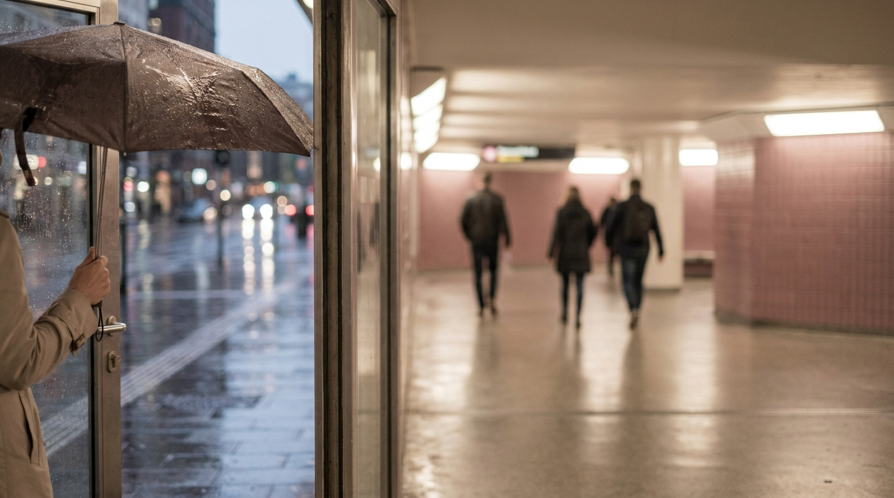
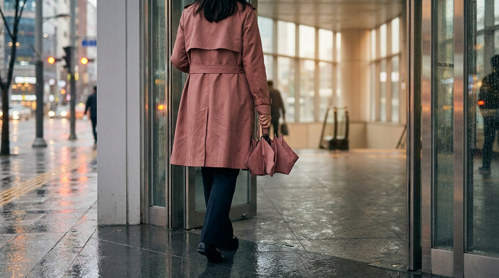

こんにちは、SEOUL TRIP NOTE の J です。

韓国旅行の計画を立てていたのに、滞在中の予報が雨マークでがっかりした経験はないでしょうか。ソウルは夏場の集中豪雨だけでなく、季節の変わり目にも雨が降ることがあります。せっかくの渡韓なら、足元を濡らさずに思いきりショッピングやカフェを楽しみたいところです。

実は、ソウルは地下鉄網が極めて発達しており、駅直結の巨大な複合商業施設や大規模な地下ショッピング街が数多く存在します。外を歩かずに過ごせるスポットを事前に把握しておけば、旅先で雨に見舞われてもスケジュールを崩さずに充実した時間を過ごせます。

公式情報やソウルの交通事情をもとに、雨の日のソウル観光に適した屋内エリアとスムーズな移動のコツを整理しました。

> **雨の日のソウル観光における要点**
> - **移動の基本は地下直結**: 地下鉄駅から地上に出ずにアクセスできる大型モールや地下街を目的地に選ぶ。
> - **タクシーは捕まりにくい**: ソウルでは雨の日にタクシーの需要が急増するため、地下鉄中心のルート設計が安心。
> - **1箇所集中型で過ごす**: 広大なモール内にはカフェ、コスメ、アパレル、グルメがすべて揃っているため、頻繁な移動を避けるのが快適。

---

## 雨でも濡れずに1日過ごせるソウルの大型屋内エリア

ソウル市内には、外の天候を気にせず買い出しや観光が完結する巨大な屋内施設があります。規模が大きく、旅行者が必要とするショップが集まっている代表的な3つのエリアを紹介します。

### 1. 三成（サムソン）：スターフィールド COEXモール

地下鉄2号線の三成（サムソン）駅および9号線の奉恩寺（ポンウンサ）駅に直結している巨大ショッピングモールです。単一フロアの地下ショッピングモールとしてはアジア有数の規模を誇り、地上に出る必要が一切ありません。

- **主な見どころ**: 開放的な吹き抜け構造の「ピョルマダン図書館（星広場図書館）」、巨大水族館（アクアリウム）、映画館。
- **買い物とグルメ**: オリーブヤングや人気ファッションブランド、韓国各地の有名グルメが集まるレストラン街が完備されています。
- **特徴**: 通路が非常に広く、ベビーカー利用や大きな荷物を持った移動でもストレスが少ない構造です。

### 2. 汝矣島（ヨイド）：ザ・現代ソウル（THE HYUNDAI SEOUL）

地下鉄5号線・9号線の汝矣島（ヨイド）駅から地下ムービングウォークで直結している、ソウル最大級の百貨店です。自然光を取り入れたガラス天井や屋内の大型庭園があり、屋内にいながら自然を感じられる空間設計が特徴とされています。

- **主な見どころ**: 5階の屋内庭園「Sounds Forest」、地下2階のトレンドファッションフロア。
- **買い物とグルメ**: 話題の韓国国内デザイナーズブランドやポップアップストア、地下1階の広大なフードフロア「Tasty SEOUL」。
- **特徴**: 聖水（ソンス）や漢南洞（ハンナムドン）で人気のブランドが多数入店しているため、街歩きをせずともトレンドアイテムを効率よくチェックできます。

免税手続きを行いたい場合、モール内や百貨店内のカウンターで即時処理が可能な店舗も多いため、買い物の際はパスポートを携帯しておくと便利です。詳しい免税制度については、[韓国の免税ショッピング完全ガイド｜即時還付と空港還付の比較と手続き手順](/blog/korea-tax-free-shopping-guide/)で解説しています。

### 3. 高速ターミナル：GOTOMALL（江南ターミナル地下ショッピングモール）

地下鉄3号線・7号線・9号線が乗り入れる高速バスターミナル駅に直結する、ソウル最大級の地下商店街です。全長約880メートルの通路に数百軒の衣類店や雑貨店が隙間なく並んでいます。

- **主な見どころ**: プチプラ服、靴、バッグ、アクセサリーの密集エリア。
- **特徴**: 天候に一切左右されず、リーズナブルなアパレルを探すのに最適です。
- **注意点**: 通路が長く非常に混雑するため、歩きやすい靴での移動が適しています。

---

## 地下鉄網を活用した雨の日の移動テクニック



<p class="img-cap">※ AIで生成したイメージ画像です</p>

ソウルの雨の日は、地上を走るバスやタクシーの混雑が激しくなります。特に通勤時間帯や夕方の雨天時は道路の渋滞が深刻化し、配車アプリでもタクシーが捕まりにくくなる傾向があります。

雨の日はできる限り地下鉄で完結するルートを組むのが鉄則です。

```
【雨の日の移動判断基準】
・地下鉄で直通できるルートがある場合：最優先で地下鉄を利用
・乗り換えが必要な場合：駅構内の連絡通路が長い駅（鍾路3街駅など）を避け、同一ホーム乗り換えが可能な駅を選ぶ
・地上移動が必要な場合：出口から目的地までの屋根付き通路や地下街の有無を地図アプリで確認
```

地下鉄を利用する際は、交通系カードを活用すると改札の出入りがスムーズです。ソウル市内の地下鉄を頻繁に乗り降りする場合は、短期滞在者向けの乗り放題カードも選択肢に入ります。カードごとの違いは、[渡韓旅行者必見！気候同行カードとWOWPASS徹底比較ガイド【2026年最新】](/blog/climate-card-vs-wowpass-comparison/)を参考にしてください。

---

## 【比較】雨の日におすすめのソウル屋内スポット

天候が悪い日に訪れる主要エリアの特徴と利便性を一覧表にまとめました。旅の目的に合わせて行き先を選んでみてください。

| スポット名 | 最寄り駅（直結路線） | 主なジャンル | 雨の日のおすすめ度 | 特徴・雰囲気 |
| :--- | :--- | :--- | :--- | :--- |
| **スターフィールド COEXモール** | 2号線 三成駅<br>9号線 奉恩寺駅 | コスメ・アパレル・文化・エンタメ | 高 | 圧倒的な広さ。図書館や水族館もあり1日中過ごせる |
| **ザ・現代ソウル** | 5・9号線 汝矣島駅 | トレンドファッション・高級ブランド・グルメ | 高 | 話題のブランドやポップアップが集結。開放感がある |
| **GOTOMALL** | 3・7・9号線 高速バスターミナル駅 | プチプラファッション・靴・雑貨 | 中〜高 | 手頃な服を大量に比較できる。通路がやや狭く混みやすい |
| **ロッテワールドモール（蚕室）** | 2・8号線 蚕室駅 | 百貨店・マート・水族館・展望台 | 高 | 大型スーパーやシネマも併設され、お土産調達にも便利 |
| **明洞地下ショッピングセンター** | 2号線 乙支路入口駅 | コスメ・アイドルグッズ・衣料 | 中 | 乙支路入口駅・ロッテ百貨店側から明洞の繁華街北側へアクセスする際に便利 |

※各施設の営業日やフロア構成は時期によって改編される場合があるため、訪問前に公式案内や地図アプリで最新状況をご確認ください。

---

## 雨の日のカフェ巡り・グルメを楽しむ工夫

雨の日は路面店のカフェ巡りが億劫になりがちです。しかし、ソウルの大型複合施設内には、路面店で話題の人気カフェが支店を出しているケースが多く見られます。

たとえば汝矣島や三成の大型モール内には、有名ベーカリーカフェやスペシャリティコーヒーを扱うカフェが複数入居しています。外を歩くことなく、館内を移動するだけで複数の有名店のスイーツやドリンクを楽しめます。

注文時はタッチパネル式のキオスクを導入している店舗が主流です。操作に不安がある方は、事前に注文手順を確認しておくと落ち着いて対応できます。詳しい利用法は、[韓国カフェの注文ガイド｜アイスアメリカーノ文化・サイズ・キオスク操作のコツ](/blog/korean-cafe-ordering-tips/)をチェックしてみてください。

> **混雑を避けるポイント**
> 雨の日の大型モールは、現地の人々も集まるため特に週末の14:00〜17:00前後はカフェやレストランの待機列が長くなります。食事やカフェの利用は、ピーク時間を少しずらして11:30前や17:30前に行うのがスムーズです（時間帯は一般的な混雑の目安）。

---

## 雨の日に注意したいルールと持ち物のコツ



<p class="img-cap">※ AIで生成したイメージ画像です</p>

雨の日のソウルを快適に過ごすために、現地の設備やルールについて知っておくべきポイントがあります。

### 1. 傘のしずく取り（アンブレラドライヤー）

韓国の多くの商業施設や駅出入口では、使い捨てのビニール製傘袋ではなく、パッドの間に傘を挟んで滑らせる「吸水式アンブレラドライヤー（しずく取り）」が設置されています。傘を入れる前に数回前後に動かして水滴を落としてから入館するのがマナーとされています。

### 2. 折りたたみ傘と足元の準備

ソウルの地下鉄駅は階段が多く、濡れた床やタイルは非常に滑りやすくなっています。特にGOTOMALLや駅の出入口付近はタイル貼りの場所が多いため、靴底にグリップ力のあるスニーカーを選ぶのが安全です。また、バスや地下鉄の乗り降りが多い場合は、素早くカバンにしまえるコンパクトな折りたたみ傘が重宝します。

---

## よくある質問（FAQ）

### Q1. 雨の日の東大門（トンデムン）ショッピングは濡れますか？
現代シティアウトレットやDOOTA MALLなどの大型ファッションビル内は快適に買い物ができますが、卸売市場の建物を外移動で行き来する場合は傘が必要です。東大門の各ビルの特徴については、[東大門ショッピング完全ガイド｜卸売とファッションビルの違い・営業時間・買い方](/blog/dongdaemun-shopping-guide/)を参考にしてください。

### Q2. 雨の日はタクシーを拾うのが難しいですか？
ソウルでは雨が降るとタクシーの需要が一気に高まり、路上で空車を捕まえるのは難しくなります。カカオタクシーなどの配車アプリを利用してもマッチングに時間がかかる場合があるため、地下鉄でアクセスできるルートを優先するのが無難です。

### Q3. 高速ターミナルのGOTOMALLは雨の日でも混雑しますか？
屋内で買い物が完結するため、雨の日は普段の平日や休日よりもさらに混雑する傾向があります。特に通路中央のベンチや周辺の飲食店は埋まりやすいため、午前中（10:30〜12:00頃、執筆時点の目安）の比較的空いている時間帯の訪問が適しています。

### Q4. 雨の日にコインロッカーを利用したい場合はどこにありますか？
ソウルの主要な地下鉄駅構内（T-Locker）や大型ショッピングモール内（COEXやザ・現代ソウルなど）に設置されています。駅構内のロッカーは専用アプリやT-moneyカード等で決済できる場合が多く、身軽に動きたい雨の日に便利です。

---

## まとめ

旅行中に雨が降ってしまうと予定の変更が必要になることもありますが、ソウルには天候に左右されずに満喫できる屋内スポットが揃っています。

- 移動は**地下鉄直結の大型施設**をメインにする
- コスメやトレンド服を一気にチェックしたいなら**ザ・現代ソウル**や**COEXモール**
- プチプラ服をまとめて探したいなら**GOTOMALL**
- 渋滞や配車難を避けるため、**地上移動（バス・タクシー）は最小限**に抑える

これらを意識してスケジュールを組み直せば、雨の日でも快適な買い出しやカフェ巡りが可能です。当日の天気予報を見ながら、臨機応変に屋内ルートを活用してみてください。