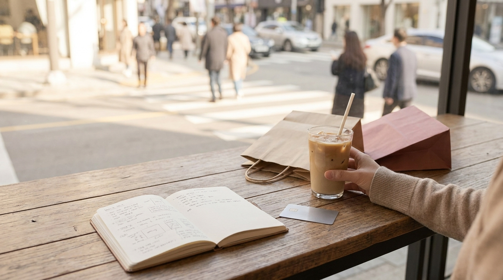

こんにちは、SEOUL TRIP NOTEのJです。ソウルに住んでいる立場から、日本の旅行者の方に向けて役立つ渡韓情報をお届けしています。

「限られた旅行日程の中で、どこで買い物をするべきかわからない」とお悩みの方は少なくありません。ソウルには魅力的な買い物スポットが点在していますが、明洞（ミョンドン）、弘大（ホンデ）、聖水（ソンス）、東大門（トンデムン）、江南（カンナム）は、それぞれ街の雰囲気や得意とするジャンル、混雑する時間帯が大きく異なります。

主要5大エリアの特徴やコスメ・ファッションの傾向、回る順番のコツを整理してまとめました。

> **この記事の要点まとめ**
> - **明洞**: コスメの一括購入や即時免税がスムーズ。日本語対応の店舗が多く、初めての渡韓にも安心。
> - **弘大**: 若者向けプチプラファッションとストリート系が中心。夜遅くまで営業するショップが多い。
> - **聖水**: 韓国デザイナーズブランドの旗艦店やポップアップが充実。トレンド感のあるコスメや雑貨向け。
> - **東大門**: 深夜営業の卸売ビルやアクセサリーショップが魅力。夜遅い時間の買い物に向いている。
> - **江南**: 美容クリニックの集積地であり、地下街のプチプラ服から高級百貨店まで幅広い。

---

## 1. 主要5大エリアの特徴とコスメ・ファッションの傾向

ソウル市内のショッピングエリアは、地下鉄路線や客層によって明確に分かれています。買いたいアイテムに合わせて目的地を選ぶのが、移動時間を無駄にしないための近道です。

### 明洞（地下鉄4号線 明洞駅・2号線 乙支路入口駅）
海外からの観光客が最も多く訪れるエリアです。大手ドラッグストアの大型旗艦店をはじめ、ロードショップ系のコスメブランドが一堂に会しています。
- **コスメの傾向**: 大手ブランドから話題のスキンケアまで品揃えが豊富です。企画セットやまとめ買い用のパックが充実しています。
- **特徴**: 店頭での即時免税（Tax Refund）に対応している店舗が多く、日本語が話せるスタッフも常駐しやすい環境とされています。

### 弘大（地下鉄2号線・空港鉄道 弘大入口駅）
近くに美術系大学があるため、若者文化やサブカルチャーが色濃いエリアです。
- **ファッション・コスメの傾向**: トレンドのストリート系ファッション、カジュアルウェア、Y2Kスタイルのアイテムが手頃な価格帯で揃います。
- **特徴**: 週末はストリートパフォーマンスなどで混雑します。深夜まで開いているコスメショップやアパレル店が多い点も特徴です。

### 聖水（地下鉄2号線 聖水駅）
かつての靴工場や町工場が集まるエリアでしたが、近年はブランドの旗艦店やポップアップストアが集積するトレンド発信地となっています。
- **ファッション・コスメの傾向**: 感度の高いデザイナーズアパレル、洗練されたパッケージのフレグランス・ヴィーガンコスメブランドの単独店舗が目立ちます。
- **特徴**: 期間限定のポップアップが多く、入店にウェイティングが必要な場合があります。土日の日中は非常に混み合います。

### 東大門（地下鉄1号線・4号線 東大門駅、2号線・4号線・5号線 東大門歴史文化公園駅）
巨大なファッションビルや卸売市場が広がる、眠らない街です。
- **ファッション・コスメの傾向**: アクセサリーのまとめ買い、衣料品、靴・バッグの専門店が密集しています。
- **特徴**: 深夜（20時〜翌朝）に営業が本格化するビルが多いため、日中の観光を終えた後に買い物を楽しむスケジュールに適しています。

### 江南（地下鉄2号線・新盆唐線 江南駅、3号線 新沙駅など）
ビジネス街と高級住宅街が隣接するエリアで、江南駅地下ショッピングセンターやカロスキルなどがあります。
- **ファッション・コスメの傾向**: 地下街では10,000ウォン〜20,000ウォン台のプチプラ服が豊富に並びます。カロスキル周辺にはハイセンスなコスメブランドのフラッグシップ店が点在します。
- **特徴**: 美容クリニックが多く集まっているため、肌管理の施術前後に立ち寄る旅行者が多いエリアです。

---

## 2. ソウル主要ショッピングエリアの比較表

各エリアの比較を一覧にまとめました。営業時間や価格帯は執筆時点の目安です。実際の店舗により異なりますので、公式情報をご確認ください。

| エリア | 主な最寄り駅 | 主なターゲット層・雰囲気 | コスメの探しやすさ | ファッションの価格帯（目安） | 活気のある時間帯 |
| :--- | :--- | :--- | :--- | :--- | :--- |
| **明洞** | 4号線 明洞駅 2号線 乙支路入口駅 | 観光客向け、便利さ重視 | 非常に高い（大型店多数） | 中〜手頃 | 11:00〜22:00 |
| **弘大** | 2号線・空港鉄道 弘大入口駅 | 10代〜20代、ストリート | 高い（駅周辺に密集） | 10,000〜40,000ウォン前後 | 13:00〜23:00 |
| **聖水** | 2号線 聖水駅 | 20代〜30代、トレンド志向 | 中〜高（単独路面店） | 50,000ウォン以上〜中高級 | 12:00〜20:00 |
| **東大門** | 1・4号線 東大門駅 2・4・5号線 東大門歴史文化公園（DDP）駅 | バイヤー、夜型旅行者 | 中（特定ビルに集中） | 卸売価格〜手頃 | 20:00〜翌朝04:00 |
| **江南** | 2号線 江南駅 3号線 新沙駅 | オフィスワーカー、美容目的 | 高い（地下街・路面店） | 地下街は10,000ウォン〜 | 11:00〜21:00 |

※金額はウォン表記です。日本円の換算は渡航時の最新レートをご確認ください。

---

## 3. 効率よく回るためのスケジュール組み立て手順

※ AIで生成したイメージ画像です

移動の負担を減らし、荷物が増えても無理なく回るためのステップをまとめました。

> **効率的なルート構築のステップ**
> 1. **午前（10:30〜12:00）**: 開店直後の明洞でコスメを一気にチェック。比較的人が少なくレジの列も短めです。
> 2. **昼〜夕方（13:00〜18:00）**: 聖水や弘大へ移動し、カフェ休憩を挟みながら洋服や限定ポップアップを巡る。
> 3. **夜（19:00〜21:00）**: ホテルに一度戻って荷物を置き、夕食をとる。
> 4. **深夜（22:00〜翌1:00）**: 体力に余裕があれば東大門へ移動し、深夜営業のアクセサリー店やファッションビルを回る。

地下鉄2号線を利用すると、弘大入口、乙支路入口（明洞徒歩圏）、東大門歴史文化公園、聖水、江南を環状線で移動できます。乗り換えを最小限に抑えるルートを組むと体力を温存しやすくなります。

---

## 4. 渡韓買い物で知っておきたい注意点とお得な制度

韓国でのショッピングをスムーズに行うためには、免税制度と決済手段の事前確認が欠かせません。

### 事後免税（Tax Refund）の仕組み
韓国では、一定額以上の買い物をした場合に付加価値税（VAT）の還付を受けられます。
- **即時還付制度**: 会計時にパスポートを提示すると、その場で税金が差し引かれた金額で決済できます。明洞や大型コスメチェーンの多くが導入しています。
- **事後還付制度**: レシートと免税書類を受け取り、空港のキオスク端末で手続きを行います。東大門の卸売ビルなどでは即時還付に対応していない場合があるため、書類の発行可否を店頭で確認してください。

### 決済手段と現金の必要性
ソウル市内は基本的に完全なキャッシュレス社会です。明洞、弘大、聖水、江南のほとんどの店舗でクレジットカードや電子決済が利用できます。
ただし、東大門の卸売市場や江南駅地下ショッピングセンターの一部のプチプラ服店では、現金払い（または韓国の口座送金）のみ割引対象となるケースが見られます。東大門や地下街を重点的に回る予定がある場合は、ある程度の現金（ウォン）を用意しておくと安心です。

---

## 5. よくある質問（FAQ）

### Q1. コスメを買うなら明洞と聖水のどちらがおすすめですか？
**A.** 目的によって異なります。大型ドラッグストアで定番の人気スキンケアをまとめ買いしたり、免税手続きを一括で済ませたい場合は明洞が効率的です。一方で、ブランド独自の世界観を体験できるショールームや、限定のフレグランス・雑貨を探したい場合は聖水が適しています。

### Q2. 東大門のショッピングビルは個人でも1着から購入できますか？
**A.** ビルによってルールが異なります。一般客向けの大型ファッションビル（現代シティアウトレットやミリオレなど）では1着から問題なく購入できます。一方、深夜に営業する完全な卸売専門ビル（apM系やDDPファッションモールなど）では、同一商品の複数枚購入（色違いなど）が条件となる店舗が多いとされています。

### Q3. ソウル市内のコスメやファッションのセール時期はいつですか？
**A.** 韓国では、例年6月〜7月頃のサマーセールと、11月〜12月頃のウィンターセールや大型割引イベントの時期に多くのショップで値引きが行われます。また、各ドラッグストアチェーンやロードショップでも季節の変わり目ごとに定期的なプロモーションが実施される傾向があります。正確な日程や対象商品は、各ブランドの公式発表をご確認ください。

### Q4. スーツケースなどの大きな荷物はどこに預けるのが便利ですか？
**A.** ソウル市内の主要地下鉄駅には、T-Lockerと呼ばれるコインロッカーが設置されています。また、東大門や弘大の大型ビル内にも荷物預かり所が設けられている場合があります。購入した荷物が増えた段階で一時預けを利用すると、移動の負担を軽減できます。

---

## まとめ

ソウルショッピングを充実させる鍵は、エリアごとの得意分野を把握し、優先順位をつけてルートを組むことです。

- コスメのまとめ買いと利便性を重視するなら **明洞**
- 若者向けトレンド服を手頃に探すなら **弘大**
- 話題のブランド旗艦店やデザイン雑貨を見るなら **聖水**
- 深夜のアクセサリー探しや問屋巡りなら **東大門**
- 美容クリニックと合わせたプチプラ服巡りなら **江南**

営業時間や免税ルールは変更される場合があるため、最新の公式情報や店頭の案内に注意しながら、無理のないスケジュールで買い物を楽しんでください。