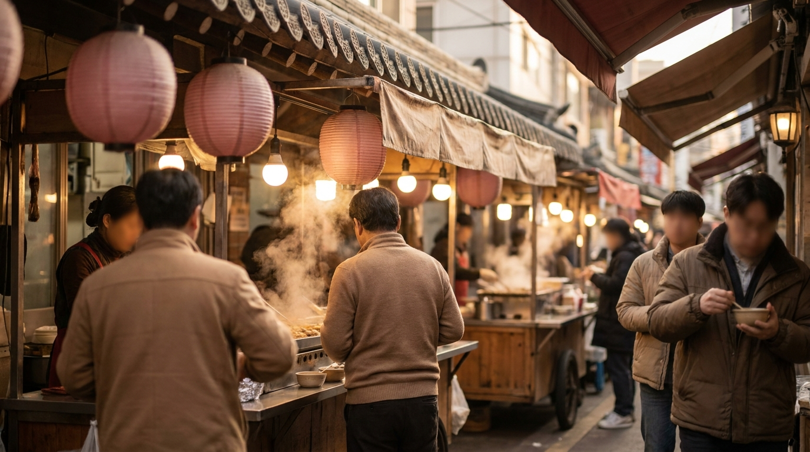
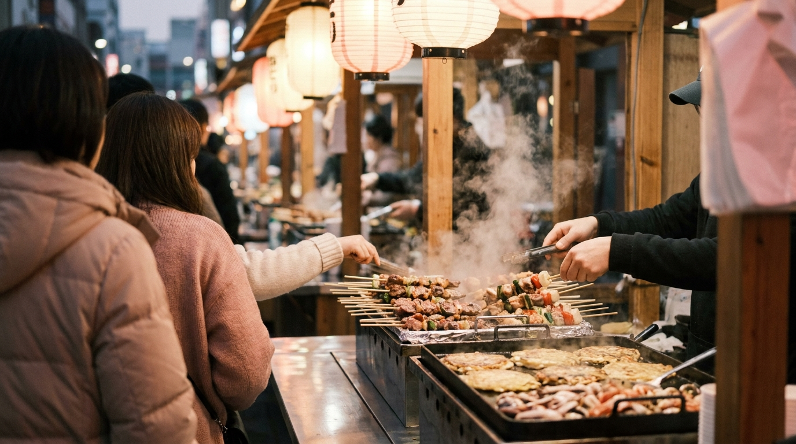

韓国旅行の大きな楽しみのひとつとして挙げられるのが、街角や市場に並ぶ「韓国屋台」での食べ歩きです。旅行番組やSNSなどをきっかけに、本場のトッポッキや焼きたてのホットクに関心を持つ旅行者が増えています。

一方で、「注文の仕方が分からない」「いくらくらいが相場なのか不安」「支払いにカードが使えるのか」といった疑問や不安の声も少なくありません。

ソウルでの食べ歩きに役立つ定番の屋台メニュー、執筆時点の価格相場、注文ルールや支払い時の注意点を整理しました。

---

### この記事の要点まとめ

- **定番メニュー**: トッポッキ、天ぷら（ティギム）、ホットク、オデン、スンデが屋台の代表格
- **相場の目安**: オデンは1本1,000〜2,000ウォン、トッポッキは1人前4,000〜6,000ウォン程度（エリアにより変動）
- **支払い方法**: 基本は現金または送金。観光地ではカードやWOWPASS対応の屋台も増えているが、小額紙幣の準備が安心
- **注文のコツ**: 立ち食い屋台では食べたいものを指差しで伝え、オデンのスープは備え付けの紙コップで自由にすくって飲むのが一般的

---

## 定番の韓国屋台メニューと価格相場の目安

ソウルの街中にあるポジャンマチャ（布幕テントの屋台）や市場の露店で、多くの人が注文する定番メニューを整理しました。

価格はすべて執筆時点の一般的な目安です。観光エリア（明洞など）や伝統市場、学生街（弘大や大学路など）によって価格設定が異なるため、最新の価格は店頭の表示をご確認ください。日本円に換算する際は最新の為替レートの確認が必要です。

### 1. トッポッキ（떡볶이）
コチュジャンベースの甘辛いタレで細長い餅（トック）を煮込んだ、韓国を代表するストリートフードです。練り物（オデン）やネギと一緒に煮込まれており、見た目ほど激辛ではないマイルドな味付けの店もあれば、辛口に仕上げている店もあります。屋台では1人前（イルインブン）単位で注文するのが一般的です。

### 2. ホットク（호떡）
小麦粉やもち米の生地に、黒砂糖、シナモン、ナッツ類を包んで多めの油でカリッと揚げ焼きにしたおやつです。外はサクサク、中は熱々の蜜が溶け出します。釜山発祥のナッツがたっぷり入った「シアッホットク」や、チャプチェ（春雨炒め）が入ったおかず系のホットクを扱う屋台もあります。

### 3. オデン（어묵 / 오뎅）
魚のすり身を波状に串に刺し、煮干しや大根、昆布などの出汁でじっくり煮込んだ料理です。辛いものが苦手な方でも食べやすい優しい味わいです。屋台のカウンターに立ってそのまま食べることができ、串の数で後から計算することが多いメニューです。

### 4. ティギム（튀김 / 韓国式天ぷら）
サツマイモ、イカ、海苔巻き春雨（キムマリ）、野菜などの揚げ物です。店頭に並んでいる好みの天ぷらを選ぶと、店主がもう一度油で揚げ直して温め、食べやすい大きさにハサミで切ってくれます。トッポッキの赤いタレを絡めて食べるスタイルも広く親しまれています。

### 5. スンデ（순대）
豚の腸に春雨や豚の血、香味野菜を詰めて蒸した韓国の伝統ソーセージです。見た目の色に驚く声もありますが、屋台の定番メニューとして定着しています。一般的には粉末唐辛子を混ぜた塩（唐辛子塩）につけて食べます。内臓（レバーやハツなど）を添えるか聞かれることが多いため、好みに応じて選べます。

### 【比較】屋台定番メニューの特徴と相場一覧

| メニュー名 | 主な特徴・味わい | 注文単位 | 相場の目安（ウォン） |
| :--- | :--- | :--- | :--- |
| トッポッキ | もちもちの餅と甘辛いタレ | 1人前 | 4,000〜6,000 |
| ホットク | 黒糖とナッツの甘い揚げ焼きパン | 1個 | 1,500〜3,000 |
| オデン | 出汁で煮込んだ魚のすり身串 | 1本 | 1,000〜2,000 |
| ティギム（天ぷら） | キムマリ、イカ、サツマイモ等 | 3〜5個（盛合せ） | 4,000〜5,000 |
| スンデ | 春雨入り蒸しソーセージ | 1人前 | 4,000〜6,000 |
| タッコッチ（焼き鳥） | 鶏肉とネギの串焼き（甘辛ダレ・塩） | 1本 | 4,000〜6,000 |

※価格は執筆時点のソウル市内の一般的な屋台を基準とした目安です。明洞のメインストリートなど一部の観光特化型屋台では、上記より高めに設定されている傾向があります。

---

## ソウルで屋台巡りが楽しめる主なエリアの特徴



<p class="img-cap">※ AIで生成したイメージ画像です</p>

ソウル市内で韓国屋台の食べ歩きをする場合、訪れるエリアによって雰囲気や価格帯が大きく異なります。

### 伝統市場エリア（広蔵市場・南大門市場）
ソウルの伝統的な食文化を感じられるエリアです。通路の中央に屋台がずらりと並び、座って食べられるベンチが用意されている店も多く見られます。ピンデトッ（緑豆チヂミ）や麻薬キンパ（一口サイズの海苔巻き）など、市場ならではの名物メニューが充実しています。地元の人が日常的に利用する混雑ピークの時間を外すと、比較的落ち着いて歩けます。

### 繁華街・観光エリア（明洞・弘大・東大門）
明洞の屋台は観光客向けに特化しており、定番のトッポッキやホットクだけでなく、ロブスター焼きやフルーツ飴、チーズ焼きなど写真映えを意識した創作メニューが豊富です。

学生街である弘大（ホンデ）周辺では、地下鉄駅の出口付近などにリーズナブルな立ち食い屋台が点在しています。深夜遅くまで営業している東大門エリアでは、夜遅くのショッピングの合間に立ち寄れる屋台が見られます。エリアごとの詳しい特徴については、[ソウルのショッピングエリア比較｜明洞・弘大・聖水・東大門・江南の違い](/blog/seoul-shopping-area-comparison/)や[東大門ショッピング完全ガイド](/blog/dongdaemun-shopping-guide/)も参考にしてみてください。

---

## 韓国屋台でのスマートな注文手順と会計マナー

初めて屋台を利用する際の手順と、知っておくと役立つマナーをまとめました。

```
【屋台利用の基本ステップ】
1. 屋台の前に立ち、空いているスペースに入る
2. メニューを指差して数量を伝える（「イゴ（これ） 1人前 ジュセヨ」など）
3. オデンを食べる場合は備え付けのコップでスープを汲む
4. 食べ終わったら串や容器をまとめ、会計を行う
```

### 1. 注文は指差しと簡単な韓国語で通じる
メニュー名が読めなくても、指を指しながら「イゴ（これ）ハナ（1つ）ジュセヨ（ください）」と伝えれば十分に意思疎通が可能です。トッポッキとティギムを一緒に頼む際、天ぷらをトッポッキのタレに絡めてほしい場合は、店主が「タレをかけますか？」とジェスチャーで確認してくれる場面が多く見られます。

### 2. オデンのスープは無料で自由に飲める
オデンを注文した際、またはトッポッキなどを食べている際、屋台の鍋の横に置いてある紙コップを使って出汁スープを注いで飲むスタイルが一般的です。寒い季節には特に体を温めてくれる定番の楽しみ方です。大きなひしゃくが置かれているため、各自で紙コップにすくって飲みます。

### 3. 会計時の支払い方法
屋台での支払いは長年現金が主流でしたが、近年は観光客向け屋台を中心にクレジットカードやWOWPASS、各種コード決済に対応する店舗が増えています。ただし、機械の不調や個人経営の小規模な屋台では依然として現金のみのケースもあります。1,000ウォン札や5,000ウォン札などの小額紙幣をあらかじめ用意しておくと確実です。

一般的な飲食店での注文や会計ルールについては、[韓国の食堂でスマートに注文！初心者も安心の呼び出しベル・おかわり・会計ガイド](/blog/korean-restaurant-ordering-guide/)や、一人旅での食事のコツをまとめた[ソウルで「ひとりご飯」を楽しむ！入りやすい店の見分け方と注文のコツ](/blog/solo-dining-seoul-tips/)でも詳しく解説しています。

---

## 屋台グルメを楽しむ際の注意点



<p class="img-cap">※ AIで生成したイメージ画像です</p>

> 屋台を利用する際は、以下のポイントを事前に把握しておくと安心です。
> - 価格表示がない店では、注文する前に「オルマエヨ？（いくらですか？）」と確認する
> - 屋台のホットクやタッコッチは中身の蜜やタレが非常に熱いため、服にこぼさないよう注意する
> - ゴミ箱は屋台の足元やカウンター横にビニール袋が設置されていることが多いため、道端へ捨てず店主に渡すか指定の場所に捨てる
> - 生ものや衛生面が気になる場合は、加熱調理がしっかりされている温かいメニューを選ぶ

観光客で混み合うエリアでは、価格表が掲示されている屋台を選ぶと会計時のトラブルを避けやすく、落ち着いて買い物できます。

---

## よくある質問（FAQ）

### Q1. 屋台でクレジットカードやWOWPASSは使えますか？
明洞などの主要観光地にある屋台では、カードリーダーを備えておりカードやWOWPASSが利用できる店舗が増加傾向にあります。しかし、地下鉄駅周辺や市場の昔ながらの屋台では「現金のみ」または「口座送金（계좌이체 / ケジャイチェ）のみ」という場所も依然として少なくありません。屋台巡りをする日は、執筆時点の目安として10,000〜20,000ウォン程度の現金を財布に入れておくのが無難です。

### Q2. 辛いものが苦手でも食べられる屋台メニューはありますか？
辛くないメニューも豊富に揃っています。オデン（魚のすり身串と出汁）、ホットク、マンドゥ（蒸し餃子）、ケランパン（卵が丸ごと1個入ったほんのり甘いパン）、スンデ（唐辛子塩の量を控えめにして食べる場合）などは唐辛子の辛さがないため、辛い料理が苦手な方や子ども連れでも食べやすいメニューとして知られています。

### Q3. オデンを1本だけ立ち食いして帰っても大丈夫ですか？
問題ありません。ソウルでは、移動の途中に屋台へ立ち寄り、オデンを1〜2本食べてスープを飲み、現金で1,000〜2,000ウォン程度を支払って立ち去る光景が日常的に見られます。小腹が空いた時の軽食として気軽に利用されています。

### Q4. 屋台の営業時間は何時頃から何時頃までですか？
店舗やエリアによって大きく異なります。学生街や駅前の立ち食い屋台は昼過ぎ（13:00〜14:00頃）からオープンし、夜22:00〜23:00頃まで営業することが一般的です。明洞の屋台は夕方16:00〜17:00頃から一斉に開き始め、23:00前後まで営業する傾向があります。市場の屋台は朝早くから開いている店もあれば、東大門のように深夜2:00〜3:00頃まで営業しているエリアもあります。正確な営業時間は各エリアや現地の状況をご確認ください。

---

## まとめ

ソウルの屋台グルメは、手頃な価格で韓国のリアルな食文化を体験できるスポットです。

トッポッキ、ホットク、オデンといった定番メニューはそれぞれ味わいが異なり、複数人でシェアしながら食べ歩くのにも適しています。支払いのための少額現金を用意し、簡単な単語や指差しを活用しながら、現地のストリートフードを楽しんでみてください。