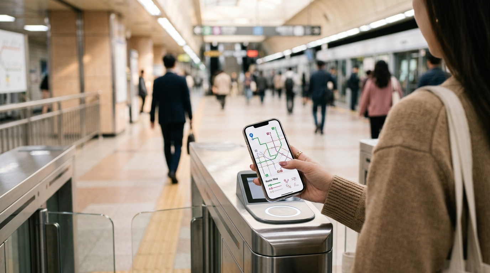
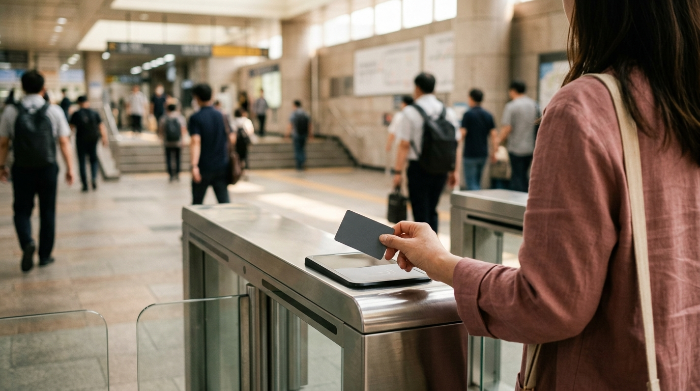

こんにちは、SEOUL TRIP NOTE の J です。

ソウル旅行の計画を立てる中で、「地下鉄の乗り方が難しそう…」「乗り換えで迷ったらどうしよう…」「T-moneyって何？」といった不安を感じる方もいらっしゃるかもしれませんね。ソウルに住んでいる立場から見ると、地下鉄はとても便利で、旅行中に移動手段として欠かせない存在です。

このガイドでは、初めてソウルの地下鉄を利用する方でも安心して移動できるよう、路線の見方から運賃、乗り換えのコツ、そして便利なT-moneyカードの使い方まで、具体的なステップで詳しくご紹介します。この記事を読めば、ソウルの地下鉄をまるで地元の人々のようにスムーズに乗りこなせるようになるはずです！

### 【結論】ソウル地下鉄を迷わず利用するための要点まとめ

まずは、ソウル地下鉄を快適に利用するためのポイントを簡単にまとめました。

*   **交通カード「T-money」を準備する**: 地下鉄だけでなくバスでも使え、運賃割引も適用されます。
*   **スマートフォンアプリを活用する**: 「Naver Map」や「Kakao Map」などのアプリで、日本語で簡単にルート検索ができます。
*   **色と番号で路線を確認する**: ソウルの地下鉄路線は色と番号で分けられており、直感的に分かりやすいです。
*   **乗り換えは案内標識に従う**: 駅構内の「갈아타는 곳 (乗り換え場所)」の標識と、次の路線の色・番号を確認して移動しましょう。
*   **改札通過時は必ずカードをタッチ**: 入場時と出場時の両方でタッチが必要です。タッチし忘れると追加料金が発生することがあります。

---

## ソウル地下鉄を快適に利用するための基本準備

ソウルの地下鉄をスムーズに利用するために、まずは出発前の準備をしっかり行いましょう。

### T-moneyカードの入手とチャージ

ソウルの地下鉄を利用する上で最も便利なのが、交通カード「T-money（ティーマネー）」です。日本でいうSuicaやPASMOのようなもので、これ一枚あれば切符を買う手間なく改札を通過できます。

#### T-moneyとは？

T-moneyは、ソウル市内の地下鉄、バス、一部のタクシーやコンビニエンスストアでの支払いにも利用できるプリペイド式の交通カードです。1回用の切符を買うよりも運賃が安く、乗り換え割引も適用されるため、旅行者にとって非常にお得で便利です。

#### どこで買える？

*   **コンビニエンスストア**: GS25、CU、セブンイレブン、emart24などの主要なコンビニでカード本体を購入できます。店員さんに「T-moneyカード ジュセヨ（T-moneyカードください）」と伝えましょう。
*   **地下鉄駅構内**: 各駅の券売機や、駅構内の案内所でも購入できる場合があります。

#### チャージ方法

*   **地下鉄駅構内のチャージ機**: 日本語表示に切り替えられる機械も多く、画面の指示に従ってチャージできます。チャージは基本的にウォン現金です。
*   **コンビニエンスストア**: 店員さんにT-moneyカードを渡し、「チュンジョン ヘジュセヨ（チャージしてください）」と伝え、希望の金額を支払います。

> **ポイント**
> T-moneyカードの残高は、チャージ機やコンビニで簡単に確認できます。カードを購入したら、まずは数万ウォン程度チャージしておくのがおすすめです。

### 路線図アプリの活用

ソウルの地下鉄路線は非常に発達しており、路線数も多いため、スマートフォンアプリの活用は必須です。

#### おすすめアプリ

*   **Naver Map (네이버 지도)**: 韓国の主要な地図アプリで、地下鉄のルート検索はもちろん、バス、徒歩のルートも詳細に表示されます。日本語での検索も可能で、乗り換え案内や所要時間、運賃まで確認できます。
*   **Kakao Map (카카오맵)**: Naver Mapと同様に韓国で広く使われている地図アプリです。表示言語の対応状況はアプリのストアページで確認してください。

これらのアプリは、出発地から目的地までの最適なルートを教えてくれるだけでなく、乗り換え駅や出口番号まで詳しく案内してくれます。オフラインでも基本的な路線図を確認できる機能があるアプリも多いので、事前にダウンロードしておくことをおすすめします。

### 駅名と案内表示の確認

ソウルの地下鉄の案内表示は、韓国語と英語が基本で、主要駅では中国語や日本語が併記されていることもあります。

*   **路線と番号**: ソウルの地下鉄路線は、それぞれ色と番号が割り振られています（例：2号線は緑色、3号線はオレンジ色）。この色と番号を覚えておくと、路線図を見たときに直感的に理解しやすくなります。
*   **駅名**: アプリで検索した駅名をメモしておき、駅構内の案内表示や電光掲示板で確認しながら進みましょう。

---

## ソウル地下鉄の乗り方・乗り換えステップ

※ AIで生成したイメージ画像です

それでは、実際にソウル地下鉄に乗って移動する際の具体的なステップを見ていきましょう。

### STEP1：目的地までのルート確認

まず、スマートフォンアプリ（Naver MapやKakao Mapなど）を使って目的地までのルートを検索します。

1.  **出発地と目的地を入力**: 現在地または出発する駅と、行きたい場所の駅名を日本語で入力します。
2.  **ルート検索**: アプリが複数のルート候補（最短時間、乗り換え回数など）を表示します。
3.  **詳細を確認**: 利用する路線番号（色）、進行方向（終点駅名）、乗り換え駅、所要時間、運賃などを確認します。

### STEP2：改札の通過

駅に着いたら、T-moneyカードを使って改札を通過します。

1.  **T-moneyカードを準備**: 改札機のリーダーにカードをタッチしやすいように準備します。
2.  **カードをタッチ**: 改札機の指定された場所にT-moneyカードを「ピッ」と音がするまでしっかりとタッチします。
3.  **残高確認**: ディスプレイに運賃と残高が表示されるので確認しましょう。
4.  **改札通過**: バーが開いたら通過します。

> **注意点**
> *   入場時と出場時の両方で必ずT-moneyカードをタッチしてください。
> *   出場時にタッチを忘れると、次回の利用時に追加料金が請求されることがあります。
> *   残高が不足していると改札を通過できません。チャージしてから再度タッチしましょう。

### STEP3：ホームでの乗車

改札を通過したら、案内表示に従ってホームへ向かいます。

1.  **進行方向の確認**: ホームの電光掲示板や案内表示で、自分が乗りたい路線の進行方向（終点駅名）を確認します。多くの駅では、ホームの柱などに次の駅名や終点駅名が大きく表示されています。
2.  **乗車**: 電車が来たら、乗降客が降りてから乗り込みましょう。
3.  **車内表示**: 車内では、次の駅名や乗り換え情報が韓国語と英語で表示・案内されます（路線によっては中国語・日本語も）。

### STEP4：乗り換え

乗り換えが必要な場合は、案内表示をよく見て進みましょう。

1.  **「갈아타는 곳 (乗り換え場所)」の表示**: 乗り換え駅で電車を降りたら、駅構内の案内表示にある「갈아타는 곳」の表示と、次に乗る路線の色と番号（例：2호선 - 2号線、초록색 - 緑色）を確認して進みます。
2.  **移動**: 乗り換え駅は広大な場合もありますが、表示に従って進めば迷うことは少ないでしょう。
3.  **追加料金なし**: 一般的に、同一駅構内での乗り換えは追加料金なしで利用できます。改札を出ずに乗り換え通路を進みましょう。

---

## ソウル地下鉄の運賃体系と種類

ソウル地下鉄の運賃は、距離によって変動する「距離制運賃」が採用されています。

### 基本運賃

*   **T-money利用時**: 現金で一回用交通カードを購入するよりも、T-moneyカードを利用すると少し割引された運賃が適用されます。
*   **距離制**: 基本区間を超えると、移動距離に応じて追加運賃が発生します。執筆時点の目安として、基本運賃は1,550ウォン（交通カード利用時）からスタートし、移動距離に応じて加算されます。

> **注意点**
> 運賃は変更されることがあります。最新の運賃情報は、地下鉄駅構内の案内やソウル交通公社の公式サイトなどで確認してください。日本円換算は、最新の為替レートでご自身で計算してください。

### 運賃の種類とカード

| カードの種類          | 購入方法                                 | チャージ | 運賃割引 | デポジット | 利便性                               |
| :-------------------- | :--------------------------------------- | :------- | :------- | :--------- | :----------------------------------- |
| **T-moneyカード**     | コンビニ、地下鉄駅の券売機               | 必要     | あり     | 不要       | 地下鉄・バス・タクシー・一部店舗で利用可 |
| **1回用交通カード**   | 地下鉄駅の券売機                         | 不要     | なし     | 必要       | 地下鉄のみ利用可（デポジット返却必要） |

*   **T-moneyカード**:
    *   前述の通り、最もおすすめのカードです。カード本体の購入費用（数千ウォン程度）がかかりますが、一度購入すれば繰り返しチャージして使えます。
    *   バスや乗り換え割引も適用され、利便性が高いです。
*   **1回用交通カード**:
    *   地下鉄駅の券売機で購入します。目的地までの運賃に加えてデポジット（保証金）500ウォンが必要です。
    *   目的地駅で改札を出た後、専用の機械でカードを返却するとデポジットが払い戻されます。
    *   短期間の利用や、T-moneyカードの購入を避けたい場合に便利ですが、毎回購入・返却の手間がかかります。

---

## 注意点とお得に使うコツ

※ AIで生成したイメージ画像です

ソウル地下鉄をより快適に、そしてお得に利用するためのポイントをまとめました。

> **注意点**
> *   **T-moneyの残高不足**: 残高が不足すると改札を通過できません。常に余裕を持った残高をキープするか、駅やコンビニでこまめにチャージしましょう。
> *   **改札のタッチ忘れ**: 入場時と出場時の両方で必ずT-moneyカードをタッチしてください。タッチを忘れると、次回の利用時に多額の追加料金が請求されることがあります。
> *   **終電の時間確認**: ソウル地下鉄は深夜まで運行していますが、路線や曜日によって終電の時間が異なります。特に乗り換えが必要な場合は、事前にアプリで終電情報を確認することをおすすめします。
> *   **優先席の利用マナー**: 車両内には「老弱者席（お年寄りや体の不自由な方のための席）」があります。空いていても、できるだけ利用を控え、必要な方が座れるように配慮しましょう。

> **お得に使うコツ**
> *   **乗り換え割引の活用**: T-moneyカードを利用すると、地下鉄とバスを乗り換える際に一定時間内であれば追加料金なしで利用できる「乗り換え割引」が適用されます。複数回乗り換えても、総移動距離に応じた運賃が計算されるため、非常にお得です。
> *   **T-moneyはバスでも使える**: T-moneyカードは地下鉄だけでなく、ソウル市内のバスでも利用できます。地下鉄とバスを組み合わせて移動することで、より効率的に目的地へアクセスできます。
> *   **空港鉄道（A'REX）との連携**: 仁川国際空港からソウル市内へ移動する空港鉄道A'REXもT-moneyカードで利用可能です。一般列車であれば、T-moneyでスムーズに乗車できます。

---

## よくある質問（FAQ）

### Q1: T-moneyカードはどこで払い戻せますか？

**A1:** 少額の残高は、T-moneyのロゴがあるコンビニエンスストアで払い戻しができます（手数料がかかります）。金額が大きい場合は、駅や指定の窓口での手続きが必要になることがあります。カード本体の購入費用は払い戻されません。条件は変わることがあるので、T-moneyの公式案内で確認してください。

### Q2: 日本語の路線図はありますか？

**A2:** はい、あります。ソウル地下鉄の駅構内には、多言語対応の路線図が掲示されていることが多いです。また、観光案内所でも日本語の路線図を入手できる場合があります。最も便利なのは、やはりスマートフォンアプリ（Naver Map, Kakao Map）で日本語表示をオンにして利用することです。

### Q3: ソウル地下鉄は夜遅くまで運行していますか？

**A3:** ソウル地下鉄は、一般的に午前5時半頃から深夜0時半〜1時頃まで運行しています。ただし、路線や平日・週末によって運行時間が異なります。特に終電間際は混雑することもありますので、夜遅くに移動する際は、事前にスマートフォンアプリで終電の時間を必ず確認することをおすすめします。

### Q4: ベビーカーや大きな荷物があっても大丈夫ですか？

**A4:** ソウル地下鉄の駅には、エレベーターやエスカレーターが整備されている場所が多く、ベビーカーや大きな荷物があっても比較的移動しやすいです。ただし、一部の古い駅や乗り換え通路では、階段の利用が必要な場合もあります。事前にアプリで駅構内の情報を確認したり、駅員さんにサポートを求めたりするのも良いでしょう。

---

## まとめ＆最後に

ソウルの地下鉄は、観光客にとって非常に便利で効率的な移動手段です。T-moneyカードの準備、スマートフォンアプリの活用、そして駅の案内表示をしっかり確認するだけで、初めての方でも迷うことなくソウル市内を自由に移動できるでしょう。

この記事が、皆さんの渡韓旅行がよりスムーズで楽しいものになるための一助となれば嬉しいです。ソウルに住んでいる私から見ても、地下鉄はソウルの街を深く知るための大切なツールです。ぜひ、地下鉄に乗って、ソウルの様々な魅力を発見してくださいね！

SEOUL TRIP NOTE の J でした。