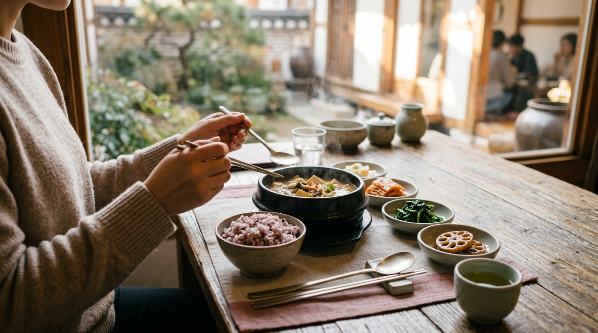
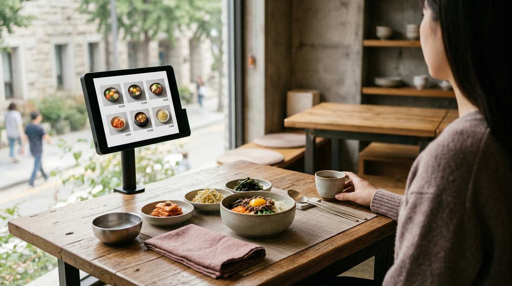

こんにちは、SEOUL TRIP NOTE の J です。

ソウル一人旅で大きな楽しみといえば食事です。しかし、「韓国はグループで食事する文化だから、一人で入りにくいのでは？」と不安に思う声もよく耳にします。

確かに鍋料理や焼肉など、複数人でシェアするメニューが多いのは事実です。それでも現在のソウルには一人で気兼ねなく食事ができる店が多く、「ホンバプ（혼밥）」と呼ばれるひとりご飯の文化もすっかり定着しています。

一人で入りやすいお店の見分け方や注文しやすいメニュー、スマートに食事を楽しむためのポイントを整理しました。

### 【結論】要点まとめ

*   **一人で入りやすいお店の特徴**: カウンター席や小さめのテーブルがある食堂、粉食（プンシク）店やカフェ、セルフオーダー式の店舗、フードコート、チェーン店など。
*   **頼みやすいメニュー**: キンパ、クッパ、チゲ（一人前）、冷麺、ビビンバ、トースト、カフェの軽食など、最初から一人前で提供される料理。
*   **注文のコツ**: 指差しや翻訳アプリを活用し、混雑時を避けて入店するとスムーズ。テイクアウトの活用も有効。

---

### 一人で入りやすいお店の見分け方：ソウルで「ホンバプ」デビュー

韓国の飲食店はグループ客を想定している店もありますが、一人客に配慮した店も増えています。選ぶ際に確認したい基準を挙げます。

#### 1. メニュー構成と「1인분（イルインブン）」の表示

もっとも確実な基準は、**一人前で提供されるメニューが豊富か**どうかです。
メニュー表に「1인분（イルインブン）」という表示があれば、一人前で注文できることを意味します。定食類（백반：ペッパン）や麺類、丼物、一人用のチゲなどは、基本的に一人前で提供されます。

#### 2. お店の雰囲気とレイアウト

*   **カウンター席や小さめのテーブルがある**: 一人客を想定した配置の店は、ホンバプ客の利用が多い傾向にあります。
*   **パーテーションがある**: テーブル間に仕切りがある店舗も、一人客が利用しやすい環境です。
*   **地元客の様子**: 店内を覗き、一人で食事をしている客がいれば気兼ねなく入れます。
*   **フードコートや市場の食堂**: 多様な店舗が集まるフードコートや市場は、一人で好きな料理を選びやすい空間です。地元の人も日常的に一人で利用しています。

#### 3. 注文方法と店舗の種類

*   **キオスク（自動券売機）でのセルフオーダー式**: 店員と会話せずに注文できるため、韓国語に不安がある場合でもスムーズです。写真付きメニューが多く、多言語対応している機械も一般的です。
*   **粉食（プンシク）店やベーカリーカフェ**: キンパや簡単な麺類を扱う粉食店や、サンドイッチなどを扱うカフェは、一人で過ごしやすい雰囲気が整っています。
*   **チェーン店**: キンパチェーンやファストフード店などはオペレーションが標準化されており、一人でも利用しやすい選択肢です。

---

### 「ホンバプ」におすすめ！一人で頼みやすい定番メニュー

※ AIで生成したイメージ画像です

韓国料理のなかでも、一人前で完結する定番メニューをまとめました。

*   **キンパ（김밥）**:
    手軽に食べられる韓国のり巻き。具材の種類も多彩です。持ち帰ってホテルでゆっくり食べるのにも向いています。
*   **クッパ（국밥）**:
    スープにご飯を合わせた温かい定食。スンデクッパ（豚の腸詰め入り）、テジクッパ（豚肉）、コンナムルクッパ（豆もやし）など種類が多く、基本的に一人前で提供されます。
*   **チゲ（찌개）**:
    スンドゥブチゲ、キムチチゲ、テンジャンチゲなど。定食店では多くが一人用の鍋で提供されます。
*   **冷麺（냉면）**:
    一人前単位で頼みやすく、さっと食事を済ませたいときにも適した麺料理です。
*   **ビビンバ（비빔밥）**:
    ご飯の上にナムルや肉、卵を乗せて混ぜて食べる定番料理。石焼きタイプも手軽に注文できます。
*   **トースト（토스트）**:
    屋台や専門店で鉄板を使って焼き上げる韓国式トースト。朝食や軽食の定番です。
*   **カフェの軽食**:
    ソウルのカフェではサンドイッチやベーカリー、スープなどの軽食メニューが充実しており、一人でも気兼ねなく過ごせます。

---

### スマートに注文＆食事を楽しむためのコツ

入店から会計まで、知っておくと安心な流れです。

#### 1. 入店時のポイント

*   **混雑時を避ける**: ランチタイム（12:00～13:00）やディナータイム（18:00～20:00）は地元の会社員などで混み合います。一人客向けの席が埋まりやすいため、13:30〜14:30頃などピークを過ぎた時間を狙うとゆったり過ごせます。ただし、多くの飲食店では15:00〜17:00頃にブレイクタイム（休憩時間）を設けて一時休止するため、入店できない可能性に注意が必要です。
*   **「一人です」と伝える**: 店員に「ホンジャヨ（혼자요）」または「ハンミョンイヨ（한 명이에요）」と伝えます。人差し指を立てて「1人」と合図するだけでも十分に伝わります。

#### 2. 注文時のポイント

*   **指差し注文**: 写真付きメニューがあれば、指を差して「イゴ ハナ ジュセヨ（これ一つください）」と伝えるのが確実です。
*   **翻訳アプリの活用**: カメラ翻訳機能を使えば、ハングル表記のみのメニューでも内容を把握しやすくなります。
*   **日本語メニューの確認**: 観光エリアでは「イルボンオ メニュー イッソヨ？（日本語メニューありますか？）」と尋ねると出してくれる店舗もあります。

#### 3. 食事中のポイント

*   **パンチャン（おかず）とお水**: メイン料理と一緒に小皿のおかず（パンチャン）が並びます。お水やお代わりのおかずは、店内のセルフコーナーから自分で持ってくる方式の店も一般的です。店員に頼む場合は「リピル ヘジュセヨ（おかわりください）」と伝えます。

#### 4. テイクアウトの活用

店内飲食に緊張する場合は、テイクアウト（포장：ポジャン）を選ぶのもひとつの方法です。キンパやチキン、トーストなどは持ち帰り対応している店舗が大半を占めます。

---

### 【比較】一人で入りやすい食事スタイルとメニューの傾向

| 食事スタイル      | 特徴                                           | 一人で入りやすい度 | 代表的なメニュー                                   |
| :---------------- | :--------------------------------------------- | :----------------- | :------------------------------------------------- |
| **食堂（백반집）** | 地元感があり、一人客も多い                     | 高                 | クッパ、チゲ、ビビンバ、一人用定食                 |
| **カフェ・ベーカリー** | 気軽に入れる雰囲気、軽食が充実               | 中                 | サンドイッチ、パン、サラダ、ケーキ                 |
| **フードコート**  | 様々な選択肢があり、気兼ねなく選べる         | 高                 | 多様な韓国料理、洋食、中華など（デパート内など）   |
| **粉食（プンシク）店**  | キンパなどの軽食を扱い、キオスク導入店も多く注文が簡単 | 高                 | キンパ、ラーメン、トッポッキ、軽食                 |
| **チェーン店**    | マニュアル化されており、安心感がある           | 高                 | チキン、ハンバーガー、キンパ、サンドイッチ         |

---

### お会計時の注意点

※ AIで生成したイメージ画像です

> **ポイント：前払いと後払いの違い**
> 韓国の食堂では食後にレジで伝票を渡して精算する形式が基本ですが、最近はキオスク（無人券売機）や各テーブルのタブレット端末で注文と同時にカード決済を行う前払い制の店舗も増えています。入店時に券売機があるか、卓上に決済端末があるかを確認しておくと戸惑いません。

---

### よくある質問（FAQ）

**Q1: 韓国で「ホンバプ」は失礼にあたりますか？**
A1: 失礼にはあたりません。一人で食事をするスタイルは現代のソウルで広く受け入れられており、一人客を歓迎する店舗も日常的な光景となっています。

**Q2: 一人でも鍋料理や焼肉は食べられますか？**
A2: 鍋料理や焼肉は基本的に2人前以上からの注文を受け付ける店が多いとされています。ただし、一人用の小鍋チゲを出す店や、1人前から対応する焼肉専門店、フードコートの個別鍋など、単独客向けに提供している店舗も存在します。

**Q3: 注文時に韓国語が話せなくても大丈夫ですか？**
A3: 写真付きメニューの指差しや翻訳アプリの提示で問題なく注文できます。キオスク端末であれば言語切り替え機能を備えている場合も多いため、落ち着いて操作できます。

**Q4: お店選びで他に気をつけることはありますか？**
A4: 不安な場合は、地図アプリのレビュー写真で店内の座席配置を確認しておくのが確実です。一人客の写真が多く投稿されている店は、利用しやすい目安になります。

---

事前の下調べと注文時の合図さえ押さえておけば、ソウルでのひとりご飯は決してハードルの高いものではありません。自分のペースで気ままに味わうソウルの食を、ぜひ楽しんでみてください。