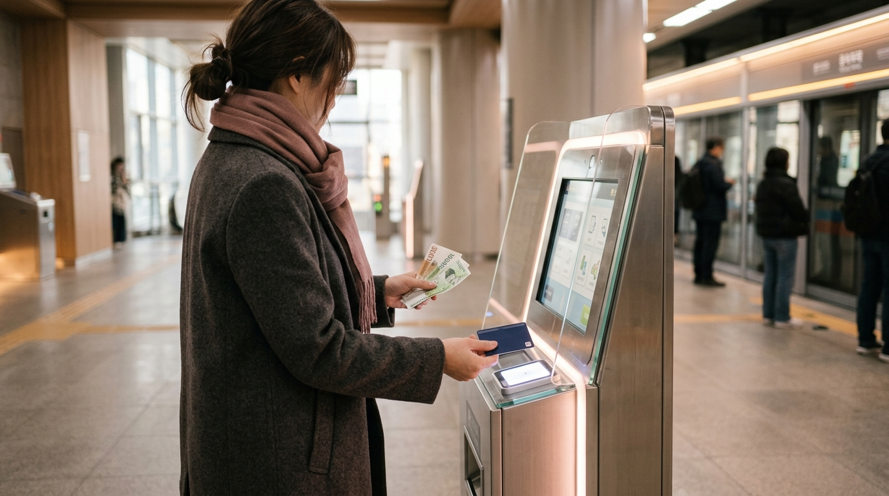
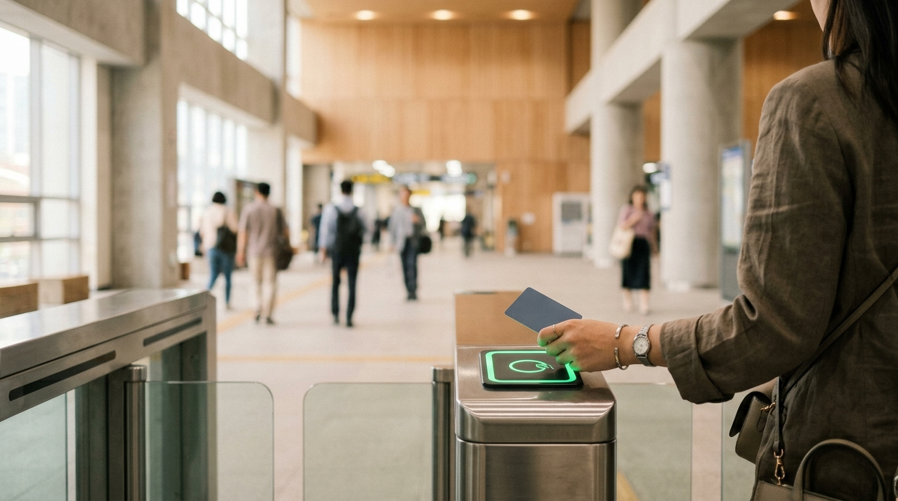

こんにちは、SEOUL TRIP NOTEです。

渡韓旅行を計画中の皆さん、ソウルでの移動に欠かせない「T-moneyカード」について、準備はできていますか？初めての渡韓だと「どこで買えばいいの？」「チャージは難しい？」「余ったお金はどうするの？」と不安に感じるかもしれませんね。

日本の旅行者の方から、交通カードの利用についてご質問をいただくことがあります。

この記事では、T-moneyカードの買い方からチャージ、払い戻し、そしてコンビニでの活用法まで、渡韓旅行を計画中の皆さんがスムーズに交通カードを使いこなせるよう、詳しくまとめてご紹介します。事前に知っておけば、現地での移動がもっと快適になりますよ。

### 【結論】この記事の要点まとめ

*   **T-moneyカードはどこで買える？**
    *   地下鉄駅の自動券売機、駅務室（顧客安全室）、コンビニエンスストア（GS25, CU, 7-Eleven, E-Mart24など）で購入できます。
*   **チャージ方法は？**
    *   地下鉄駅の自動券売機やコンビニでチャージが可能です。物理カードへのチャージは基本的に現金（ウォン）のみ対応しています。モバイルT-moneyアプリを利用すればクレジットカードでのチャージも可能です。
*   **払い戻しはできる？**
    *   はい、残高によって払い戻し場所が異なります。2万ウォン以下ならコンビニや地下鉄駅で、それ以上（5万ウォンを超える場合など）はTmoney Town（ソウル駅近く）などで手続きできますが、手数料がかかり、カード代金は戻りません。
*   **コンビニでできることは？**
    *   購入、チャージ、残高2万ウォン以下の払い戻し、そしてT-moneyカードでの買い物が可能です。

---

## T-moneyカードって何？なぜ渡韓に必須なの？

T-moneyカードは、韓国の交通機関で利用できるICカードです。ソウルだけでなく、釜山や済州島など韓国の主要都市の多くで利用できます。ただし、一部地域ではCashbeeなど他の交通カードがより一般的であったり、T-moneyが利用できない交通機関もあるため、利用前に確認することをおすすめします。

主に地下鉄、バス、タクシーなどの交通機関で利用できるほか、一部のコンビニエンスストアや公共施設でも決済手段として利用可能です。

渡韓旅行にT-moneyカードが必須と言われる理由はいくつかあります。

1.  **割引料金の適用**: 地下鉄やバスに乗る際、現金で支払うよりもT-moneyカードを使った方が割引運賃が適用されます。
2.  **乗り換え割引**: 地下鉄とバス、またはバスからバスへと乗り換える際に、一定時間内であれば乗り換え割引が適用され、交通費を節約できます。
3.  **利便性**: 小銭を用意する手間がなく、スムーズに改札を通過したり、バスに乗車したりできます。また、コンビニでの少額決済にも利用できるため、非常に利便性が高いです。

## T-moneyカードの買い方とチャージ方法

※ AIで生成したイメージ画像です

T-moneyカードは、韓国に到着したらすぐに準備しておきたいアイテムです。ここでは、具体的な購入場所とチャージ方法を詳しくご紹介します。

### T-moneyカードの買い方

T-moneyカードは、主に以下の場所で購入できます。

*   **地下鉄駅の自動券売機**:
    *   主要な地下鉄駅に設置されており、日本語対応の機械も多いです。
    *   「交通カード購入」のメニューを選び、カード本体を購入します。
    *   この時、チャージも同時に行うことができます。
*   **地下鉄駅の駅務室（顧客安全室）**:
    *   一部の主要駅にある駅務室（顧客安全室）でも購入できます。
*   **コンビニエンスストア**:
    *   韓国の主要なコンビニエンスストア（GS25, CU, 7-Eleven, E-Mart24など）で購入できます。
    *   レジで「T-moneyカードをください」と伝えれば購入できます。
    *   カード本体価格は、執筆時点の目安として3,000ウォンから6,000ウォン程度です。デザインによって価格が異なる場合があります。

> **ポイント**
> カード本体の料金にはチャージ金額は含まれていません。カードを購入したら、忘れずにチャージも行いましょう。コンビニで購入する場合は、店員さんに「チャージもお願いします」と伝えれば、その場でチャージもしてもらえます。

### T-moneyカードのチャージ方法

T-moneyカードのチャージは、以下の場所で可能です。

*   **地下鉄駅の自動券売機**:
    *   購入時と同様に、日本語対応の券売機で「交通カードチャージ」を選び、T-moneyカードを読み取り部に置いてチャージ金額を選択します。
    *   チャージは1,000ウォン単位で可能です。
*   **コンビニエンスストア**:
    *   レジで店員さんに「T-moneyカードをチャージしたいです」と伝えます。
    *   チャージしたい金額を伝え、現金で支払います。
    *   チャージは1,000ウォン単位で可能です。

> **注意点**
> 物理カードへのチャージは基本的に**現金（ウォン）のみ**対応しています。地下鉄駅の券売機やコンビニではクレジットカードは使えないことが多いので、現金を準備しておきましょう。ただし、モバイルT-moneyアプリを利用すれば、クレジットカードでのチャージも可能です。チャージできる上限額は1枚につき50万ウォンとされています。

## T-moneyカードの払い戻し方法

旅行最終日に残高が余ってしまった場合、払い戻しを検討する方もいるでしょう。T-moneyカードの払い戻しにはいくつかルールがあります。

### 残高による払い戻し場所の違い

*   **残高が2万ウォン以下の場合**:
    *   全国のコンビニエンスストア（GS25, CU, 7-Eleven, E-Mart24など）
    *   地下鉄駅の駅務室（顧客安全室）（一部駅に設置）
    *   これらの場所で払い戻しを依頼できます。
*   **残高が2万ウォンを超える場合**:
    *   残高が2万ウォンを超える場合（特に5万ウォンを超える高額の場合）は、ソウル駅近くのTmoney Townでの手続きが推奨されます。一部の主要駅にある駅務室（顧客安全室）でも対応可能な場合がありますが、事前に最新の公式情報で確認することをおすすめします。

### 払い戻しの際の注意点

*   **手数料**: 払い戻しには手数料として500ウォンがかかります。
*   **カード代金は戻らない**: T-moneyカード本体の料金（3,000〜6,000ウォン程度）は返金されません。これはカードの購入費用であり、チャージ残高とは別物です。
*   **使い切るのがおすすめ**: 手数料を払うことや、カード代金が戻らないことを考えると、旅行中に残高を使い切るのが最もお得な方法です。コンビニでの買い物に利用するのも良いでしょう。

## コンビニでT-moneyカードを最大限活用する方法

T-moneyカードは、交通機関だけでなく、コンビニエンスストアでの買い物にも利用できます。コンビニは旅行中に立ち寄る機会が多い場所の一つです。T-moneyカードを交通機関以外でも活用できることを知っておくと、より便利に滞在を楽しめます。

### コンビニでT-moneyカードができること一覧

1.  **T-moneyカードの購入**:
    *   前述の通り、GS25、CU、7-Eleven、E-Mart24などの主要コンビニで購入できます。
2.  **T-moneyカードのチャージ**:
    *   レジで現金を使ってチャージが可能です。
3.  **残高2万ウォン以下の払い戻し**:
    *   残高が少ない場合は、コンビニで払い戻しができます。
4.  **T-moneyカードでの買い物**:
    *   交通費としてだけでなく、コンビニでの決済手段として利用できます。
    *   飲み物、お菓子、軽食、日用品など、ほとんどの商品をT-moneyカードで支払うことが可能です。
    *   小銭が増える心配がなく、スマートに買い物ができるのが大きなメリットです。

ソウル在住者も、ちょっとした買い物や急な移動の際にT-moneyカードを日常的に活用しています。特に、旅行中は小銭が増えがちなので、T-moneyカードで支払う習慣をつけると便利ですよ。

## 【比較】T-moneyカードとモバイルT-money

近年、スマートフォンのアプリで利用できる「モバイルT-money」も登場しています。外国人旅行者向けの物理カードと、スマホで使えるモバイルT-moneyを比較してみましょう。

| 項目           | T-moneyカード（物理カード）              | モバイルT-money（アプリ）                         |
| :------------- | :--------------------------------------- | :------------------------------------------------ |
| カード形式     | プラスチックカード                       | スマートフォンアプリ（iPhoneおよびAndroidで利用可能）     |
| 購入場所       | 地下鉄駅、コンビニエンスストア           | App StoreまたはGoogle Playストアからアプリをダウンロード     |
| チャージ方法   | 地下鉄駅の券売機、コンビニ（現金）       | アプリ内決済（クレジット・デビットカードなど） |
| 払い戻し       | 地下鉄駅、コンビニ（残高による）         | アプリ内手続き                                    |
| スマホ連携     | 不要                                     | 必須                                              |
| メリット       | 現金チャージで手軽、スマホがなくても使える | 現金不要でチャージ、残高確認が簡単                |
| デメリット     | 紛失リスク、現金チャージが必要           | 設定が必要、バッテリー消費     |

*注：モバイルT-moneyは外国人でも利用できますが、チャージ方法や一部機能に制限がある場合があります。特にiPhoneのApple Walletから直接T-moneyを追加・チャージする際、2026年3月以降は外国人旅行者もMastercard、American Express、UnionPayの海外発行クレジットカードを利用してチャージできるようになりました（Visaは現在非対応）。Mobile Tmoneyアプリ経由でも海外発行クレジットカードでのチャージが可能です。渡韓前に最新の公式情報で利用条件を確認することをおすすめします。初めての渡韓で手軽さを求めるなら、物理カードの利用が一般的で安心です。*

## 注意点とお得に使うコツ

※ AIで生成したイメージ画像です

T-moneyカードをより快適に、そしてお得に使うためのポイントをまとめました。

> **ポイント**
> *   T-moneyカードは、**カード本体価格とチャージ金額が別**です。購入時にチャージも忘れずに行いましょう。
> *   物理カードへのチャージは基本的に**現金（ウォン）のみ**対応しています。現金を準備しておくとスムーズです。
> *   払い戻しには手数料がかかります。旅行最終日に残高を使い切るのがおすすめです。コンビニでの買い物に活用するのも良い方法です。

### ソウル在住者から見たお得な使い方

ソウルに住んでいる立場から見ると、T-moneyカードは日常生活に欠かせないインフラです。旅行者の皆さんにも、ぜひ積極的に活用していただきたいです。

*   **残高は常に余裕を持って**: 地下鉄やバスに乗る直前に残高不足に気づくと焦ってしまいます。特に週末や夜間はチャージできる場所が限られることもあるので、常に数千ウォン以上の残高があるか確認しておくと安心です。
*   **空港からの移動にも活用**: 仁川国際空港や金浦国際空港からソウル市内へ向かう空港鉄道（AREX）の一般列車でもT-moneyカードが利用できます。到着後すぐに購入・チャージしておくと、スムーズに市内へ移動できます。
*   **乗り換え割引を最大限活用**: 地下鉄とバス、またはバスからバスへの乗り換えは、30分以内（21:00〜翌7:00は1時間以内）であれば、追加料金なしで乗り換え割引が適用されます。改札を出る際、またはバスを降りる際に必ずT-moneyカードをリーダーにタッチするのを忘れないようにしましょう。
*   **小銭対策にコンビニで活用**: 韓国はクレジットカード社会ですが、屋台や小さな商店では現金が必要な場合もあります。T-moneyカードをコンビニでの少額決済に使うことで、お財布に小銭が増えすぎるのを防ぎ、スマートに支払いができます。

## よくある質問（FAQ）

### Q1: T-moneyカードはどこで買えますか？

A1: 地下鉄駅の自動券売機、駅務室（顧客安全室）、そして韓国の主要コンビニエンスストア（GS25, CU, 7-Eleven, E-Mart24など）で購入できます。コンビニではレジで店員さんに「T-moneyカードをください」と伝えれば購入できます。

### Q2: T-moneyカードのチャージはクレジットカードでできますか？

A2: 物理カードへのチャージは基本的に現金（ウォン）のみ対応しています。地下鉄駅の券売機やコンビニでは現金チャージが一般的で、クレジットカードは使えないことが多いので、チャージ用の現金を準備しておきましょう。ただし、モバイルT-moneyアプリを利用すれば、クレジットカードでのチャージも可能です。

### Q3: T-moneyカードの残高は払い戻しできますか？

A3: はい、払い戻しは可能です。残高が2万ウォン以下の場合はコンビニエンスストアや地下鉄駅の駅務室（顧客安全室）で、2万ウォンを超える場合（特に5万ウォンを超える高額の場合）はTmoney Town（ソウル駅近く）などで手続きできます。ただし、払い戻し手数料（500ウォン）がかかり、カード本体の料金は返金されません。旅行中に残高を使い切るのが最もお得です。

### Q4: T-moneyカードは交通費以外にも使えますか？

A4: はい、T-moneyカードは交通機関だけでなく、一部のコンビニエンスストア（GS25, CU, 7-Elevenなど）やタクシー、公共施設などでも決済手段として利用できます。小銭の心配なく買い物ができるので便利です。

## まとめ＆最後に

T-moneyカードは、ソウルでの滞在を快適でスムーズにするための必須アイテムです。買い方、チャージ方法、払い戻しの基本、そしてコンビニでの活用法を事前に知っておくことで、現地での移動や買い物が格段に楽になります。

この記事でまとめた情報を参考に、スマートにT-moneyカードを使いこなし、渡韓旅行を存分に楽しんでください。皆さんの渡韓が素敵な思い出になるよう願っています。

この記事が、皆さんのソウル旅行準備に役立てば嬉しいです。
